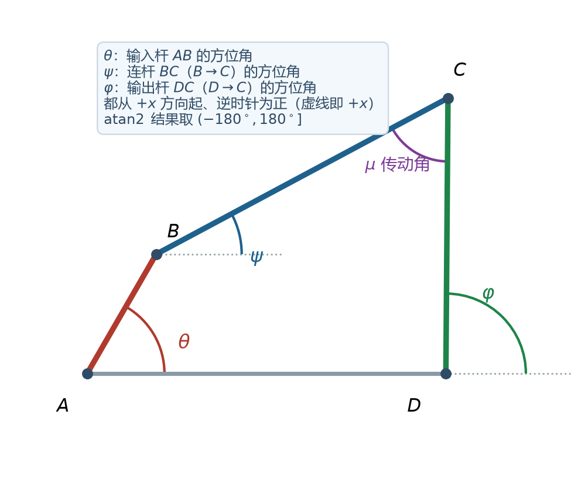
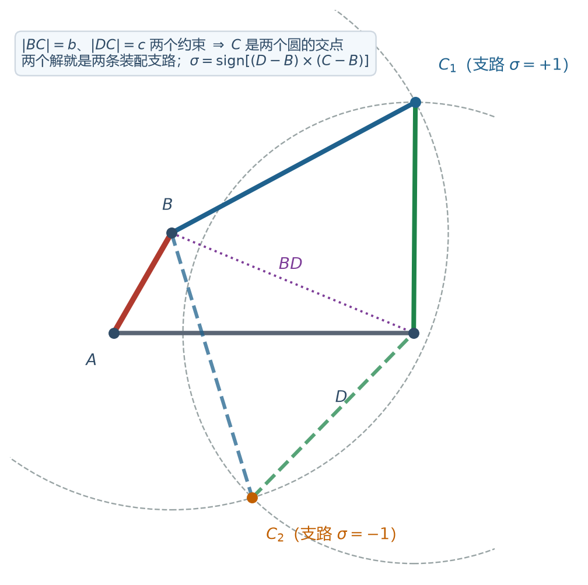
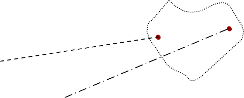
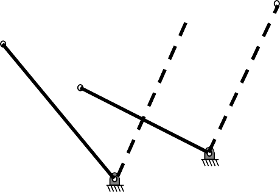
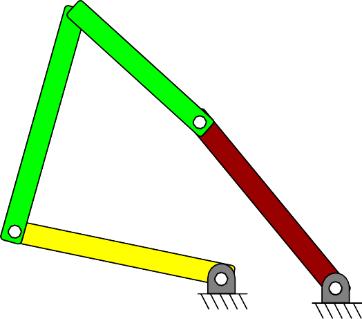
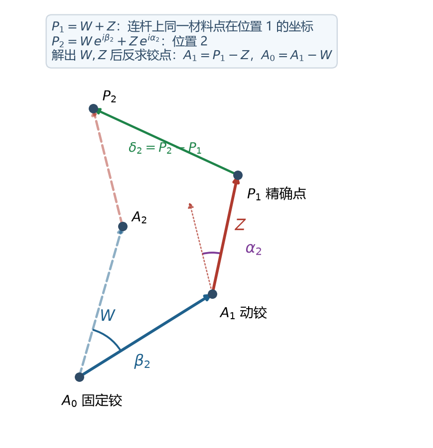
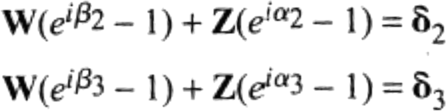
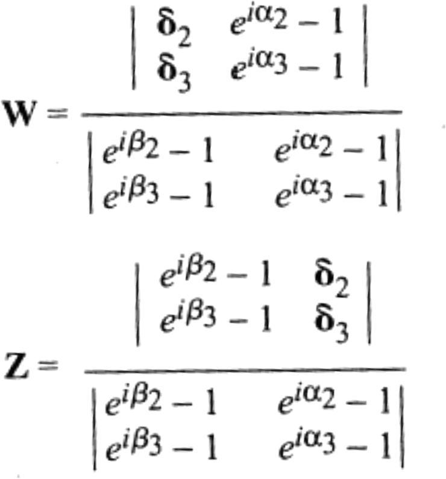

# L2 四杆机构的分析与综合

> **课件结构**（L2_4barLinkage_design，47 页）：
> - 分析：给定机构，求位置、速度、机械效益（Norton《Design of Machinery》第 4 章）
> - 综合：图解法（中垂线）+ 解析法（复数矢量、二元组 dyad）
> - 最后给出"同一个问题用不同计算框架求解"的路线图，对应四次作业的演进
>
> L1 讲"怎么判断"，本讲讲"怎么算、怎么设计"。**位置分析、速度分析、三点导引的解析式**是这一讲的核心公式。

---

## 0 课件页码 → 本节

| 课件页 | 内容 | 本节 |
| --- | --- | --- |
| 1–2 | 四杆机构位置分析（"注意有两个解"） | 1 |
| 3–8 | 综合问题分类、刚体导引实例 | 4 |
| 9–17 | 两个/三个位置图解法、圆点与圆心点、自由选择数 | 4 |
| 18–25 | 复数、Euler 公式、Cramer 法则 | 3 |
| 26–35 | 标准二元组（dyad）、三位姿解析综合、Cramer 解 | 5 |
| 36–44 | 算例（船体导引）、MATLAB 代码、迭代 β | 6 |
| 45 | 四种计算框架（线性→fsolve→fmincon→lsqnonlin） | 7 |
| 46–47 | 作业 2 说明 | 8 |

---

### 0.1 符号表（本讲专用）

| 符号 | 含义 | 单位 |
| --- | --- | --- |
| $\theta,\ \psi,\ \varphi$ | 输入杆 / 连杆 / 输出杆的方位角（都从 $+x$ 逆时针） | ° |
| $a,\ b,\ c,\ d$ | 四杆长度（与 L1 一致） | mm |
| $\omega_2,\ \omega_3,\ \omega_4$ | 输入 / 连杆 / 输出构件的角速度 | rad/s |
| $W,\ Z$ | 二元组的两个复矢量（连架杆 / 描点臂） | mm |
| $P_j$ | 第 $j$ 个位置的精确点（课件记 $PP_j$） | mm |
| $\delta_j$ | 精确点位移 $P_j-P_1$ | mm |
| $\beta_j$ | 连架杆从位置 1 到 $j$ 的转角增量 | ° |
| $\alpha_j$ | 连杆从位置 1 到 $j$ 的转角增量 | ° |
| $k_1,k_2,k_3$ | Freudenstein 系数 | — |
| $\Delta$ | 行列式（Cramer 法则的分母） | — |
| $\mathbf{x}$ | 设计变量向量 | — |
| $\mathbf{r}$ | 残差向量 | — |
| $w_r$ | 闭环方程的权重 | — |
| $\mathbf{t}_i$ / $\mathbf{P}_i$ | 第 $i$ 个目标点 / 计算得到的描点 | mm |
| $\gamma$ | 作业里描点臂与连杆的夹角 | ° |
| $\ell_2,\dots,\ell_5$ | 作业中的各杆长 | mm |
| $N$ | 采样点数（作业 $N=10$） | — |

> 【命名规则】本讲的 $\alpha_j$ 是**连杆转角增量**，不是压力角；压力角统一记 $\phi$（见 L3–L5）。$K$ 只表示行程速比（L1），Freudenstein 系数一律小写 $k$。

## 1 位置分析：为什么"有两个解"

### 1.1 闭环矢量方程

以 $A$ 为原点，四杆闭环 $A\to B\to C\to D\to A$：

$$a\,e^{i\theta}+b\,e^{i\psi}=d+c\,e^{i\varphi}$$

- $a=AB$（输入杆），$b=BC$（连杆），$c=CD$（输出杆），$d=AD$（机架）；
- $\theta$ 输入角（已知），$\psi$ 连杆方位角，$\varphi$ 输出角。



*图（自绘）四杆机构的三个方位角：$\theta$、$\psi$、$\varphi$，都从 $+x$ 方向起、逆时针为正*

**三个角的确切定义**（坐标约定：$A$ 为原点，$A\to D$ 沿 $+x$，故 $D=(d,0)$）：

| 角 | 名称 | 定义 | 对应向量 |
| --- | --- | --- | --- |
| $\theta$ | 输入角（曲柄转角） | $AB$ 的方位角 | $\vec{AB}=a\,e^{i\theta}$ |
| $\psi$ | **连杆方位角**（coupler angle） | **从 $B$ 指向 $C$** 的方位角 | $\vec{BC}=b\,e^{i\psi}$ |
| $\varphi$ | **输出角**（follower angle） | **从 $D$ 指向 $C$** 的方位角 | $\vec{DC}=c\,e^{i\varphi}$ |

- 三个角都是**绝对方向**（相对固定坐标系的 $+x$），不是"两根杆之间的夹角"；
- 实用写法（避免丢象限）：

$$\psi=\operatorname{atan2}\left(C_y-B_y,\ C_x-B_x\right),
\qquad
\varphi=\operatorname{atan2}\left(C_y,\ C_x-d\right)$$

- $\varphi$ 从 $+x$ 量，而 $A\to D$ 就是 $+x$，所以它也等于"相对机架 $AD$ 的方向"；有些教材从 $D\to A$（$-x$）量，记为 $\varphi'=180^\circ-\varphi$；
- 若把 $\psi$ 定义成 $\vec{CB}$（$C\to B$）的方向，则 $\psi'=\psi+180^\circ$，速度公式的符号会跟着变——**全文只能采用一种约定**。

> 【由此推出的三个"相对角"】传动角 $\mu=\lvert\varphi-\psi\rvert$ 取锐角（本例 $\lvert89.56^\circ-28.19^\circ\rvert=61.37^\circ$，与三角形算出的 $\angle BCD$ 一致）；摇杆摆角 $=\varphi_{\max}-\varphi_{\min}$；极位夹角则是**两个曲柄位置**之差，与 $\psi,\varphi$ 无关，别混。

【课件】"Be aware, there are two solutions."——**同一个 $\theta$ 对应两组 $(\psi,\varphi)$**，几何上就是"连杆在 $BD$ 的左侧还是右侧"（上装/下装两条装配支路）。

> 【说明】解析式里的 $\pm$、图解法里的"上方/下方"，说的都是这两条支路。**数值解一定有两个，必须按机构简图选对的那一支**，否则画出来的机构是"镜像"的。

**两条装配支路的严格定义**

给定 $\theta$ 后，$C$ 点必须同时满足两个长度约束：

$$|BC|=b,\qquad |DC|=c$$

所以 $C$ 是"以 $B$ 为圆心、$b$ 为半径的圆"与"以 $D$ 为圆心、$c$ 为半径的圆"的交点——两圆一般有**两个交点**，就是**两条装配支路**（assembly modes）。



*图（自绘）同一 $\theta$ 下的两个 $C$ 解：$C_1$（实线）与 $C_2$（虚线），两解关于直线 $BD$ 镜像*

形式化的判别式：令

$$\vec u=\vec{BD}=\vec{OD}-\vec{OB},\qquad \vec v=\vec{BC}$$

$$\sigma=\operatorname{sign}\left(\vec u\times\vec v\right)
=\operatorname{sign}\big[(D_x-B_x)(C_y-B_y)-(D_y-B_y)(C_x-B_x)\big]$$

- $\sigma=+1$ 是一条支路，$\sigma=-1$ 是另一条；
- 等价写法：$\sigma=\operatorname{sign}\sin(\psi-\beta_{BD})$，其中 $\beta_{BD}=\operatorname{atan2}(D_y-B_y,\ D_x-B_x)$ 是 $B\to D$ 的方位角；
- 同一 $\theta$ 下两解**关于 $BD$ 镜像**：$\lvert\angle CBD\rvert$ 相同，$\psi-\beta_{BD}$ 反号。

**例题（$a=50,b=120,c=100,d=130$，$\theta=60^\circ$）**

| 支路 | $C$ 坐标 | $\sigma$ | $\psi$ | $\varphi$ |
| --- | --- | --- | --- | --- |
| 支路 1 | $(130.76,\ 100.00)$ | $+1$ | $28.19^\circ$ | $89.56^\circ$ |
| 支路 2 | $(60.05,\ -71.47)$ | $-1$ | $-73.02^\circ$ | $-134.39^\circ$ |

两条支路的 $\angle CBD$ 都是 $61.37^\circ$（传动角相同），但 $\psi-\beta_{BD}=\pm50.6^\circ$，方向相反。

> 【"上装/下装"这个叫法的来源与问题】当图上 $AD$ 水平、机构画在 $AD$ 上方时，$C$ 在 $BD$ 上方的那一支被叫"上装"、在下方叫"下装"。这只是**画图的俗称**：换个画法、换个机架（反演）或镜像一下，"上下"就反了。考试里建议写 $\sigma=\pm1$ 或"支路 1 / 支路 2"，再配一句"按图示取 $C$ 在 $BD$ 上方的那一支"，就不会被判错。

**支路会不会中途切换？** 不会，除非机构经过**两圆相切**的位形——此时 $B,C,D$ 共线、$\mu=0$（变向点/死点），两条支路合并。Grashof 曲柄摇杆在整个循环中 $\mu$ 不会降到 0，所以**一旦按某条支路装好，就一直在这条支路上运动**。

> 【综合时的"分支缺陷"（branch defect）】解析综合解出的机构，如果三个精确点分别落在不同支路上，实际机构根本走不到这些位置——这叫分支缺陷。检查办法：把解出的机构从位置 1 开始正算，看 $\sigma$ 是否始终为同一值、$\varphi(\theta)$ 是否连续；若翻号，就重选自由参数（$\beta_2,\beta_3$）再解。

### 1.2 几何法（考场首选，四步）

已知 $a,b,c,d,\theta$：

$$BD=\sqrt{a^2+d^2-2ad\cos\theta}$$

$$\cos\angle CBD=\frac{b^2+BD^2-c^2}{2b\cdot BD}$$

$$\beta_{BD}=\operatorname{atan2}\left(-a\sin\theta,\ d-a\cos\theta\right)$$

$$\psi=\beta_{BD}\pm\angle CBD,\qquad
C=B+b(\cos\psi,\sin\psi),\qquad
\varphi=\operatorname{atan2}\left(C_y,\ C_x-d\right)$$

> 【坑】$\operatorname{atan2}(y,x)$ 的参数顺序、$\psi$ 的 $\pm$ 与 $B$ 点坐标的正负号要一致；直接写 $\arccos$ 会丢象限信息。

### 1.3 代数通式（消去 $\psi$）

把闭环方程两边取模：

$$b^2=(d+c\cos\varphi-a\cos\theta)^2+(c\sin\varphi-a\sin\theta)^2$$

展开整理成

$$\lambda_1\cos\varphi+\lambda_2\sin\varphi+\lambda_3=0$$

$$\lambda_1=2c(d-a\cos\theta),\qquad
\lambda_2=-2ac\sin\theta,\qquad
\lambda_3=d^2+c^2+a^2-b^2-2ad\cos\theta$$

令 $t=\tan(\varphi/2)$，得一元二次方程

$$(\lambda_3-\lambda_1)t^2+2\lambda_2t+(\lambda_1+\lambda_3)=0
\quad\Longrightarrow\quad
t=\frac{-\lambda_2\pm\sqrt{\lambda_1^2+\lambda_2^2-\lambda_3^2}}{\lambda_3-\lambda_1}$$
$$\varphi=2\arctan t\quad(\text{两个根 }=\text{两条装配支路})$$

> 【说明】根号内 $\lambda_1^2+\lambda_2^2-\lambda_3^2<0$ 表示"该 $\theta$ 下机构装不起来"（超出可达范围），这正好用来判断曲柄能否整周回转：**判据与 Grashof 一致**。

### 1.4 例题（本讲通用机构）

$$a=50,\ b=120,\ c=100,\ d=130\ \text{mm},\qquad \theta=60^\circ$$

$$\lambda_1=2\times100\times(130-50\cos60^\circ)=21000$$

$$\lambda_2=-2\times50\times100\sin60^\circ=-8660$$

$$\lambda_3=130^2+100^2+50^2-120^2-2\times50\times130\cos60^\circ=8500$$

$$t=\frac{-\lambda_2\pm\sqrt{\lambda_1^2+\lambda_2^2-\lambda_3^2}}{\lambda_3-\lambda_1}
=\frac{8660\pm\sqrt{21000^2+8660^2-8500^2}}{8500-21000}
=\frac{8660\pm21065}{-12500}$$

两个根给出 $\varphi=-134.39^\circ$（$\sigma=-1$，图示的下装支路）与 $\varphi=89.56^\circ$（$\sigma=+1$，图示的上装支路，按图取这个）。

> 【验算】此时 $\angle BCD=61.37^\circ$，与 L1 §3.4 在 $\theta=60^\circ$ 处算出的传动角一致——**位置分析顺带就把传动角算出来了**。

---

## 2 速度分析

### 2.1 矢量方程

$$\vec v_C=\vec v_B+\vec v_{CB}$$

- $v_B=\omega_2 a$，方向 $\perp AB$；
- $v_{CB}=\omega_3 b$，方向 $\perp BC$；
- $v_C=\omega_4 c$，方向 $\perp CD$。

对位置方程求导（复数形式最省事）：

$$i\omega_2 a\,e^{i\theta}+i\omega_3 b\,e^{i\psi}=i\omega_4 c\,e^{i\varphi}$$

取实部、虚部得两个线性方程，解出 $\omega_3,\omega_4$。闭式解：

$$\omega_3=-\frac{a\,\omega_2\sin(\varphi-\theta)}{b\sin(\varphi-\psi)},\qquad
\omega_4=-\frac{a\,\omega_2\sin(\psi-\theta)}{c\sin(\varphi-\psi)}$$

> 【说明】分母 $\sin(\varphi-\psi)\to0$ 就是"连杆与输出杆共线"（死点），此时 $\omega_4\to\infty$ 的数学表现。所以**死点在公式里表现为分母为零**。

### 2.2 例题

$\theta=60^\circ$、$\omega_2=10$ rad/s（$\sigma=+1$ 支路，即图示上装支路）：

$$\omega_3=-2.34\ \text{rad/s},\qquad
\omega_4=3.00\ \text{rad/s},\qquad
v_C=\omega_4 c=300.2\ \text{mm/s}$$

转 1 圈摇杆转 $3.00/10=0.30$ 圈，**速比约 3.33**；机械效益 $MA=\omega_2 a/(\omega_4 c)\approx1.67$（忽略损失时按力矩比算则再乘杆长比）。

### 2.3 瞬心法（判断题、快速估算）

**三心定理（Kennedy）**：三个构件的三个瞬心必在同一直线上。

四杆机构共 6 个瞬心：$P_{12},P_{23},P_{34},P_{14}$ 就在四个铰点处；$P_{13}$、$P_{24}$ 用三心定理求（$P_{13}$ 是连杆与机架的瞬心，也是连杆曲线出现**尖点**的位置）。

$$\frac{\omega_3}{\omega_2}=\frac{\overline{P_{12}P_{23}}}{\overline{P_{13}P_{23}}}$$

转向由实际运动方向判断（正负号别硬套）。

> 【作业衔接】你的四杆轨迹综合里，"描点落在瞬心 $P_{13}$ 上 → 描点速度为零 → 轨迹出现尖点"，就是这条定理的直接应用；目标曲线顶点曲率半径很小（0.033）时，用"尖点机构"构造初值最有效。

---

## 3 加速度分析（知道方法即可）

$$\vec a_C=\vec a_B^n+\vec a_B^t+\vec a_{CB}^n+\vec a_{CB}^t
=\vec a_C^n+\vec a_C^t$$

- $a_B^n=\omega_2^2a$（指向 $A$），$a_B^t=\alpha_2a$（$\perp AB$）；
- $a_{CB}^n=\omega_3^2b$（指向 $B$），$a_{CB}^t=\alpha_3b$（$\perp BC$）；
- $a_C^n=\omega_4^2c$（指向 $D$），$a_C^t=\alpha_4c$（$\perp CD$）。

两个未知数 $\alpha_3,\alpha_4$，投影到两个坐标轴求解。图解法用**加速度影像**：同一构件上三点构成的加速度三角形与构件本身相似。

> 【说明】平面四杆没有移动副，**没有科氏加速度**；只有曲柄滑块、导杆这类带移动副的机构才有 $a_k=2\omega v_r$。

---

## 4 图解法综合（要点回顾）

详细作法见 L1 §7，这里只记"考试怎么写步骤"：

### 4.1 两个位置

1. 连 $A_1A_2$，作中垂线，在其上任取 $A_0$；
2. 同法得 $B_0$；
3. 连 $A_1A_0$、$B_1B_0$ 即为两连架杆；$A_1B_1$ 为连杆。



*图 L2-1 两个位置的中垂线（PB）作图法：固定铰可在中垂线上任取（L2 课件）*

### 4.2 三个位置

1. 作 $A_1A_2$、$A_1A_3$ 的两条中垂线，**交点** = $A_0$；
2. 作 $B_1B_2$、$B_1B_3$ 的两条中垂线，交点 = $B_0$；
3. 连 $A_1A_0$、$B_1B_0$；
4. 检查 $A_0,B_0$ 是否落在题目规定区域（如"机架内"），不合格就重选动铰位置。

### 4.3 必须写进卷子的三句话

- 圆点（circle point）绕圆心点（center point）作圆弧运动，所以中垂线过圆心；
- 两个位置时固定铰可沿中垂线任取（1 个自由选择/侧）；三个位置时交点唯一（只剩动铰的 2 个自由选择/侧）；
- 保留作图线，标注 $A_1,A_2,A_3,B_1,B_2,B_3,A_0,B_0$。

---



*图 L2-2 三个位置：两条中垂线的交点即固定铰，两交点的连线对应动铰的三个位置（L2 课件）*

## 5 解析法综合：标准二元组（dyad）

### 5.1 为什么叫"二元组"

一个四杆机构可以看成**两个二元组**：$\vec W_A+\vec Z_A$ 与 $\vec W_B+\vec Z_B$。

- $\vec W$：从固定铰指向动铰的向量（连架杆）；
- $\vec Z$：从动铰指向连杆上精确点 $P$ 的向量；
- 两个 $\vec Z$ **刚性固连**，一起构成连杆。

只要每个二元组都能让点 $P$ 到达各精确点并满足姿态，拼起来的四杆当然也能。



*图 L2-3 一个四杆机构由两个二元组（$W+Z$）拼成：两个 $Z$ 刚性固连成连杆（L2 课件）*

### 5.2 参数化

**先弄清 $P$ 是什么：** $P$ 是**连杆上的一个材料点**（coupler point），不是铰点。综合问题的原始要求就是"连杆上这个点要走过的若干位置 $+$ 连杆在那些位置的姿态"，所以 $P$ 的坐标是**题目给的**（量出来或直接给定），不是算出来的；要算的未知量是 $W$ 和 $Z$。

课件把它叫 **precision point（精确点）**，第 $j$ 个位置记作 $PP_j$，所以 $PP_1\equiv P_1$。



*图（自绘）一个二元组 $A_0\!-\!A_1\!-\!P$：$W$ 是连架杆，$Z$ 是"动铰 $\to$ 精确点"的描点臂；位置 2 由 $W$、$Z$ 各自转过 $\beta_2$、$\alpha_2$ 得到*

$$P=W+Z,\qquad W=|W|\,e^{i\angle W},\quad Z=|Z|\,e^{i\angle Z}$$

第 $j$ 个位置（$P_j$ 为精确点，$\alpha_j$ 为连杆转角增量）：

$$P_j=W e^{i\beta_j}+Z e^{i\alpha_j}$$

其中 $\beta_j$ 是**连架杆**从位置 1 到位置 $j$ 的转角（自由选择），$\alpha_j$ 是**连杆**的姿态增量（已知）。

两式相减（消去 $P_1$）：

$$\boxed{\ W\left(e^{i\beta_j}-1\right)+Z\left(e^{i\alpha_j}-1\right)=\delta_j\ }$$

$$\delta_j=P_j-P_1,\qquad \alpha_j=\theta_j-\theta_1$$



*图 L2-4 三位姿的标准二元组方程：$W(e^{i\beta_j}-1)+Z(e^{i\alpha_j}-1)=\delta_j$（L2 课件）*

### 5.3 三个精确点：方程数与自由选择

| 量 | 个数 |
| --- | --- |
| 未知数 $W$（复数 2）+ $Z$（复数 2）+ $\beta_2,\beta_3$ | **6** |
| 方程（$j=2,3$，每个复数方程 = 2 个实方程） | **4** |
| 自由选择 | **2** |

【课件】"Typically, we choose $\beta_j$'s → linear equations."——选定 $\beta_2,\beta_3$ 后，方程对 $W,Z$ **线性**：

$$\begin{bmatrix}
e^{i\beta_2}-1 & e^{i\alpha_2}-1\\
e^{i\beta_3}-1 & e^{i\alpha_3}-1
\end{bmatrix}
\begin{bmatrix}W\\Z\end{bmatrix}
=
\begin{bmatrix}\delta_2\\\delta_3\end{bmatrix}$$

### 5.4 Cramer 法则解（就是 MATLAB 里那三行）

$$\Delta=\begin{vmatrix}
e^{i\beta_2}-1 & e^{i\alpha_2}-1\\
e^{i\beta_3}-1 & e^{i\alpha_3}-1
\end{vmatrix}$$
$$W=\frac{1}{\Delta}\begin{vmatrix}
\delta_2 & e^{i\alpha_2}-1\\
\delta_3 & e^{i\alpha_3}-1
\end{vmatrix},
\qquad
Z=\frac{1}{\Delta}\begin{vmatrix}
e^{i\beta_2}-1 & \delta_2\\
e^{i\beta_3}-1 & \delta_3
\end{vmatrix}$$



*图 L2-5 用 Cramer 法则解出 $W$、$Z$ 的矩阵形式（L2 课件）*

### 5.5 从 $W,Z$ 回到铰点

$$A_1=PP_1-Z,\qquad A_0=A_1-W$$

（$PP_1$ 就是位置 1 的精确点 $P_1$：动铰 = 精确点往回退一个 $Z$，固定铰再往回退一个 $W$。）

（$A_1$ 是连杆上的动铰，$A_0$ 是机架上的固定铰；$B$ 侧同理。）

### 5.6 算例（船体导引，课件 95–101 页）

已知（量出来的）：

$$\delta_2=2.54\,e^{i156^\circ},\quad
\delta_3=3.75\,e^{i196^\circ},\quad
\alpha_2=11^\circ,\quad
\alpha_3=0^\circ$$

**第一次试选** $\beta_2=50^\circ,\ \beta_3=200^\circ$：

$$W=1.8935+0.1990i,\qquad Z=-1.0524+7.9184i$$

$$A_1=PP_1-Z=1.0524-7.9184i,\qquad A_0=A_1-W=-0.8411-8.1174i$$

另一侧取 $\beta_2=68^\circ,\beta_3=114^\circ$，得 $W=1.4667+1.6873i,\ Z=3.7017-1.2018i$。拼出的机构**太大**，不能装进机身。

**迭代**：改选 $\beta_2=77.36^\circ,\beta_3=155.04^\circ$ → $W=1.6880+0.9157i,\ Z=0.5806+0.5114i$；$B$ 侧 $\beta_2=71.11^\circ,\beta_3=152^\circ$ → $W=1.6735+0.9662i,\ Z=0.6728+1.3740i$。"Mechanism is much better."

> 【说明】这就是解析法的真正用法：**β 是自由参数，靠它把机构"调"到能装、尺寸合理、传动角好**。求出的解永远有 4 个自由选择（3 点）或 6 个（2 点），"唯一解"是不存在的。

### 5.7 两个精确点（更自由）

只有一个复数方程：

$$W\left(e^{i\beta_2}-1\right)+Z\left(e^{i\alpha_2}-1\right)=\delta_2$$

未知数 5（$W,Z$ 各 2 + $\beta_2$），方程 2 → **3 个自由选择**：常先选 $\beta_2$ 和 $Z$（= 指定动铰位置，moving pivot specification），再解 $W$。

---

## 6 MATLAB 写法（照抄即可）

```matlab
deg = pi/180;
beta2 = 50*deg;  beta3 = 200*deg;      % 自由选择
alpha2 = 11*deg; alpha3 = 0*deg;       % 已知
delta2 = 2.54*exp(1i*156*deg);         % 注意：必须化成弧度
delta3 = 3.75*exp(1i*196*deg);
A = [delta2, exp(1i*alpha2)-1; delta3, exp(1i*alpha3)-1];
B = [exp(1i*beta2)-1, delta2; exp(1i*beta3)-1, delta3];
C = [exp(1i*beta2)-1, exp(1i*alpha2)-1;
     exp(1i*beta3)-1, exp(1i*alpha3)-1];
W = det(A)/det(C);   Z = det(B)/det(C);
A1 = -Z;   A0 = A1 - W;                % 相对 PP1
```

> 【坑】MATLAB 的 `exp(1i*156*deg)` 里角度必须乘 `deg`；`det` 对复数矩阵有效；算完记得对**另一侧**再算一遍，两个 dyad 才组成四杆。

---

## 7 四种计算框架（这一页是"方法论"，简答常考）

【课件】同一个设计问题，随着"方程/未知数"的比例不同，用不同工具：

| 情形 | 数学性质 | 求解工具 |
| --- | --- | --- |
| 未知数多、方程少 | 欠定非线性 | **给部分变量赋值** → 定解线性系统 → Cramer / 伪逆 `pinv` |
| 再加约束方程 | 恰定非线性 | `fsolve` / `vpasolve` |
| 不加方程、只加"目标"（如总长最小） | 约束优化 | `fmincon` |
| 方程多于未知数 | 超定非线性 | **最小二乘** `lsqnonlin` / `fminunc` |
| 要求同时满足两条分叉路径 | 多目标约束优化 | `fmincon`（2023–2026 作业） |

> 【说明】作业 2 的分叉路径设计就是最后一行的情形：不是"解方程"，而是"在满足两条路径约束下让某个指标最优"。

---

## 8 你的作业（轨迹综合）怎么讲

题目：给定目标曲线上的 $N=10$ 个采样点 $\mathbf{t}_i$，设计四杆机构，让连杆描点 $P$ 依次经过这些点；**不要求姿态、不要求时间对应**（path generation without prescribed timing）。

### 8.1 变量与方程

$$\mathbf{x}=\left[d,\ \ell_2,\ell_3,\ell_4,\ell_5,\ \gamma,\ t_x,t_y,\psi,\ \theta_1,\dots,\theta_{10}\right]$$

- 机构参数 9 个（机架、四杆、描点臂夹角、平面位姿 3 个）；
- 每个采样点 1 个自由曲柄转角 $\theta_i$，共 10 个；
- **未知数 19 个**。

方程：

- 每个采样点：$\mathbf{P}_i=\mathbf{t}_i$ 给 **2** 个标量方程 → $2N=20$；
- 每个采样点：摇杆闭环 $|\mathbf{C}_i-\mathbf{D}|=\ell_4$ 给 **1** 个方程 → $N=10$。

**合计 30 个方程 vs 19 个未知数** → 超定，一般无精确解。

### 8.2 为什么用最小二乘

$$\min_{\mathbf{x}}\ \tfrac12\|\mathbf{r}(\mathbf{x})\|^2,\qquad
\mathbf{r}(\mathbf{x})=\begin{bmatrix}\mathbf{P}_1-\mathbf{t}_1\\ \vdots\\ \mathbf{P}_{10}-\mathbf{t}_{10}\\ w_r\left(|\mathbf{C}_1-\mathbf{D}|-\ell_4\right)\\ \vdots\\ w_r\left(|\mathbf{C}_{10}-\mathbf{D}|-\ell_4\right)\end{bmatrix}$$

- 超定 → 只能求残差平方和最小；
- 闭环方程加权（$w_r=1000$）保证"机构闭合"这条硬约束近似成立；
- 用 `scipy.optimize.least_squares`（信赖域反射 trf），等价于 MATLAB 的 `lsqnonlin`。

结果：采样点位置误差标准差 $\sigma\approx1.5\times10^{-3}$，约为曲线拱高的 $0.01\%$。

### 8.3 三个必答问题

1. **"为什么方程比未知数多？"**——每个点给 2 个位置方程，只新增 1 个自由转角，净多 1 个约束；$N=10$ 就多 10 个。
2. **"为什么用最小二乘而不是解方程？"**——超定 + 目标曲线顶点接近尖点，精确解可能不存在；最小二乘给出残差意义下的最优折中。
3. **"若给定 timing 会怎样？"**——每个点不再有自由 $\theta_i$，只剩 9 个机构参数对 30 个方程，超定程度更大，只能近似。

---

## 9 补充：函数生成与 Freudenstein 方程

【补充】课件只提了"function generation"这一类，没给公式；国内教材和 Norton 都用 Freudenstein 方程，考试若考"按两连架杆对应位置设计"就是它。

由闭环方程消去连杆方位角：

$$k_1\cos\varphi-k_2\cos\theta+k_3=\cos(\varphi-\theta)$$

$$k_1=\frac{d}{a},\qquad k_2=\frac{d}{c},\qquad
k_3=\frac{d^2+c^2+a^2-b^2}{2ac}$$

给三对对应位置 $(\theta_i,\varphi_i)$，得到三个**线性**方程：

$$\begin{bmatrix}
\cos\varphi_1 & -\cos\theta_1 & 1\\
\cos\varphi_2 & -\cos\theta_2 & 1\\
\cos\varphi_3 & -\cos\theta_3 & 1
\end{bmatrix}
\begin{bmatrix}k_1\\k_2\\k_3\end{bmatrix}
=
\begin{bmatrix}\cos(\varphi_1-\theta_1)\\
\cos(\varphi_2-\theta_2)\\
\cos(\varphi_3-\theta_3)\end{bmatrix}$$

解出 $k_1,k_2,k_3$ 后，**任选 $a$**（尺度自由），回代：

$$d=k_1a,\qquad c=\frac{d}{k_2},\qquad
b=\sqrt{a^2+c^2+d^2-2ack_3}$$

**例**：三对位置 $(30^\circ,86.60^\circ)$、$(60^\circ,90.63^\circ)$、$(90^\circ,102.65^\circ)$，取 $a=40$ mm：

$$k_1=2.750,\quad k_2=1.375,\quad k_3=1.578$$

$$d=110,\quad c=80,\quad b=100\ \text{mm}$$

校验：$40+110=150\le100+80=180$，满足 Grashof，且最短杆 $a$ 为连架杆 → 曲柄摇杆。

> 【说明】这三对位置本来就是由 $a=40,b=100,c=80,d=110$ 正算出来的，所以能精确还原——用它验证你的公式有没有写错。

---

## 10 易错点清单

1. 位置分析有**两条装配支路**，数值解两个都要算，按图选。
2. $\operatorname{atan2}$ 的参数顺序是 $(y,x)$，不是 $(x,y)$。
3. 速度公式的分母 $\sin(\varphi-\psi)=0$ 对应死点，不是"算错了"。
4. 瞬心法里 $\omega_3/\omega_2$ 的比值方向别搞反，转向靠运动方向判断。
5. 解析综合的 $\beta_j$ 是**自由参数**，不是未知数；选得不好会出现"机构太大/杆长负值"。
6. Cramer 法则要求行列式不为 0；$\beta_2=\beta_3$ 或 $\alpha_2=\alpha_3$ 时会退化。
7. $A_1=PP_1-Z$、$A_0=A_1-W$ 的符号别写反（$Z$ 从动铰指向 $P$）。
8. 超定问题不要硬解，直接最小二乘；欠定问题先固定自由参数再解线性。
9. Freudenstein 里 $a$ 可任选，说明解有**尺度自由度**。
10. 轨迹综合的 19/30 是"变量投影后"的数；保留闭环中间变量 $\varphi_i$ 时是 29/30。

---

## 11 自测（5 分钟）

1. 写出四杆闭环矢量方程，并说明为什么位置分析有两个解。
2. $a=50,b=120,c=100,d=130$、$\theta=60^\circ$，求 $\varphi$（取 $\sigma=+1$ 支路）。
3. 三位姿解析综合中，未知数、方程、自由选择各几个？通常固定哪两个量？
4. 写出 $W,Z$ 的 Cramer 表达式，并说明如何从 $W,Z$ 得到 $A_1,A_0$。
5. 轨迹综合为什么是超定问题？用哪两个数说明。

> 答案见《08 模拟卷答案》附录。
