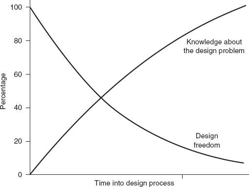
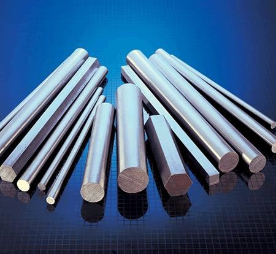
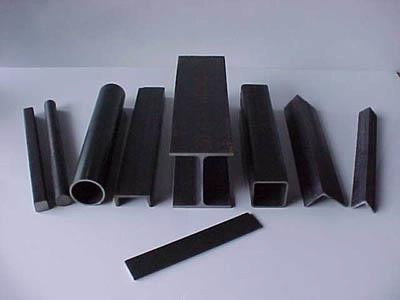
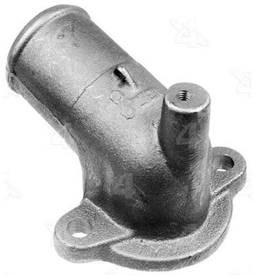
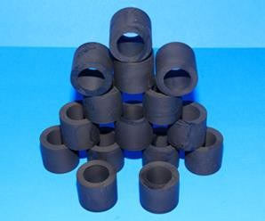
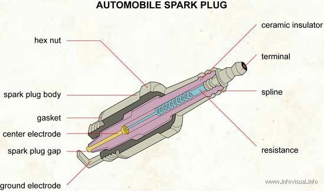
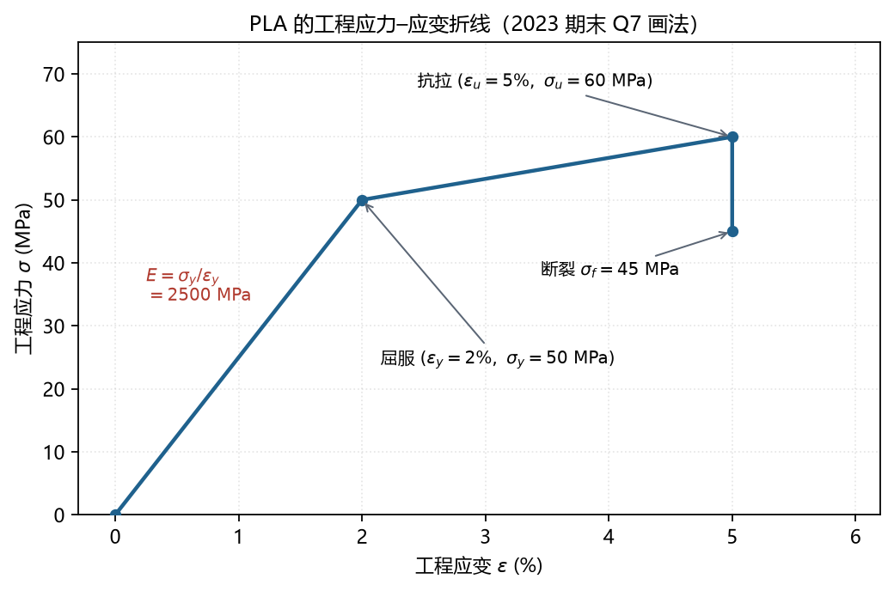

# L4 设计流程、材料与齿轮几何设计

> **课件结构**（L4_project_designProcedure 33 页 + L4_gears_geometry_force 80 页）：
> 1 设计流程（Design Process）
> 2 工程材料与选材（Material Selection）
> 3 齿轮几何设计（Gear Geometry Design）——与 L3 后半重复，但上升到"设计流程"层面
>
> 这一讲是**概念 + 常识**型考点：设计流程排序、选材因素、强度与刚度的区别、齿轮尺寸计算与画图。

---

## 0 课件页码 → 本节

| 课件页 | 内容 | 本节 |
| --- | --- | --- |
| 1–15 | 设计定义、设计流程、IDEO、早期自由度 | 1 |
| 16–33 | 选材因素、材料族、钢/铝/塑料/陶瓷/复合材料、强度 vs 刚度 | 2 |
| 34–53 | 渐开线、压力角、间隙、齿轮基本参数 | 3.1–3.4 |
| 54–65 | 标准齿比例、设计步骤、`rat`、轮系 | 3.5–3.7 |
| 66–80 | 行星、谐波、带链（与 L3 重复） | 见 L3 |

---

### 0.1 符号表（本讲专用）

| 符号 | 含义 | 单位 |
| --- | --- | --- |
| $u$ | 传动比 | — |
| $m$ | 模数 | mm |
| $z$ | 齿数（$z_1,z_2$） | — |
| $P_d$ | 径节 $=z/d$（英制） | 1/in |
| $d,\ d_a,\ d_f,\ d_b$ | 分度圆 / 齿顶圆 / 齿根圆 / 基圆直径 | mm |
| $a_w$ | 标准中心距 | mm |
| $\phi$ | 压力角 | ° |
| $h_a,\ h_f,\ h_c$ | 齿顶高 / 齿根高 / 顶隙 | mm |
| $b_f$ | 齿宽 | mm |
| $E$ | 弹性模量 | MPa |
| $\sigma,\ \sigma_y,\ \sigma_u,\ \sigma_f$ | 工作应力 / 屈服 / 抗拉 / 断裂应力 | MPa |
| $\varepsilon,\ \varepsilon_y,\ \varepsilon_u$ | 应变 / 屈服应变 / 极限应变 | — |
| $w$ | 挠度 | mm |
| $\delta$ | 延伸率 | % |
| $S_e$ | 疲劳极限 | MPa |

> 【命名规则】齿数用 $z$（不是 $N$），传动比用 $u$（不是 $i$），中心距用 $a_w$（不是 $C$），齿宽用 $b_f$（不是 $F$），顶隙用 $h_c$（不是 $c$）。挠度 $w$ 与延伸率 $\delta$ 是两个不同的量。

## 1 设计流程

### 1.1 什么是机械设计

【课件】"Design (also called Synthesis): to define the sizes, shapes, material compositions, and arrangements of parts so that the resulting machine will perform a given task."（Shigley & Uicker）

一句话：**定尺寸、定形状、定材料、定布置**，使机器完成规定任务。词源 designare = "标出、指定"。

> 【说明】注意"design = synthesis"：这门课里"设计"和"综合"是同义词（对应 L1 的 analysis vs synthesis）。

### 1.2 设计流程（顺序必背）

【课件】

1. **Specification of requirements** 需求规格（功能、载荷、速度、精度、寿命、成本）
2. **Research and benchmarking** 调研与对标（现有方案、专利、产品）
3. **Generation of design concepts** 概念生成（头脑风暴，越多越好）
4. **Concept selection** 概念筛选（Pugh 矩阵、加权评分）
5. **Detailed design** 详细设计（尺寸、公差、材料、图纸）
6. **Modeling and analysis** 建模与分析（运动学、强度、仿真）
7. **Prototype construction and testing** 样机与试验
8. **Final design** 定型（出图、BOM、工艺）

> 【坑】"先详细设计再选方案"是典型错误：概念阶段就要筛选，否则后面全部白做。

### 1.3 早期自由度最大（课件 12 页）

【课件】"Be creative early. Freedom decreases as more knowledge/cost/details are committed."（Dieter & Schmidt）

- 概念阶段：几乎无限方案，改动成本低；
- 详细设计后：一个尺寸改动会牵动几十张图、模具、工装；
- 所以**越早做对方向，越省钱**。

*图 L4-1 设计自由度随时间下降：越早改越便宜，后期只能微调（L4 课件）*

### 1.4 IDEO "Deep Dive"（课件 13–14 页）

流程：Problem definition → Information search → Concept generation → Funneling → Prototyping。

【课件】三个观察：

- **"Focused Chaos"**：看似混乱，但有明确目标；
- **"Enlightened trial and error succeeds over the planning of the lone genius."**：快速试错优于一个人闭门规划；
- **Everyone is equal**：不按资历，按想法。

### 1.5 "任何设计问题都不止一个解"（课件 7 页）

课件用蒙戈菲耶尔热气球与查尔斯氢气球作对比：同样的需求（载人升空），不同的技术路线，各有各的失败方式（"The Destruction of Charles's Balloon"）。结论：**方案要多、要早筛、要试**。

---

## 2 材料选择

### 2.1 选材要考虑什么（课件 18 页）

| 类别 | 具体指标 |
| --- | --- |
| 力学 | 强度（yield/ultimate）、刚度（弹性模量）、硬度、韧性/延性、疲劳 |
| 物理 | 密度、热膨胀系数、导热/导电、耐蚀 |
| 工艺 | 可加工性、可焊性、可铸性、热处理性、成本 |
| 功能 | 零件在系统中的角色（承力？密封？绝缘？外观？） |

【课件课堂活动】设计订书机：至少列 4 个材料属性并说明理由（例：弹簧要弹性极限高；机身要刚度高、成本低；钉道要硬度高、耐磨；手柄要绝缘、手感好）。

### 2.2 四大材料族（课件 32 页）

| 族 | 特征 | 例子 |
| --- | --- | --- |
| **金属 Metals** | 延展、韧、导热导电好 | 钢、铝、铜、钛 |
| **陶瓷与玻璃 Ceramics & glasses** | 硬、脆、耐蚀、绝缘 | 火花塞、刀具、光学玻璃 |
| **高分子 Polymers（含弹性体、泡沫）** | 轻、易成形、柔、绝缘 | ABS、POM、尼龙、橡胶 |
| **复合材料 Hybrids/composites** | 两种以上材料组合，各向异性 | 玻纤/碳纤、蜂窝夹层、木材 |

*图 L4-2 材料族与性能图（Ashby 图）：金属、陶瓷、高分子、复合材料各占一块区域（L4 课件）*

### 2.3 钢（课件 20–21 页）

成分：铁 + 碳（+ 铬、锰、钒、钨等合金元素）。

| 优点 | 缺点 |
| --- | --- |
| 强度高、刚度高（$E\approx200$ GPa） | 密度大（约 7850 kg/m³），重 |
| 相对韧（不是脆性材料） | 碳钢会锈，必须防护 |
| 可热处理（调质、淬火、渗碳）改变硬度与性能 | 加工比铝费劲 |

防锈三种常见做法：**涂漆、镀锌（galvanizing）、发黑（black oxide）**。

常见型材：圆棒、方棒、圆管、方管、角钢、槽钢、工字钢、扁钢。

*图 L4-3 常见钢材型材：圆棒、方管、角钢、槽钢、扁钢等（L4 课件）*

### 2.4 铝（课件 23 页）

- **比强度高**（强度/密度），密度约为钢的 1/3；
- 耐蚀性好（表面自然氧化膜），但持续摩擦会磨掉氧化膜，可**阳极氧化（anodizing）**；
- 导电导热好；
- **刚度只有钢的约 1/3**（$E\approx70$ GPa）——这是最容易记错的点；
- 常合金化（Cu、Si、Mn、Mg），牌号如 **6061-T6**。

> 【说明】发动机缸体从铸铁改铝，就是为了减重；但铝的刚度低，所以结构件要靠截面形状（筋、管）补刚度。

*图 L4-4 铝合金铸件（进水口）：比强度高、刚度约为钢的 1/3（L4 课件）*

### 2.5 高分子（课件 24–27 页）

| 类别 | 行为 | 例子 |
| --- | --- | --- |
| **热塑性 Thermoplastics** | 加热软化、冷却硬化，可反复 | PE、PP、PVC、PS、ABS（乐高）、PMMA（亚克力）、PC（防弹）、POM（Delrin） |
| **热固性 Thermosets** | 加热发生化学反应固化，不可逆 | 酚醛（电木）、聚酯、环氧、硅胶、聚氨酯 |
| **弹性体 Elastomers** | 大变形可恢复 | 橡胶密封圈、O 型圈 |

应用例子：

- 水龙头出水口：塑料主体 + **黄铜嵌件**（螺纹处承力，塑料不承力）——"load limiter"思想；
- 橡胶密封圈：靠弹性变形密封；
- **挑战者号（1986）O 型圈**：低温下弹性体失去回弹，密封失效——材料选择与环境温度直接相关。

*图 L4-5 塑料件（带金属嵌件）：承力部位用嵌件，塑料只做形状（L4 课件）*

*图 L4-6 橡胶 O 形圈：靠弹性变形密封，低温会失去回弹（挑战者号事故）（L4 课件）*

### 2.6 陶瓷与复合材料（课件 28–30 页）

- 陶瓷：火花塞（耐高温、绝缘）、切削刀片（硬质合金）；
- 复合材料：玻璃钢船体、碳纤 + Nomex 芳纶蜂窝夹层（太阳能车）、纤维缠绕压力容器；
- 特点：**比强度/比刚度高、可设计性强**，但失效模式复杂（分层、纤维断裂）、连接困难、成本高。

*图 L4-7 火花塞：陶瓷绝缘体耐高温、绝缘、耐蚀（L4 课件）*

### 2.7 强度 vs 刚度（必考概念，课件 31、33 页）

| | 强度 Strength | 刚度 Stiffness |
| --- | --- | --- |
| 定义 | 抵抗**破坏/屈服**的能力 | 抵抗**变形**的能力 |
| 指标 | $\sigma_y$、$\sigma_u$、$S_e$（MPa） | $E$（MPa）、刚度 $k$（N/mm） |
| 判据 | $\sigma\le[\sigma]$ | $w\le[w]$ |
| 失效形式 | 断裂、屈服、疲劳 | 变形过大、失稳、精度丧失 |

【课件例子】高速公路钢索护栏：**要强度（撞不断）**，但也**要刚度（变形不能太大）**——两者都可能成为失效模式。

> 【说明】"强但不硬"是常见组合（如橡胶：强度不高、刚度极低）；"硬但脆"（陶瓷：强度高、韧性差）。选材时先问"这个零件是怕断还是怕变形"。

*图 L4-8 钢索护栏：既怕撞断（强度），也怕变形过大（刚度）（L4 课件）*

### 2.8 应力–应变曲线（补充，2023 期末 Q7 原题）

课件只给了材料性能数值（PLA：$E=2500$ MPa、$\sigma_y=50$ MPa、$\sigma_u=60$ MPa、$\sigma_f=45$ MPa、$\varepsilon_y=2\%$、$\varepsilon_u=5\%$），期末要求"用折线画出并标出所有数值"。画法：

1. 横轴工程应变 $\varepsilon$（%），纵轴工程应力 $\sigma$（MPa）；
2. 原点到屈服点：直线，斜率 $E=\sigma_y/\varepsilon_y=50/0.02=2500$ MPa（**先验算一致性**）；
3. 屈服点到抗拉点：塑性段（略微上升，加工硬化），到 $(5\%,\ 60)$；
4. 抗拉点之后：颈缩、下降，到断裂点 $(5\%,\ 45)$；
5. 标出 $\sigma_y$、$\sigma_u$、$\sigma_f$、$\varepsilon_y$、$\varepsilon_u$，以及弹性段斜率 $E$。

| 特征 | 含义 | 用途 |
| --- | --- | --- |
| 弹性段斜率 $E$ | 刚度 | 变形计算 |
| 屈服强度 $\sigma_y$ | 开始塑性变形 | **静强度设计的主判据**（配合安全系数） |
| 抗拉强度 $\sigma_u$ | 最大工程应力 | 质量指标、疲劳极限估算 |
| 断裂应力 $\sigma_f$ | 断裂瞬间 | 脆性材料更关注 |
| 延伸率 $\delta=\varepsilon_u$ | 塑性 | $>5\%$ 一般算塑性材料 |
| 曲线下面积 | 韧性（能量吸收） | 抗冲击 |

> 【坑 1】$\sigma_y=50$ MPa 且 $\varepsilon_y=2\%$ 时，$E$ 必须是 2500 MPa；若题目给的三个数不自洽，以 $E=\sigma_y/\varepsilon_y$ 为准并在卷面上说明。
> 【坑 2】题目只给了 $\varepsilon_u=5\%$，没给断裂应变，所以断裂点画在 $\varepsilon=5\%$ 处、应力从 60 竖直降到 45，这是**简化画法**；真实曲线在颈缩段应变还会继续增加。卷面上注明"简化为在 $\varepsilon_u$ 处下降"即可。

---

## 3 齿轮几何设计

### 3.1 设计输入与输出

| 输入（需求） | 输出（图纸） |
| --- | --- |
| 传动比 $u$、输入转速/功率 | 齿数 $z_1,z_2$、模数 $m$ |
| 中心距限制、空间限制 | 分度圆/齿顶圆/齿根圆/基圆直径 |
| 载荷（转矩） | 齿宽 $b_f$（由 L5 强度定） |
| 材料与热处理 | 精度等级、公差、表面粗糙度 |
| 寿命、噪声要求 | 装配图（中心距、轴承位置） |

### 3.2 基本参数（与 L3 §5.4 同一张表，背下来）

$$d=mz,\qquad p=\pi m,\qquad P=\frac{1}{m},\qquad d_b=d\cos\phi$$

$$d_a=d+2m,\qquad d_f=d-2.5m,\qquad a_w=\frac{m(z_1+z_2)}{2}$$

【课件】"Pitch circle: a theoretical circle upon which most calculations are based. Pitch circles of a pair of mating gears are tangent to each other."

> 【说明】分度圆是**计算基准**，不是真实存在的圆；节圆（pitch circle in mesh）在标准安装时才与分度圆重合。中心距一变，节圆就变，但分度圆不变。

### 3.3 压力角与间隙（课件 39–42 页）

- 啮合线 $DE$ 与两基圆相切；压力角 $\phi$ = 啮合线与分度圆公切线的夹角；
- $\phi=20^\circ$ 承载高；$14.5^\circ$ 对中心距误差不敏感、重合度大、更安静；
- **间隙（clearance）**：齿顶到对方齿根圆的径向距离，标准值 $0.25m$。没有间隙 → 齿顶顶死、发热、卡死。

### 3.4 标准齿形的比例关系

| 项目 | 公式 | $m=1$ 时 |
| --- | --- | --- |
| 齿顶高 | $h_a=m$ | 1 |
| 齿根高 | $h_f=1.25m$ | 1.25 |
| 顶隙 | $h_c=0.25m$ | 0.25 |
| 全齿高 | $h=2.25m$ | 2.25 |
| 工作高度 | $h_w=2m$ | 2 |

### 3.5 设计步骤（课件 55 页 "Step by step"）

1. 由需求定传动比 $u=n_1/n_2$；
2. 把 $u$ 化成**整数齿数比**（MATLAB：`[num,den]=rat(i,tol)`），必要时拆成多级（每级 $<10$）；
3. 选齿数 $z_1,z_2$（小齿轮齿数不宜太少：标准直齿 $z\ge17$ 免根切；实际常取 18–30）；
4. 选模数 $m$（按强度初选，L5 校核；再按标准系列圆整）；
5. 算 $d,d_a,d_f,d_b$、中心距 $a_w$；
6. 定齿宽 $b_f$（一般 $b_f=(6\text{–}12)m$，由 L5 弯曲/接触强度校核）；
7. 选材料与热处理、精度等级；
8. 出图（标注 $d_a$、$d$、$d_f$、$b_f$、孔径、键槽、倒角、中心距及公差）。

> 【坑】齿数必须是整数，所以实际传动比一定与目标有偏差；用 `rat` 找"最接近的整数比"，并检查误差是否在允许范围内（如 ±1%）。

### 3.6 例题：设计 $u=20$ 的两级齿轮箱

取 $u=20=4\times5$，每级 $<10$：

| 级 | 小齿轮 | 大齿轮 | 传动比 | $m$ | $a_w$ |
| --- | --- | --- | --- | --- | --- |
| 1 | $z_1=20$ | $z_2=80$ | 4 | 1.5 | $75$ mm |
| 2 | $z_3=20$ | $z_4=100$ | 5 | 1.5 | $90$ mm |

$$d_1=30,\ d_2=120,\ d_3=30,\ d_4=150\ \text{mm}$$

$$a_{w1}=\frac{1.5(20+80)}{2}=75,\qquad a_{w2}=\frac{1.5(20+100)}{2}=90\ \text{mm}$$

总传动比 $u=4\times5=20$，输出转速 $n_{out}=n_m/20$，输出转矩 $T_{out}=20\eta T_m$（$\eta$ 为两级效率之积，约 0.95–0.97）。

> 【说明】若要"同轴输出"（输入输出同轴线），两级中心距必须相等，需用变位或改用行星/谐波；这是齿轮箱布局的核心约束。

### 3.7 一张图看懂几何关系

- 上：一对啮合齿轮的分度圆相切、基圆内切于啮合线；
- 下：行星轮系（太阳—行星—齿圈—系杆）与谐波减速器的组成。

---

## 4 易错点清单

1. 设计流程顺序：需求 → 调研 → 概念 → 筛选 → 详细设计 → 分析 → 样机 → 定型。
2. 自由度在**概念阶段**最大，越往后改动成本越高。
3. 铝的密度约钢的 1/3，**刚度也约 1/3**，强度可通过合金/热处理接近中碳钢。
4. 强度≠刚度：一个怕断，一个怕变形，都可能是失效判据。
5. 热塑性可反复加热成形，热固性不可逆。
6. $d=mz$ 是分度圆；$d_a=d+2m$；$d_f=d-2.5m$；$d_b=d\cos\phi$。
7. 中心距 $a_w=m(z_1+z_2)/2$，是**分度圆**相切，不是基圆。
8. 模数与径节互为倒数，单位不同（mm vs teeth/inch）。
9. 齿数必须整数，实际传动比与目标有偏差，要检查误差。
10. 每级传动比不超过 10，超过就要多级。

---

## 5 自测（5 分钟）

1. 按顺序写出设计流程的 8 个步骤。
2. 某零件要求"不变形"，应主要看材料的哪个指标？要求"不断"，看哪个指标？
3. 铝的 $E\approx70$ GPa，钢 $E\approx200$ GPa，同样截面同样载荷，铝件的变形约为钢件的多少倍？
4. $m=2.5$、$z_1=24$、$z_2=60$，求 $d$、$d_a$、$d_f$、$a_w$ 和 $u$。
5. 目标传动比 12，要求每级 $<10$，怎么分配？给出两级齿数。

> 答案见《08 模拟卷答案》附录。
