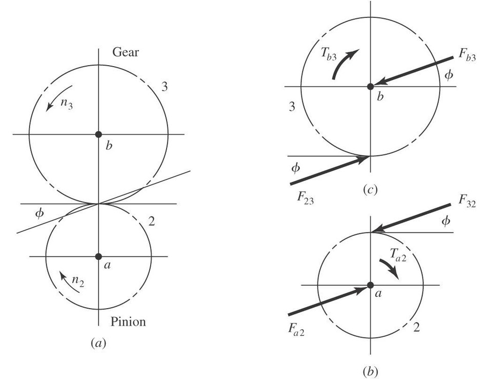
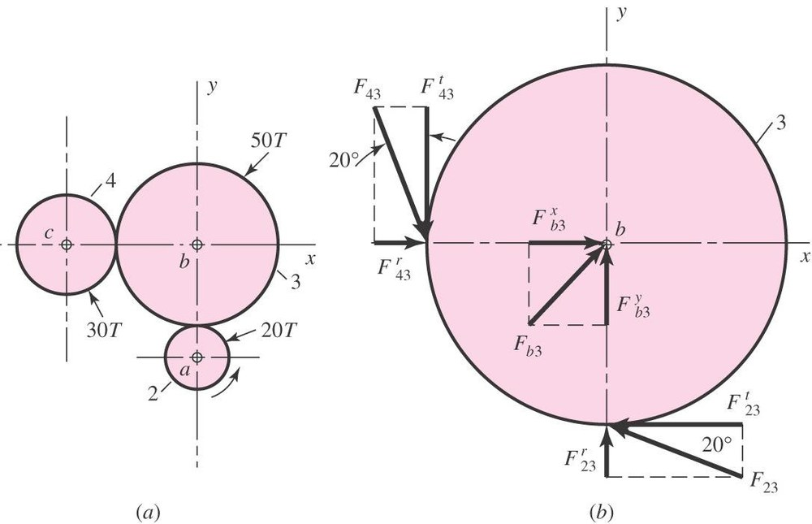
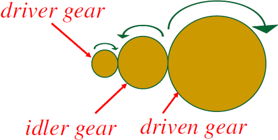
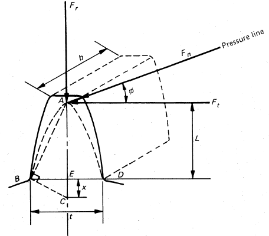
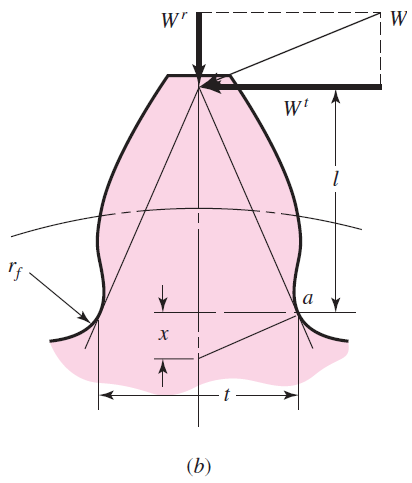
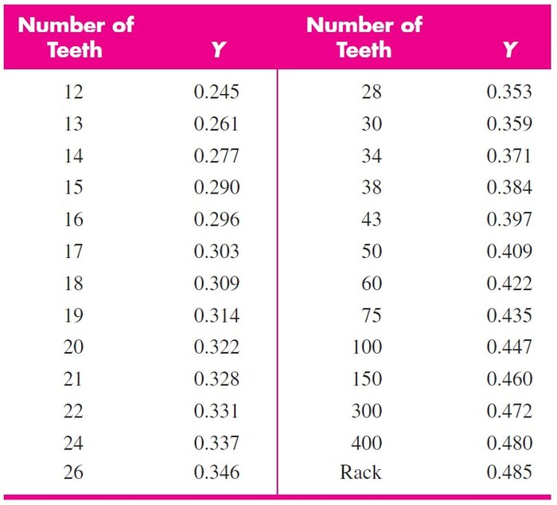
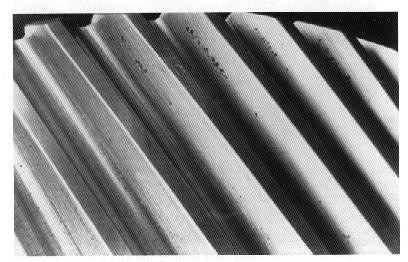
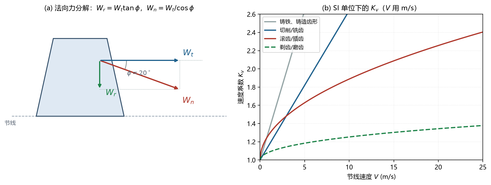

# L5 齿轮受力与强度

> **课件结构**（L5_gears_force_stress，53 页）：
> 1 齿面受力分析（$W_t$、$W_r$、功率–速度–载荷）
> 2 失效模式（折断、点蚀）与 AGMA 方法概览
> 3 **弯曲强度**：Lewis 悬臂梁模型 + 速度系数 $K_v$
> 4 **接触强度**：Hertz 圆柱模型 + 弹性系数 $Z_E$
>
> 这一讲是期末 Q10、Q11 的直接来源：**给功率/转矩 → 求 $W_t$ → 求齿宽或校核强度**。

---

## 0 课件页码 → 本节

| 课件页 | 内容 | 本节 |
| --- | --- | --- |
| 1–3 | 惰轮为什么先坏（双向弯曲） | 2.2 |
| 4–8 | 受力符号、马力–转矩–转速关系 | 1 |
| 9–16 | 例 13-7、轴承反力 | 1.4–1.5 |
| 17–23 | 齿轮箱实例、"齿面故意比齿根弱" | 2 |
| 24–38 | 失效形式、悬臂梁模型、Lewis 公式、$K_v$、例 14-5 | 3 |
| 39–48 | 点蚀、Hertz 接触应力、例 14-3 | 4 |
| 49–53 | AGMA 方法（不考，了解） | 5 |

---

### 0.1 符号表（本讲专用）

| 符号 | 含义 | 单位 |
| --- | --- | --- |
| $W_t,\ W_r,\ W_n$ | 切向（传递）载荷 / 径向力 / 法向力 | N（US：lbf） |
| $F_{23}^{t}$ | 构件 2 对构件 3 的切向力（下标为构件号） | N |
| $\phi$ | 压力角 | ° |
| $V$ | 节线速度 | m/s（US：ft/min） |
| $P$ | 功率 | kW（US：hp） |
| $n$ | 转速 | rpm |
| $T$ | 转矩 | N·m |
| $d$ / $b_f$ | 分度圆直径 / 齿宽 | mm |
| $P_d$ | 径节 | teeth/in |
| $Y$ | Lewis 齿形系数 | — |
| $K_v$ | 速度系数 | — |
| $\sigma$ | 齿根弯曲应力 | MPa |
| $\sigma_C$ | 齿面接触应力（负号表示压） | MPa |
| $Z_E$ | 弹性系数（Shigley 记 $C_p$） | — |
| $\rho_1,\ \rho_2$ | 节点处两齿廓的曲率半径 | mm |
| $d_p,d_g$ / $z_p,z_g$ | 小齿轮、大齿轮的分度圆 / 齿数 | mm / — |
| $E_p,E_g$ / $\nu_p,\nu_g$ | 两齿轮的弹性模量 / 泊松比 | MPa / — |
| $S_C$ | 表面耐久强度 | MPa（kpsi） |
| $H_B$ | 布氏硬度 | HB |
| $n_s$ | 安全系数（Shigley 记 $n$） | — |

> 【命名规则】载荷用 $W$ 系列（$W_t,W_r,W_n$），力用 $F_{ij}$（带构件号）；齿宽记 $b_f$（不是 $F$），安全系数记 $n_s$（不是 $n$，$n$ 只表示转速）；曲率半径用 $\rho_1,\rho_2$（不是 $r_1,r_2$）。

## 1 齿面受力

### 1.1 三个分量

【课件】把法向力 $W_n$ 分解为

$$W_t=W_n\cos\phi\quad(\text{切向/传递载荷}),\qquad
W_r=W_n\sin\phi\quad(\text{径向力})$$
$$\Longrightarrow\quad W_r=W_t\tan\phi,\qquad W_n=\frac{W_t}{\cos\phi}$$

- $W_t$：真正传递转矩的分量，**所有强度公式都用它**；
- $W_r$：把两轴推开，由轴承承担，对弯曲强度影响小（课件明确"neglect"）；
- $\phi$：压力角（标准 $20^\circ$）。

符号约定：$F_{23}^{t}$ 表示"构件 2 对构件 3 的切向力"，$F_{23}^{r}$ 为径向分量。

*图 L5-1 齿面受力：法向力 $W_n$ 分解为切向 $W_t$ 与径向 $W_r$（$\phi$ 为压力角）（L5 课件）*

### 1.2 功率、速度、载荷的关系

**马力–转矩–转速**（US）：

$$P[\text{hp}]=\frac{T[\text{lbf·in}]\cdot n[\text{rpm}]}{63025}$$

**节线速度**（pitch-line velocity）：

$$V=\frac{\pi d n}{60}\quad(\text{SI：}V\ \text{m/s},\ d\ \text{m},\ n\ \text{rpm})$$

**传递载荷**：

$$W_t=33000\frac{P}{V}\quad(\text{US：}P\ \text{hp},\ V\ \text{ft/min},\ W_t\ \text{lbf})$$

$$W_t=\frac{60000\,P}{\pi d n}\quad(\text{SI：}P\ \text{kW},\ d\ \text{mm},\ n\ \text{rpm})$$

> 【坑】SI 这条式子算出来是 **kN**，不是 N！课件专门提醒："be careful of units! That equation produced an answer in kN." 做题时先写 $W_t=0.546$ kN，再换成 546 N 代入强度公式。

### 1.3 推导（30 秒）

$$P=T\omega=W_t\frac{d}{2}\cdot\frac{2\pi n}{60}
\quad\Longrightarrow\quad
W_t=\frac{60P}{\pi dn}$$

把 $P$ 用 kW、$d$ 用 mm 代入，系数就是 $60000/\pi$，量纲落在 kN。

### 1.4 例题：例 13-7（课件 13–16 页）

已知：$m=2.5$ mm、$z_2=20$（主动）、$z_3=50$、$P=2.5$ kW、$n=1750$ rpm、$\phi=20^\circ$。

**(1) 分度圆**

$$d_2=mz_2=50\ \text{mm},\qquad d_3=mz_3=125\ \text{mm}$$

**(2) 传递载荷**

$$W_t=\frac{60000\times2.5}{\pi\times50\times1750}=0.546\ \text{kN}=546\ \text{N}$$

**(3) 径向力与法向力**

$$W_r=W_t\tan20^\circ=0.546\times0.364=0.199\ \text{kN}$$

$$W_n=\frac{W_t}{\cos20^\circ}=\frac{0.546}{0.9397}=0.581\ \text{kN}$$

**(4) 惰轮（gear 3）**

惰轮不传递功率给轴（只改方向），所以两侧切向力大小相等：$F_{43}^{t}=F_{23}^{t}=0.546$ kN，$F_{43}^{r}=0.199$ kN。

**(5) 轴承受力**

把 $F^{t}$、$F^{r}$ 沿 $x,y$ 分解后求合力，再按跨距分配。例中：

$$F_{b3}^{x}=-(F_{23}^{t}+F_{43}^{r})=-(-0.546+0.199)=0.347\ \text{kN}$$

$$F_{b3}^{y}=-(F_{23}^{r}+F_{43}^{t})=-(0.199-0.546)=0.347\ \text{kN}$$

> 【说明】符号来自"力平衡"，方向画对了自然就对；考试一定要画受力图（自由体图），标出 $W_t$ 的方向（主动轮与转向相反、从动轮与转向相同）。

*图 L5-2 三齿轮轮系的受力方向（例 13-7 的 Fig. 13-34）：惰轮两侧切向力等大反向（L5 课件）*

### 1.5 轴承径向载荷（期末 Q11 的思路）

$$W_r=W_t\tan\phi,\qquad W_{total}=\frac{W_t}{\cos\phi}$$

若两轴承对称布置、各承担一半：

$$F_{\text{bearing}}=\frac{W_{total}}{2}$$

---

## 2 失效模式

### 2.1 两类失效（课件 24 页）

【课件】"Gears fail when actual loads applied to teeth are greater than allowable loads."

- **轮齿折断（tooth fracture）**：弯曲应力超过许用 → 突然、彻底失效；
- **齿面失效（surface failure / wear / pitting）**：接触应力导致点蚀、剥落 → 渐进失效。

### 2.2 惰轮为什么最先坏（课件 1–3 页）

【课件】"The idler gear, because the teeth are being bent in both directions instead of just one direction. In other words, they experience reversed loading."

- 主动轮、从动轮的齿根弯曲应力是**单向脉动**（0 → max → 0）；
- 惰轮同时与两侧啮合，齿根先受一侧弯曲、再受另一侧弯曲 → **对称循环（reversed）**；
- 同样的应力幅下，对称循环的疲劳寿命远低于脉动循环 → 惰轮先断。

*图 L5-3 主动轮—惰轮—从动轮：惰轮轮齿两次受力方向相反（对称循环）（L5 课件）*

### 2.3 为什么"齿面故意设计得比齿根弱"（课件 21–22 页）

【课件】"Gear teeth are typically designed to be weaker in wear than in bending. Why?"

- 磨损/点蚀是**渐进**的，会先出现噪声、振动，给出预警；
- 弯曲折断是**突然**的，整台机器可能瞬间失效、飞出碎片；
- 所以设计上让"先坏的那一环"是可控的、有预警的（fail-safe 思想）。

### 2.4 其他失效原因（课件 25–29 页）

- 齿根圆角不足、热处理不当 → 弯曲疲劳裂纹源；
- 轴系**不对中（misalignment）** → 齿面偏载，一端先点蚀/折断；
- 循环过载（cyclic overload）→ AGMA 标准里有专门的过载系数；
- 润滑不良 → 胶合、磨损。

---

## 3 弯曲强度：Lewis 公式

### 3.1 模型（课件 31 页）

把轮齿看成一端固定的**悬臂梁**：

- 载荷 $W_t$ 作用在齿顶（最不利），沿齿宽 $b_f$ 均布；
- 危险截面在齿根（抛物线内切）；
- 实际齿形与理想抛物线不同 → 用**齿形系数 $Y$** 修正。

$$\sigma=\frac{M_b\,y}{I_z}\ \Longrightarrow\ \sigma=\frac{W_t\,P_d}{b_f\,Y}\ (\text{US}),\qquad
\sigma=\frac{W_t}{b_f\,m\,Y}\ (\text{SI})$$

其中 $P_d$ 为径节、$m$ 为模数、$Y$ 为 Lewis 齿形系数（查表）；$M_b$ 是齿根弯矩、$y$ 是到中性轴的距离、$I_z$ 是截面惯性矩（都是悬臂梁模型里的量）。

> 【记忆】$Y$ 越大（齿数越多）→ 同样载荷下应力越小。齿条（$z\to\infty$）的 $Y$ 最大。

*图 L5-4 悬臂梁模型：把轮齿看成齿根固定的悬臂梁，载荷作用在齿顶（L5 课件）*

*图 L5-5 抛物线内切齿廓：用齿形系数 $Y$ 修正实际齿形与理想抛物线的差别（L5 课件）*

### 3.2 完整公式（含速度系数）

**US 单位**（$\sigma$ psi，$W_t$ lbf，$b_f$ in，$P_d$ teeth/in）：

$$\boxed{\ \sigma=\frac{K_v W_t P_d}{b_f Y}\ }\quad(\text{Eq. 14-7})$$

**SI 单位**（$\sigma$ MPa，$W_t$ N，$b_f,m$ mm）：

$$\boxed{\ \sigma=\frac{K_v W_t}{b_f m Y}\ }\quad(\text{Eq. 14-8})$$

### 3.3 速度系数 $K_v$（动载系数）

速度越高，冲击与动载越大，用 $K_v>1$ 放大应力。按**加工方式**选取（课件 34–35 页，Shigley Eq. 14-4～14-6）：

| 加工方式 | US（$V$ 单位 ft/min） | SI（$V$ 单位 m/s） |
| --- | --- | --- |
| 铸铁、铸造齿形 | $\dfrac{600+V}{600}$ | $\dfrac{3.05+V}{3.05}$ |
| 切削/铣齿 | $\dfrac{1200+V}{1200}$ | $\dfrac{6.1+V}{6.1}$ |
| 滚齿/插齿 | $\dfrac{50+\sqrt{V}}{50}$ | $\dfrac{3.56+\sqrt{V}}{3.56}$ |
| 剃齿/磨齿 | $\sqrt{\dfrac{78+\sqrt{V}}{78}}$ | $\sqrt{\dfrac{5.56+\sqrt{V}}{5.56}}$ |

> 【说明】精度越高、$K_v$ 越接近 1（动载小）；题目没说加工方式时，用"切削/铣齿"或"滚齿"并在卷面注明假设。**两套单位的公式不能混用**（$V$ 的单位不同）。

### 3.4 Lewis 齿形系数 $Y$（20° 全齿高，节选）

| $z$ | 12 | 14 | 16 | 18 | 20 | 22 | 24 | 26 | 28 | 30 |
| --- | --- | --- | --- | --- | --- | --- | --- | --- | --- | --- |
| $Y$ | 0.245 | 0.277 | 0.296 | 0.309 | 0.322 | 0.331 | 0.337 | 0.346 | 0.353 | 0.359 |

| $z$ | 34 | 36 | 38 | 40 | 45 | 50 | 更大 | 齿条 |
| --- | --- | --- | --- | --- | --- | --- | --- | --- |
| $Y$ | 0.371 | 0.377 | 0.383 | 0.389 | 0.399 | 0.409 | 查表，趋近 0.48 | $\approx0.485$ |

> 【坑】表值对应 **20° 全齿高**；若题目给 25° 或短齿，$Y$ 不同。考试若只给 $z$ 不给表，通常允许用近似值或直接给 $Y$。

*图 L5-6 Lewis 齿形系数 $Y$（20° 全齿高，Shigley 表 14-2）：齿数越多 $Y$ 越大（L5 课件）*

### 3.5 例题 1：求最小齿宽（Prob. 14-5）

已知：钢制直齿小齿轮，$m=1$ mm，$z=16$，$20^\circ$ 全齿高，传递 $P=0.15$ kW、$n=400$ rpm，许用弯曲应力 $150$ MPa（已含安全系数）。求最小齿宽 $b_f$。

$$d=mz=1\times16=16\ \text{mm}$$

$$V=\frac{\pi d n}{60}=\frac{\pi\times0.016\times400}{60}=0.335\ \text{m/s}$$

$$W_t=\frac{60000\times0.15}{\pi\times16\times400}=0.4477\ \text{kN}=447.7\ \text{N}$$

按滚齿/插齿取 $K_v=\dfrac{3.56+\sqrt{0.335}}{3.56}=1.163$；$Y(16)=0.296$。

由 $\sigma=\dfrac{K_vW_t}{FmY}\le150$：

$$b_f\ge\frac{1.163\times447.7}{150\times1\times0.296}=11.7\ \text{mm}$$

圆整取 $b_f=12$ mm。

> 【说明】若按"切削/铣齿"取 $K_v=1.055$，则 $b_f\ge10.6$ mm；若按"铸铁铸造"取 $K_v=1.11$，则 $b_f\ge11.2$ mm。**加工方式影响 10% 左右**，所以必须写清假设。齿宽一般还要求 $b_f=(6\text{–}12)m$，本题 $12m$ 刚好在上限。

### 3.6 例题 2：仿期末题（$W_t$ 由转矩给）

已知：小齿轮 $d=40$ mm（$m=2$、$z=20$）、$n=500$ rpm、传递 $0.5$ kW、滚齿、$\phi=20^\circ$、许用弯曲应力 $120$ MPa。求最小齿宽。

$$V=\frac{\pi\times0.04\times500}{60}=1.047\ \text{m/s},\qquad
K_v=\frac{3.56+\sqrt{1.047}}{3.56}=1.287$$
$$W_t=\frac{60000\times0.5}{\pi\times40\times500}=0.477\ \text{kN}=477\ \text{N}$$

$$b_f\ge\frac{1.287\times477}{120\times2\times0.322}=\frac{614}{77.3}=7.94\ \text{mm}$$

取 $b_f=8$ mm（$=4m$，偏窄，工程上常取 $8\text{–}10$ mm）。

> 【说明】2023 期末 Q10 给的是 $T_m=10$ mNm、$\omega_m=100$ rpm、$d_p=20$ mm、$m=1$ 这种"轻载"数据，算出的 $W_t=T/r=10/10=1$ N，按公式算出的 $b_f$ 只有零点几毫米。这不是算错，而是说明**轻载下齿宽由结构/工艺决定，不由强度决定**——答题时写一句"强度不控制，取结构最小值"即可。

---

## 4 接触强度（齿面点蚀）

*图 L5-7 齿面磨损/点蚀的宏观形貌：渐进失效，先出现噪声（L5 课件）*

### 4.1 Hertz 模型（课件 43 页）

把两齿面在节点处的接触看成**两个圆柱体受压**，最大接触应力在表面下：

$$\rho_1=\frac{d_p\sin\phi}{2},\qquad \rho_2=\frac{d_g\sin\phi}{2}$$

**弹性系数**（由两材料 $E,\nu$ 决定）：

$$Z_E=\left[\frac{1}{\pi\left(\dfrac{1-\nu_p^2}{E_p}+\dfrac{1-\nu_g^2}{E_g}\right)}\right]^{1/2}$$

### 4.2 接触应力公式（课件 44 页）

$$\boxed{\ \sigma_C=-Z_E\left[\frac{K_vW_t}{b_f\cos\phi}\left(\frac{1}{\rho_1}+\frac{1}{\rho_2}\right)\right]^{1/2}\ }\quad(\text{Eq. 14-14})$$

- 负号表示**压应力**；
- $\sigma_C\propto\sqrt{W_t}$（**与载荷的平方根成正比**，不是线性！）；
- $d$ 越大 → $\rho_1,\rho_2$ 越大 → 应力越小，所以"**抗点蚀看直径**"。

### 4.3 例题：例 14-3（课件 45–47 页）

已知：

| 项目 | 小齿轮（AISI 1020 钢） | 大齿轮（ASTM #50 铸铁，铣齿） |
| --- | --- | --- |
| $E$ | 30 Mpsi | 14.5 Mpsi |
| $\nu$ | 0.292 | 0.211 |
| 表面耐久强度 $S_C$ | — | 83.8 kpsi |

$P_d=8$ teeth/in、$z_p=16$、$z_g=50$、$\phi=20^\circ$、$n_p=1200$ rpm、$W_t=382$ lbf、$b_f=1.5$ in。

**(1) 分度圆**

$$d_p=\frac{z_p}{P_d}=\frac{16}{8}=2\ \text{in},\qquad d_g=\frac{z_g}{P_d}=\frac{50}{8}=6.25\ \text{in}$$

**(2) 曲率半径**

$$\rho_1=\frac{2\sin20^\circ}{2}=0.342\ \text{in},\qquad
\rho_2=\frac{6.25\sin20^\circ}{2}=1.069\ \text{in}$$

**(3) 弹性系数**

$$Z_E=\left[\frac{1}{\pi\left(\dfrac{1-0.292^2}{30\times10^6}+\dfrac{1-0.211^2}{14.5\times10^6}\right)}\right]^{1/2}=1817$$

**(4) 速度系数**（切削齿，$V=\pi d n/12=\pi\times2\times1200/12=628$ ft/min）

$$K_v=\frac{1200+628}{1200}=1.52$$

**(5) 接触应力**（课件解答中 $W_t$ 取 380 lbf，这里照用）

$$\sigma_C=-1817\left[\frac{1.52\times380}{1.5\cos20^\circ}\left(\frac{1}{0.342}+\frac{1}{1.069}\right)\right]^{1/2}
=-72\,400\ \text{psi}=-72.4\ \text{kpsi}$$

**(6) 安全系数**

铸铁表面耐久强度估算：

$$S_C\approx0.32H_B\ \text{kpsi}\quad(H_B=262)\ \Longrightarrow\ S_C=83.8\ \text{kpsi}$$

因为接触应力与载荷的平方根成正比，**载荷比 = 应力比的平方**：

$$n_s=\frac{S_C^2}{\sigma_C^2}=\left(\frac{83.8}{72.4}\right)^2=1.34$$

> 【说明】这是"用应力比算安全系数"的标准做法：$n_s=(\text{许用}/\text{实际})^2$ 只适用于接触应力（$\sqrt{}$ 关系）；弯曲应力是线性的，$n_s=\sigma_{\text{allow}}/\sigma$。

---

## 5 AGMA 方法（不考，但要"知道有它"）

【课件】"We will not ask you about this method on the exam, but you should be aware of it."

- 两个失效模式：弯曲 + 接触；
- 引入一系列修正系数（过载、尺寸、载荷分布、动载、温度、可靠性、表面状态……）；
- 表格默认：$10^7$ 循环、99% 可靠性；
- **使应力增大的因素**：冲击与振动、更高速度、大尺寸材料的性能不均、不对中、薄轮缘；
- **使许用应力降低的因素**：循环次数多、温度高、可靠性要求高。

> 【说明】这条只出选择题/简答题，记住"两模式 + 一堆修正系数 + 10⁷ 循环 + 0.99 可靠度"。

---

## 6 设计准则：先弯还是先接？

| 齿轮类型 | 主要失效 | 设计顺序 |
| --- | --- | --- |
| 闭式软齿面（≤350 HB） | 点蚀 | 先按接触强度定 $d$，再校核弯曲 |
| 闭式硬齿面（>350 HB） | 折断 | 先按弯曲强度定 $m$，再校核接触 |
| 开式齿轮 | 磨损 | 按弯曲强度定 $m$，并加大模数补偿磨损 |

> 【记忆】"**抗点蚀看直径，抗折断看模数**"：加大 $d$ 降低接触应力，加大 $m$ 降低弯曲应力。

---

## 7 与 L4 的衔接

- L4 定**几何**（$m,z,d,C$）；
- L5 定**齿宽 $b_f$ 与材料/热处理**（弯曲 + 接触校核）；
- 两者联立才是完整设计：先由传动比定 $z$，由弯曲强度初定 $m$，由接触强度校核 $d$，最后回到 L4 出图。

- 左：法向力 $W_n$ 分解为 $W_t$、$W_r$，压力角 $\phi$ 决定二者比例；
- 右：四种加工方式的 $K_v$–$V$ 曲线（SI），精度越高动载越小。

---

## 8 易错点清单

1. $W_t$ 是**切向**力，$W_r=W_t\tan\phi$ 只给轴承，不参与弯曲强度。
2. SI 的 $W_t=60000H/(\pi dn)$ 结果是 **kN**，代入 $\sigma$ 公式前乘 1000。
3. 弯曲公式里是 $m$（SI）或 $P_d$（US），两者互为倒数，别同时用。
4. $K_v$ 的两套单位公式不能混（ft/min vs m/s）。
5. $Y$ 查表对应 20° 全齿高，齿数越多 $Y$ 越大。
6. 接触应力与 $\sqrt{W_t}$ 成正比，安全系数要**平方**。
7. 接触应力取负号只是表示压应力，比较时用绝对值。
8. 惰轮是**对称循环**弯曲，比主动轮/从动轮更容易疲劳。
9. 齿面设计得比齿根弱是**故意的**（渐进失效有预警）。
10. AGMA 不考公式，但要知道它有两个失效模式和一堆修正系数。

---

## 9 自测（5 分钟）

1. $W_t=500$ N、$\phi=20^\circ$，求 $W_r$ 和 $W_n$。
2. 传递 $1.5$ kW、$d=60$ mm、$n=900$ rpm，求 $W_t$（kN）与节线速度（m/s）。
3. $m=2$、$z=25$、$b_f=20$ mm、$W_t=800$ N、$K_v=1.2$，求弯曲应力（$Y$ 查表）。
4. 接触应力算得 600 MPa、许用 900 MPa，安全系数是多少？若载荷加倍，应力变多少？
5. 为什么惰轮最容易发生弯曲疲劳断裂？

> 答案见《08 模拟卷答案》附录。
