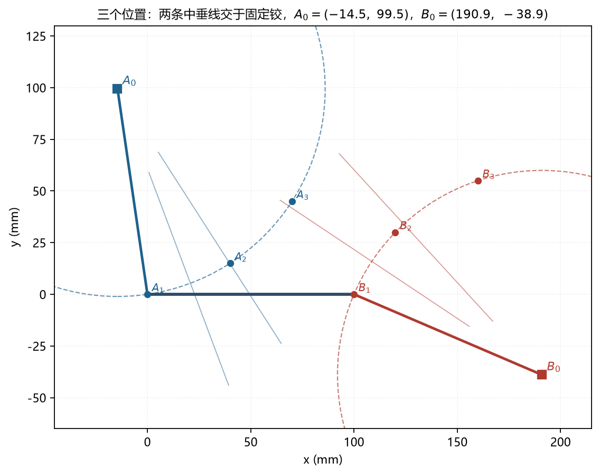

# 模拟卷答案与评分要点

> 每题给"关键步骤 + 数值结果"。考试时**步骤分比结果分多**，以下每一条都可以单独得分。

---

## 一、自由度与机构基础（8 分）

**1.（3 分）** $L=4$，$J_1=4$，$J_2=0$。

- 总自由度：$3(L-1)=3\times3=9$；
- 总约束数：$2J_1+J_2=8$；
- $M=9-8=1$。

**2.（3 分）**

- 纯滚动（滚子与凸轮无滑动）：$L=4$、$J_1=4$、$J_2=0$ → $M=3\times3-8=1$；
- 从动件与输出焊成一体、凸轮副允许转+滑：$L=3$、$J_1=2$、$J_2=1$ → $M=6-4-1=1$。

两种假设答案相同（1 个自由度），但**建模不同**，卷面必须写清假设。

**3.（2 分）** 偏大 **2**。三个构件共销实际上是两两成副，应记 2 个 $J_1$（去掉 4 个约束）；只记 1 个只去掉 2 个约束，所以 $M$ 多算 2。

---

## 二、四杆机构：类型、急回、传动角（12 分）

**1.（4 分）**

$$\ell_{\min}=45,\quad \ell_{\max}=120,\quad \ell_p=90,\quad \ell_q=110$$

$$\ell_{\min}+\ell_{\max}=165<200=\ell_p+\ell_q\quad\Rightarrow\quad\text{Grashof 机构}$$

最短杆 $a=45$ 是**连架杆** → **曲柄摇杆机构**（$a$ 为曲柄，$c$ 为摇杆）。

**2.（4 分）** 极限位置时曲柄与连杆共线：

$$AC_1=a+b=155,\qquad AC_2=b-a=65$$

$$\cos\angle C_1AD=\frac{d^2+AC_1^2-c^2}{2d\cdot AC_1}
=\frac{120^2+155^2-90^2}{2\times120\times155}=0.8152
\ \Rightarrow\ 35.39^\circ$$
$$\cos\angle C_2AD=\frac{120^2+65^2-90^2}{2\times120\times65}=0.6747
\ \Rightarrow\ 47.57^\circ$$
$$\theta=|47.57^\circ-35.39^\circ|=12.18^\circ$$

$$K=\frac{180^\circ+\theta}{180^\circ-\theta}=\frac{192.18}{167.82}=1.145$$

**3.（4 分）** $\mu_{\min}$ 在曲柄与机架共线处：

$$BD=d-a=75:\quad
\cos\angle BCD=\frac{110^2+90^2-75^2}{2\times110\times90}=0.7361
\ \Rightarrow\ 42.60^\circ$$
$$BD=d+a=165:\quad
\cos\angle BCD=\frac{110^2+90^2-165^2}{2\times110\times90}=-0.3548
\ \Rightarrow\ 110.78^\circ\ \to\ 69.22^\circ$$
$$\mu_{\min}=42.60^\circ>[\mu]=40^\circ\quad(\text{合格})$$

---

## 三、位置与速度分析（10 分）

**1.（5 分）**

$$\lambda_1=2c(d-a\cos60^\circ)=2\times90\times(120-22.5)=17550$$

$$\lambda_2=-2ac\sin60^\circ=-2\times45\times90\times0.8660=-7014.3$$

$$\lambda_3=d^2+c^2+a^2-b^2-2ad\cos60^\circ=14400+8100+2025-12100-5400=7025$$

$$t=\frac{-\lambda_2\pm\sqrt{\lambda_1^2+\lambda_2^2-\lambda_3^2}}{\lambda_3-\lambda_1}
=\frac{7014.3\pm17545.7}{-10525}$$

取 $\sigma=+1$ 支路（图示上装），$t=1.0006$：

$$\varphi=2\arctan(1.0006)=90.03^\circ$$

$$C=(d+c\cos\varphi,\ c\sin\varphi)=(119.95,\ 90.00)$$

$$\psi=\operatorname{atan2}(90.00-38.97,\ 119.95-22.50)=\operatorname{atan2}(51.03,\ 97.45)=27.64^\circ$$

**2.（5 分）**

$$\omega_3=-\frac{a\omega_2\sin(\varphi-\theta)}{b\sin(\varphi-\psi)}
=-\frac{45\times10\times\sin30.03^\circ}{110\times\sin62.39^\circ}=-2.31\ \text{rad/s}$$
$$\omega_4=-\frac{a\omega_2\sin(\psi-\theta)}{c\sin(\varphi-\psi)}
=-\frac{45\times10\times\sin(-32.36^\circ)}{90\times\sin62.39^\circ}=+3.02\ \text{rad/s}$$
$$v_C=\omega_4 c=3.02\times90=272\ \text{mm/s}$$

$\omega_4>0$ 表示与 $\theta$ 增大方向相同；若图示 $\theta$ 为逆时针，则摇杆也逆时针。

---

## 四、图解法综合（10 分）

**1.（5 分）**

1. 连 $A_1A_2$、$A_1A_3$，分别作两条中垂线；
2. 两中垂线**交点**即固定铰 $A_0$（$A$ 点绕 $A_0$ 作圆弧，圆心必在两条中垂线上）；
3. 连 $B_1B_2$、$B_1B_3$，同法得 $B_0$；
4. 连 $A_1A_0$、$B_1B_0$ 得两连架杆，$A_1B_1$ 为连杆；
5. 检查 $A_0,B_0$ 是否在允许区域内，并保留作图线。

**2.（2 分）** 4 个自由选择：$A$、$B$ 两个动铰在连杆上的位置各 2 个（$x,y$）。固定铰由交点唯一确定，没有自由选择。

*图（自绘）Q4 的作图结果：$A_1A_2A_3$ 与 $B_1B_2B_3$ 各自的外接圆，圆心就是固定铰*

**3.（3 分）** 本题坐标算出的结果为 $A_0\approx(-14.5,\ 99.5)$、$B_0\approx(190.9,\ -38.9)$——两个固定铰都远远落在点群之外，说明所选的动铰位置不合适，必须**重新选动铰位置**（改那 4 个自由选择）再做一次；因为固定铰的位置完全由"动铰三位置所确定的圆"决定，动铰一改，圆心就跟着变。也可退而求其次：固定一端（只做 2 位置导引）或允许第三位置有小误差。

---

## 五、直流电机与传动（10 分）

**1.（4 分）**

$$T_s=\frac{V_sK_T}{R_a}=\frac{18\times0.02865}{3}=0.1719\ \text{N·m}=171.9\ \text{mNm}$$

$$\text{斜率}=\frac{K_TK_b}{R_a}=\frac{0.02865^2}{3}=2.736\times10^{-4}\ \text{N·m/(rad/s)}=0.2736\ \text{mNm/(rad/s)}$$

$$171.9-0.2736\,\omega=50+0.01\,\omega
\quad\Rightarrow\quad
\omega=429.8\ \text{rad/s}=4105\ \text{rpm}$$
$$T=54.3\ \text{mNm},\qquad I=\frac{T}{K_T}=1.895\ \text{A}$$

$$P_{in}=18\times1.895=34.1\ \text{W},\quad
P_{out}=0.0543\times429.8=23.3\ \text{W},\quad
\eta=68.4\%$$

（也等于 $\omega/\omega_0=429.8/628.3$。）

**2.（3 分）** $\omega=314.16$ rad/s 时 $T_L=50+3.14=53.14$ mNm：

$$V_s=\frac{T R}{K_T}+K_b\omega
=\frac{0.05314\times3}{0.02865}+0.02865\times314.16
=5.56+9.00=14.57\ \text{V}$$

**3.（3 分）** 折算到电机侧：

$$T_m=\frac{50+0.01\,\omega_m/10}{10\times0.9}=\frac{50+0.001\,\omega_m}{9}\ \text{mNm}$$

$$171.9-0.2736\,\omega_m=5.556+1.111\times10^{-4}\omega_m
\ \Rightarrow\ \omega_m=607.7\ \text{rad/s}=5803\ \text{rpm}$$
$$T_m=5.6\ \text{mNm},\qquad
\omega_{out}=\frac{\omega_m}{10}=60.8\ \text{rad/s}=580\ \text{rpm}$$
$$T_{out}=T_m\times10\times0.9=50.4\ \text{mNm}$$

（与负载线 $50+0.01\times60.8=50.6$ mNm 基本一致，差值来自四舍五入。）

---

## 六、齿轮几何与轮系（12 分）

**1.（6 分）**

| 量 | 小齿轮 | 大齿轮 |
| --- | --- | --- |
| $d=mz$ | 72 | 180 |
| $d_a=d+2m$ | 80 | 188 |
| $d_f=d-2.5m$ | 62 | 170 |
| $d_b=d\cos20^\circ$ | 67.66 | 169.14 |

$$a_w=\frac{m(z_1+z_2)}{2}=\frac{4\times63}{2}=126\ \text{mm}$$

**2.（3 分）**

$$r_{a1}=40,\ r_{b1}=33.83;\qquad r_{a2}=94,\ r_{b2}=84.57$$

$$\varepsilon_\alpha=\frac{\sqrt{40^2-33.83^2}+\sqrt{94^2-84.57^2}-126\sin20^\circ}{\pi\times4\times\cos20^\circ}
=\frac{21.34+41.05-43.09}{11.81}=1.63$$

物理意义：同时参与啮合的轮齿对数平均为 1.63；$\varepsilon_\alpha>1$ 才能连续传动，越大越平稳。

**3.（3 分）** $18=3\times6$：第一级 $z_1=18$、$z_2=54$（$i_1=3$）；第二级 $z_3=18$、$z_4=108$（$i_2=6$）。总传动比 $3\times6=18$，每级均小于 10。

---

## 七、行星轮系与谐波（10 分）

**1.（6 分）** 校核：$z_r=2z_p+z_s=2\times36+24=96$ ✓。

$$\omega_c=\omega_s\frac{S}{R+S}=1200\times\frac{24}{120}=240\ \text{rpm}\quad(\text{与太阳轮同向，顺时针})$$

$$\omega_p=\frac{\omega_c(P+S)}{P}=\frac{240\times60}{36}=400\ \text{rpm}$$

按行星轮反号约定，实际转向与太阳轮相反 → **逆时针 400 rpm**。

$$u=\frac{\omega_s}{\omega_c}=\frac{z_r+z_s}{z_s}=5$$

**2.（4 分）**

$$u_h=\frac{z_f}{z_g-z_f}=\frac{200}{2}=100$$

刚轮固定、波发生器输入、柔轮输出时，**输出转向与波发生器相反**。

---

## 八、齿轮受力与弯曲强度（12 分）

**1.（4 分）**

$$V=\frac{\pi d n}{60}=\frac{\pi\times0.05\times1200}{60}=3.142\ \text{m/s}$$

$$K_v=\frac{3.56+\sqrt{V}}{3.56}=\frac{3.56+1.772}{3.56}=1.498$$

$$W_t=\frac{60000P}{\pi dn}=\frac{60000\times0.75}{\pi\times50\times1200}=0.2387\ \text{kN}=238.7\ \text{N}$$

**2.（3 分）**

$$W_r=W_t\tan20^\circ=86.9\ \text{N},\qquad
W_n=\frac{W_t}{\cos20^\circ}=254\ \text{N}$$
$W_t$ 传递转矩、使轮齿受弯；$W_r$ 与 $W_n$ 的径向分量由轴与轴承承担（对弯曲强度影响可忽略）。

**3.（5 分）**

$$\sigma=\frac{K_vW_t}{FmY}
=\frac{1.498\times238.7}{25\times2.5\times0.322}
=\frac{357.6}{20.13}=17.8\ \text{MPa}$$

转速翻倍时：

$$V'=6.283\ \text{m/s},\qquad
K_v'=\frac{3.56+\sqrt{6.283}}{3.56}=1.704$$

功率不变则 $W_t'=W_t/2=119.4$ N：

$$\sigma'=\frac{1.704\times119.4}{20.13}=10.1\ \text{MPa}$$

即 $K_v$ 上升约 14%，但因 $W_t$ 减半，弯曲应力**下降约 43%**。结论：同一功率下提高转速反而降低齿根弯曲应力（所以高速级用小模数、低速级用大模数）。

---

## 九、设计流程与材料（8 分）

**1.（3 分）** 需求规格 → 调研与对标 → 概念生成 → 概念筛选 → 详细设计 → 建模与分析 → 样机与试验 → 定型。

**2.（2 分）**

- 强度：抗破坏/屈服的能力，指标 $\sigma_y$、$\sigma_u$（MPa），判据 $\sigma\le[\sigma]$，例子：螺栓被拉断；
- 刚度：抗变形的能力，指标 $E$（MPa）或 $k=F/\delta$，判据 $\delta\le[\delta]$，例子：机床床身变形导致精度超差。

**3.（3 分）** 折线：$(0,0)\to(2\%,\ 50)\to(5\%,\ 60)\to(5\%,\ 45)$。

- 弹性段斜率 $E=\dfrac{50}{0.02}=2500$ MPa，与题给 $E$ **自洽**；
- 屈服点 $(2\%,\ 50)$、抗拉点 $(5\%,\ 60)$、断裂点 $(5\%,\ 45)$；
- 延伸率 5%，属于塑性材料；曲线下面积代表韧性。

---

## 十、简答（8 分）

1. **渐开线**：啮合点公法线始终是两基圆的公切线，与连心线交点（节点）固定 → 瞬时传动比恒定（共轭啮合），且中心距有误差时传动比不变。矩形齿的法线方向随啮合位置变化，交点不固定 → 传动比波动、卡死或回差大。
2. **惰轮**：同时与两侧啮合，轮齿先受一侧弯曲、再受另一侧弯曲，是**对称循环**载荷；主动轮/从动轮是单向脉动。同样应力幅下对称循环的疲劳寿命低得多。
3. **齿面故意弱**：磨损/点蚀是渐进的，会通过噪声、振动给出预警；弯曲折断是突发的、灾难性的。让"先失效的一环"可预警，是 fail-safe 设计思想。
4. **为什么还要减速器**：靠降压降速会使电流剧增，铜耗 $I^2R$ 按平方增长、效率骤降、散热困难；减速器让电机留在高速小转矩的高效区，再把转速换成转矩，代价只是减速器本身的效率损失。

---

# 附录：各章自测答案

## L1 自测

1. $L=6$、$J_1=7$：总自由度 $3\times5=15$，总约束 $2\times7=14$，$M=1$。
2. 偏大 2（三个构件共销应为 2 个 $J_1$）。
3. $\ell_{\min}+\ell_{\max}=40+80=120<90+70=160=\ell_p+\ell_q$ → Grashof；最短杆 $a$ 为连架杆 → **曲柄摇杆**。
4. $BD=d-a=40$：$\cos\angle BCD=\dfrac{90^2+70^2-40^2}{2\times90\times70}=0.9048\to25.2^\circ$；$BD=d+a=120$：$\cos\angle BCD=-0.1111\to96.4^\circ\to83.6^\circ$。$\mu_{\min}=25.2^\circ<40^\circ$，**不合格**，需加长机架或调整杆长。
5. 输入与连杆共线时，输出构件速度为零（处于极限位置），由 $MA=v_{in}/v_{out}$ 知机械效益趋于无穷；连杆与输出共线时 $\mu=0$，连杆力全部沿输出杆、力臂为零，无法产生转矩，且从该位置出来时方向不确定（死点）。

## L2 自测

1. $a e^{i\theta}+b e^{i\psi}=d+c e^{i\varphi}$；对给定 $\theta$，$C$ 点是以 $B$ 为圆心、$b$ 为半径的圆与以 $D$ 为圆心、$c$ 为半径的圆的交点，两圆一般有两个交点 → 两条装配支路。
2. $\varphi=89.56^\circ$（$\sigma=+1$，$t=0.9924$）。
3. 未知数 6（$W$、$Z$ 各 2 个实分量 + $\beta_2,\beta_3$），方程 4，自由选择 2；通常固定 $\beta_2,\beta_3$。
4. $W=\det(A)/\det(C)$、$Z=\det(B)/\det(C)$，其中 $A,B,C$ 见正文；$A_1=PP_1-Z$，$A_0=A_1-W$。
5. 19 个未知数、30 个标量方程（20 个目标点方程 + 10 个闭环方程）。

## L3 自测

1. $K_b=\dfrac{12}{6000\times2\pi/60}=\dfrac{12}{628.3}=0.0191$ V·s/rad。
2. $T_s=\dfrac{0.0191\times12}{2}=0.1146$ N·m；$I_s=\dfrac{12}{2}=6$ A。
3. $d=36/108$ mm，$d_a=40/112$ mm，$d_f=31/103$ mm，$a_w=72$ mm，$u=3$。
4. $u=(60/20)\times(72/18)=3\times4=12$。
5. $z_r=2z_p+z_s=2\times36+24=96$ ✓；$u=1+z_r/z_s=1+96/24=5$；系杆 $1200/5=240$ rpm，与太阳轮同向。

## L4 自测

1. 需求 → 调研 → 概念生成 → 概念筛选 → 详细设计 → 分析 → 样机试验 → 定型。
2. 不变形看**刚度**（$E$）；不断看**强度**（$\sigma_y,\sigma_u$）。
3. $\delta\propto1/E$：$200/70\approx2.86$ 倍。
4. $d=60/150$ mm，$d_a=65/155$ mm，$d_f=53.75/143.75$ mm，$a_w=105$ mm，$u=2.5$。
5. $12=3\times4$：$z_1=20,z_2=60$（3），$z_3=18,z_4=72$（4）。

## L5 自测

1. $W_r=500\tan20^\circ=182$ N；$W_n=500/\cos20^\circ=532$ N。
2. $W_t=\dfrac{60000\times1.5}{\pi\times60\times900}=0.531$ kN；$V=\dfrac{\pi\times0.06\times900}{60}=2.83$ m/s。
3. $Y(25)\approx0.341$（24 齿 0.337、26 齿 0.346 之间插值）；$\sigma=\dfrac{1.2\times800}{20\times2\times0.341}=70.4$ MPa。
4. $n_s=(900/600)^2=2.25$；载荷加倍时 $\sigma_C$ 变 $\sqrt2$ 倍 = 849 MPa，$n_s=(900/849)^2=1.12$。
5. 惰轮齿根承受**对称循环**弯曲（两侧轮流啮合），疲劳寿命最低。
