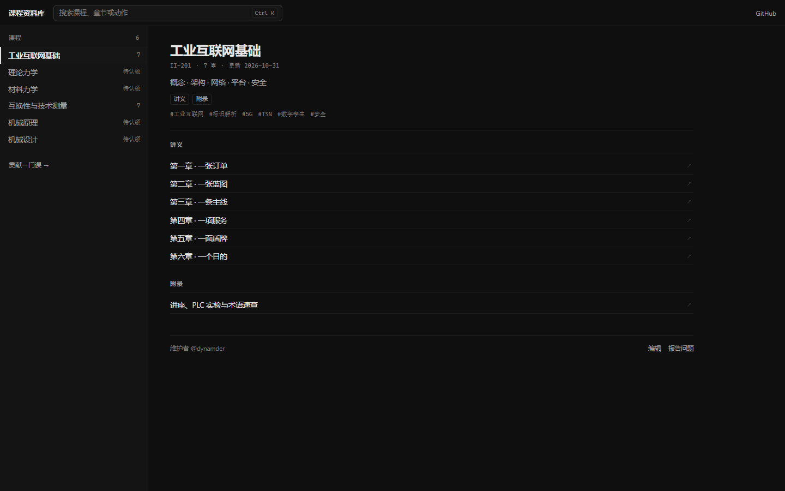

# 课程资料库

按课程组织的复习资料：**每门课是一本独立的 mdbook**，外面套一个用
[Gleam](https://gleam.run/) + [Lustre](https://lustre.build/) 写的门面，负责
在课程之间导航、筛选、跳章节。

- 在线：<https://dynamder.github.io/WHUstre/>
- 当前课程：工业互联网基础、互换性与技术测量
- 门面不渲染正文；正文由每本书自己的 mdbook 负责


## 它长什么样

左边是课程列表，右边是选中课程的目录地图；点任意章节直接进入 mdbook 的对应页。

```
┌──────────────────────────────────────────────────────────────────────┐
│ 课程资料库        [ 搜索课程、章节或动作        Ctrl K ]        GitHub │
├────────────────────┬─────────────────────────────────────────────────┤
│ 课程 6             │  工业互联网基础                                 │
│ ▌工业互联网基础 11 │  II-201 · 11 页 · 更新 2026-10-31               │
│ 互换性与技术测量 7 │  ME-204 · 7 页 · 更新 2026-11-01                │
│  理论力学   待认领 │  机构 · 四杆 · 电机 · 齿轮                      │
│  材料力学   待认领 │  [开始] [讲义] [速查] [真题] [附录]             │
│  机械原理   待认领 │  ─────────────────────────────────────────────    │
│  机械设计   待认领 │  讲义                                           │
│                    │  L1 机构学基础与四杆机构                    ↗   │
│                    │  L2 四杆机构的分析与综合                    ↗   │
│                    │  ...                                            │
└────────────────────┴─────────────────────────────────────────────────┘
```

命令面板把「找东西」和「做动作」收在同一个入口：`Ctrl K` / `⌘K` 打开，
`/` 也可以。里面只有三类结果——**章节、课程、动作**。


深浅色跟随系统，门面和书一起切换（没有单独的开关）：



手机上退化成两屏：课程列表 → 课程地图，返回按钮回到列表。

<p>
  
  
</p>

## 目录结构

```text
.
├── courses/
│   ├── industrial-internet/    # 一门课 = 一本 mdbook
│   │   ├── meta.json           # 门面读：标题、代码、标签、状态、维护者
│   │   ├── book.toml           # mdbook 配置
│   │   ├── theme/              # 与门面对齐的 mdbook 主题 + 返回胶囊
│   │   └── src/
│   │       ├── SUMMARY.md      # 目录（Part 标题决定内容类型）
│   │       ├── ch01.md ...     # 章节
│   │       └── assets/figs/    # 图片
│   ├── mechanics/              # 只有 meta.json 的“待认领”课程
│   └── ...
├── site/                       # Gleam + Lustre 门面
│   ├── src/                    # catalog / data / results / view / ffi
│   ├── public/                 # index.html、styles.css、vendor/mathjax
│   └── scripts/                # esbuild 打包、依赖处理
├── scripts/                    # 构建编排 + 插图脚本
├── docs/                       # 设计文档 + 截图
└── dist/                       # 构建产物（被 .gitignore）
```

## 构建

依赖：

- [Gleam](https://gleam.run/) 1.19+
- [mdbook](https://rust-lang.github.io/mdBook/) 0.5.4
- Node.js 18+

第一次先装门面的依赖：

```bash
cd site
gleam deps download
npm install        # 只为 esbuild
cd ..
```

然后：

```bash
npm run build      # catalog -> mdbook -> gleam -> bundle -> dist/
npm run serve      # http://127.0.0.1:5173/
npm run dev        # build + serve
```

`npm run build` 做四件事：

1. `scripts/gen-catalog.mjs`：扫 `courses/*/meta.json` 和 `src/SUMMARY.md`，
   生成 `catalog.json`（门面在构建期内联，运行时零请求）；
2. 对每门有 `src/SUMMARY.md` 的课执行 `mdbook build`；
3. `site/` 里 `gleam build` + esbuild 打成 `app.js`；
4. `scripts/assemble.mjs` 把门面和所有书组装进 `dist/`。

## 加一门课

1. 建目录 `courses/<slug>/`，写 `meta.json`：

   ```json
   {
     "slug": "mechanics",
     "title": "理论力学",
     "code": "ME-102",
     "summary": "静力学 · 运动学 · 动力学",
     "tags": ["静力学", "运动学"],
     "status": "active",
     "order": 2,
     "maintainers": ["@your-handle"],
     "updated": "2025-10-24"
   }
   ```

   有 `src/SUMMARY.md` 的课会被构建；`status: "planned"` 且没有 SUMMARY 的
   课只出现在门面里，显示“待认领”，主按钮变成 GitHub Issue 认领入口。

2. 写 `book.toml`（可以直接复制 `courses/industrial-internet/book.toml`，改标题和
   `edit-url-template`）。

3. 写 `src/SUMMARY.md`。**Part 标题决定门面里的内容类型标签**：

   | Part | kind | 门面显示 |
   | --- | --- | --- |
   | `# 开始` | `intro` | 开始 |
   | `# 讲义` | `notes` | 讲义 |
   | `# 速查` | `cheatsheet` | 速查 |
   | `# 真题` / `# 练习` | `exam` | 真题 |
   | `# 附录` | `appendix` | 附录 |

   没有 `SUMMARY.md` 的课按“待认领”处理。

4. `npm run build`。门面会自动出现新课程，不需要改 Gleam 代码。

## 交互与 URL

门面只做三件事：选课、筛选、跳章节。所有状态都在 URL 里，**不写任何本地存储**
（没有 localStorage、没有 cookie、没有进度上报）：

| 参数 | 含义 | 例子 |
| --- | --- | --- |
| `?c=<slug>` | 选中的课程 | `?c=industrial-internet` |
| `?q=<text>` | 打开命令面板并带上查询 | `?q=齿轮` |
| `?kind=<kind>` | 只看含某类内容的课程 | `?kind=exam` |

刷新会还原；把链接发给同学，对方看到的是同一屏。关闭面板会清掉 `?q=`。

深浅色跟随系统，门面和书保持一致；没有主题开关（门面不写存储）。

键盘只有四个：`Ctrl K` / `⌘K` / `/` 打开，`↑↓` 选择，`↵` 打开，`Esc` 关闭。
其余动作（只看真题、复制链接、编辑、报告问题、打印）都在命令面板里，不铺快捷键。

更完整的设计说明见 [docs/design.md](docs/design.md)。

## 内容写作

- 章节是 `courses/<slug>/src/*.md`，在 `SUMMARY.md` 里排序
- 图片放 `src/assets/figs/`，Markdown 里写 ``
- 公式用 `$...$` / `$$...$$`；书内使用仓库自带的 MathJax（`site/public/vendor/`），
  不依赖 CDN
- 打印/存 PDF 由 mdbook 自带样式负责
- 书页右下角有一个返回门面的浮动胶囊，由 `theme/course.js` 注入

## 部署

`main` 分支推送到 GitHub Actions，构建 `dist/` 后由 Pages 发布。
仓库 **Settings → Pages → Source** 选 **GitHub Actions** 即可。

## 贡献

见 [CONTRIBUTING.md](CONTRIBUTING.md)。一句话版本：开目录、写 SUMMARY、写
markdown、跑构建；门面会自动收录。
