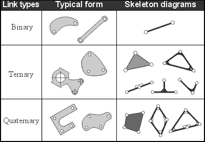
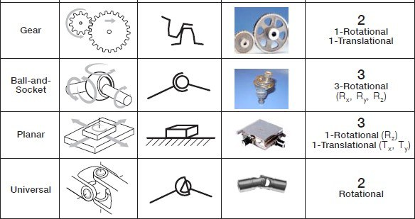
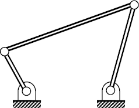
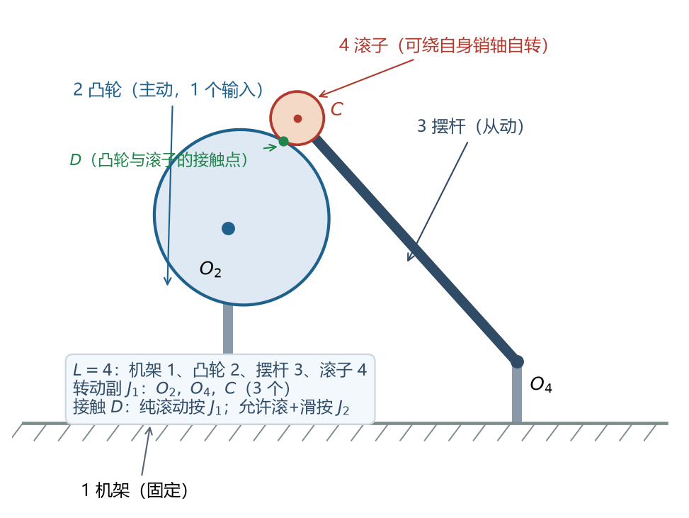
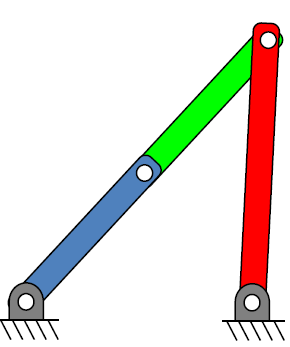
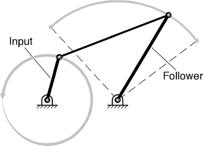
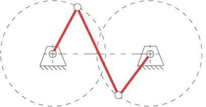
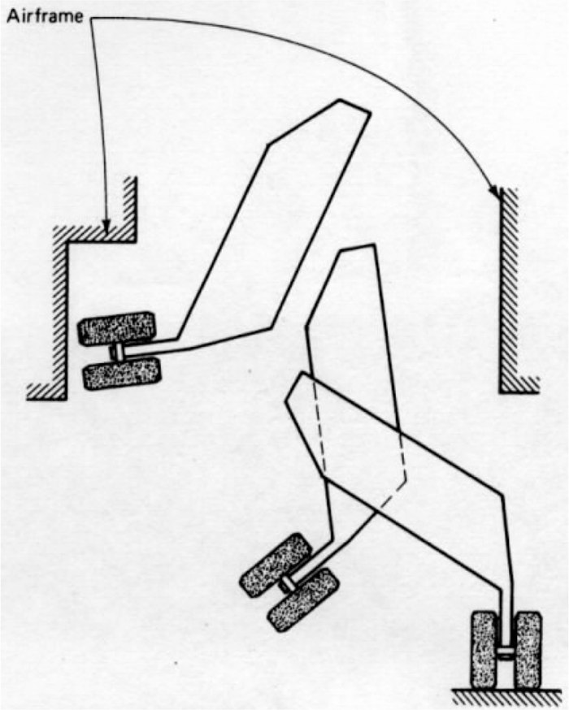
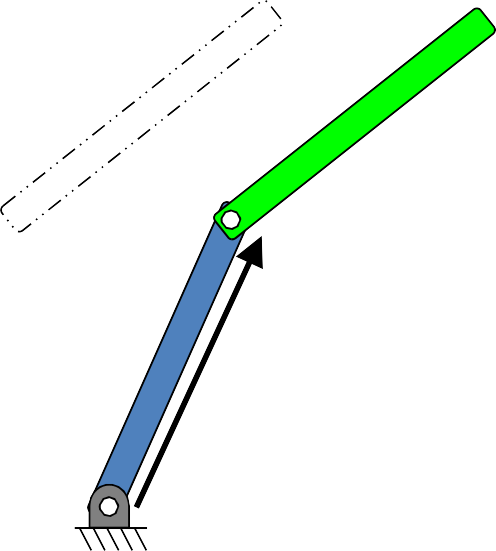

# L1 机构学基础与四杆机构

> **课件结构**（L1_intro_4barLinkage，107 页）：
> 1 **Basics**：运动简图、自由度、连杆机构类型、Grashof 判据
> 2 **Practical skills**：机构分析与设计
>
> 本讲讲"判断"，L2 讲"算"和"设计"。判断类题目（数自由度、判类型、算传动角）几乎必考，而且性价比最高。

---

## 0 课件页码 → 本节

| 课件页 | 内容 | 本节 |
| --- | --- | --- |
| 7–19 | 课程大纲、机构定义、运动简图、构件与运动副、四杆术语 | 1 |
| 20–23 | 传动角、死点/极限位置、许用范围 | 3 |
| 24–27 | 平面机构与空间机构 | 4 |
| 28–40 | Gruebler–Kutzbach 自由度公式、推导、反例 | 2 |
| 41–44 | 六杆机构、五杆机构为什么少见 | 2.6 |
| 45–56 | Grashof 判据、类型、反演、平行四边形 | 5 |
| 57–58 | 四杆机构分析（引出 L2） | 6 |
| 59–75 | 分析 vs 综合、三类综合问题、图解法 | 7 |
| 76–107 | 复数矢量、Cramer 法则、二元组解析综合、计算框架 | 8（详见 L2） |

---

### 0.1 符号表（本讲专用）

| 符号 | 含义 | 单位 |
| --- | --- | --- |
| $a,\ b,\ c,\ d$ | 输入杆 $AB$ / 连杆 $BC$ / 输出杆 $CD$ / 机架 $AD$ 的长度 | mm |
| $L$ | 构件总数（含机架） | — |
| $J_1$ / $J_2$ | 1 自由度副 / 2 自由度副的个数 | — |
| $M$ | 自由度（独立输入数） | — |
| $\theta$ | 曲柄转角（$AB$ 的方位角） | ° |
| $\mu$ | 传动角（课件记 $\mu$，国内教材记 $\gamma$） | ° |
| $\phi$ | 压力角 | ° |
| $\ell_{\min},\ \ell_{\max},\ \ell_p,\ \ell_q$ | Grashof 判据里的最短、最长、另两根杆长 | mm |
| $K$ | 行程速比系数 | — |
| $MA$ | 机械效益 $F_{out}/F_{in}$ | — |
| $P_{ij}$ | 构件 $i$ 与 $j$ 的瞬心（$i,j$ 为构件号） | — |
| $A_1,B_1,C_1,\dots$ | 连杆上的点（动铰 / 精确点） | — |

> 【命名规则】长度只用 $a,b,c,d$（四杆）与 $\ell$ 系列（Grashof 判据）；构件数用大写 $L$，不与长度 $\ell$ 混。传动角统一写 $\mu$。

## 1 机构、构件、运动副、运动简图

### 1.1 机构（mechanism）

【课件】"A mechanism is a device for transferring motion and/or force from a source to an output. In a mechanism, at least one link has been grounded."

- 机构 = 传递运动/力的装置，**至少有一个构件被固定**（机架，ground/frame）。
- 机器的组成：**机构 + 动力（电机）+ 控制/传感**。所以这门课的顺序是：机构（L1–L2）→ 电机与传动（L3）→ 齿轮（L4–L5）。

### 1.2 构件（link）与运动副（joint）

- **构件 link**：至少带两个运动副的刚体（rigid body with at least two joints）。一个构件可以是一个零件，也可以是几个零件固连在一起（如焊成一体）。
- **运动副 joint /  kinematic pair**：两构件之间的可动联接。
- 按接触形式分：**低副（面接触）**——转动副（revolute/pin）、移动副（prismatic/slider）；**高副（点、线接触）**——齿轮啮合、凸轮与从动件、滚子接触。
- 按自由度数分：**J1**（允许 1 个相对自由度）、**J2**（允许 2 个相对自由度，叫"半副"）。

*图 L1-1 构件的类型：二副（binary）、三副（ternary）、四副（quaternary）构件及机构简图画法（L1 课件）*

*图 L1-2 运动副的类型与自由度：齿轮副、球面副、平面副、万向副（L1 课件）*

### 1.3 运动简图（kinematic diagram）

【课件】"We draw kinematic diagrams to reduce mechanisms into a simpler form so we can analyze them."

把真实机器"抽象"成线条和符号：

1. 只保留与运动有关的尺寸（杆长、铰点位置、偏距、半径）；
2. 忽略外形、质量、材料、驱动方式；
3. 转动副画小圆圈，移动副画滑块 + 导轨，机架画斜线。

> 【说明】画简图是自由度计算和位置分析的第一步。考试若给实物图，第一步永远是"先画简图、标号"，这一步本身就有分。

### 1.4 四杆机构的术语（务必按这套记号）

| 符号 | 名称 | 说明 |
| --- | --- | --- |
| 1 | 机架 ground / frame | **永远标 1** |
| 2 | 输入构件 input link（曲柄 crank 或摇杆 rocker） | 未说明时取**左边**那根 |
| 3 | 连杆 coupler | 不直接与机架相连，作平面运动 |
| 4 | 输出构件 follower（摇杆） | 与机架相连的另一根 |
| $a,b,c,d$ | 各杆长度 | 常用 $a=AB$（输入）、$b=BC$（连杆）、$c=CD$（输出）、$d=AD$（机架） |

---

*图 L1-3 四杆机构的四个构件：机架 1、输入 2、连杆 3、从动件 4（L1 课件）*

## 2 自由度：Gruebler–Kutzbach 公式

### 2.1 公式与推导

【课件】

$$M=3(L-1)-2J_1-J_2$$

- $M$：自由度（mobility, DOF），= 完全确定机构位置所需的**独立输入数**；
- $L$：构件总数（含机架）；
- $J_1$：1 自由度运动副的个数；
- $J_2$：2 自由度运动副（半副/高副）的个数。

**推导**（课件第 29 页）：

- 平面内每个自由构件有 3 个自由度（2 个移动 + 1 个转动）；
- 机架不动，减去 1 个构件：$3(L-1)$；
- 每个 $J_1$ 允许 1 个相对自由度、**去掉 2 个**约束；
- 每个 $J_2$ 允许 2 个相对自由度、**去掉 1 个**约束。

所以

$$M=\underbrace{3(L-1)}_{\text{总自由度}}-\underbrace{(2J_1+J_2)}_{\text{总约束数}}$$

> 【考点】2023 期末 Q1 就是按这个思路问的：先数总自由度 $3(L-1)$，再数运动副引入的约束数 $2J_1+J_2$，两者相减。**分开写清楚**，比只写一个 $M$ 更容易拿分。

### 2.2 常见运动副归类

| 运动副 | 类别 | 引入约束 | 例子 |
| --- | --- | --- | --- |
| 转动副 revolute / pin | $J_1$ | 2 | 铰链、轴承（理想） |
| 移动副 prismatic / slider | $J_1$ | 2 | 滑块、导轨、活塞 |
| 齿轮啮合（两轮） | $J_2$ | 1 | 外啮合、内啮合 |
| 凸轮–尖底/滚子从动件 | $J_2$ | 1 | 凸轮机构 |
| 销槽 pin-in-slot | $J_2$ | 1 | 允许转动 + 相对滑动 |
| 纯滚动（无滑动） | $J_2$ | 1 | 滚子、轮子 |

### 2.3 三个必踩的坑（课件 30–33 页）

1. **三个构件共用一个销轴**：必须算成 **2 个 $J_1$**，否则 $M$ 会偏大 2。
   理由：3 个构件在同一销上两两成副，共 2 对。
2. **滑块上带铰链**：滑块本身是**独立构件**，不能把它和连杆看成一个。
3. **销槽是 $J_2$ 不是 $J_1$**：它允许转动 + 滑动两个相对自由度。

### 2.4 例题：把 $M$ 数出来

**(a) 铰链四杆机构**：$L=4$，$J_1=4$，$J_2=0$

$$M=3(4-1)-2\times4-0=1$$

**(b) 曲柄滑块机构**：$L=4$（机架、曲柄、连杆、滑块），$J_1=4$（3 个转动副 + 1 个移动副）

$$M=3(4-1)-2\times4=1$$

**(c) 凸轮 + 滚子摆杆**（三种假设，答案不同，**必须先声明假设**）

*图（自绘）凸轮-滚子摆杆的建模：机架 1、凸轮 2、摆杆 3、滚子 4；接触点 $D$ 的假设不同，$J_1/J_2$ 的记法就不同*

| 假设 | $L$ | $J_1$ | $J_2$ | $M$ |
| --- | --- | --- | --- | --- |
| 滚子与凸轮纯滚动 | 4 | 4 | 0 | 1 |
| 从动件与输出焊成一体（凸轮副允许转+滑） | 3 | 2 | 1 | 1 |
| 凸轮副允许转动 + 滑动（滚子可滑） | 4 | 3 | 1 | 2（含 1 个冗余自由度） |

> 【说明】课件原话："On any cam and follower problems, state your assumptions!"——凸轮题不写假设，答案无法判对。

**为什么同一台机构会有三个答案？** 因为"数几个构件、把接触记成 $J_1$ 还是 $J_2$"是**建模选择**，不是唯一的：

| 行 | 建模选择 | 结果 |
| --- | --- | --- |
| 1 | 滚子是独立构件，且**强制"纯滚动、不滑动"**（把无滑动当成约束） | 4 个构件、4 个各去 2 个约束的副 → $M=1$ |
| 2 | 滚子不再独立（与从动件焊成一体），凸轮直接压在从动件上，接触允许滚+滑 | 3 个构件、2 个 $J_1$ + 1 个 $J_2$ → $M=1$ |
| 3 | 滚子是独立构件，接触只是一般高副（允许滚+滑） | 4 个构件、3 个 $J_1$ + 1 个 $J_2$ → $M=2$ |

- 第 3 行多出来的那个自由度是**滚子绕自身销轴的自转（局部自由度）**：它不影响从动件的运动规律，纯属"空转"。
- 所以把局部自由度剔除后，三行的**有效自由度都是 1**——与"凸轮转 1 圈、摆杆摆 1 次"的物理事实一致。
- 考试写法：先写"滚子为独立构件/与从动件固连"，再写"接触按纯滚动（$J_1$）还是按高副（$J_2$）"，最后才写 $L,J_1,J_2$ 和 $M$。

> 【口径提醒】课件第 35 页把"纯滚动"列在 $J_2$（高副）例子里，而第 40 页的凸轮算例又按 $J_1$ 计（$J_2=0$）。两种口径都能自洽：按高副算会得到 $M=2$，扣掉滚子自转的局部自由度仍是 1。**答题时二选一、写明假设、前后一致**，不要一半按 $J_1$、一半按 $J_2$。

**(d) 五杆机构**：$L=5$，$J_1=5$

$$M=3(5-1)-2\times5=2$$

这就是**五杆机构不常用**的原因：需要两个独立输入（两个电机），控制成本翻倍。

**(e) 带齿轮的五杆机构**：齿轮副提供 1 个约束（$J_2=1$）

$$M=3(5-1)-2\times5-1=1$$

一个输入即可，所以"齿轮五杆"在工程上很常见。

**(f) 六杆机构（Watt / Stephenson 型）**：$L=6$，$J_1=7$

$$M=3(6-1)-2\times7=1$$

【课件】2 个三副构件 + 4 个二副构件共有 **5 种唯一拓扑**：Watt 1、Stephenson 1、Watt 2、Stephenson 2、Stephenson 3。典型应用：假肢膝关节（prosthetic knee）。

### 2.5 $M<0$：预紧结构

$M<0$ 表示"构件太多、约束过剩"，是**预紧结构/桁架**，装不上或产生装配应力。课件第 37 页即此例。

### 2.6 公式失效的两个特例（课件 39 页）

公式只数"拓扑"，不管"几何"，所以特殊尺寸下会算错：

1. $L=5$、$J_1=6$ → 公式给 $M=0$，但若 2、3、4 三杆**平行且等长**，实际能动（瞬时机构）。
2. $L=3$、$J_1=3$（2 个铰 + 1 个纯滚动）→ 公式给 $M=0$，但滚子间距与机架铰位置**精确匹配**时能动。

> 【记忆】"数出来是 0 却能动"＝几何巧合，属于瞬时自由度/冗余约束，考试遇到要写一句"特殊几何配置导致公式失效"。

---

## 3 传动角与死点：力能不能传过去

### 3.1 传动角 $\mu$（国内教材记作 $\gamma$）

【课件】"It is defined as the acute angle between the coupler and the follower."

$$\mu=\angle BCD\ (\text{取锐角})$$

**物理意义**：连杆是二力杆，力沿 $BC$ 方向；把它分解到摇杆上：

$$F_t=F\sin\mu\quad(\text{产生转矩的有效分量}),\qquad
F_r=F\cos\mu\quad(\text{沿摇杆的径向分量，不做功})$$

> **说明**：$\mu$ 越大，同样大小的连杆力能产生越大的转矩 → 传力性能越好。课件用的 $\mu$ 就是国内教材的传动角 $\gamma$；压力角 $\phi$ 满足 $\mu=90^\circ-\phi$。

### 3.2 许用范围与后果

【课件】理想范围：

$$30^\circ\le\mu\le150^\circ$$

传动角太差的三个后果：

- 机构**自锁/卡死**（binds，no motion）；
- 铰链受力过大而**损坏**（关节飞出）；
- **运动方向失控**（从死点出来时不知往哪边走）。

### 3.3 死点与极限位置（toggle positions）

| 共线情况 | 现象 | 说明 |
| --- | --- | --- |
| 输入构件与连杆共线 | **机械效益趋于无穷** | 此时输出速度为零，输入再小的力也能顶住很大的负载；$\mu$ 不一定为 0 |
| 连杆与输出构件共线 | **死点 / 变向点**（change point） | $\mu=0$，力全部沿输出杆，无法产生转矩；从该位置出来时方向不确定 |

> 【坑】"输入与连杆共线"和"连杆与输出共线"是**两种不同的共线**，结论完全不同：前者是"省力到极致"，后者是"动不了"。考试画图时一定要标出是哪两根杆共线。

*图 L1-4 极限位置/死点：输入与连杆共线（或连杆与输出共线）时的位形（L1 课件）*

### 3.4 例题：$\mu_{\min}$ 怎么算（这台机构后面反复用）

$$a=50,\quad b=120,\quad c=100,\quad d=130\ \text{mm}$$

$\mu_{\min}$ 一定出现在**曲柄与机架共线**的两个位置（$BD=|d-a|$ 或 $d+a$）：

$$\cos\angle BCD=\frac{b^2+c^2-BD^2}{2bc}$$

- $BD=d-a=80$：$\cos\angle BCD=\dfrac{120^2+100^2-80^2}{2\times120\times100}=0.75$，$\angle BCD=41.41^\circ$；
- $BD=d+a=180$：$\cos\angle BCD=-0.3333$，$\angle BCD=109.47^\circ$，取补角 $70.53^\circ$。

$$\mu_{\min}=41.41^\circ>[\mu]=40^\circ\quad(\text{合格，但只是压线})$$

> 【说明】一般机械 $[\mu]\ge40^\circ$，高速重载 $[\mu]\ge50^\circ$。这题刚过线，属于"能用但不好"的设计——考试常让你判断"是否需要重新设计"，答案是要，措施是加长机架或调整杆长比。

- 左：$\theta=60^\circ$ 时的位形，$\varphi=89.6^\circ$（与 L2 §1.4 的位置分析结果一致），$\mu=61.4^\circ$；
- 右：传动角随曲柄转角的变化，在曲柄与机架共线处取到最小值 $\mu_{\min}=41.4^\circ$。

> 【说明】画草图时只要画**两个共线位置**（$BD=d-a$ 与 $d+a$）就够了，$\mu_{\min}$ 必在这两处之一。

### 3.5 机械效益（mechanical advantage）

【补充】课件没有给公式，但 2023 期末 Q2 直接考了。

$$MA=\frac{F_{out}}{F_{in}}=\frac{v_{in}}{v_{out}}\quad(\text{虚功原理，忽略损失})$$

- 用转矩写：$MA=\dfrac{T_{out}/r_{out}}{T_{in}/r_{in}}$；
- 用有限位移近似：$MA\approx\dfrac{|\Delta s_{out}|}{|\Delta s_{in}|}$（期末 Q2 就是这么算的：$|Q_i-Q_{i+1}|/|P_i-P_{i+1}|$）；
- **死点附近 $v_{out}\to0$，$MA\to\infty$**；反之输出速度最大的位置 $MA$ 最小。

**为什么是速度比？** 忽略摩擦时输入功 = 输出功：

$$F_{in}v_{in}=F_{out}v_{out}
\quad\Longrightarrow\quad
\frac{F_{out}}{F_{in}}=\frac{v_{in}}{v_{out}}$$

所以"省力"必然"费距离"——杠杆、齿轮、四杆都一样，**没有白得的力**。

**四杆机构的 $MA$ 随位置变化**（还是那台 $a=50,b=120,c=100,d=130$ 的机构，$MA=\dfrac{v_B}{v_C}=\dfrac{\omega_2 a}{\omega_4 c}$）：

| $\theta$ | 0° | 30° | 60° | 90° | 120° | 150° | 180° | 210° | 240° | 270° | 300° | 330° |
| --- | --- | --- | --- | --- | --- | --- | --- | --- | --- | --- | --- | --- |
| $\lvert MA\rvert$ | 0.80 | 4.96 | 1.67 | 1.07 | 1.01 | 1.17 | 1.80 | 4.77 | 9.45 | 2.37 | 1.20 | 0.75 |

- 这台机构的两个**极限位置**（摇杆速度为零）在 $\theta\approx35.9^\circ$ 与 $229.6^\circ$，那里 $MA\to\infty$；
- 中间段 $MA\approx1\text{–}2$：曲柄转 1 圈、摇杆只转 0.3 圈的同时，力放大 1.7 倍左右；
- 符号只表示方向（摇杆回程时 $\omega_4$ 反号），比较"放大几倍"取绝对值。

> 【区分】$MA$ 是**纯运动学量**（忽略摩擦的理想放大倍数）；**效率**是"输出功/输入功"，含摩擦损失。$MA$ 大的位置（接近死点）效率往往并不高，因为杆件内力很大、摩擦损失也大。

> 【坑】$MA$ 可以小于 1（增速机构，如自行车高速挡），它只描述"力与速度的交换比例"，不表示机构好坏。

---

## 4 平面机构与空间机构

【课件】

- **平面机构（planar）**：所有构件在**互相平行的平面**内运动；
- **空间机构（spatial）**：至少有一个构件不平行于同一平面运动。

例子：折叠童车、可翻转沙发床、汽车转向梯形（空间）都是空间机构。本课程只算平面机构的自由度，空间机构只需知道定义与例子。

---

## 5 Grashof 判据与四种基本型式

### 5.1 判据

【课件】设 $\ell_{\min}$ 最短杆、$\ell_{\max}$ 最长杆、$\ell_p,\ell_q$ 为另外两杆：

$$\ell_{\min}+\ell_{\max}<\ell_p+\ell_q\quad\Longrightarrow\quad\text{Grashof 机构（至少有一杆能整周回转）}$$

| 关系 | 名称 | 结论 |
| --- | --- | --- |
| $\ell_{\min}+\ell_{\max}<\ell_p+\ell_q$ | Grashof | 至少一个构件可相对机架整周回转（有曲柄） |
| $\ell_{\min}+\ell_{\max}=\ell_p+\ell_q$ | 变向点机构（change point） | 形式上是 Grashof，但存在"不确定位置/折叠位置" |
| $\ell_{\min}+\ell_{\max}>\ell_p+\ell_q$ | 非 Grashof | 任何构件都不能整周回转（双摇杆） |

### 5.2 判定流程（30 秒）

1. 四个长度排序，找出 $\ell_{\min}$ 和 $\ell_{\max}$；
2. 算 $\ell_{\min}+\ell_{\max}$ 与 $\ell_p+\ell_q$ 比较；
3. 若满足 Grashof，再看**最短杆坐哪把交椅**：

| 最短杆是 | 机构类型 | 英文 |
| --- | --- | --- |
| 连架杆（与机架相连） | **曲柄摇杆** | crank-rocker |
| 机架 | **双曲柄**（拖动机构） | double-crank / drag-link |
| 连杆 | **双摇杆** | double-rocker |

*图 L1-5 曲柄摇杆机构：输入曲柄整周回转，从动摇杆往复摆动（虚线为极限位置的圆弧）（L1 课件）*

> 【坑 1】题目只说"四杆长度"，必须说明"以哪根为机架"，否则类型不唯一。
> 【坑 2】不满足 Grashof 时，无论最短杆在哪，都是**双摇杆**。

### 5.3 反演（kinematic inversion）

【课件】"A kinematic inversion is created by grounding a different link... The relative motion between the links is the same in all inversions, while the absolute motion is different."

- 换一个构件当机架，**相对运动规律不变**，但**绝对运动（轨迹、摆角、行程）改变**；
- 同一副四杆可以反演出：曲柄摇杆、双曲柄、双摇杆、曲柄摇杆 #2；
- 曲柄滑块、导杆机构、摇块机构、定块机构都是四杆的**演化**（改变杆长或取不同构件为机架），不是新机构。

### 5.4 变向点与平行四边形（课件 51–54 页）

- $\ell_{\min}+\ell_{\max}=\ell_p+\ell_q$ 时，机构经过"变向点"（change point）时**装配形式不确定**，可能翻到另一支路（折叠位置）。
- **平行四边形机构**：两连架杆等长、连杆与机架等长 → 连杆始终平行于机架，两连架杆同步整周回转。
- **反平行四边形（anti-parallelogram）**：经过变向点后翻到交叉装配，是典型的变向点机构，工程上要靠错列相位或加惯性/辅助杆来避免。

*图 L1-6 平行四边形与反平行四边形：经过变向点后翻到交叉装配（L1 课件）*

### 5.5 例题

$$1.0,\ 2.4,\ 2.4,\ 3.4\ \text{m}$$

$$\ell_{\min}+\ell_{\max}=1.0+3.4=4.4<2.4+2.4=\ell_p+\ell_q=4.8\quad\Rightarrow\quad\text{Grashof}$$

- 若 $1.0$ 为机架 → **双曲柄**；
- 若 $1.0$ 为连架杆 → **曲柄摇杆**；
- 若 $1.0$ 为连杆 → **双摇杆**。

【课件例题 #2】把两根杆互换，**杆长集合不变**，所以仍然是 Grashof，**只是类型可能改变**——这正是"最短杆位置决定类型"的最好例子。

---

## 6 分析与综合（analysis vs synthesis）

【课件】

- **分析 Analysis**："Given this mechanism, calculate the mechanical advantage, velocity of point P, etc."
- **综合/设计 Synthesis**："Design a mechanism to satisfy these objectives."

三类综合问题（必背，简答题常考）：

| 类型 | 要求 | 典型提法 |
| --- | --- | --- |
| **轨迹生成** path generation | 连杆上一点走过给定曲线 | 不要求姿态、不要求时间对应 |
| **刚体导引** motion generation | 连杆依次到达若干**位置 + 姿态** | 给 2 或 3 个位置 |
| **函数生成** function generation | 输入角与输出角满足给定函数关系 | 给若干对 $(\theta_i,\varphi_i)$ |

> 【说明】L2 的图解法/解析法主要解决前两类；函数生成在 L2 末尾用 Freudenstein 方程补充。

---

## 7 图解法综合（L1 后半 + L2 前半）

### 7.1 两个位置：中垂线法（perpendicular bisector）

已知连杆两个位置 $A_1B_1$、$A_2B_2$，求固定铰 $A_0,B_0$：

1. 连 $A_1A_2$，作其中垂线（PB）；
2. 在中垂线上任取一点作为 $A_0$；
3. 对 $B_1B_2$ 同样操作得 $B_0$；
4. 连 $A_1A_0$、$B_1B_0$ 即得两连架杆。

**术语**（课件 69 页）：

- $A_1$ 是**圆点（circle point）**：它绕 $A_0$ 作圆弧运动；
- $A_0$ 是**圆心点（center point）**：固定铰；
- 两条中垂线的交点 $P_{12}$ 叫**转动极点（rotopole）**：把连杆在该点铰接到机架上，也能实现同样的两位姿运动。

### 7.2 三个位置：两中垂线交点

3 个不共线点唯一确定一个圆，所以：

1. 作 $A_1A_2$、$A_1A_3$ 的中垂线，**交点**即 $A_0$；
2. 对 $B$ 点同样操作得 $B_0$；
3. 连 $A_1A_0$、$B_1B_0$ 得机构。

> 【说明】作图题要**保留作图线**（课件原话：show your work, do not erase your construction lines），并把 $A_0,B_0$ 落在题目给的"机架允许区域"内。

*图 L1-7 刚体导引的三个位置：机架铰必须落在允许的机身区域内（L1/L2 课件，期末 Q4 同类题）*

### 7.3 自由选择数（考点）

| 给定位置数 | 每侧自由选择 | 总数 | 来源 |
| --- | --- | --- | --- |
| 2 个位置 | 3 | 6 | 动铰坐标 $(x,y)$ 2 个 + 固定铰在中垂线上的位置 1 个 |
| 3 个位置 | 2 | 4 | 动铰坐标 $(x,y)$ 2 个 |

### 7.4 图解法的困难 → 为什么要解析法

- 全靠"线画得直不直、垂不垂直"，精度取决于手；
- 每次迭代都要重画，很慢；
- 有 4–6 个自由选择，需要反复试。

所以课件紧接着讲**解析（代数）综合**。

---

## 8 解析综合的数学准备（为 L2 铺垫）

### 8.1 复数矢量

$$e^{i\theta}=\cos\theta+i\sin\theta\quad(\text{Euler 公式})$$

向量 $\vec W=w\,e^{i\phi}$；**乘 $e^{i\beta}$ 等于逆时针转 $\beta$**：

$$\vec W_j=w\,e^{i(\phi+\beta_j)}=\vec W\,e^{i\beta_j}$$

*图 L1-8 乘 $e^{i\beta}$ 等于把向量逆时针转 $\beta$（L1 课件）*

### 8.2 Cramer 法则

$$\begin{vmatrix}a&b\\c&d\end{vmatrix}=ad-bc$$

$$\begin{bmatrix}a&b\\c&d\end{bmatrix}\begin{bmatrix}x\\y\end{bmatrix}=\begin{bmatrix}e\\f\end{bmatrix}
\ \Longrightarrow\ 
x=\frac{ed-bf}{ad-bc},\quad y=\frac{af-ec}{ad-bc}$$

要求：**方阵 + 满秩**（行列式不为 0）。

> 【说明】解析综合里所有"解线性方程组"的步骤，本质都是 Cramer 法则；MATLAB 里就写成 `det(A)/det(C)`。

---

## 9 这一讲可以"带过"的内容

以下只在选择题/名词题里出现，记住一句话即可：

- **柔顺机构（compliant mechanism）**：用弹性变形代替铰链，零刚度/双稳态结构；
- **微型机构**、可重构机构：MEMS 与变体结构；
- **着陆架、折叠童车、沙发床**：空间机构/多杆机构的应用实例；
- **纸板机构设计**：课堂动手练习，不考。

---

## 10 易错点清单

1. 数自由度时，**三个构件共销 = 2 个 $J_1$**；滑块带铰链时滑块算独立构件。
2. 高副（齿轮、凸轮、纯滚动、销槽）是 $J_2$，只去掉 1 个约束。
3. 凸轮题**必须先声明假设**，否则 $M$ 不唯一。
4. $M<0$ 是预紧结构；$M=0$ 但能动是**特殊几何**，要注明公式失效。
5. 传动角是**连杆与输出杆**的夹角（取锐角），不是压力角。
6. $\mu_{\min}$ 在**曲柄与机架共线**的两个位置取小，两个都要算。
7. Grashof 判据是 $\ell_{\min}+\ell_{\max}\le\ell_p+\ell_q$，不是"任意两边之和大于第三边"。
8. 类型由**最短杆的位置**决定；不满足 Grashof 一律双摇杆。
9. 反演改变绝对运动，不改变相对运动。
10. 图解法两个位置的自由选择是 6 个，三个位置是 4 个。

---

## 11 自测（5 分钟）

1. 机构 $L=6$、$J_1=7$、$J_2=0$，求 $M$，并说出总自由度与总约束数。
2. 三个构件在同一销轴上，若只记 1 个 $J_1$，算出的 $M$ 会偏大多少？
3. $a=40,b=90,c=70,d=80$，判断类型（已知 $a$ 为连架杆、$d$ 为机架）。
4. 上题中求 $\mu_{\min}$，并判断是否满足 $[\mu]=40^\circ$。
5. 为什么"输入与连杆共线"时机械效益趋于无穷，而"连杆与输出共线"时机构动不了？

> 答案见《08 模拟卷答案》附录。
