# L3 电机与传动（Transmission, Gears, and Belts）

> **课件结构**（L3_motor_transmission，90 页）：
> 1 为什么需要传动 → 2 直流电机模型（转矩–转速直线、功率、效率）→ 3 传动比与电机选型
> 4 齿轮类型 → 5 渐开线与齿轮术语 → 6 轮系（简单/复合/行星）→ 7 谐波、CVT → 8 带与链
>
> 这一讲是全课程**计算量最大**的一讲，期末 Q5、Q6、Q8、Q9 都从这里出。核心只有一条直线和一个传动比。

---

## 0 课件页码 → 本节

| 课件页 | 内容 | 本节 |
| --- | --- | --- |
| 1–29 | 为什么传动、直流电机模型、功率、效率、电机选型 | 1–3 |
| 30–35 | 传动的功能块、实例 | 3 |
| 36–53 | 齿轮类型、渐开线、压力角、间隙、基本参数 | 4–5 |
| 54–65 | 简单/复合轮系、惰轮、差速器 | 6 |
| 66–80 | 行星轮系、杠杆类比、算例 | 7 |
| 81–85 | 谐波减速器、CVT | 8–9 |
| 86–90 | 带与链 | 10 |

---

### 0.1 符号表（本讲专用，先看再往下读）

| 符号 | 含义 | 单位 |
| --- | --- | --- |
| $V_s$ | 供电电压 | V |
| $I$ | 电枢电流 | A |
| $R_a$ | 电枢电阻 | $\Omega$ |
| $E$ | 反电动势 | V |
| $K_T$ | 转矩常数 | N·m/A |
| $K_b$ | 反电动势常数 | V·s/rad |
| $k_m$ | 机械特性斜率 $K_TK_b/R_a$ | N·m·s/rad |
| $T_m$ / $T_L$ / $T_s$ | 电机转矩 / 负载转矩 / 堵转转矩 | N·m |
| $\omega$ / $\omega_0$ | 角速度 / 空载角速度 | rad/s |
| $n$ | 转速 | rpm |
| $P$ | 功率 | W |
| $\eta$ | 效率 | — |
| $u$ | 传动比 | — |
| $m$ | 模数 | mm |
| $z$ | 齿数（$z_1,z_2$；行星 $z_s,z_p,z_r$；谐波 $z_g,z_f$） | — |
| $P_d$ | 径节（英制） | 1/in |
| $p_c$ | 周节 | mm |
| $d$ / $d_a$ / $d_f$ / $d_b$ | 分度圆 / 齿顶圆 / 齿根圆 / 基圆直径 | mm |
| $a_w$ | 标准中心距 | mm |
| $\phi$ | 压力角 | ° |
| $h_a$ / $h_f$ / $h_c$ | 齿顶高 / 齿根高 / 顶隙 | mm |
| $\varepsilon_\alpha$ | 重合度 | — |
| $\omega_s,\omega_p,\omega_r,\omega_c$ | 太阳轮 / 行星轮 / 齿圈 / 系杆的角速度 | rad/s |
| $u_h$ | 谐波传动比 | — |

> 【命名规则】课件里同一个字母干好几件事：$N$ 既表示传动比又表示齿数，$P$ 既表示功率又表示径节，$S,P,R$ 表示太阳/行星/齿圈的**齿数**。本文统一为：**传动比 $u$、齿数 $z$、径节 $P_d$、太阳/行星/齿圈齿数 $z_s,z_p,z_r$**——和课件对照时按这四个替换读即可。

## 1 为什么需要传动

【课件】发动机 $800\text{–}6000$ rpm，车轮 $0\text{–}2000$ rpm。传动要做三件事：**改转速、改方向、改位置**。

功能块：

$$P_{in}\ \longrightarrow\ \boxed{\text{Transmission}}\ \longrightarrow\ P_{out},\qquad P_{out}=P_{in}-\text{losses}$$

- 机械功率 $P=T\omega$；理想传动**功率不变**，所以转矩与转速成反比；
- 实际传动有摩擦、打滑、发热，效率 $\eta<1$，这就是"用传动的代价"。

---

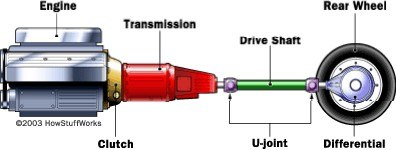

*图 L3-1 发动机→离合器→变速器→传动轴→差速器→车轮：转速与转矩要经过传动才能匹配（L3 课件）*

## 2 直流电机模型（本讲的地基）

### 2.1 三个基本关系

$$E=K_b\,\omega\quad(\text{反电动势}),\qquad
T=K_T\,I\quad(\text{电磁转矩}),\qquad
V_s=E+I R_a\quad(\text{电枢回路})$$

- $V_s$：供电电压；$R_a$：电枢电阻；$I$：电枢电流；
- $K_T$：转矩常数（N·m/A 或 mNm/A）；$K_b$：反电动势常数（V·s/rad 或 V/rpm）；
- 【要点】在**同一套单位制**下（SI），数值上 $K_T=K_b$；但工程数据表常把 $K_b$ 写成"rpm/V"，此时 $K_b[\text{V·s/rad}]=60/(2\pi K_n)$，其中 $K_n$ 是转速常数（rpm/V，数据表里那一行）。

### 2.2 机械特性：一条直线

联立三式消去 $E,I$：

$$T_m=\frac{V_sK_T}{R_a}-\frac{K_TK_b}{R_a}\,\omega$$

【课件】即

$$\boxed{\ T_m=T_s\left(1-\frac{\omega}{\omega_0}\right)\ }$$

| 特征点 | 表达式 | 含义 |
| --- | --- | --- |
| 堵转转矩（stall torque） | $T_s=\dfrac{V_sK_T}{R_a}$ | $\omega=0$，启动瞬间 |
| 空载转速（no-load speed） | $\omega_0=\dfrac{V_s}{K_b}$ | $T=0$ |
| 斜率 | $-\dfrac{K_TK_b}{R_a}$ | 由电机本体决定，**与电压无关** |
| 堵转电流 | $I_s=\dfrac{V_s}{R_a}$ | 只由电阻决定，通常是额定电流的数倍 |

> 【说明】升压时整条直线**平行右移**（斜率不变）；所以"调压调速"改变的是空载转速，不改变电机的"硬度"。

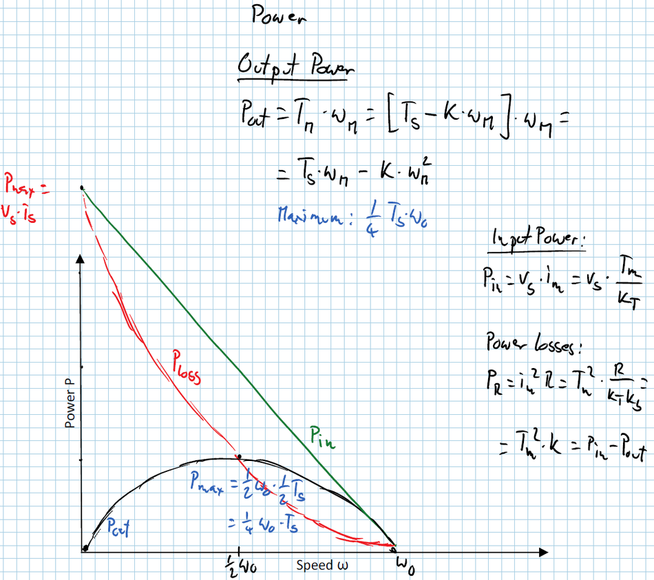

*图 L3-2 电机 $T-\omega$ 直线、功率 $P=T\omega$ 抛物线与负载线的交点（课件手绘原图）*

### 2.3 功率、效率、最大功率点

$$P_{out}=T\omega,\qquad P_{in}=V_sI,\qquad \eta=\frac{P_{out}}{P_{in}}$$

理想情况（忽略铁耗、摩擦）：

$$\eta=\frac{T\omega}{V_sI}=\frac{K_TI\,\omega}{V_sI}=\frac{K_b\omega}{V_s}=\frac{\omega}{\omega_0}$$

**效率 = 转速比**：转速越低，效率越低；堵转时效率为 0，全部电能变成 $I^2R_a$ 的热。

最大功率点（抛物线顶点）：

$$\omega=\frac{\omega_0}{2},\qquad T=\frac{T_s}{2},\qquad
P_{\max}=\frac{T_s\omega_0}{4}=\frac{V_s^2}{4R_a}$$

此处效率只有 50%，所以"最大功率点"≠"最高效率点"。

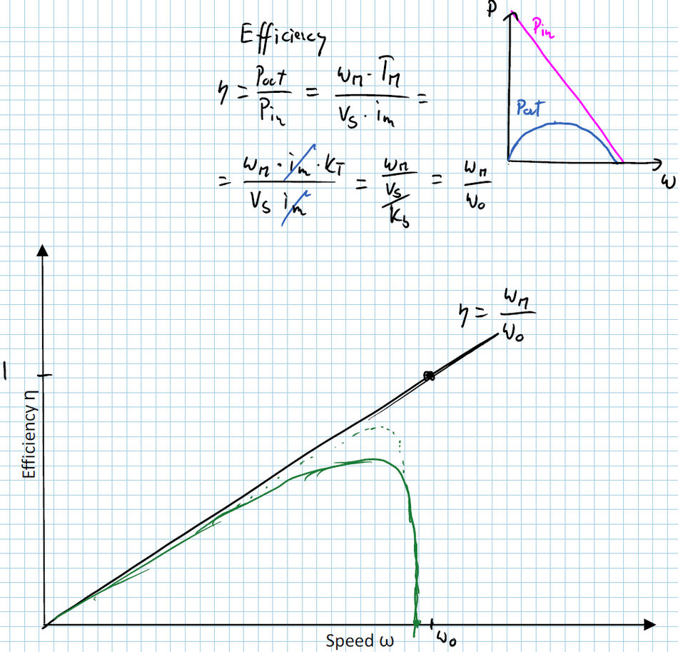

*图 L3-3 效率曲线：$\eta=P_{out}/P_{in}=\omega/\omega_0$，高速段效率高、低速大转矩段效率低（课件手绘原图）*

### 2.4 极限在哪里（课件 17–18 页）

| 限制 | 后果 |
| --- | --- |
| 电流过大 | 绕组过热、绝缘损坏（电气烧毁） |
| 转速过高 | 轴承损坏、电刷打火、振动、离心力（导线甩出） |
| 长时间堵转 | $I^2R_a$ 全部发热，几分钟就烧 |

### 2.5 例题：电机 118701 + 负载线（课件 15 页原题）

maxon RE16 数据表（12 V 那一列）：$n_0=7130$ rpm，$T_s=18.6$ mNm，$R_a=10.3\ \Omega$，$K_T=16$ mNm/A，转速常数 597 rpm/V，额定 5.48 mNm / 5030 rpm。

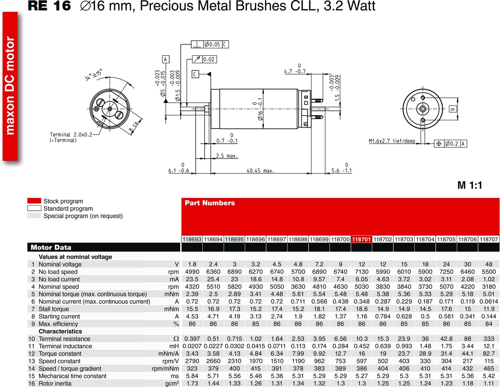

*图 L3-4 maxon RE16 数据表（118701 那一列：12 V、7130 rpm、18.6 mNm、10.3 Ω、16 mNm/A）（L3 课件）*

换成 SI：

$$K_T=0.016\ \text{N·m/A},\qquad
\omega_0=\frac{2\pi\times7130}{60}=746.6\ \text{rad/s},\qquad
K_b=\frac{12}{746.6}=0.01607\ \text{V·s/rad}$$

负载线（课件）：$T_L=2+0.001\omega$ mNm。

**(1) 标称电压 12 V 时的工作点**

$$T_s=\frac{12\times0.016}{10.3}=18.64\ \text{mNm},\qquad
\text{斜率}=\frac{K_TK_b}{R_a}=0.02497\ \text{mNm/(rad/s)}$$
$$18.64-0.02497\,\omega=2+0.001\,\omega
\quad\Longrightarrow\quad
\omega=640.7\ \text{rad/s}=6119\ \text{rpm}$$

此时 $T=2.64$ mNm，$P_{out}=1.69$ W，$\eta\approx\omega/\omega_0=86\%$（与数据表 86% 吻合）。

**(2) 想把转速调到 3000 rpm，需要多少电压？**

$\omega=314.16$ rad/s 时 $T_L=2+0.314=2.314$ mNm，由 $T=\dfrac{V_sK_T}{R_a}-\dfrac{K_TK_b}{R_a}\omega$ 反解：

$$V_s=\frac{T R}{K_T}+K_b\omega
=\frac{2.314\times10^{-3}\times10.3}{0.016}+0.01607\times314.16
=1.49+5.05=6.54\ \text{V}$$

> 【说明】这就是课件那句"You don't have to use the provided nominal voltage"的量化含义：**降压就能降速**，只要不超电流/转矩上限。

### 2.6 对照例：$T-\omega$ 图上的两个工作点

另一台电机：$V_s=24$ V、$n_0=8000$ rpm、$R_a=1\ \Omega$、$K_T=K_b=0.02865$ N·m/A。

$$T_s=\frac{0.02865\times24}{1}=0.688\ \text{N·m},\qquad
\omega_0=\frac{2\pi\times8000}{60}=837.8\ \text{rad/s},\qquad
\text{斜率}=\frac{K_TK_b}{R_a}=8.21\times10^{-4}$$

- **恒转矩负载** $T_L=0.30$ N·m：$0.30=0.688-8.21\times10^{-4}\omega$ → $\omega=472$ rad/s $=4509$ rpm；
- **风机负载** $T_L=2.5\times10^{-6}\omega^2$：解二次方程得 $\omega=385$ rad/s $=3680$ rpm。

> 【说明】同一个电机，负载类型不同，工作点就不同：风机负载的工作点更低、电流更大、效率更低。**"电机发烫"往往不是电机坏了，是工作点选错了。**

### 2.7 哪台电机更好（课件 20–22 页）

两条 $T-\omega$ 线比较，看两个指标：

- **速度调节率（speed regulation）**：负载有 $\Delta T$ 的扰动时，转速跌落
  $$\Delta\omega=\frac{\Delta T}{|k_m|}=\Delta T\,\frac{R_a}{K_TK_b}$$
  所以 **$R_a/(K_TK_b)$ 越小越好**——在 $T$–$\omega$ 图（横轴 $\omega$）上，这对应**直线越陡越好**（$|k_m|=K_TK_b/R_a$ 越大）。
- **损耗**：同样工作点下，$I^2R_a$ 越小越好 → 同样要求 $K_T$ 大、$R_a$ 小。

【课件】"Let's make $K$ as large as possible"——这里的 $K$ 是电机的"单位转速能出多大力"，即 $K_T$（转矩常数）；$K_T$ 大意味着磁钢强、绕组多，代价是贵、重。

> 【术语与方向】"机械特性硬"= 转速几乎不随转矩变 = 图上接近**竖直**（陡）；"软"= 平。**越硬（越陡）调节率越好**，别被"平"字带偏：平直的线意味着负载一变、转速就大幅跌落。
>
> 【与效率一致】理想效率 $\eta=\dfrac{1}{1+T R_a/(K_T^2\omega)}$：$R_a$ 小、$K_T$ 大都让效率升高——和"越陡越好"是同一个方向。所以"好电机"的三个说法（$K_T$ 大、$R_a$ 小、特性陡）其实是一件事。
>
> 【验算】$K_T=K_b=0.02865$、$R_a=1\ \Omega$ 时 $k_m=8.2\times10^{-4}$；$R_a=3\ \Omega$ 时 $k_m=2.7\times10^{-4}$。负载扰动 $\Delta T=0.1$ N·m：前者 $\Delta\omega=122$ rad/s，后者 $366$ rad/s——**陡的那个跌落小**。

### 2.8 负载线 $T_L(\omega)$ 是从哪来的

**负载线是被驱动机械的稳态转矩–转速特性，跟电机无关。** 电机线是"电机能给出什么"，负载线是"负载需要多少"，两条线的交点才是工作点。

工程上通常写成多项式，每一项对应一种物理机制：

$$T_L(\omega)=T_0+k_v\omega+k_q\omega^2+\frac{P_{\text{proc}}}{\omega}$$

| 项 | 物理来源 | 典型负载 |
| --- | --- | --- |
| $T_0$ | 库仑摩擦、预紧、重力 | 轴承/密封、提升重物、传送带 |
| $k_v\omega$ | 粘性摩擦（油膜剪切、涡流） | 润滑良好的轴系、磁粉制动器 |
| $k_q\omega^2$ | 流体/气动阻力 | 风机、离心泵、螺旋桨 |
| $P_{\text{proc}}/\omega$ | 恒功率工艺 | 卷绕、机床主轴 |

课件里的 $T_L=2+0.001\omega$（mNm，$\omega$ 用 rad/s）就是"$2$ mNm 静摩擦 $+$ 粘性项"的**线性化**——工程上多数场合只取前两项。

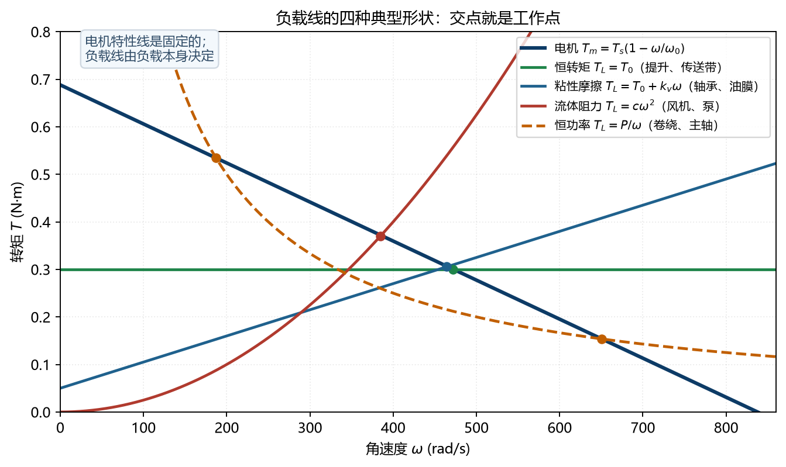

*图（自绘）四种典型负载线与同一条电机特性线的交点；恒功率负载有两个交点，只有高速那个稳定*

**这三类来源怎么得到？**

1. **实测**：测功机加载、或自由停车法测减速度（$T=J\dot\omega$）；
2. **由机构算**：$T_L=F\cdot r$，$F$ 来自摩擦、重力、切削力——例：提升 $m=2$ kg、卷筒半径 $r=20$ mm，则 $T_0=mgr=2\times9.81\times0.02=0.392$ N·m；再加轴承粘性 $k_v=2\times10^{-4}$ N·m·s/rad；
3. **由工艺曲线拟合**：给一组 $(\omega_i,T_i)$ 数据，最小二乘拟合上式。

**折算到电机轴（加了减速器之后）**：

$$T_m(\omega_m)=\frac{T_L(\omega_m/u)}{u\,\eta}$$

所以常数项被压缩 $u\eta$ 倍、$k_v\omega$ 项被压缩 $u^2\eta$ 倍（因为 $\omega$ 也变成 $\omega_m/u$）。上例加 $u=10$、$\eta=0.9$ 后：$T_m=43.6+2.22\times10^{-6}\omega_m$ mNm——**负载线在电机坐标下变平了**，这正是减速器"让电机跑在高速小转矩区"的数学表现。

**工作点与稳定性**：

$$T_m(\omega)=T_L(\omega),\qquad
\text{稳定} \iff \frac{dT_L}{d\omega}>\frac{dT_m}{d\omega}$$

恒功率负载 $T_L=P/\omega$ 的斜率是 $-P/\omega^2$：低速交点处的斜率比电机线**更负**（$|dT_L/d\omega|$ 更大）→ **不稳定**；高速交点才稳定。

> 【期末概念题（2023 Q5）】"负载线由谁决定？"——**负载（洗衣机）**，不是电机也不是减速器。减速器只改变它在电机坐标下的斜率与截距，不改变它的物理来源。

> 【考场识别】题目给负载线通常有三种方式：① 直接给公式 $T_L=A+B\omega$；② 给两点或表格，让你拟合；③ 给负载的物理描述（质量、卷筒半径、摩擦系数、风阻系数），让你自己算 $T=F\cdot r$。**如果既没给、也无法从描述算出，就写"设 $T_L=T_0+k_v\omega$"并在卷面声明假设**——阅卷看的是你知不知道该由负载决定。
>
> 【两个容易踩的点】① 看清负载线是给在**负载端**还是**电机端**："external load line" 一般指负载端，代进公式前要先按 $T_m=T_L/(u\eta)$ 折算；② 若负载是连杆/凸轮机构，$T_L$ 随转角周期性变化，**不是一条直线**——选电机要用一周期的**均方根转矩**（发热判据）和**峰值转矩**（能力判据）两个指标。

---

## 3 传动比与电机选型

### 3.1 传动比的定义（课件 24 页）

**传动比是运动学量**（由齿数/半径决定，与损失无关）：

$$u=\frac{\omega_m}{\omega_o}=\frac{r_o}{r_m}\quad(\text{恒成立})$$

只有在**无损失**（$\eta=1$）时，功率守恒才给出转矩关系 $T_o/T_m=u$；有损失时：

$$P_o=\eta P_i\quad\Longrightarrow\quad T_o\omega_o=\eta\,T_m\omega_m\quad\Longrightarrow\quad T_o=u\eta\,T_m$$

即 **转矩比 $T_o/T_m=u\eta$，不等于 $u$**。$m$ 表示电机侧（motor），$o$ 表示输出侧（output）。

| 传动比 | 转速 | 转矩（理想 $\eta=1$） | 转矩（实际） |
| --- | --- | --- | --- |
| $u=2$ | 减半 | 翻倍 | $2\eta$ 倍 |
| $u=1$ | 不变 | 不变 | $\eta$ 倍 |
| $u=0.5$ | 加倍 | 减半 | $0.5\eta$ 倍 |

一般形式：

$$\omega_o=\frac{\omega_m}{u},\qquad T_o=u\,\eta\,T_m$$

### 3.2 为什么不直接升压？

【课件】"Why transmission? Why not just control $V_s$?" 答案：**Heat $=i^2R$**。

- 要低速大转矩，靠降压 → 电流很大 → 铜耗按平方增长、散热困难、效率极低；
- 用减速器：电机仍工作在高速小转矩的高效区，由减速器把"高速小转矩"换成"低速大转矩"；
- 代价：减速器本身有效率损失（行星 0.9–0.97，谐波 0.7–0.85，蜗杆 0.4–0.8）。

### 3.3 电机选型两步（课件 26–27 页）

**第一步：定需求**

- 力/功率需求、能源形式、成本、是否需要速度/位置闭环、开环还是闭环；
- 算出各工作点的 $P,\omega,T$，画到 $T-\omega$ 图上（开环只能取一个工作点）；
- **单位统一**。

**第二步：选型与迭代**

- 用"最大转矩 × 最大转速"估功率等级，按供电电压选电机类型；
- 选减速器把转矩放大到需求；
- 迭代校验：启动瞬态、动态过程、减速器额定转矩、效率、惯量比；
- 效率优先时：**大电机 + 小减速比**更好；同尺寸下 $K_T$ 大的电机效率高但更贵；
- 很多参数只能离散取值（齿数、电压档位）。

### 3.4 其他因素（课件 28 页）

成本、功率等级与形式、环境（温度/湿度/光照）、鲁棒性（冲击/振动）、寿命（疲劳/磨损/保修/复杂度）、体积重量、噪声、成熟度、供货。

---

## 4 齿轮传动类型

【课件】齿轮："a component within a transmission device that transmits rotational torque by applying a force to the teeth of another gear."

| 类型 | 轴的关系 | 特点 | 典型用途 |
| --- | --- | --- | --- |
| **直齿圆柱齿轮 spur** | 平行轴 | 最常用；转向相反；$T_{in}\omega_{in}\approx T_{out}\omega_{out}$ | 一般减速器 |
| 斜齿圆柱 helical | 平行轴 | 啮合平稳、噪声小、承载高；有轴向力 | 高速、重载 |
| 锥齿轮 bevel | 相交轴 | 改变 90° 转向 | 差速器、手电钻 |
| 蜗轮蜗杆 worm | 交错轴（90°） | 减速比大、转矩放大明显；效率低；**只能蜗杆带蜗轮**（自锁） | 卷扬、分度 |
| 齿条齿轮 rack & pinion | 转动 ↔ 直线 | 把旋转变成直线运动 | 龙门机器人、转向器 |

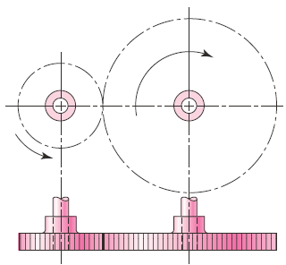

*图 L3-5 直齿外啮合：分度圆相切，两轮转向相反（L3 课件）*

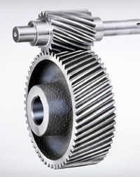

*图 L3-6 斜齿轮：啮合平稳、噪声小，但有轴向力（L3 课件）*

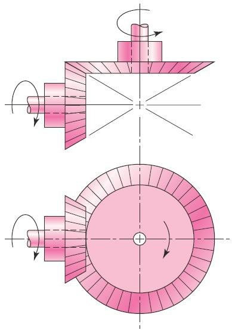

*图 L3-7 锥齿轮：相交轴，90° 换向（L3 课件）*

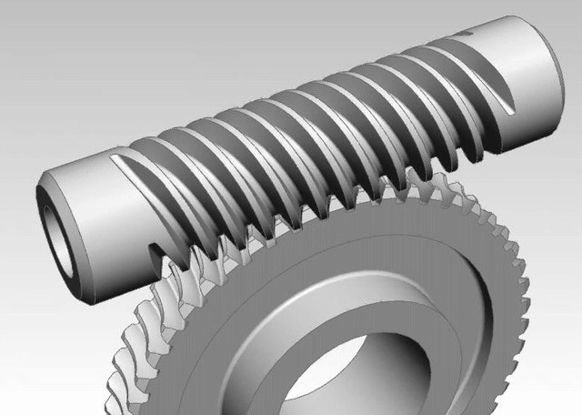

*图 L3-8 蜗轮蜗杆：减速比大、可自锁，但效率低（L3 课件）*

### 4.1 圆周速度与传动比

线速度连续（无滑动）：

$$v=r_i\omega_i=r_o\omega_o
\quad\Longrightarrow\quad
\omega_o=\omega_i\frac{d_i}{d_o}$$
$$T_{in}\omega_{in}\approx T_{out}\omega_{out}\quad(\text{理想，功率守恒})$$

---

## 5 渐开线与齿轮几何

### 5.1 为什么必须是渐开线（简答必考）

【课件】

- 方齿（矩形齿）啮合时会**卡死**：接触点法线方向随位置变化，与连心线交点不固定 → 传动比时大时小、有冲击；留间隙则产生**回差（backlash）**、输出速度不稳。
- 渐开线满足**共轭啮合（conjugate action）**：接触点公法线始终是两基圆的**内公切线**，与连心线的交点（节点 $P_w$）固定 → **瞬时传动比恒定**。
- 渐开线的生成：一根线绕在圆柱上，松开时线上一点的轨迹。圆柱 = **基圆（base circle）**。
- 齿廓在基圆到齿顶圆之间是渐开线；基圆到齿根圆之间是**径向直线**；基圆内没有渐开线。

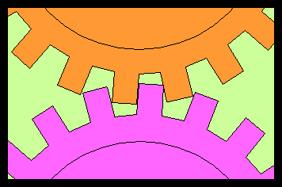

*图 L3-9 渐开线的生成：绳绕基圆展开，展开长度等于基圆弧长（L3 课件）*

### 5.2 压力角（pressure angle）

- 啮合线（line of action）$DE$ 与两基圆相切；
- 压力角 $\phi$ = 啮合线与两分度圆公切线 $AB$ 的夹角；
- 标准值 $\phi=20^\circ$（也有 $14.5^\circ$、$25^\circ$）。

| 压力角 | 优点 | 缺点 |
| --- | --- | --- |
| $20^\circ$ | 承载能力高（齿根厚） | 径向力大 |
| $14.5^\circ$ | 中心距误差/同轴度误差引起的回差变化小；重合度大、运转平稳安静 | 承载能力低 |

基圆直径：

$$d_b=d\cos\phi$$

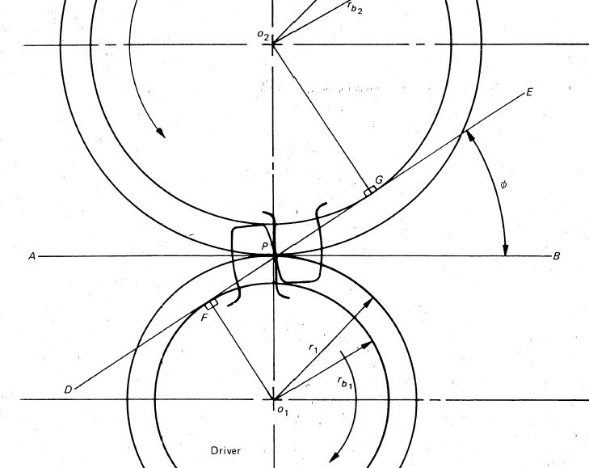

*图 L3-10 啮合线 $DE$ 与两基圆相切，它与分度圆公切线的夹角就是压力角（L3 课件）*

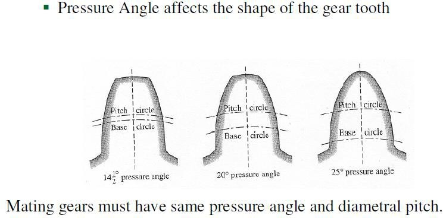

*图 L3-11 压力角对齿形的影响：14.5° 齿顶薄而高、20° 常用、25° 齿根更厚（L3 课件）*

### 5.3 间隙（clearance）

【课件】"the distance from the tip of a tooth to the circle passing through the bottom of the tooth space, measuring radially."

- 中心距必须让两分度圆**相切**；
- 齿顶与齿根之间必须留径向间隙，否则齿顶会顶死、无法转动。

### 5.4 基本参数（必背）

| 参数 | 符号 | 公式 | 说明 |
| --- | --- | --- | --- |
| 齿数 | $z$ | — | 小齿轮叫 pinion，大齿轮叫 gear |
| 分度圆直径 | $d$ | $d=mz$ | 计算基准，两轮分度圆相切 |
| 周节（circular pitch） | $p_c$ | $p_c=\dfrac{\pi d}{z}=\pi m$ | 相邻同侧齿廓在分度圆上的弧长；**啮合两轮 $p_c$ 必须相同** |
| 模数（module） | $m$ | $m=\dfrac{d}{z}=\dfrac{p_c}{\pi}$ | SI 的齿大小指标（mm） |
| 径节（diametral pitch） | $P_d$ | $P_d=\dfrac{z}{d}$ | 英制指标（teeth/inch），与模数互为倒数：$m[\text{mm}]=25.4/P_d$ |
| 基圆 | $d_b$ | $d\cos\phi$ | 渐开线的发生圆 |
| 齿顶圆 | $d_a$ | $d+2m$ | 标准全齿高 |
| 齿根圆 | $d_f$ | $d-2.5m$ | 标准全齿高 |
| 标准中心距 | $a_w$ | $a_w=\dfrac{m(z_1+z_2)}{2}$ | 外啮合，两分度圆相切 |

> 【课件原话】"For a given pitch diameter, the smaller the diametral pitch, the larger the gear tooth."——$P_d$ 越小齿越大；模数 $m$ 越大齿越大，两者互为倒数。

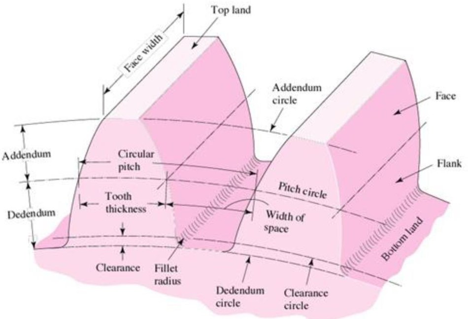

*图 L3-12 齿轮几何术语：齿顶高/齿根高/周节/齿厚/齿槽宽/顶隙/工作高度（L3 课件）*

### 5.5 标准全齿高比例（补充，但做题必用）

$$h_a=m\ (\text{addendum}),\qquad
h_f=1.25m\ (\text{dedendum}),\qquad
h_c=0.25m\ (\text{clearance，顶隙})$$
$$h=2.25m\ (\text{whole depth}),\qquad h_w=2m\ (\text{working depth})$$

### 5.6 啮合与重合度（补充）

正确啮合条件（直齿）：$m_1=m_2$、$\phi_1=\phi_2$。

连续传动条件：重合度 $\varepsilon_\alpha\ge1$。

$$\varepsilon_\alpha=
\frac{\sqrt{r_{a1}^2-r_{b1}^2}+\sqrt{r_{a2}^2-r_{b2}^2}-a_w\sin\phi}{\pi m\cos\phi}$$

### 5.7 例题：$m=3$、$z_1=20$、$z_2=40$（$\phi=20^\circ$，标准全齿高）

| 量 | 小齿轮 | 大齿轮 |
| --- | --- | --- |
| $d=mz$ | 60 | 120 |
| $d_a=d+2m$ | 66 | 126 |
| $d_f=d-2.5m$ | 52.5 | 112.5 |
| $d_b=d\cos20^\circ$ | 56.38 | 112.76 |
| $a_w=m(z_1+z_2)/2$ | 90 | — |

$$\varepsilon_\alpha=
\frac{\sqrt{33^2-28.19^2}+\sqrt{63^2-56.38^2}-90\sin20^\circ}{\pi\times3\cos20^\circ}
=\frac{17.16+28.11-30.78}{8.856}=1.64$$

> 【说明】$\varepsilon_\alpha=1.64$ 表示平均有 1.64 对齿同时啮合；$\varepsilon_\alpha<1$ 会断续啮合、冲击。一般要求 $\ge1.2$（精密传动 $\ge1.4$）。

### 5.8 根切（补充）

用范成法加工时齿数太少，刀具会切掉齿根渐开线 → **根切**，齿根变薄、弯曲强度下降。标准直齿不根切的最小齿数：

$$z_{\min}=\frac{2h_a^*}{\sin^2\phi}\approx17\quad(\phi=20^\circ,\ h_a^*=1)$$

$h_a^*$ 是**齿顶高系数**（正常齿取 1，短齿取 0.8），不带星号时 $h_a$ 是齿顶高的**长度**。

避免办法：增大齿数、正变位、增大压力角。

---

## 6 轮系

### 6.1 一对齿轮的基本定律

【课件】"Only need to know one equation, and an important variation of it."

$$\text{外啮合：}\ \frac{\omega_b}{\omega_a}=-\frac{z_a}{z_b},
\qquad
\text{内啮合：}\ \frac{\omega_b}{\omega_a}=+\frac{z_a}{z_b}$$

负号表示转向相反；内啮合转向相同。

### 6.2 简单轮系（每根轴一个齿轮）

$$\frac{\omega_{in}}{\omega_{out}}=\frac{\prod z_{\text{driven}}}{\prod z_{\text{driving}}}$$

由于同一模数下 $z\propto d\propto r$，所以也可以写 $=\prod r_{\text{driven}}/\prod r_{\text{driving}}$。

**惰轮（idler）**：

- 不改变传动比大小（它同时是主动轮和从动轮，在分子分母里抵消）；
- **只改变转向**：惰轮个数为奇数 → 与主动轮同向；偶数 → 反向。

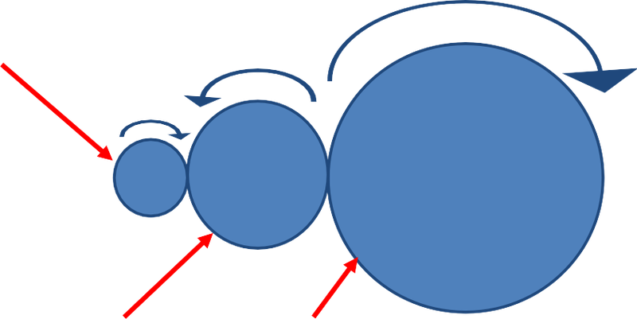

*图 L3-13 简单轮系与惰轮：惰轮只改变转向，不改变速比（L3 课件）*

### 6.3 复合轮系（compound train）

- 一对齿轮的传动比实际限制约 **10:1**；
- 要更大传动比，就把两个齿轮**固连在同一根轴上**（复合轮系）；
- 传动比 = 各级传动比之积：

$$\frac{\omega_{in}}{\omega_{out}}
=\frac{z_2z_4z_6\cdots}{z_3z_5z_7\cdots}$$

转向由各级外啮合次数判定（或逐级画箭头）。

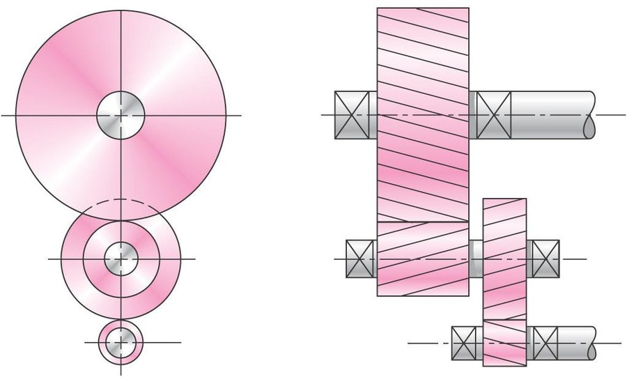

*图 L3-14 复合轮系：同轴固连的两个齿轮，传动比为各级之积（L3 课件）*

### 6.4 例题：设计 $u=20$ 的两级齿轮箱（对应期末 Q8）

要求每对齿轮传动比 $<10$，取

$$u=20=4\times5$$

- 第一级：$z_1=20$、$z_2=80$ → $u_1=4$；
- 第二级：$z_3=20$、$z_4=100$ → $u_2=5$；
- 取模数 $m=1$ mm：$d=20,80,20,100$ mm；中心距 $a_{w1}=50$ mm、$a_{w2}=60$ mm；
- 总传动比 $u=4\times5=20$，输出转速 $=n_m/20$，输出转矩 $=20\eta T_m$。

> 【说明】两级中心距不同，所以两根中间轴要分别布置；若要求同轴，需要变位或改用行星轮系。齿数必须取整数，实际传动比会有小数——用 MATLAB 的 `[num,den]=rat(x,tol)` 可以把目标传动比化成整数比（课件 55 页就是这么做的）。

### 6.5 差速器（differential）

【课件】"A differential allows two output shafts to rotate at different speeds. Torque split is inversely proportional to each wheel speed."——两输出轴可异速，转矩按转速反比分配。

---

## 7 行星（周转）轮系

### 7.1 组成与自由度

四个基本件：**太阳轮 sun**（齿数 $z_s$）、**行星轮 planet**（$z_p$）、**内齿圈 ring**（$z_r$）、**系杆/行星架 carrier**（角速度 $\omega_c$）。

- 行星轮既自转又"绕太阳轮公转"；
- 两个自由度：必须给定**任意两个**构件的转向与转速，运动才唯一（常见做法是"固定其中一个"）。

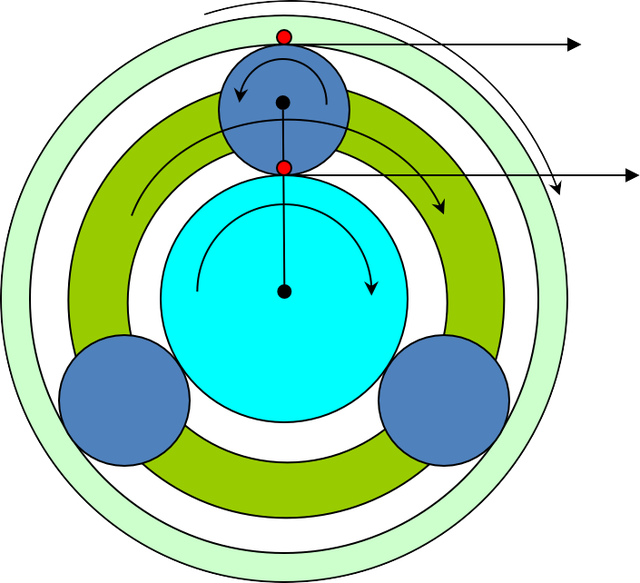

*图 L3-15 行星轮系：太阳轮、行星轮、内齿圈、系杆（L3 课件）*

### 7.2 运动学方程（课件 75–77 页）

以齿数表示（同模数下齿数与半径成正比，也可直接用半径）：

$$\omega_s z_s=\omega_c\left(z_p+z_s\right)+\omega_p z_p$$

$$\omega_r z_r=\omega_c\left(z_p+z_s\right)-\omega_p z_p$$

两式相加消去 $\omega_p$：

$$\boxed{\ \omega_s z_s+\omega_r z_r=\omega_c\left(z_r+z_s\right)\ }$$

> 【重要符号约定】课件特别强调：**行星轮的正转向与其他构件相反**。用 $\omega_p$ 时必须带这个负号，否则方向全错。

### 7.3 杠杆类比（lever analogy）

把 $(\omega_s,\omega_r,\omega_c)$ 看成一根杠杆上三个点的速度，力臂为 $z_s$、$z_r$、$z_s+z_r$：

$$\omega_c=\frac{z_s}{z_r+z_s}\,\omega_s+\frac{z_r}{z_r+z_s}\,\omega_r$$

三个节点的运动被这条直线约束 → **只有 2 个自由度**。

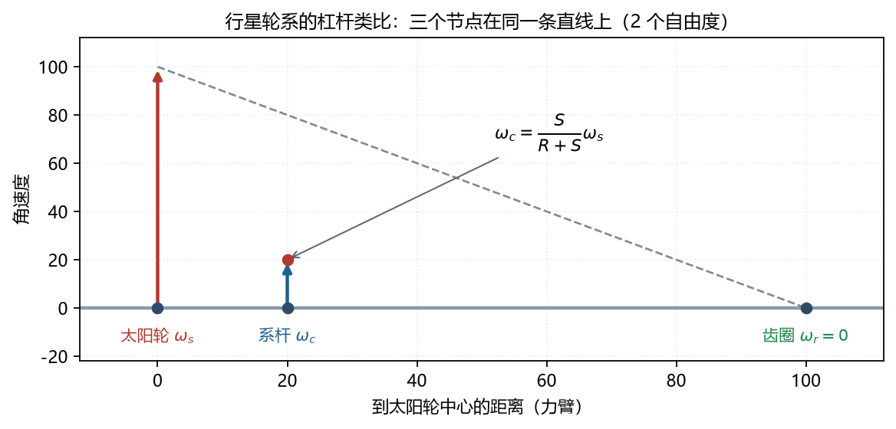

*图（自绘）行星轮系的杠杆类比：太阳轮、系杆、齿圈三个节点在同一直线上，速度向量的端点共线*

| 固定件 | 输入 → 输出 | 传动比 |
| --- | --- | --- |
| 齿圈固定 | 太阳 → 系杆 | $u_{sc}=1+\dfrac{z_r}{z_s}$ |
| 太阳轮固定 | 齿圈 → 系杆 | $u_{rc}=1+\dfrac{z_s}{z_r}$ |
| 系杆固定 | 太阳 → 齿圈 | $u_{sr}=-\dfrac{z_r}{z_s}$（反向） |
| 无（差动） | 两个输入一个输出 | $\omega_s z_s+\omega_r z_r=\omega_c(z_r+z_s)$ |

### 7.4 例题（课件 78 页原题）

太阳轮 20 齿，行星轮 30 齿，内齿圈 80 齿（$80=2\times30+20$ ✓）。太阳轮顺时针 100 rpm，齿圈固定，求行星轮（gear 4）的转速与转向。

由杠杆方程（$\omega_r=0$）：

$$\omega_c=\omega_s\frac{z_s}{z_r+z_s}=100\times\frac{20}{100}=20\ \text{rpm}\ (\text{顺时针})$$

再由 $\omega_r z_r=\omega_c(z_p+z_s)-\omega_p z_p$：

$$\omega_p=\frac{\omega_c(z_p+z_s)}{z_p}=\frac{20\times50}{30}=33.3\ \text{rpm}$$

按行星轮的反号约定，实际转向与太阳轮**相反** → **逆时针 33.3 rpm**。

> 【验算】用速度法：行星轮中心的线速度 $v_c=\omega_c(z_p+z_s)/2$，与齿圈接触点速度为 0 → $\omega_p^{\text{abs}}=-v_c/(z_p/2)=-\omega_c(z_p+z_s)/z_p=-33.3$，负号即逆时针。两种方法一致。

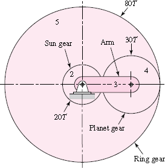

*图 L3-16 行星轮系算例：太阳 20 齿、行星 30 齿、齿圈 80 齿（L3 课件）*

### 7.5 行星齿轮箱（课件 72–74 页）

- 同一套行星轮，通过"抱住/松开"不同构件可实现：减速、增速（overdrive）、反转、直接挡（1:1）、空挡；
- 课件那款行星齿轮箱（type A：行星架输出、齿圈固定）有 8 种速比：4:1、5:1、16:1、20:1、25:1、80:1、100:1、400:1，空载转速 23.5–2350 rpm；
- 该型传动比 $u=\dfrac{z_r+z_s}{z_s}=1+\dfrac{D_{\text{ring}}}{D_{\text{sun}}}$；
- 优点：体积小、速比大、多齿同时啮合（承载高）、可多级串联；缺点：结构复杂、齿面受力大（"high applied torques that can strip teeth"）。

---

## 8 谐波减速器

【课件】优点：

- 单级减速比大（可达 1:100 以上），结构紧凑、轻、惯量小；
- 多齿同时啮合 → 承载大；
- **无回差（no backlash）**、精度高。

组成：**波发生器**（椭圆凸轮 + 柔性轴承，输入）、**柔轮**（薄壁杯形外齿，通常输出）、**刚轮**（内齿圈，通常固定）。

【补充】减速比（刚轮固定、波发生器输入、柔轮输出）：

$$u_h=\frac{z_f}{z_g-z_f}=\frac{z_f}{2}\quad(\text{齿数差为 }2),\qquad \text{转向与输入相反}$$

柔轮固定、刚轮输出时 $u_h=z_g/2$，转向相同。课本不给公式，但谐波"齿数差 2"这个结论要记住。

---

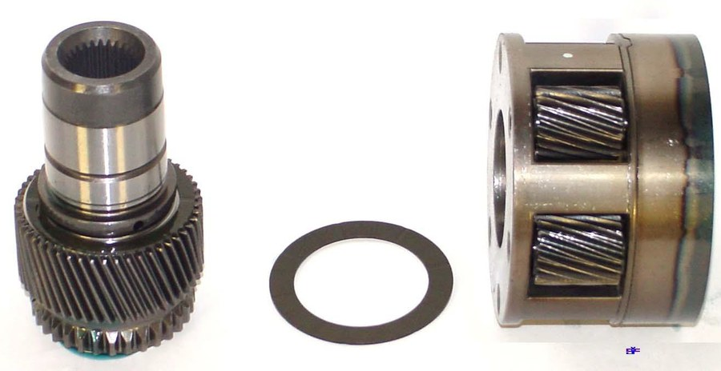

*图 L3-17 谐波减速器的三大件：波发生器（椭圆凸轮+柔性轴承）、柔轮（薄壁外齿）、刚轮（内齿圈）（L3 课件）*

## 9 CVT（无级变速）

【课件】"CVTs have no fixed transmission"——靠带轮工作半径连续变化（或钢球/滚轮）实现连续速比，例子：NuVinci。特点是速比连续可调，但效率与承载通常低于齿轮。

---

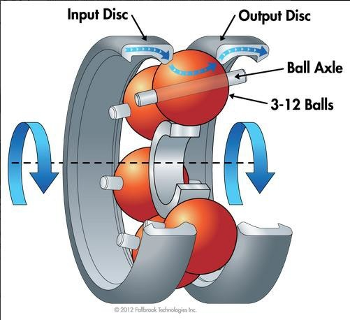

*图 L3-18 NuVinci CVT：用钢球/滚轮改变接触半径，实现连续变速（L3 课件）*

## 10 带与链（课件 86–90 页）

### 10.1 带传动

- 可以自由选择中心距（齿轮做不到），但**必须张紧**（张紧轮或可调中心距），否则打滑；
- 理想情况下与齿轮同样的关系：

$$\frac{T_1}{T_2}=\frac{d_1}{d_2}=\frac{\omega_2}{\omega_1}$$

- 能吸收振动、便宜、效率与齿轮接近；缺点是有弹性滑动，传动比不绝对准确。

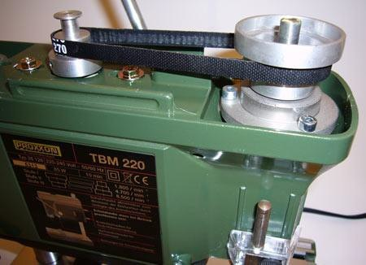

*图 L3-19 钻床的带传动：中心距可调、需要张紧（L3 课件）*

### 10.2 链传动

- 便宜、中心距可调、**不需要很大张紧力、不易打滑**；
- 最常用的是**滚子链（roller chain）**；传递转矩比带大；
- 长度靠拆装**过渡链节/活节（master link）**调整；
- 同样有 $\dfrac{T_2}{T_1}=\dfrac{d_2}{d_1}=\dfrac{\omega_1}{\omega_2}$（平均意义）。

### 10.3 三种传动对比

| 项目 | 齿轮 | 带 | 链 |
| --- | --- | --- | --- |
| 传动比准确性 | 准确 | 有弹性滑动（同步带除外） | 平均准确，瞬时波动 |
| 中心距 | 小、固定 | 大、可调 | 较大、可调 |
| 缓冲吸振 | 差 | 好 | 一般 |
| 过载保护 | 无 | 打滑（有） | 无 |
| 效率 | 0.97–0.99 | 0.90–0.95 | 0.95–0.98 |
| 环境 | 需润滑密封 | 怕油、怕高温 | 耐油、耐尘 |

> 【备注】带的详细设计（欧拉公式、包角、应力）属于 L6 内容，见《09 附录》。

---

## 11 易错点清单

1. $K_T=K_b$ 只在 SI 下成立；数据表给的是 rpm/V 时必须换算。
2. 空载转速≠额定转速；堵转转矩≠额定转矩（堵转只能几秒）。
3. 机械特性斜率 $K_TK_b/R_a$ 与电压无关，升压只是平移直线。
4. 效率 $\eta=\omega/\omega_0$ 是理想值；实际因铁耗、摩擦更低。
5. 传动比的定义是**运动学**的：$u=\omega_m/\omega_o$（减速时 $u>1$）。$T_o/T_m=u$ 只在**无损失**时成立。
6. 有损失时转矩关系是 $T_o=u\eta T_m$（功率 $P_o=\eta P_i$）；**速度比不受 $\eta$ 影响**。
7. 外啮合变号、内啮合不变号；惰轮只改转向不改速比。
8. 复合轮系每对传动比不宜超过 10。
9. 行星公式里**行星轮符号相反**，这是最容易错的一步。
10. 谐波减速比是 $z_f/2$（齿数差 2），不是 $z_f$；刚轮固定时输出反向。
11. 模数与径节互为倒数，$m[\text{mm}]=25.4/P$，别把两个都当 mm。
12. 标准中心距是两分度圆相切，不是两基圆相切。

---

## 12 自测（5 分钟）

1. 12 V、$n_0=6000$ rpm 的电机，$K_b$（V·s/rad）是多少？
2. 上题 $R_a=2\ \Omega$、$K_T=K_b$，求堵转转矩与堵转电流。
3. $m=2$、$z_1=18$、$z_2=54$，求 $d$、$d_a$、$d_f$、$a_w$、$u$。
4. 复合轮系 $z_1=20,z_2=60,z_3=18,z_4=72$，求总传动比（第一级外啮合、第二级外啮合）。
5. 行星轮系 $z_s=24,\ z_p=36,\ z_r=96$，齿圈固定、太阳轮 1200 rpm，求系杆转速和传动比。

> 答案见《08 模拟卷答案》附录。
