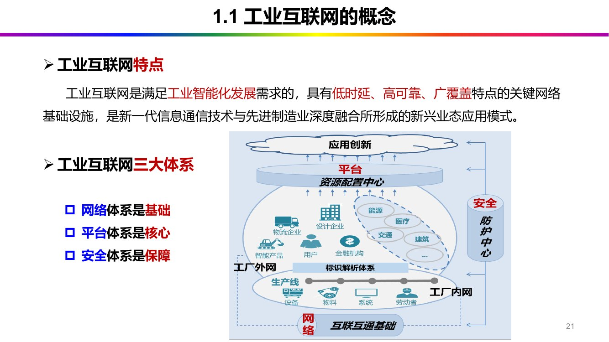
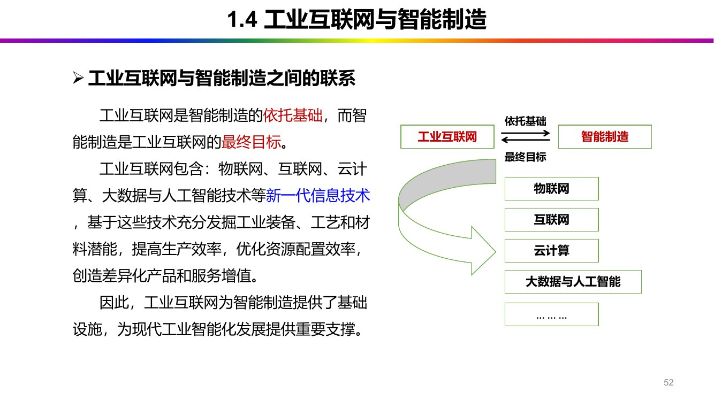

# 第 1 章 绪论：概念与边界

> 本章对应课件《第 1 章 绪论》（共 64 页）。
> 图例：加粗 = 课件原文中以红色（深红或纯红）标出的内容，句尾〔标红 C1·Py〕标注来源页。本文不用加粗表达其他强调。

本章回答"工业互联网是什么、边界在哪里"。主线是逐层划界：先立定义，再依次与互联网、与物联网、与智能制造分开，最后落到我国的发展现状。课件开篇先讲四则古代手工业的例子，用来说明这套逻辑在技术上出现之前就已经存在。

## 1.1 工业互联网的概念

### 1.1.1 四个古典类比：核心逻辑先于技术

课件用四组古代手工业的例子说明：工业互联网要解决的问题，在作坊时代就已经存在，只是当时用人和规矩解决，今天用协议和数据解决。

| 古代的做法 | 课件页 | 对应到工业互联网 |
| --- | --- | --- |
| 秦军工体系的"通用协议"与"责任制" | P13 | 标准化 / 通信协议：异构设备能互通的前提 |
| 铸钟时"甲炉既倾，乙炉疾继之，丙炉又疾继之"；"过手七十二，方克成器" | P14 | 分工协作 / 产线节拍控制（节点与链路） |
| "织造尚松江，浆染尚芜湖" | P14 | 产业链协同：跨地域分工 |
| 龙泉窑以瓯江为轴心组织运输 | P15–16 | 物流与信息网（动脉与服务器） |

《礼记》里的"**物勒工名**，以考其诚"是其中的"责任制"一环：每件器物刻上匠人姓名，出了问题能找到人〔标红 C1·P13〕。

课件把这四例收成三条核心逻辑〔C1·P17〕：标准化（协议）、分工协作（节点与链路）、物流与信息网（动脉与服务器）。

> 三条逻辑此后一直复现：通信协议标准对应 §1.2.3 的第三个区别要素，分工协作对应第 4 章的标识解析与产业链协同，物流与信息网对应第 5 章平台上流动的数据。

### 1.1.2 两个定义

（1）概念性定义〔标红 C1·P18〕

工业互联网（Industrial Internet）是开放、全球化的网络，把人、数据和机器连接起来，属于泛互联网的目录分类；它是全球**工业系统**与高级计算、分析、传感技术及互联网的高度融合。

（2）中国工业互联网产业联盟（AII）的定义〔标红 C1·P18〕

工业互联网是新一代信息通信技术与工业经济深度融合的**新型基础设施**、**应用模式**和**工业生态**，通过对人、机、物、系统等的**全面连接**，构建起覆盖**全产业链**、**全价值链**的全新制造和服务体系，为工业乃至产业**数字化**、**网络化**、**智能化**发展提供了实现途径。

> 两个定义的落点不同：概念性定义回答"它是什么形态"——一张开放的网络；AII 定义回答"它在经济中占什么位置"——基础设施、应用模式、生态三重身份。前者是技术描述，后者是产业定位。

### 1.1.3 概念的来历

- **2012** 年，美国通用电气公司（GE）最早提出**工业互联网**的概念〔标红 C1·P19〕；
- 2014 年，GE、AT&T、Cisco、IBM、Intel 五家美国行业龙头企业联手组建**工业互联网联盟**（Industrial Internet Consortium，**IIC**），把这一概念推广开来〔标红 C1·P19〕；
- 中国并非只有舶来品：2015 年 7 月发布《关于积极推进"互联网+"行动的指导意见》，提出以**智能工厂**为发展方向，开展**智能制造**试点示范〔标红 C1·P19〕。

> 三件事的主语不同：GE 提出的是概念，IIC 是推广概念的组织，中国的政策文件则把它写进了智能工厂与智能制造的试点。

### 1.1.4 交叉学科与两个理解角度

工业互联网属于**交叉性学科**的综合应用，三根支柱是工业信息安全、网络通信、广域自动化〔标红 C1·P20〕。

同页给出两个理解角度〔C1·P20〕：

1. 通信视角：依托公众网络连接专用网络、局域网；
2. 自动化视角：以生产自动化为基础，实现企业全面信息化，然后再变成工业互联网。

> 【补充】两个角度对应两种产业路径：美国偏"从 IT 走向 OT"（GE Predix），德国偏"从 OT 走向 IT"（西门子 MindSphere、工业 4.0）。第 5 章讲平台实例时可以互证。

### 1.1.5 特点与三大体系

工业互联网是满足**工业智能化发展**需求的，具有**低时延、高可靠、广覆盖**特点的关键网络基础设施，是新一代信息通信技术与先进制造业深度融合所形成的新兴业态应用模式〔标红 C1·P21〕。

三大体系〔标红 C1·P21〕：网络体系是**基础**，平台体系是**核心**，安全体系是**保障**。

| 体系 | 管什么 |
| --- | --- |
| 网络体系 | 工业系统互联、工业数据传输交换 |
| 平台体系 | 数据汇聚、建模分析、应用创新 |
| 安全体系 | 网络与数据在工业中应用的安全 |

*图 1-1 工业互联网三大体系：网络是基础、平台是核心、安全是保障（课件 C1·P21）*

> 这张"基础—核心—保障"的图在后续各章反复出现：第 3 章用它讲体系架构，第 5 章讲平台，第 6 章讲安全。

### 1.1.6 本质与核心

工业互联网的**本质**和**核心**，是通过开放的、全球化的工业级网络平台，把设备、生产线、工厂、供应商、产品和客户紧密地连接融合起来，高效共享工业经济中的各种要素资源，形成跨设备、跨系统、跨厂区、跨地区的互联互通，从而通过自动化、智能化的生产方式降低成本、提高效率，帮助制造业延长产业链、**推动制造业**转型发展、推动整个制造服务体系智能化，并实现制造业与服务业之间的跨越发展〔标红 C1·P23〕。

拆开是"一个平台、六个对象、四个跨"：

- 一个平台：开放的、全球化的工业级网络平台；
- 六个对象：设备、生产线、工厂、供应商、产品、客户——从车间一直排到用户；
- 四个跨：跨设备、跨系统、跨厂区、跨地区〔C1·P23〕。

同一页还标出**万物互联**四字〔标红 C1·P23〕，它是四个"跨"最终指向的状态。

> 【补充】"越跨越难、越跨越值钱"不是课件的话。课件只并列了四个"跨"，未作排序；由小到大（设备 → 系统 → 厂区 → 地区）是字面上的层级，"难度与价值递增"属于后人的读法。

### 1.1.7 三个要素与西门子的"数据—知识—智能"

课件把工业互联网的构成拆成三个要素〔C1·P22〕：

| 要素 | 课件的描述 |
| --- | --- |
| 智能机器 | 以崭新的方法，将现实世界中的机器、设备、团队和网络，通过先进的传感器、控制器和软件应用程序连接起来 |
| 高级分析 | 使用基于物理的分析法、预测算法，以及自动化、材料科学、电气工程及其他关键学科的深厚专业知识，理解机器与大型系统的运作方式 |
| 工作人员 | 建立员工之间的实时连接，连接各种工作场所的人员，以支持更智能的设计、操作、维护以及高质量的服务与安全保障 |

课件对这一组合的判断是：工业互联网通过智能机器间的连接，最终实现人、机连接，结合软件和大数据分析，把这些元素融合起来，为企业与经济体提供新的机遇〔C1·P22〕。

> 三个要素是一条链：智能机器产生数据，高级分析把数据变成对机器的理解，工作人员再用这份理解去设计、操作和维护。GE 后来把这条链概括为"数据 → 知识 → 行动"【补充】。

课件另用两页给出"西门子眼中的工业互联网"，落成三个词：数据、知识、智能〔C1·P24–25〕。

> 这与上表同构：数据对应智能机器的产出，知识对应高级分析的成果，智能对应工作人员的判断。两家公司对工业互联网的叫法不同——GE 讲 Industrial Internet，西门子讲 Industrie 4.0——但对价值链的判断一致：价值不在连接本身，而在连接之后能否形成知识与决策。

### 1.1.8 贯穿全课的案例：列车预测性维护

GE 的机车（列车）预测性维护是一条五步链〔C1·P26–27〕：

实时传感 → 远程互联 → 数据分析 → 智能预测 → 反馈控制

| 五步 | 后续章节的技术落点 |
| --- | --- |
| 实时传感 | 第 2 章感知与识别技术 |
| 远程互联 | 第 2 章网络通信、第 4 章网络连接技术 |
| 数据分析 | 第 2 章工业大数据、第 5 章大数据平台 |
| 智能预测 | 第 5 章数字孪生与平台应用（预测性维护） |
| 反馈控制 | 第 5 章 CPS、第 6 章控制安全 |

> 这五步几乎是全课的骨架：后面每一章都在给其中一步做技术注脚——第 2 章给前三步，第 5 章给后两步，第 6 章负责让这条链在攻击面前不断。

## 1.2 工业互联网与互联网

### 1.2.1 三个词

| 词 | 含义 | 关系 |
| --- | --- | --- |
| **internet**（互联网） | 网络与网络之间串联成的庞大网络，以一组通用的协议相连，形成逻辑上的单一巨大国际网络 | 泛称 |
| **Internet**（因特网） | 特指全球最大的那个互联网 | 特指 |
| WWW（万维网） | 建立在互联网之上的一种信息服务系统，只是互联网中的一项服务 | 应用 |

- 互联网始于 1969 年美国的阿帕网（ARPANET）〔C1·P30〕；
- 通常 **internet** 泛指互联网，而 **Internet** 特指因特网〔标红 C1·P30〕；
- 互联网 ≠ 万维网：万维网是建立在互联网之上的一种信息服务系统，是互联网中的一项服务〔C1·P30〕。

> 打个比方：互联网是公路，万维网是跑在上面的车队。车队停运，公路还在。

### 1.2.2 传统互联网的特性

课件用三栏概括传统互联网〔C1·P31〕：

| 维度 | 传统互联网 |
| --- | --- |
| 受众 | C 端用户 |
| 特性 | 效率高、传播实时、展现内容多，但内容未经筛选、容易让人迷惑 |
| 变现模式 | 付费、广告 |

> 三栏合起来是一句话：面向人、面向消费、靠流量变现【补充】。

### 1.2.3 工业互联网的特性

工业互联网从诞生起就以工业发展为关注点，因此**服务工业发展**是其**核心目标**。它是工业行业变革的衍生物，特性更多依靠工业行业的特点延伸而来。工业种类繁多、工况复杂，对制造过程中的准确性和安全性都有极高要求，传统的数据分析和实时建模相对封闭独立，不能产生量变效应〔标红 C1·P33〕。

相比传统互联网，工业互联网增强了数据分析能力、设备连接能力与安全管理能力〔C1·P33〕。

工业互联网平台与基于传统互联网的系统相区别的三大要素，分别为**工业模型、工业App、通信协议标准的建立**〔标红 C1·P33〕。

> 三个要素各管一头：工业模型是行业 know-how 的沉淀（把老师傅的经验写成可计算的模型），工业 App 是交付形态（把模型做成能装能用的应用），通信协议标准是互通前提（把不同厂商的设备拉到同一套语言上）。三者齐备，平台才谈得上"工业"二字【补充】。

### 1.2.4 四个区别

| 维度 | **传统互联网** | **工业互联网** |
| --- | --- | --- |
| 服务主体 | 服务主体和连接对象主要是人，强调生活场景的全面线上化，应用场景相对简单 | 需**连接人、机、物、系统等**，连接种类和数量更多，强调企业生产线上与线下的协同发展，场景十分复杂 |
| 网络形态 | 主要面向公共网络，对网络性能要求相对较低 | 网络形态是企业内网，而且是物联网，具有更高的可靠性和安全性要求，以满足工业生产的需要 |
| 复杂程度和发展模式 | 连接的主要是人，应用场景相对简单，应用门槛低，发展模式可复制性强 | 行业标准多，应用专业化、个性化强，由互联网企业主导推动且投资回收期短，容易获得社会资本支持，但难以找到普适性的发展模式 |
| 市场格局 | 市场集中度高，典型案例有阿里巴巴、腾讯、百度、京东等 | 具有较鲜明的垂直细分特点，较难形成寡头垄断，目前在我国乃至世界仍处于发展起步阶段 |

课件从服务主体、网络形态、复杂程度和发展模式、市场格局四个方面对比〔C1·P34〕。

### 1.2.5 脑机接口：边界还在移动

课件在"与互联网的区别"之后留了一个问题：脑机接口与工业互联网是否可以结合？〔标红 C1·P35〕

随后两页给了正在发生的答案：工业脑机智能安全帽（**华脑安全**）〔标红 C1·P36〕；脑机接口与虚拟现实（VR）的免手持控制，强脑科技（BrainCo）发布的脑控机器人训练平台〔C1·P37〕。

课件对这一结合的判断是〔C1·P37〕：

- 核心在于将人从"被动的系统操作员"升级为"主动的智能协作节点"；
- 将工业互联网从"设备联网"升级为充满人类意图与感知的"意图物联网"。

> 分量在后半句。此前各节讲的是机器与机器、机器与系统的连接，人始终是操作员；脑机接口把人这一侧也变成可读可写的接口，连接的对象便从"设备"换成了"意图"。第 5 章的人机交互、第 6 章的行为安全，都是这条线的延长。

## 1.3 工业互联网与物联网

### 1.3.1 物联网（IoT）

物联网是一个基于互联网、传统电信网等的信息承载体，广泛应用于网络的融合中，也被称为继计算机、互联网之后世界信息产业发展的第三次浪潮〔C1·P39〕。

物联网的**本质**，是通过各种**信息感知**装置与技术，实时**采集**任何需要监控、连接、互动的物体或过程的相关信息，并通过与各类网络的接入，实现物与物、物与人的泛在连接，以实现对物品和过程的智能化感知、识别和管理，从而让所有能够被独立寻址的普通物理对象形成互联互通的网络〔标红 C1·P40〕。

> 拆开这句话有五个要件：感知装置（拿什么采）、实时采集（采得多快）、泛在连接（连到哪）、独立寻址（怎么找到它）、智能化感知与识别管理（采来干什么）。

### 1.3.2 工业物联网（IIoT）

工业物联网（Industrial Internet of Things，**IIoT**）是通过**工业资源**的网络互联、数据互通和系统互操作，实现制造资源的灵活配置、制造过程的按需执行、制造工艺的合理优化和制造环境的快速适应，达到资源的高效利用，从而构建服务驱动型的**新工业体系**〔标红 C1·P41〕。

这句话里"制造"出现四次，四次指向四个不同层面〔C1·P41〕：

| 课件的四个"制造" | 落在哪个层面 |
| --- | --- |
| 制造资源的灵活配置 | 资源 |
| 制造过程的按需执行 | 过程 |
| 制造工艺的合理优化 | 工艺 |
| 制造环境的快速适应 | 环境 |

同页还有两句关系判断〔标红 C1·P41〕：

1. **工业物联网**强调更大规模的设备连接与数据获取，以及工业现场的优化反馈；
2. **工业物联网**是工业互联网的同义词，同时又与工业互联网存在包含关系。

> 两句要合起来读：日常语境里两个词混用（同义），但严格说，IIoT 落在"物"的连接与现场反馈上，工业互联网还包含平台、标识解析、安全等体系，所以工业物联网是工业互联网的子集【补充】。

工业物联网在现代工业中越来越重要，它不仅是简单的物联网应用，而是通过智能化的设备连接和数据共享，推动整个**制造业**的效率提升〔标红 C1·P42〕。

### 1.3.3 工业物联网与传统物联网的三点区别

| 方面 | 传统物联网 | 工业物联网 |
| --- | --- | --- |
| **感知方面** | 通过智能感知识别等通信感知技术，增强人们对周围环境的感知和响应 | 将传统物联网技术与数据同制造等工业过程相结合，旨在提高工业领域设备自动化水平、设备生产效率和企业生产率 |
| **应用方面** | 更多关注消费领域，如家居方面 | 主要强调生产和服务方面的应用（能源、运输、工业控制），往往涉及更高价值的设备和资产，同时对运行安全有更高的要求 |
| **设施基础方面** | — | 建立在工业基础设施上，用于提升而非替代原有的工业生产设备和设施；它是物联网的子集，集中在生产力方面应用 |

课件第 44 页配了一道思考题：智能家居与智能车间，哪一个属传统物联网、哪一个属工业物联网？判断回到上表三行——连接对象是"人/生活"还是"机/生产"、是否涉及高价值资产与生产安全、是新建还是改造既有工业设施〔C1·P44〕。

### 1.3.4 工业物联网六大典型特征

**六大典型特征**〔标红 C1·P45〕：

| 特征 | 课件给的定位 |
| --- | --- |
| **智能感知** | 是工业物联网的基础 |
| **泛在连通** | 是工业物联网的前提 |
| **数字建模** | 是工业物联网的方法 |
| **实时分析** | 是工业物联网的手段 |
| **精准控制** | 是工业物联网的目的 |
| **迭代优化** | 是工业物联网的效果 |

> 六个定位本身是一条逻辑链：先能感知（基础），才能连通（前提）；连通之后要建模（方法），建模才能分析（手段），分析的落点是控制（目的），控制之后还要迭代（效果）。

### 1.3.5 发展工业物联网的意义

课件给三条〔标红 C1·P46〕：

1. 工业物联网**助力**智能制造；
2. 工业物联网为智能制造**提供基石**；
3. 合理调配供应链资源以提升生产和服务效率，实现制造业的**智能化**管理模式创新。

> 三条量级不同：第二条把工业物联网放在"基础"的位置，第一条说的是它对智能制造的推动，第三条落在供应链与管理的具体收益上。

## 1.4 工业互联网与智能制造

### 1.4.1 四次工业革命

| 阶段 | 课件的名称 | 代表国家 | 标志 |
| --- | --- | --- | --- |
| 工业 1.0 | **蒸汽机革命** | 英国 | 机械化（起点是手工作坊） |
| 工业 2.0 | **电气化革命** | 德国 | 大规模生产线 |
| 工业 3.0 | **信息化革命** | 美国 | CIMS |
| 工业 4.0 | **新工业革命** | 美国、德国、**中国** | 数字化、网络化、智能化 |

图中另标**制造模式变革**的四个方向：智能化、个性化、服务化、绿色化〔标红 C1·P48〕。

> 代表国家这一列值得看清：蒸汽机在英国，电气化与大规模生产线在德国，信息化（CIMS）在美国，新工业革命则由美、德、中三国同时推进。前三阶段都落在单一国家，第四阶段第一次是并列的。

### 1.4.2 新一代智能制造的三个阶段与三个性质

三个阶段由低到高〔C1·P49〕：数字化制造 → 数字化网络化制造 → 数字化网络化智能化制造。

三个性质：阶段性、延续性、**融合性**〔标红 C1·P49〕。

> 【补充】课件只给出三个词，未作解释。按字面理解：阶段性指三阶段有先后、不能跳级；延续性指后一阶段包容前一阶段而非推翻它；融合性指新一代信息技术与制造技术深度融合。

### 1.4.3 各国智能制造战略

| 国家/地区 | 战略或计划 | 年份 |
| --- | --- | --- |
| 美国 | 先进制造伙伴计划（AMP） | 2011 |
| 美国 | 先进制造业国家战略计划 | 2012 |
| 美国 | 全美制造业创新网络（投资 10 亿美元） | 2012 |
| 欧盟 | 智能制造系统 2020 计划 | — |
| 英国 | 《未来的制造》报告 | 2013 |
| 法国 | 未来智能工厂计划 | — |
| 日本 | 未来新工业和新市场的研究计划 | — |
| **德国** | 工业 4.0 计划 | 2013 |

> "工业 4.0"是德国 2013 年的提法，不是美国；美国对应的概念是 GE 于 **2012** 年提出的工业互联网〔标红 C1·P19〕。两者指向同一件事，但出发点相反：一个从制造业往上走，一个从 IT 往下走【补充】。

### 1.4.4 标杆工厂：西门子安贝格

安贝格电子制造工厂（Electronic Works Amberg，EWA）建于 1989 年，主要生产西门子 SIMATIC 可编程逻辑控制器（PLC）〔C1·P51〕。

| 指标 | 数值 | 说明 |
| --- | --- | --- |
| 生产节拍 | 每 **1秒** 出一个产品 | 生产效率 |
| 合格率 | **99.9985%** | 产品质量 |
| 管理元器件 | **30亿** 个 | 管理 / 追溯 |
| 年产量 | 超过 **1200万** 件 | 生产效率 |
| 地下元器件运输带 | 5 公里 | 物流协同 |
| 提升幅度 | 产能提升 **8倍**，质量提升 **40倍** | 综合效益 |
| 自动化率 | **75%** 的工序由生产设备和电脑自主完成，只有 1/4 需要人工 | 标准化 |

> 第 5 章会再讲一次安贝格，补的是另一组指标——每百万件产品中残次品十余件、可靠性 99%、可追溯性 100%〔C5·P142〕，与本节这组不重复。

### 1.4.5 两者的关系：依托基础与最终目标

工业互联网是智能制造的**依托基础**，而智能制造是工业互联网的**最终目标**〔标红 C1·P52〕。

工业互联网包含物联网、互联网、云计算、大数据与人工智能技术等新一代信息技术，基于这些技术充分发掘工业装备、工艺和材料的潜能，提高生产效率，优化资源配置效率，创造差异化产品和服务增值；因此，工业互联网为智能制造提供了基础设施，为现代工业智能化发展提供重要支撑〔C1·P52〕。

*图 1-2 工业互联网是智能制造的依托基础，智能制造是工业互联网的最终目标（课件 C1·P52）*

### 1.4.6 主阵地：制造业

**制造业是工业互联网应用主阵地**〔标红 C1·P53〕。

课件随后给出 2024 年中国工业互联网带动 9 大行业增加值规模的数据图（单位：亿元）〔C1·P53〕，用量级说明"主阵地"三个字的分量：工业互联网的收益主要记在制造业的产出上。

> 这句话可以回答"工业互联网是不是又一场互联网泡沫"：它的收益记在制造业的增加值上，不记在流量上。

### 1.4.7 应用范围的区别：工业服务与工业制造

| | 工业互联网 | **智能制造** |
| --- | --- | --- |
| 侧重 | **工业服务** | **工业制造方面** |
| 做法 | 帮助企业上云，为企业提供定制化服务 | 实现整个制造价值链的智能化 |
| 定位 | 实现智能制造的发展模式和现实途径 | 帮助企业实现工业转型，开展新一轮的工业革命 |

课件还补了一层：工业互联网可以促进传统企业向生产服务型企业转型——借助信息全互通的平台推动管理流程、组织与商业模式的创新，再通过企业互联实现网络化协同、产品互联实现服务延伸，并在精准对接的基础上实现个性化定制服务〔C1·P54〕。

> 一句话区分：工业互联网偏"服务"（怎么把制造能力变成可交付的服务），智能制造偏"制造"（怎么把东西造得更聪明）。两者不是并列的两件事，而是同一场转型的两个侧面。

## 1.5 发展现状

### 1.5.1 三个联盟与组织

| 时间 | 事件 |
| --- | --- |
| 2014 年 3 月 | **美国** GE、AT&T、Cisco、IBM、Intel 等公司成立工业互联网联盟（IIC） |
| — | **德国**工业 4.0 平台：由德国机械设备制造业联合会、德国电气和电子制造商协会等发起 |
| 2016 年 2 月 1 日 | 在工业和信息化部指导下，工业、信息通信业、互联网等领域百余家单位共同发起成立**工业互联网产业联盟**（Alliance for Industrial Internet，**AII**），成员规模超过 2800 家（2026） |

课件对产业联盟的定位是：汇聚成员单位的优势资源，推进产学研用协同发展，使成员之间的成果转化和对接更加高效，共同指导行业发展〔C1·P56〕。

### 1.5.2 各大企业的平台

| 企业 | 平台 / 作为 | 定位 |
| --- | --- | --- |
| 日立 | Lumada | 工业互联网平台 |
| 东芝 | SPINEX | 工业互联网平台 |
| 安川 | MMcloud | 为自家产品提供增值服务 |
| 霍尼韦尔 | Sentience | 同上 |
| 库卡（KUKA） | KUKA Connect | 同上 |
| 微软、亚马逊 | 与工业企业联合研发 | 提供大数据、人工智能方面的通用算法框架和工具 |
| 思科 | 与工业企业合作 | 帮助工业企业从各种工业以太网和现场总线中实时获得生产数据 |
| QiO、Particle、Uptake | — | 把工业大数据、人工智能技术与互联网平台深度融合，提供数据分析服务 |
| Telit、DeviceInsight、Sierra Wireless | — | M2M 通信，帮助工业企业实现资产的远程连接与在线管理 |

> 三类角色分工清晰：IT 巨头提供通用算法与工具（微软、亚马逊），网络厂商提供现场取数能力（思科），设备厂商把自己的产品做成平台服务（日立、东芝、安川、霍尼韦尔、库卡）。第 5 章讲平台生态时按这个分工展开。

### 1.5.3 经济规模

- 2020 年：我国工业互联网产业经济规模 3.1 万亿元，占 GDP 比重 2.9%；
- 2024 年：核心产业经济规模 1.53 万亿元，渗透产业经济规模超过 3.48 万亿元，产业总规模达 5.01 万亿元，占 GDP 比重 3.81%〔C1·P58〕。

> 【补充】"核心产业"指工业互联网自身（网络、平台、安全等产品与服务），"渗透产业"指被它带动的行业产出，后者的体量远大于前者。

### 1.5.4 政策时间线

| 时间 | 发布方 | 文件 |
| --- | --- | --- |
| 2017.11.27 | 国务院 | 《关于深化"互联网＋先进制造业"发展工业互联网的指导意见》 |
| 2018.6 | 工信部 | 《工业互联网发展行动计划（2018—2020 年）》 |
| 2020.12 | 工信部 | 《工业互联网创新发展行动计划（2021—2023 年）》 |
| 2021.12 | 工信部 | 《"十四五"智能制造发展规划》 |
| 2024.1 | 工信部 | 《工业互联网标识解析体系"贯通"行动计划（2024—2026 年）》 |
| 2024.12 | — | 《打造"5G+工业互联网"512 工程升级版实施方案》 |
| 2026.1 | 工信部 | 《推动工业互联网平台高质量发展行动方案（2026—2028 年）》 |

> 表中《"十四五"智能制造发展规划》，课件原文作《"十四五"智能制造发展计划》〔C1·P60〕，"发展规划"是正式名，两者指同一份文件。
> 另外，课件第 60 页把《关于深化"互联网＋先进制造业"发展工业互联网的指导意见》标为 2025 年 11 月 27 日，与第 59 页的 2017 年 11 月 27 日不一致；表中取第 59 页的 2017 年〔C1·P59–60〕。

### 1.5.5 我国工业互联网的成果（网络、标识解析、平台、安全四方面）

课件先给总述：中国在**工业互联网网络**（网络化改造）、**标识解析**、**平台**（集成创新）、**安全**（集成创新）等方向支持了工业互联网创新发展工程项目，并遴选了工业互联网试点示范项目〔标红 C1·P61〕。

（1）网络

运营商积极作为，企业外网商用网络引入 5G、软件定义网络（SDN）技术；面向产业的有**中国移动**、**中国联通**等推出的专门网络；还有基于国家未来网络实验平台的商用试验网络，为工业企业提供试验环境〔标红 C1·P62〕。

（2）标识解析

初步形成"东西南北中"的服务架构：**国家顶级节点**已在北京、上海、重庆、广州、武汉 5 大城市陆续完成部署上线；**二级节点**建设也已在广东、福建、贵阳、浙江、江苏、河北、北京、湖北等地陆续启动上线〔标红 C1·P61〕。

（3）平台

我国各类型平台数量总计已有数百家，培育了超过七十家有一定影响力的区域工业互联网平台；**华为**、华能、海尔等行业领先企业推出平台产品，把工业技术能力和先进制造经验转化成高效、灵活、低成本的平台服务〔标红 C1·P62〕。

在**企业管理**方面，天智、黑湖科技、用友等平台利用云 ERP（企业资源计划）、云 MES（制造执行系统）、云 CRM（客户关系管理）等服务，解决生产运营管理、供应链协同与客户管理问题〔标红 C1·P62〕。

（4）安全

与网络、标识解析、平台并列的第四个方向是**安全**，并标明为集成创新方向，同样以工程项目与试点示范的方式推进〔标红 C1·P61〕。课件在这一页只点到方向，安全技术本身在第 6 章展开。

（5）产品服务与应用模式创新

在**产品服务**方面，树根互联、徐工信息将工程机械远程管理解决方案推广，实现纺织机械、工业机器人、数控机床等设备的远程服务〔标红 C1·P63〕。

在**应用模式创新**上，树根互联、智能云科、天正、生意帮等企业探索"平台＋保险""平台＋金融""平台＋订单"等新模式新业态〔标红 C1·P63〕。

此外，重点工业互联网平台平均设备连接数近 60 万台，平均工业 App 数量突破 1500 个〔C1·P63〕。

## 本章小结

- 定义两套：概念性定义（开放、全球化的网络，连接人、数据与机器）；AII 定义（新型基础设施、应用模式、工业生态）。
- 来历：GE 于 2012 年提出，IIC 于 2014 年成立，中国 2015 年 7 月的"互联网+"文件提出智能工厂与智能制造试点。
- 交叉学科三支柱：工业信息安全、网络通信、广域自动化；两个理解角度：通信视角、自动化视角。
- 特点：低时延、高可靠、广覆盖。三大体系：网络是基础、平台是核心、安全是保障。
- 本质与核心：一个平台、六个对象（设备、生产线、工厂、供应商、产品、客户）、四个跨（设备、系统、厂区、地区），指向万物互联。
- 三要素：智能机器、高级分析、工作人员；西门子视角：数据、知识、智能。
- 列车预测性维护五步：实时传感、远程互联、数据分析、智能预测、反馈控制。
- 与互联网的四方面区别：服务主体、网络形态、复杂程度和发展模式、市场格局；三大区别要素为工业模型、工业 App、通信协议标准的建立。
- 脑机接口：把人从系统操作员变为智能协作节点，使工业互联网从"设备联网"走向"意图物联网"。
- 与物联网：IIoT 的四个"制造"是灵活配置、按需执行、合理优化、快速适应；强调更大规模的设备连接与数据获取、工业现场的优化反馈；IIoT 是同义词，又是工业互联网的子集。
- 与传统物联网三点区别：感知、应用、设施基础。六大特征：智能感知（基础）、泛在连通（前提）、数字建模（方法）、实时分析（手段）、精准控制（目的）、迭代优化（效果）。
- 与智能制造：工业互联网是依托基础，智能制造是最终目标；制造业是应用主阵地；应用范围上偏工业服务与偏工业制造。
- 四次工业革命：蒸汽机革命（英）、电气化革命（德）、信息化革命（美，CIMS）、新工业革命（美、德、中）。
- 安贝格：每 1 秒一个产品、合格率 99.9985%、管理 30 亿个元器件、年产超 1200 万件、产能提升 8 倍、质量提升 40 倍、75% 工序自主完成。
- 经济规模：2020 年 3.1 万亿元、占 GDP 2.9%；2024 年核心 1.53 万亿元、渗透 3.48 万亿元、总规模 5.01 万亿元、占 3.81%。
- 成果：5 个国家顶级节点（北京、上海、重庆、广州、武汉）、平台数百家、重点平台平均设备连接近 60 万台、平均工业 App 超 1500 个；AII 成员超 2800 家。
- 政策：2017 指导意见、2018 与 2020 两个行动计划、2021"十四五"规划、2024 标识解析贯通与 512 工程升级版、2026 平台高质量发展方案。

课件第 64 页附有本章 12 道课后习题，可作为自查。
