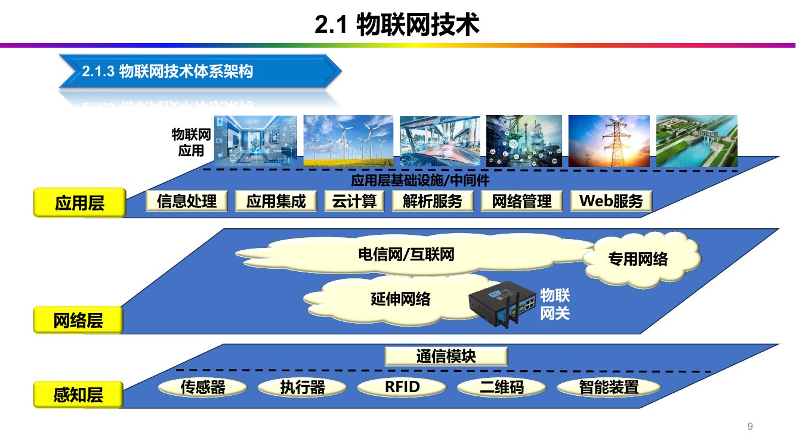
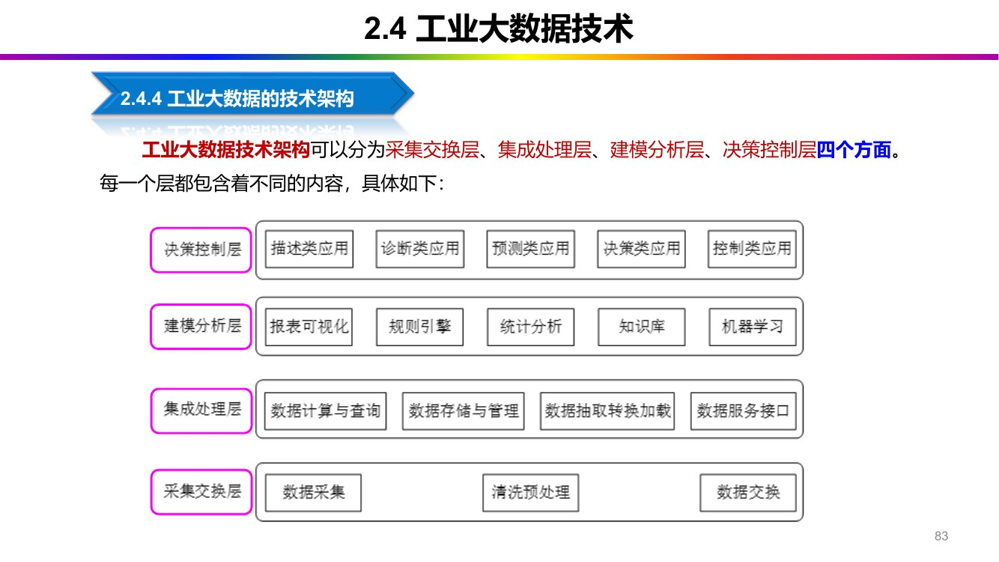

# 第 2 章 工业互联网基础技术

> <strong>课件结构</strong>（第2章 工业互联网基础技术-0911，92 页）：
> 2.1 物联网技术 → 2.2 网络通信技术 → 2.3 云计算技术 → 2.4 工业大数据技术 → 2.5 信息安全技术

## 0 课件页码 → 本节

| 课件页 | 内容 | 本节 |
| --- | --- | --- |
| 5–8 | 物联网概念、本质、三特点、国内外现状 | 1.1 |
| 9–16 | 物联网三层体系架构（感知层/网络层/应用层） | 1.2 |
| 17–21 | 物联网四大关键技术 | 1.3 |
| 22–27 | 物联网应用（电网/物流/农业/交通/环境）与展望 | 1.4 |
| 31–33 | 新基建、连接技术两大类别、场景匹配 | 2.1 |
| 34–37 | 现场总线、三种基本类型、现场总线本质、四大工业以太网 | 2.2 |
| 40–48 | 无线通信：LTE、5G、室内定位、LPWAN | 2.3 |
| 51–61 | 云计算定义、三种服务、七大特点、五大优势、与工业互联网 | 3 |
| 64–69 | 工业大数据定义、四大核心技术、三类来源、制造业十大系统 | 4.1–4.2 |
| 71–79 | 采集技术、多源异构、三类分析技术 | 4.3 |
| 83–85 | 工业大数据技术架构（四层）、核心价值、五大应用场景 | 4.4–4.5 |
| 88–91 | 信息安全风险构成、影响因素、三类技术 | 5 |
| 92 | 课后习题（12 题） | §6 |

## 1 物联网技术（2.1）

### 1.1 三个层次的定义

<strong>（1）物联网是什么</strong>

<strong>（2）物联网的本质</strong>

> 【课件 C2·P5】物联网的<strong>本质还是互联网</strong>，终端不仅是计算机，还包括通过传感设备连接的
> 其它物体。按照约定的<strong>协议</strong>和<strong>信息安全保障机制</strong>，对物体进行在线监测、安全管理、
> 定位追踪、调度指挥、远程控制、在线升级等，实现对万物的管理。

物联网的本质：<strong>互联网</strong>（不是"传感器网"，也不是"新的网络"）。

<strong>（3）三个特点：感知—传输—应用</strong>

| 环节 | 定位 | 具体内容 |
| --- | --- | --- |
| <strong>感知</strong> | <strong>全面感知</strong> | 利用 RFID、传感器、二维码等，随时随地采集物体的动态信息 |
| <strong>传输</strong> | <strong>可靠传输</strong> | 通过网络将感知到的各种信息进行实时传输 |
| <strong>应用</strong> | <strong>智能处理</strong> | 利用计算机技术，及时对海量数据进行信息控制，真正达到人与物、物与物的沟通 |

"全面感知、可靠传输、智能处理"——三个四字词，对应感知、传输、应用三环节。注意"智能处理"不是"智能分析"，课件用词是<strong>处理</strong>。

### 1.2 国内外发展现状（只考"谁提了什么"）

| 国家/地区 | 计划/战略 | 核心内容 |
| --- | --- | --- |
| <strong>美国</strong> | <strong>"智慧地球"计划（2018）</strong> | 核心是 <strong>3I：物联化（Instrumented）、互联化（Interconnected）、智能化（Intelligent）</strong> |
| <strong>欧盟</strong> | 十四点行动计划 | 涵盖标准化、研究项目、试点工程、管理机制、国际对话 |
| <strong>日本</strong> | <strong>U-Japan 计划</strong> | 实现人与物的互相连接，建设"人与物随时随地均可连接的泛在网络社会" |
| <strong>韩国</strong> | <strong>IT839 战略</strong>、<strong>U-Korea</strong> 战略 | 把泛在物联网 <strong>USN</strong> 作为基础建设之一，确定为经济新增长点 |

3I 是哪三个：物联化、互联化、智能化。<strong>顺序固定</strong>：先物联（感知设备）、再互联（网络）、再智能（应用），与三层架构同构。

> 【课件 C2·P8】国内四条：① 应用领域加速发展（民生领域试点示范与规模应用）；
> ② 生态体系逐渐形成（元器件、设备、芯片、运营、软件、服务的完整产业链）；
> ③ 产业集群优势突显（以应用平台为先导）；
> ④ <strong>高端传感器、智能硬件和核心芯片仍与发达国家有差距，网络与信息安全存在隐患</strong>。

### 1.3 物联网三层体系架构

*图 2-1 物联网三层体系架构：感知层—网络层—应用层（课件 C2·P9）*

<strong>（1）感知层：物联网的"五官"与"皮肤"</strong>

这一层由两类设备构成（【课件 C2·P10】）：

| 类别 | 举例 | 职责 |
| --- | --- | --- |
| <strong>传感器</strong> | 温度、湿度传感器、摄像头 | 负责"<strong>感知</strong>" |
| <strong>识别设备</strong> | 二维码、RFID 标签和读写器 | 给物体"<strong>贴标签</strong>"以便识别 |

传感器的三种分类维度：

| 分类维度 | 举例 |
| --- | --- |
| 按<strong>原理</strong>分 | 电阻式、电容式、光栅式、超声波、激光、压电式 |
| 按<strong>被测量</strong>分 | 温度、湿度、振动、压力、力矩传感器 |
| 按<strong>输出信号</strong>分 | 数字传感器、模拟传感器 |

<strong>（2）网络层：物联网的"神经网络"和"信息高速公路"</strong>

典型链路（课件同页，举例极好，可直接背）：

这句话是"分层思想"的最佳论据：<strong>每层只关心自己的职责</strong>，网络层不解析业务语义（语义是应用层的事），所以才能"异构互联"。

<strong>（3）应用层：物联网的"大脑"</strong>

两个关键部分（【课件 C2·P15】）：

1. <strong>物联网应用基础设施</strong>：支撑海量数据处理的云计算平台、大数据分析平台；
2. <strong>具体的行业应用服务</strong>：智慧农业灌溉、智能家居、智慧交通、智慧医疗等。

把三层想成人体：<strong>感知层=五官皮肤</strong>（采集）、<strong>网络层=神经网络</strong>（传导）、<strong>应用层=大脑</strong>（决策）。课件 P10/P13/P15 的比喻就是这三个词。

### 1.4 物联网四大关键技术

<strong>（1）传感器技术</strong>

无线传感器网络（WSN）：通过<strong>微型传感器节点</strong>在检测区中的布局规划构成，利用无线通信技术
建立<strong>集结构化</strong>的网络结构。主要发展方向（课件同页）：<strong>测试技术与网络化测控、传感器网络
组织结构与底层协议、传感器自我检测及控制</strong>。

<strong>（2）云计算技术（详见 §3）</strong>

<strong>（3）无线传感技术</strong>

节点<strong>协同运行</strong>，对监控区域所有点位、所有时间实现"感知—收集—处理—传输"，再<strong>利用网关与
公用网络连接</strong>，最后传给监测人员。

数据传输技术包括（课件同页）：<strong>无线局域网技术（WLAN）、无载波通信技术、紫蜂协议（ZigBee）技术</strong>。

<strong>（4）安全与隐私技术</strong>

"为什么物联网比互联网更需要隐私保护"——答"标签可被远程扫描 + 节点无人值守 +数据量大且分散"，三条都来自 P21。

### 1.5 五类典型应用（选择/填空只需认名字）

| 应用 | 一句话要点 |
| --- | --- |
| <strong>智能电网</strong> | 需高效网络传输 + 传感整合分析；监控各用电节点，实现动态化监控 |
| <strong>智能物流</strong> | 覆盖采购、生产、销售；控制生产成本与运输成本 |
| <strong>智慧农业</strong> | 典型是<strong>智慧大棚</strong>：多传感器操作、简化工序、增产 |
| <strong>智能交通</strong> | 智能停车引导、智能交通预警；摄像头采集 → 后台分析 → 推送手机/广播 |
| <strong>环境监测</strong> | 多节点<strong>自组网</strong>，某节点失效可由其他节点<strong>自行选择路径</strong>形成新网络；数据可"云托管" |

> 【课件 C2·P26】环境监测那段描述的就是 WSN 的<strong>自愈能力</strong>（self-healing），是"为什么用
> 无线自组网而不是有线"的标准答案。

本节课件原文 · 14 条（C2·P5–26）

> 【课件 C2·P5】物联网（Internet of Things，IoT）是<strong>物与网络的结合</strong>，通过信息传感设备将
> 要连接的物体接入网络，让接入网络的物体实现互联互通，并实现对这些物体的<strong>识别、控制、
> 管理、定位、互联、信息共享</strong>等，推动了信息科学技术产业的<strong>第三次革命</strong>。

> 【课件 C2·P6】

> 【课件 C2·P7】国外四家：

> 【课件 C2·P10】感知层是三层体系架构中<strong>最基础、也是最为核心的一层</strong>。作用是通过传感器
> 对物质属性、行为态势、环境状态等各类信息进行<strong>大规模的、分布式的获取与状态辨识</strong>，采用
> <strong>协同处理</strong>的方式，针对具体感知任务对多种感知信息进行在线计算与控制并做出反馈。

> 【课件 C2·P13】网络层是整个体系架构的<strong>中枢</strong>，起到<strong>承上启下</strong>的作用，解决的是感知层在
> 一定范围一定时间内所获得的数据<strong>传输</strong>问题，通常以解决<strong>长距离传输</strong>问题为主。这些数据可
> 通过企业内部网、通信网、互联网、各类专用通用网、小型局域网等进行传输交换。

> 传感器 →（<strong>ZigBee 或 LoRa</strong> 这类低功耗局域网技术）→ <strong>网关</strong> →（<strong>4G/5G 或光纤</strong>等广域网
> 技术）→ <strong>云平台</strong>。

> 【课件 C2·P13】关键一句：<strong>网络层不关心数据具体代表什么，只确保数据能准确、高效地送达。</strong>

> 【课件 C2·P15】应用层位于三层架构的<strong>最顶层</strong>，主要解决<strong>信息处理、人机交互</strong>等相关问题，
> 通过对数据的分析处理，为用户提供丰富特定的服务。功能包括两方面：<strong>数据</strong>（管理 + 处理）
> 与<strong>应用</strong>（与应用结合才有价值）。

> 【课件 C2·P17】四大关键技术：① 传感器技术；② 云计算技术；③ 无线传感器（网络）技术；
> ④ 安全与隐私技术。

> 【课件 C2·P18】传感器是物联网针对自身内部及外部环境进行感知的装置系统，不仅负责感知，
> 还能辅助实现数据的分析和传输。发展趋势是<strong>由传统传感器逐渐转变为嵌入式 Web 传感器</strong>，
> 趋于<strong>智能化</strong>。

> 【课件 C2·P19】云计算通过远程服务器或非本地服务器为用户提供数据的<strong>计算、存储</strong>等服务，
> 能够实现大量数据的<strong>并行计算</strong>与<strong>弹性增长资源存储</strong>。它把海量程序分解为子程序，由多台
> 服务器高效处理，在很短时间内达到与超级计算机类似的效率。

> 【课件 C2·P20】无线传感网络（WSN）是集<strong>稳定性、安全性、高效性</strong>于一身的<strong>自组织</strong>无线
> 网络信息系统，能实现<strong>分布式</strong>的信息收集、处理、共享。

> 【课件 C2·P21】几乎所有标签/识别技术都能<strong>远程扫描</strong>，标签可按阅读器指令把信息传出，
> 因此必须保证涉及机密或隐私的实物信息在标签上具有较高安全性。此外还要保障：
> <strong>终端安全管理</strong>与<strong>感知节点的物理安全性</strong>（用户卡安全、设备软硬件安全、避免异常移动导致
> 的安全问题）。

> 【课件 C2·P22–26】

## 2 网络通信技术（2.2）

### 2.1 定位与两类连接技术

<strong>新基建七大领域</strong>：

<strong>不同场景对通信方式的要求</strong>（【课件 C2·P33】，这段是选择题的"配对题"密集处）：

| 场景 | 要求 | 对应技术 |
| --- | --- | --- |
| 自动驾驶 | <strong>低时延</strong> | 5G 的 <strong>uRLLC</strong>（超可靠低时延通信） |
| 远程医疗 | 大带宽 | 5G 的 <strong>eMBB</strong>（增强移动宽带） |
| 低速率、大容量、远距离 | 广覆盖低功耗 | <strong>LPWAN</strong>：LoRa、NB-IoT、Chirp-IoT |
| 对 <strong>MESH 组网</strong>要求高 | 自组网 | <strong>BLE / ZigBee</strong> |

5G 三大应用场景的名称要分清：<strong>eMBB</strong>（大带宽）、<strong>uRLLC</strong>（低时延高可靠）、<strong>mMTC</strong>（海量机器类通信）。课件 P33/P44 用的是前两个 + "大连接"的说法。

### 2.2 有线：现场总线与工业以太网

<strong>（1）现场总线的定义与三种基本类型</strong>

工业总线三种基本类型（【课件 C2·P35】）：

| 类型 | 层次 | 连接的设备 |
| --- | --- | --- |
| <strong>传感器级总线</strong> | 较低层次 | 传感器、行程开关、继电器、接触器、阀门定位器 |
| <strong>设备级总线</strong> | 较低层次（同传感器级） | 同上（课件原文如此并列） |
| <strong>现场总线</strong> | 较高层次 | 完成过程控制器或现场仪表之间的通信 |

<strong>（2）现场总线的"本质"六点</strong>

其中最重要的两条，课件讲得最细：

<strong>（3）工业以太网与四大协议</strong>

| 协议 | 推出时间 | 课件给的特点 |
| --- | --- | --- |
| <strong>Modbus TCP/IP</strong> | 首个推出的工业以太网协议 | 本质是传统 Modbus 通信在以太网传输层协议中"压缩"，用于控制设备间传输<strong>离散数据</strong> |
| <strong>EtherCAT</strong> | <strong>2003 年</strong> | 所有联网从机从数据包中<strong>仅提取所需相关信息</strong>，并在向下游传输时把数据<strong>插入帧中</strong>——通常称为"<strong>飞速</strong>"通信 |
| <strong>EtherNet/IP</strong> | <strong>2000 年</strong> | <strong>唯一一个完全基于以太网标准</strong>并使用标准以太网物理层、数据链路层、网络层和传输层的工业以太网协议；采用标准以太网交换，<strong>支持无限数量节点</strong> |
| <strong>Profinet</strong> | 西门子与 Profibus 用户组织成员共同开发 | 利用集成到设备中的<strong>特殊交换机</strong>，本质上是把 <strong>Profibus I/O 控制器通信扩展到以太网</strong> |

EtherCAT 的"飞速"（on-the-fly）指的是<strong>报文在从站间不停留、边传边读写</strong>，不是"速度特别快"的泛称。

### 2.3 无线：LTE / 5G / 室内定位 / LPWAN

<strong>（1）LTE</strong>

作用：满足工厂<strong>外</strong>网络<strong>普遍覆盖和高速传输</strong>需求，实现 IT 系统与互联网融合、企业专网与
互联网融合。

<strong>（2）5G</strong>

三个判断：

1. 5G 网络是<strong>控制和转发分离</strong>的网络：<strong>转发面</strong>专注业务数据的高效路由转发，<strong>控制面</strong>采用
 <strong>逻辑集中</strong>的方式，实现统一的策略控制、灵活的流量调度和连接管理；
2. 5G 为工业互联网提供<strong>更可靠、更开放、按需定制</strong>的网络，支撑大流量业务（虚拟工厂、高清
 视频远程维护）；
3. 支持工厂内、外大量设备监控（远程监控与控制、无线视频监控、环境参数上报）。

5G 的核心特征：高速率、低时延、大连接（三个词）；"5G 网络架构特征" →<strong>控制与转发分离</strong>。

<strong>（3）室内定位技术对比表</strong>（【课件 C2·P45】，数字题）

| 技术 | 定位精度（米） | 覆盖范围 | 保密性 | 穿透性 | 抗扰性 |
| --- | --- | --- | --- | --- | --- |
| <strong>RFID</strong> | 10 ~ 100 | 小 | 高 | 差 | 好 |
| <strong>WiFi</strong> | 3 ~ 15 | 大 | 差 | 差 | 差 |
| <strong>蓝牙 Beacon</strong> | 1 ~ 5 | 大 | 一般 | 好 | 差 |
| <strong>ZigBee</strong> | 3 ~ 10 | 大 | 一般 | 好 | 差 |
| <strong>UWB（超宽带）</strong> | <strong>0.1 ~ 0.5</strong> | 小 | 高 | 差 | 好 |

精度最高的室内定位技术是 <strong>UWB（0.1~0.5 m）</strong>；精度最差、覆盖最小的是 RFID。记法："<strong>UWB 最准但覆盖小、RFID 最糙但便宜</strong>"。

<strong>（4）LPWAN（低功耗广域网）对比表</strong>

> 【课件 C2·P48】LPWAN 以<strong>低功耗、广覆盖和大连接</strong>能力为核心，适用于大规模物联网设备的
> 远程通信。工业互联网环境存在大量传感器、阀门、过程控制变量等<strong>低速信号</strong>需要采集与处理。

| 类别 | 频谱 | 信道带宽 | 通信速率 | 覆盖范围 | 模组成本 | 续航 | 建网方式 |
| --- | --- | --- | --- | --- | --- | --- | --- |
| <strong>LTE-Cat1</strong> | 授权 | < 18 MHz | < 5 Mbps | 较大 | $5~10 | 2~3 年 | 蜂窝公网 |
| <strong>LTE-eMTC</strong> | 授权 | 1.4 MHz | < 1 Mbps | 大 | $5~10 | 5 年 | 蜂窝公网 |
| <strong>NB-IoT</strong> | <strong>授权</strong> | <strong>180 kHz</strong> | <strong>< 250 kbps</strong> | 大 | <strong>< $5</strong> | <strong>5 年</strong> | <strong>蜂窝公网</strong> |
| <strong>LoRa</strong> | <strong>非授权</strong> | <strong>125 kHz</strong> | <strong>< 50 kbps</strong> | 大 | <strong>< $5</strong> | <strong>10 年</strong> | <strong>自组网络</strong> |
| <strong>Chirp-IoT</strong> | 非授权 | 125 kHz | < 50 kbps | 大 | < $5 | 10 年 | 自组网络 |
| <strong>SigFox</strong> | 非授权 | 100 Hz | < 100 bps | 大 | < $5 | 10 年 | 自组网络 |

三个易错处：<strong>NB-IoT 用授权频谱、LoRa 用非授权频谱</strong>；<strong>NB-IoT 带宽 180 kHz、LoRa 带宽 125 kHz</strong>；<strong>LoRa 续航 10 年、NB-IoT 5 年</strong>。NB-IoT 与 LoRa 的最大区别在<strong>频谱是否授权</strong>与<strong>建网方式（蜂窝公网 / 自组网）</strong>，不在速率。

本节课件原文 · 11 条（C2·P31–44）

> 【课件 C2·P31】工业互联网是"<strong>新基建</strong>"<strong>七大板块</strong>之一，也是从传统<strong>消费互联网（To C）</strong>
> 向<strong>产业互联网（To B）</strong>转型的重要方向。网络通信技术是产业发展的<strong>重要推动力量</strong>，是工业
> 互联网的<strong>基础设施</strong>，是连接先进信息技术（物联网、大数据、云计算、人工智能等）与工业
> <strong>全要素</strong>之间的<strong>桥梁</strong>。

> <strong>5G 基站建设、特高压、城际高速铁路和城市轨道交通、新能源汽车充电桩、大数据中心、
> 人工智能、工业互联网</strong>。

> 【课件 C2·P32】工业互联网连接技术包括：<strong>有线连接</strong>与<strong>无线通信</strong>两大类别。
> 无线通信因<strong>部署简单、功能强大、使用便捷、组网灵活、覆盖区域大</strong>而在工业互联网中广泛使用，
> 特别是 <strong>5G、TSN、LoRa</strong> 等新技术的导入所引发的技术变革。

> 【课件 C2·P34】工业控制网络主要分为<strong>现场总线</strong>和<strong>工业以太网</strong>两大技术体系，以实现
> <strong>现场控制</strong>为主。

> 【课件 C2·P35】现场总线是一种<strong>应用于生产现场</strong>，在<strong>现场设备之间、现场设备和控制装置
> 之间</strong>实行<strong>双向、串行、多结点</strong>的数字通信技术。

> 现场总线本质包含：① <strong>现场通信网络</strong>；② <strong>现场设备互联</strong>；③ <strong>互操作性</strong>；
> ④ <strong>分散功能块</strong>；⑤ <strong>通信线供电</strong>；⑥ <strong>开放式互联网络</strong>。

> - <strong>分散功能块</strong>：FCS <strong>废弃了 DCS 的输入/输出单元和控制站</strong>，把 DCS 控制站的功能块
> <strong>分散地分配给现场仪表</strong>，从而构成<strong>虚拟控制站</strong>，彻底地实现了<strong>分散控制</strong>。
> - <strong>通信线供电</strong>：允许现场仪表<strong>直接从通信线上摄取能量</strong>，提供用于<strong>本质安全环境</strong>的
> 低功耗现场仪表，配套还有<strong>安全栅</strong>。

> 【课件 C2·P34】工业以太网是一种<strong>专为工业环境设计</strong>的网络通信技术，<strong>基于标准的以太网
> 技术，但针对工业应用进行了优化</strong>。

> 【课件 C2·P37】主流四种工业以太网协议：<strong>Modbus TCP/IP、EtherCAT、EtherNet/IP、Profinet</strong>。

> 【课件 C2·P42】LTE（Long-Term Evolution，<strong>长期演进</strong>）是一种<strong>高速、低延迟的 4G</strong> 无线
> 通信技术。它是全球<strong>唯一主流的 4G 标准</strong>，200 个国家和地区的运营商提供服务，可<strong>无缝漫游</strong>。
> 单站覆盖最多十几公里甚至几十公里；<strong>时延小、可靠性高</strong>。

> 【课件 C2·P44】5G（5th Generation Mobile Communication Technology）是一种具有<strong>高速率、
> 低时延和大连接</strong>特点的新一代宽带移动通信技术，5G 通讯设施是实现<strong>人机物互联</strong>的网络基础设施。

## 3 云计算技术（2.3）

### 3.1 定义与"云—大"关系

> 【课件 C2·P51】云计算（Cloud Computing）是<strong>分布式计算的一种</strong>，指通过网络"云"将巨大的
> 数据处理程序<strong>分解成无数个小程序</strong>，然后通过<strong>多部服务器组成的系统</strong>处理和分析这些小程序，
> 得到结果并返回给用户。

<strong>云计算的七个特点</strong>：

1. "云"是一个庞大的<strong>资源池</strong>，用户按需购买，像自来水、电、煤气那样计费；
2. "云"具有相当的<strong>规模</strong>（谷歌云已有上百万台服务器）；
3. 云计算<strong>不针对特定的应用</strong>，在"云"的支撑下可以构造出千变万化的应用；
4. "云"的规模可以<strong>动态伸缩</strong>，满足应用和用户规模增长的需要；
5. "云"使用了<strong>数据多副本容错、计算节点同构可互换</strong>等措施保障高可靠性；
6. "云"的<strong>特殊容错措施</strong>使得可以采用极其廉价的节点来构成云；
7. "云"的<strong>自动化管理</strong>使数据中心管理成本降低；用户<strong>无须了解应用的具体位置</strong>，一台计算机、
 PAD 或手机就能通过网络服务获取能力超强的服务。

### 3.2 三种服务模式：IaaS / PaaS / SaaS

| 模式 | 课件定义 | 关键判据 | 用户自主权 |
| --- | --- | --- | --- |
| <strong>IaaS</strong> | 将<strong>硬件设备等基础资源</strong>封装成服务供用户使用；用户相当于在使用<strong>裸机和磁盘</strong> | 允许用户<strong>动态申请或释放节点</strong>，按使用量计费；由公众共享，资源使用效率更高 | <strong>最高</strong>（能管 OS 及以上） |
| <strong>PaaS</strong> | 对资源的抽象层次<strong>更进一步</strong>，提供<strong>应用程序的运行环境</strong>；自身负责<strong>资源的动态扩展和容错管理</strong> | 用户不必考虑节点间配合 | <strong>降低</strong>（必须用特定编程环境与编程模型） |
| <strong>SaaS</strong> | 针对性更强，将<strong>某些特定应用软件功能</strong>封装成服务 | 既不提供计算/存储资源（不像 PaaS），也不提供运行用户自定义程序的环境（不像 IaaS），<strong>只提供某些专门用途的服务供应用调用</strong> | <strong>最低</strong> |

用户自主权从高到低：<strong>IaaS > PaaS > SaaS</strong>；抽象层次从低到高：<strong>IaaS < PaaS < SaaS</strong>。PaaS 提供运行用户自定义应用程序的环境；IaaS 只提供裸机和存储。

### 3.3 五大优势

| 优势 | 描述 |
| --- | --- |
| <strong>按需自助服务</strong> | 用户可根据自己的需求购买云计算服务 |
| <strong>广泛的网络接入</strong> | 任何地点、任何时间只要有网络即可 |
| <strong>资源池化</strong> | 可随意加减资源，最大特点是<strong>屏蔽硬件差异</strong>（品牌、型号） |
| <strong>快速弹性伸缩</strong> | 可快速根据需求增减服务 |
| <strong>可计量服务</strong> | 用技术和其他的手段实现<strong>单位的统一</strong> |

> 【课件 C2·P61】云计算优势的本质：<strong>技术特征和规模效应带来的压倒性的性能/价格比优势</strong>。
> 全球企业 IT 开销分三部分（<strong>硬件、能耗、管理成本</strong>），使用云计算后，大型数据中心相比中型
> 至少可以降低 <strong>5～7 倍</strong>的网络、存储和管理成本。

### 3.4 云计算与工业互联网

四个上云：<strong>能力上云、业务上云、设备上云、管理上云</strong>。

本节课件原文 · 5 条（C2·P52–60）

> 【课件 C2·P52】两句关系：
> <strong>云计算是大数据的来源和支撑；大数据是云计算的灵魂和发展方向。</strong>

> 【课件 C2·P53】云计算按服务类型大致分三类：① <strong>软件即服务（SaaS）</strong>；② <strong>平台即服务
> （PaaS）</strong>；③ <strong>基础设施即服务（IaaS）</strong>。

> 【课件 C2·P54】三者的准确表述：

> 【课件 C2·P60】五大优势：

> 【课件 C2·P57】
> - 云计算是推动工业互联网发展的<strong>关键技能力量</strong>：<strong>如果没有云计算，以及在云计算平台上所
> 运行的大数据技术，工业互联网就不会存在</strong>；
> - 使用<strong>工业云平台</strong>能够支撑企业<strong>智能制造、云制造、协同制造</strong>三类制造，逐步促进企业的
> <strong>能力上云、业务上云、设备上云和管理上云</strong>，帮助企业实现数字化转型。

## 4 工业大数据技术（2.4）

### 4.1 定义与四大核心技术

> 【课件 C2·P64】工业大数据技术：在工业领域中，围绕典型智能制造模式，<strong>从客户需求到销售、
> 订单、计划、研发、设计、工艺、制造、采购、供应、库存、发货和交付、售后服务、运维、报废或
> 回收再制造</strong>等整个<strong>产品全生命周期</strong>各个环节所产生的各类数据及相关技术和应用的总称。

> 【课件 C2·P65】四大核心技术：<strong>工业大数据采集技术、工业大数据管理技术、工业大数据分析
> 技术、工业大数据平台技术</strong>（采集在最左，平台在中间托底，分析在右侧）。

### 4.2 三类主体来源

| 类别 | 内容 | 具体系统/数据 | 特点 |
| --- | --- | --- | --- |
| <strong>① 企业信息化数据</strong> | 企业运营管理相关的<strong>业务数据</strong> | <strong>ERP、PLM、SCM、CRM</strong> 等 | 工业企业传统意义上的<strong>数据资产</strong> |
| <strong>② 工业物联网数据</strong> | <strong>制造过程数据</strong>：装备、物料及产品加工过程的<strong>工况状态参数、环境参数</strong> | 通过 <strong>MES</strong> 系统实时传递 | 智能装备大量应用下，<strong>此类数据量增长最快</strong> |
| <strong>③ 企业外部数据（外部跨界数据）</strong> | 产品售出后的<strong>使用、运营情况</strong>数据；客户名单、供应商名单、外部互联网数据 | — | 跨界、外部 |

<strong>制造业十大系统集成</strong>：

| 缩写 | 全称 | 缩写 | 全称 |
| --- | --- | --- | --- |
| <strong>MES</strong> | 制造执行系统 | <strong>APS</strong> | 高级计划和排程 |
| <strong>ERP</strong> | 企业资源规划 | <strong>SCADA</strong> | 监控控制与数据获取 |
| <strong>SCM</strong> | 供应链管理 | <strong>PLM</strong> | 产品生命周期管理 |
| <strong>WMS</strong> | 仓库管理系统 | <strong>QMS</strong> | 质量管理系统 |
| <strong>CRM</strong> | 客户关系管理 | <strong>EAM</strong> | 企业资产管理 |

按"计划—执行—资源—质量—设备—供应链—客户"七条线记：计划（APS、ERP）、执行（MES、SCADA）、资源（EAM）、质量（QMS）、仓储物流（WMS、SCM）、产品（PLM）、客户（CRM）。

### 4.3 三类关键技术

<strong>（1）采集技术</strong>

<strong>（2）存储与管理：多源异构数据</strong>

多模态的<strong>五种</strong>表述：<strong>关系、图、键值、时序、非结构化</strong>（这是"多模态/多源异构"的标准枚举）。

<strong>（3）分析技术：三类</strong>

| 分析技术 | 数据来源 | 能做什么 |
| --- | --- | --- |
| <strong>① 时序模式分析</strong> | 设备上的温度、振动、压力、位移、重量等传感器持续产生的<strong>海量时序数据</strong> | 设备<strong>故障预警和诊断</strong>、利用率分析、能耗优化、生产监控 |
| <strong>② 工业知识图谱</strong> | 人、设备、材料、工艺、环境、测量及故障、经验、因果关系；维修工单、工艺流程文件、故障记录等<strong>非结构化文本</strong> | 构建机器可理解、可推理的<strong>结构化知识网络</strong>；抽取故障类型、故障现象/征兆/排查路线/结果分析；沉淀<strong>专家知识库</strong>（故障排查、运维检修、设备操作） |
| <strong>③ 多源数据融合分析</strong> | 内部信息系统（CRM、MES、ERP、SEM）的生产/管理/销售数据 + 外部物流、行业数据 | <strong>价格预测、精准销售、产品追溯、质量管控</strong>；提升生产加工、质量监控、运营、风险感知能力 |

多源数据分析的算法族（【课件 C2·P79】）：<strong>统计分析算法、深度学习算法、回归算法、分类算法、
聚类算法、关联规则</strong>。

"时序分析为什么重要"——课件 P76 有一句关键话：传感器数据的<strong>很多重要信息隐藏在时序模式结构中</strong>，只有挖掘出背后的结构模式，才能构建<strong>效果稳定</strong>的数据模型。

### 4.4 技术架构（四层，与第 5 章的四层互相对应）

*图 2-2 工业大数据技术架构：采集交换—集成处理—建模分析—决策控制（课件 C2·P83）*

四层顺序固定：<strong>采集交换 → 集成处理 → 建模分析 → 决策控制</strong>。与第 5 章（【课件 C5·P73】）的"数据采集与交换、数据集成与处理、数据建模与分析、决策与控制应用"<strong>是同一套东西的两种叫法</strong>。

### 4.5 核心价值与五大应用场景

这五个词与第 1 章"工业互联网的四种新模式"（智能化生产、网络化协同、个性化定制、服务化延伸）高度重合，只多了"智能化设计"。

本节课件原文 · 11 条（C2·P66–85）

> 【课件 C2·P66–69】

> 【课件 C2·P71】工业大数据的采集：主要通过 <strong>PLC、SCADA、DCS</strong> 等系统从机器设备<strong>实时</strong>
> 采集数据；也可通过<strong>数据交换接口</strong>从实时数据库等系统以<strong>透传或批量同步</strong>的方式获取物联网
> 数据；同时还需要从业务系统的<strong>关系型数据库、文件系统</strong>中采集结构化与非结构化业务数据。

> 【课件 C2·P71】DCS（分布式控制系统）、PLC（可编程逻辑控制器）、SCADA（监控与数据采集
> 系统）是工业自动化中常见的<strong>三种技术</strong>。

> 【课件 C2·P72】数据采集是生产中<strong>最实际最高频</strong>的需求，也是<strong>工业 4.0 的先决条件</strong>。

> 【课件 C2·P73】<strong>多源异构数据</strong>：数据源不同、数据结构或类型不同的数据集合。

> 【课件 C2·P74】多源异构数据管理的关键：针对不同类型数据的<strong>存储与查询</strong>技术，考虑数据
> 来源与结构<strong>随时间不断增加与变化</strong>的情况，形成<strong>可扩展的一体化管理系统</strong>；需要针对工业领域
> 数据在不同阶段、不同流程呈现<strong>多种模态（关系、图、键值、时序、非结构化）</strong>的特点，研制不同的
> <strong>数据管理引擎</strong>。

> 【课件 C2·P75】多模态数据集成技术的目的：把多模态数据<strong>有机结合</strong>，发挥单一模态无法挖掘
> 的价值；关心数据之间是否存在<strong>内在联系</strong>，使数据能被<strong>协同</strong>用于描述或解释工业现象。

> 【课件 C2·P76–79】

> 【课件 C2·P83】工业大数据技术架构可分为四个方面：
> <strong>① 采集交换层；② 集成处理层；③ 建模分析层；④ 决策控制层。</strong>

> 【课件 C2·P84】核心价值五条：① 新工业革命的<strong>基础动力</strong>；② 提升制造智能化水平，推动
> 中国工业升级；③ 支持工业互联网发展，促进中国工业转型；④ 助力中国制造<strong>弯道取直</strong>；
> ⑤ 在智能制造中的应用价值。

> 【课件 C2·P85】五大典型应用场景：<strong>① 智能化设计；② 智能化生产；③ 网络化协同制造；
> ④ 智能化服务；⑤ 个性化定制</strong>。

## 5 信息安全技术（2.5）

> 本节是第 6 章的"预告片"，只讲风险与三类技术；<strong>五维防护的细节在第 6 章</strong>，两章不要混。

### 5.1 形势

> 【课件 C2·P88】工业互联网以<strong>连接</strong>为本质、以<strong>人才</strong>为驱动、以<strong>智能科技</strong>为技术支撑，
> 除此以外，还需要以<strong>安全</strong>为保障。近年来以工业互联网为攻击目标的网络安全事件层出不穷，
> 工业互联网时代的到来也从侧面预示着<strong>工业病毒时代</strong>的到来。

两个数字：<strong>48482 条（总漏洞）</strong>、<strong>864 条（工控漏洞）</strong>；两个增速：<strong>21.1%</strong>、<strong>13.2%</strong>。若记不住具体数，记"总漏洞约 4.8 万、工控漏洞约 900"。

### 5.2 风险构成五类（第 6 章会逐条展开）

| 风险类型 | 课件描述 |
| --- | --- |
| <strong>设备安全</strong> | 设备层的信息安全风险得不到治理，极可能影响整个工业互联网的正常运行 |
| <strong>网络安全</strong> | 工业企业现阶段的网络建设模式使<strong>网络拓扑结构越发复杂、变化多端</strong>，导致<strong>传统静态防护系统失效</strong> |
| <strong>数据安全</strong> | 企业信息数据处理更加便捷，并逐步实现由内向外的<strong>双向共享流动</strong>，数据处理环节增多，产生新风险 |
| <strong>控制安全</strong> | 信息技术与运营技术<strong>高度融合</strong>，在很大程度上破坏了<strong>传统安全可信的控制环境</strong> |
| <strong>管理安全</strong> | 互联网技术应用仍未完全成熟，很多情况下<strong>依旧需要人的管理维护介入</strong> |

注意"管理安全"这一项——很多同学只记"设备/控制/网络/数据"四类，课件 P89 的图里是<strong>五类</strong>（含管理安全），第 6 章的框架里则是"设备/控制/网络/应用/数据"。

### 5.3 影响因素：人员与技术

| 因素 | 具体表现 |
| --- | --- |
| <strong>人员</strong> | 工业互联网的发展与应用对企业<strong>管理结构</strong>形成较大挑战；很多企业对信息安全的<strong>认知尚未达到相当高度</strong>，相关<strong>长效机制暂未形成</strong>，没有融入整个文化体系，导致员工<strong>主动意识薄弱</strong> |
| <strong>技术</strong> | 受制于技术水平，很多企业工控网络系统的<strong>安全防护等级较低</strong>，多数情况下只能<strong>被动应对</strong>，存在<strong>滞后性</strong>；工业互联网环境下企业现代化生产对工控管理要求越来越高，涉及的理论、技术不断增多且<strong>日益复杂化</strong> |

### 5.4 三类信息安全技术

| 技术 | 课件描述 |
| --- | --- |
| <strong>工业防火墙技术</strong> | 在原 <strong>IT 防火墙访问控制</strong>功能基础上的<strong>加强版</strong>，能够对<strong>现场网络通讯协议</strong>进行剖析，<strong>限制非法访问</strong> |
| <strong>入侵检测技术</strong> | 现阶段可大规模应用于工业互联网领域的入侵检测技术主要包括<strong>机器学习、数据挖掘</strong>等检测方法，且新方法新技术<strong>更新较快</strong> |
| <strong>新型入侵检测技术</strong> | ① <strong>特征选择技术</strong>；② <strong>图像感知哈希特征提取技术</strong>；③ <strong>实验数据集研究方法</strong> |

"工业防火墙与 IT 防火墙的区别"——一句话：<strong>工业防火墙能深度解析工业协议</strong>（Modbus/Profinet 等），而 IT 防火墙只看 IP/端口，且工业防火墙不能随便阻断（会停生产线）。课件只给了前半句，后半句标【补充】。

本节课件原文 · 4 条（C2·P88–91）

> 【课件 C2·P88】<strong>2025 年：网络安全漏洞总数达 48482 条，同比增长 21.1%；其中工控系统漏洞
> 864 条，同比上升 13.2%。</strong> 攻击针对电力、化工、石油、铁路、新能源、核应用等关键领域，
> 关系到国家经济命脉的产业行业的信息安全。

> 【课件 C2·P89】

> 【课件 C2·P90】

> 【课件 C2·P91】主要有<strong>工业防火墙技术、入侵检测技术</strong>以及<strong>基于特征选择方法、图像感知
> 哈希特征提取方法、实验数据集</strong>等的<strong>新型入侵检测技术</strong>。

## 本章课后习题与对应小节

课件第 92 页 12 道题：

| 课件原题 | 对应小节 |
| --- | --- |
| 1. 物联网的三层结构是什么？分别简述三层的核心功能 | §1.3（五官/神经/大脑） |
| 2. 物联网有哪些关键技术？ | §1.4 四大关键技术 |
| 3. 什么是网络通信技术？工业互联网通信连接技术包括哪两大类别？ | §2.1（有线/无线） |
| 4. 什么是现场总线？现场总线和工业以太网的区别是什么？ | §2.2（六点本质 + 四大协议） |
| 5. 无线网络通信技术有哪些？应用于哪些领域？ | §2.3（LTE/5G/WiFi/UWB/LPWAN） |
| 6. IaaS、PaaS、SaaS 三者之间的关系和应用 | §3.2 对照表（自主权/抽象层次） |
| 7. 工业大数据的主体来源可以分为哪几类？ | §4.2 三类 |
| 8. 工业大数据的关键技术有哪些？ | §4.3（采集/存储管理/分析） |
| 9. 简述工业大数据的技术架构，并画出技术架构图 | §4.4 四层 + 图 2-2 |
| 10. 工业大数据是如何集成的？ | §4.3（多源异构 + 多模态 + ETL） |
| 11. 工业互联网面临的信息安全风险由什么构成？其影响因素是什么？ | §5.2 五类 + §5.3 人员/技术 |
| 12. 简述工业互联网信息安全技术主要有哪些技术？ | §5.4 三类 |

第 9 题明确要求"<strong>并画出技术架构图</strong>"——这是本课程<strong>唯一一道明确要求画图</strong>的课后题，务必能徒手画出四层框图（采集交换/集成处理/建模分析/决策控制），见 图 2-2。

## 本章要点

1. <strong>物联网三特点</strong>：全面感知、可靠传输、智能处理；<strong>本质还是互联网</strong>。
2. <strong>三层架构</strong>：感知层（五官/皮肤）、网络层（神经网络/信息高速公路）、应用层（大脑）。
3. <strong>四大关键技术</strong>：传感器、云计算、无线传感（网）、安全与隐私。
4. <strong>美国智慧地球 3I</strong>：物联化、互联化、智能化。
5. <strong>新基建七领域</strong>：5G 基站、特高压、城际高速铁路与城市轨道交通、新能源汽车充电桩、
 大数据中心、人工智能、工业互联网。
6. <strong>有线两大类</strong>：现场总线、工业以太网；<strong>工业以太网四协议</strong>：Modbus TCP/IP、EtherCAT（2003）、
 EtherNet/IP（2000）、Profinet。
7. <strong>现场总线本质六点</strong>：现场通信网络、现场设备互联、互操作性、分散功能块、通信线供电、
 开放式互联网络。
8. <strong>LPWAN 表</strong>：NB-IoT（授权 180 kHz，5 年）、LoRa（非授权 125 kHz，10 年）、SigFox（100 Hz）。
9. <strong>室内定位</strong>：UWB 0.1~0.5 m 最准；RFID 10~100 m 最粗。
10. <strong>云三服务</strong>：IaaS > PaaS > SaaS（自主权）；抽象层次反向。<strong>云—大关系</strong>：云计算是大数据
 的来源和支撑，大数据是云计算的灵魂和发展方向。
11. <strong>工业大数据三类来源</strong>：企业信息化数据、工业物联网数据（增长最快）、外部跨界数据；
 <strong>十大系统</strong>：MES/ERP/SCM/WMS/APS/SCADA/PLM/QMS/CRM/EAM。
12. <strong>技术架构四层</strong>：采集交换、集成处理、建模分析、决策控制。
13. <strong>安全风险五类</strong>：设备、网络、数据、控制、管理；<strong>影响因素</strong>：人员、技术；
 <strong>三类技术</strong>：工业防火墙、入侵检测、新型入侵检测。
