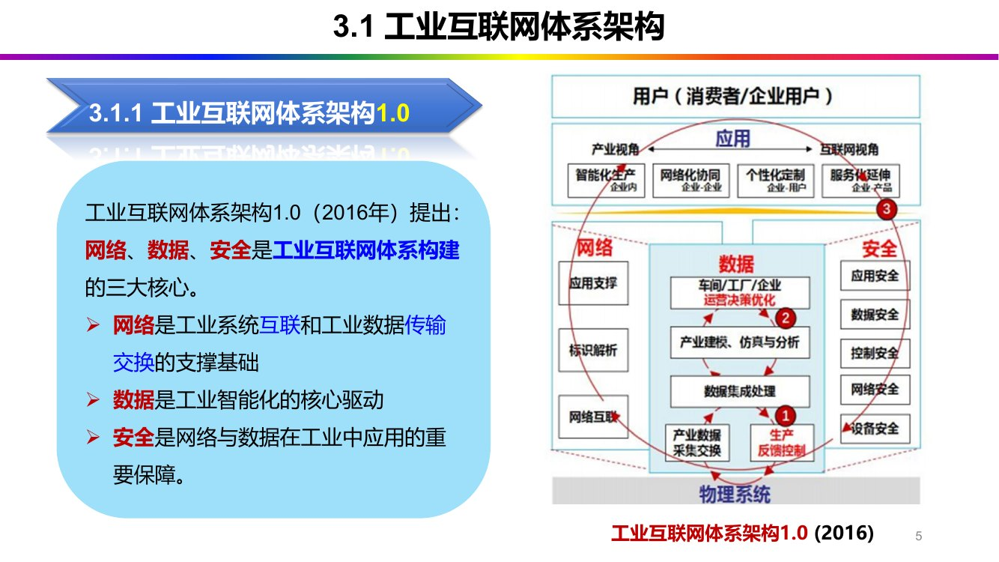
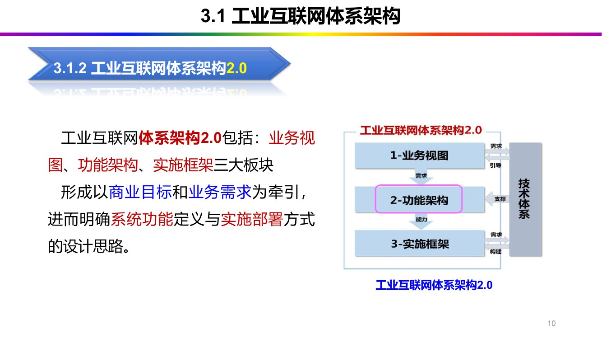
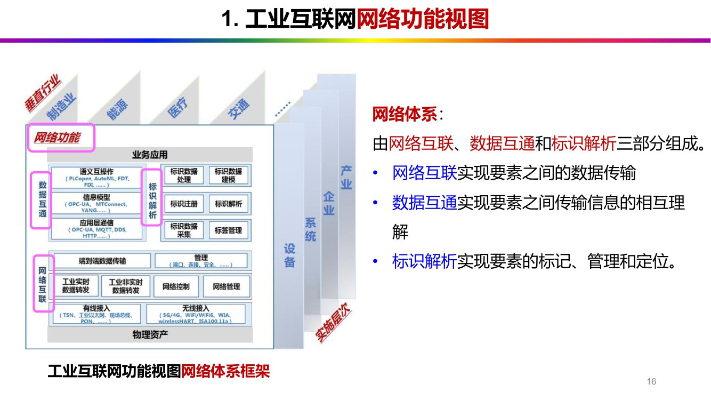
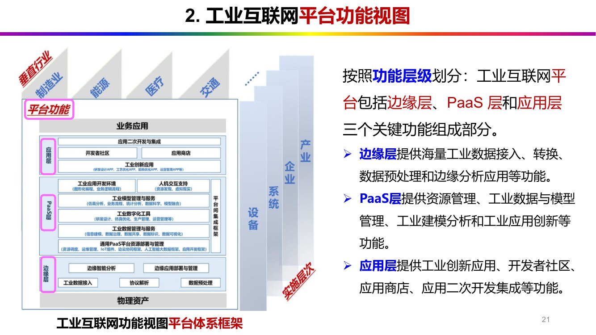
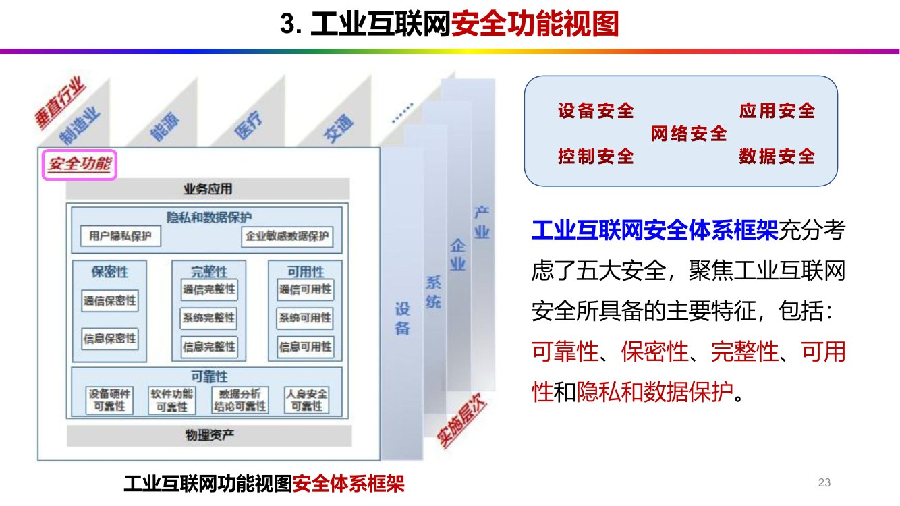
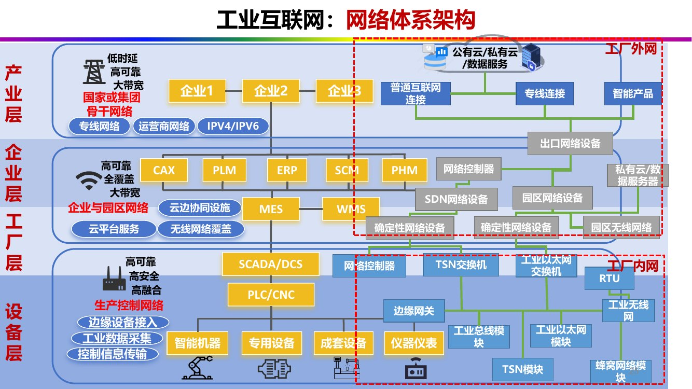
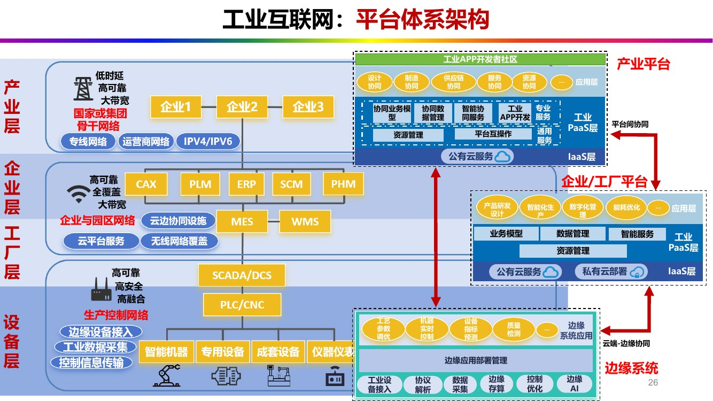
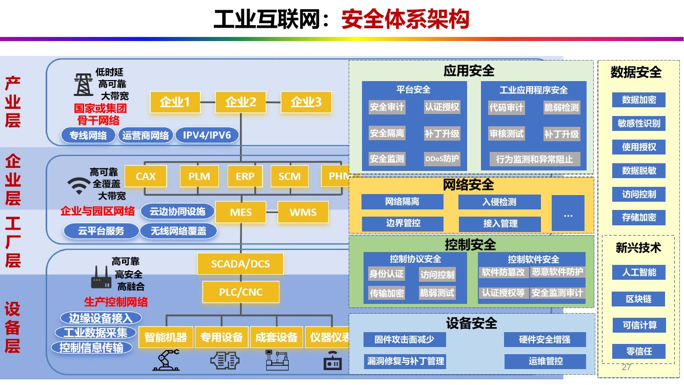

# 第 3 章 工业互联网体系架构

> <strong>课件结构</strong>（第3章 工业互联网体系架构-0918，30 页）：
> 3.1 体系架构 1.0 / 2.0 → 3.2 业务视图 → 3.3 功能架构（核心功能原理、网络/平台/安全三大功能视图）
> → 3.4 实施框架

## 0 课件页码 → 本节

| 课件页 | 内容 | 本节 |
| --- | --- | --- |
| 5–7 | 体系架构 1.0（2016）：三大核心 + 三大优化闭环 | 1.1 |
| 8–9 | 从 1.0 到 2.0 的演进：三阶段、继承了什么、为什么以平台替代数据 | 1.2 |
| 10–11 | 体系架构 2.0 的三大板块及各自"明确了什么" | 1.3 |
| 13 | 业务视图四层次（产业层/商业层/应用层/能力层） | 2 |
| 15 | 核心功能原理 | 3.1 |
| 16–20 | 网络功能视图：网络互联、数据互通、标识解析 | 3.2 |
| 21 | 平台功能视图：边缘层、PaaS 层、应用层 | 3.3 |
| 22–23 | 安全功能视图：五大安全 | 3.4 |
| 24–27 | 功能架构的"4 层 3 体系"及三张体系架构大图 | 3.5 |
| 29 | 实施框架：四大实施系统 | 4 |
| 30 | 课后习题（9 题） | §6 |

## 1 从 1.0 到 2.0：两代体系架构

### 1.1 体系架构 1.0（2016）：网络、数据、安全

> 【课件 C3·P5】工业互联网体系架构 <strong>1.0（2016 年）</strong>提出：<strong>网络、数据、安全</strong>是工业互联网
> 体系构建的三大核心。
> - <strong>网络</strong>是工业系统互联和工业数据传输交换的<strong>支撑基础</strong>；
> - <strong>数据</strong>是工业智能化的<strong>核心驱动</strong>；
> - <strong>安全</strong>是网络与数据在工业中应用的<strong>重要保障</strong>。

*图 3-1 工业互联网体系架构 1.0（2016）：网络、数据、安全三大核心（课件 C3·P5）*

1.0 的三大核心是 <strong>网络、数据、安全</strong>（注意：是"数据"，不是"平台"）。

### 1.2 三大优化闭环

| 闭环 | 数据基础 | 用什么技术 | 优化结果 |
| --- | --- | --- | --- |
| <strong>① 面向机器设备运行优化的闭环</strong> | 机器<strong>操作数据</strong>、<strong>生产环境数据</strong>的实时感知 | <strong>边缘计算</strong> | 机器设备的<strong>动态优化调整</strong>，构建<strong>智能机器和柔性生产线</strong> |
| <strong>② 面向生产运营优化的闭环</strong> | <strong>信息系统数据、制造执行系统（MES）数据、控制系统数据</strong>的集成处理 | <strong>大数据建模分析</strong> | 生产运营管理的<strong>动态优化调整</strong>，形成各种情景下的<strong>智能生产模式</strong> |
| <strong>③ 面向企业协同、用户交互与产品服务优化的闭环</strong> | <strong>供应链数据、用户需求数据、产品服务数据</strong>的综合集成与分析 | 综合集成 + 分析 | 企业资源组织和商业活动的<strong>创新</strong>，形成<strong>网络化协同、个性化定制、服务化延伸</strong>等新模式 |

三句话总结：<strong>"设备闭环管机器、运营闭环管生产、商业闭环管模式"</strong>，范围逐层放大。

### 1.3 从 1.0 到 2.0：演进的三阶段与"平台替代数据"

为什么 2.0 用'平台'替代了'数据'？ ：原因是，<strong>因为 1.0 中网络、数据、安全在数据功能上存在重叠</strong>；2.0 让"平台"专门承载<strong>数据的集成、管理与建模分析</strong>，于是网络管"通"、平台管"算"、安全管"保"，三者边界清晰。

### 1.4 体系架构 2.0 的三大板块

*图 3-2 工业互联网体系架构 2.0 的三大板块：业务视图、功能架构、实施框架（课件 C3·P10）*

| 板块 | 明确了什么 |
| --- | --- |
| <strong>业务视图</strong> | 明确了企业应用工业互联网实现<strong>数字化转型的目标、方向、业务场景及相应的数字化能力</strong> |
| <strong>功能架构</strong> | 明确了企业支撑业务实现所需的<strong>核心功能、基本原理和关键要素</strong> |
| <strong>实施框架</strong> | 描述了各项功能在企业<strong>落地实施的层级结构、软硬件系统和部署方式</strong> |

本节课件原文 · 5 条（C3·P6–11）

> 【课件 C3·P6】工业互联网体系架构 1.0 提出<strong>三大优化闭环</strong>：

> 【课件 C3·P8】演进三阶段（能力递进）：
> <strong>数字化（单点优化）→ 网络化（全面互联）→ 智能化（全局智能）</strong>。

> 【课件 C3·P9】体系架构 <strong>2.0（2019）</strong>充分继承了 1.0 的核心思想：
> - 2.0 <strong>仍突出数据作为核心要素</strong>；
> - 2.0 <strong>仍强调数据智能化闭环的核心驱动</strong>及其在生产管理优化与组织模式变革方面的变革作用；
> - 2.0 <strong>继承了三大功能体系</strong>。考虑到 1.0 中<strong>网络、数据、安全在数据功能上存在一定重叠</strong>，
> 2.0 中<strong>以平台替代数据</strong>，重点体现 1.0 中<strong>数据的集成、管理与建模分析功能</strong>，形成
> <strong>网络、平台、安全</strong>三大体系，但<strong>功能内涵与 1.0 基本一致</strong>。

> 【课件 C3·P10】工业互联网体系架构 2.0 包括：<strong>业务视图、功能架构、实施框架</strong>三大板块，
> 形成<strong>以商业目标和业务需求为牵引，进而明确系统功能定义与实施部署方式</strong>的设计思路。

> 【课件 C3·P11】三者各自"明确了什么"：

## 2 业务视图：四个层次

| 层次 | 定位 | 说明 |
| --- | --- | --- |
| <strong>产业层</strong> | <strong>宏观视角</strong> | 产业整体数字化转型 |
| <strong>商业层</strong> | <strong>微观视角</strong> | 企业数字化转型（业务/商业模式） |
| <strong>应用层</strong> | <strong>微观视角</strong> | 企业数字化转型（具体应用场景） |
| <strong>能力层</strong> | <strong>微观视角</strong> | 企业数字化转型（所需数字化能力） |

哪一个层次是宏观视角：<strong>产业层</strong>；其余三层都是<strong>企业（微观）视角</strong>。

业务视图的"应用层"与功能架构里平台体系的应用层<strong>不是一回事</strong>：前者是"业务视角的应用场景"，后者是"平台技术分层"。

本节课件原文 · 1 条（C3·P13）

> 【课件 C3·P13】工业互联网体系包括<strong>四个层次</strong>：<strong>产业层、商业层、应用层、能力层</strong>。

## 3 功能架构：核心功能原理与三大功能视图

### 3.1 核心功能原理（一句话，但极重要）

> 【课件 C3·P15】工业互联网的<strong>核心功能原理</strong>是基于<strong>数据驱动的物理系统与数字空间全面互联
> 与深度协同</strong>，以及在此过程中的<strong>智能分析与决策优化</strong>。

拆成三块：<strong>全面互联（物理↔数字）→ 深度协同 → 智能分析与决策优化</strong>。

### 3.2 网络功能视图：网络互联、数据互通、标识解析

*图 3-3 网络功能视图：网络互联、数据互通、标识解析（课件 C3·P16）*

一句话记法：<strong>"连得上（互联）→ 听得懂（互通）→ 找得到（解析）"</strong>。

#### （1）网络互联（【课件 C3·P17】）

三个子功能与对应技术：

| 子功能 | 做什么 | 典型技术 |
| --- | --- | --- |
| <strong>多方式接入</strong> | <strong>有线接入</strong> | 现场总线、工业以太网、<strong>工业 PON</strong>、<strong>TSN</strong> |
| | <strong>无线接入</strong> | <strong>5G/4G、WiFi/WiFi6、WIA、WirelessHART、ISA100.11a</strong> |
| <strong>网络层转发</strong> | 工业<strong>非实时</strong>数据转发、工业<strong>实时</strong>数据转发、网络控制、网络管理 | — |
| <strong>传输层传送</strong> | <strong>端口管理、端到端连接管理、安全管理</strong> | — |

#### （2）数据互通（【课件 C3·P18】）

三个层次与协议：

| 层次 | 做什么 | 协议 |
| --- | --- | --- |
| <strong>应用层通信</strong> | 数据信息传输<strong>安全通道</strong>的建立、维持、关闭；对支持工业数据资源模型的装备、传感器、远程终端单元、服务器等<strong>设备节点</strong>进行管理 | <strong>OPC UA、MQTT、HTTP</strong> |
| <strong>信息模型</strong> | 提供<strong>完备、统一</strong>的数据对象表达、描述和操作模型 | <strong>OPC UA、MTConnect、YANG</strong> |
| <strong>语义互操作</strong> | 工业数据信息的<strong>发现、采集、查询、存储、交互</strong>；以及<strong>请求、响应、发布、订阅</strong> | <strong>OPC UA、PLCopen、AutoML</strong> |

提供统一信息模型的协议：<strong>OPC UA / MTConnect / YANG</strong>；"用于发布/订阅的轻量协议" → <strong>MQTT</strong>（它属于应用层通信那一栏）。

#### （3）标识解析（【课件 C3·P19–20】）

六个功能逐条：

| 功能 | 具体内容 |
| --- | --- |
| <strong>标识数据采集</strong> | 负责标识的<strong>识读和数据预处理</strong>（含标识读写、数据传输、标识载体形式） |
| <strong>标签管理</strong> | 负责完成<strong>载体数据信息的存储、管理和控制</strong>（含标识编码存储形式） |
| <strong>标识注册</strong> | 在信息系统中<strong>创建对象标识注册数据</strong>并存储、管理、维护注册数据 |
| <strong>标识解析</strong> | 根据标识编码<strong>查询目标对象网络位置或相关信息</strong>的系统装置，对机器和物品进行<strong>唯一性定位和信息查询</strong> |
| <strong>标识数据处理</strong> | 对采集后数据进行<strong>清洗、存储、检索、加工、变换和传输</strong> |
| <strong>标识数据建模</strong> | 构建特定领域应用的<strong>标识数据服务模型</strong>，建立标识应用<strong>数据字典、知识图谱</strong>等 |

六个功能正好是一条流水线：<strong>采集 → 管标签 → 注册 → 解析 → 处理 → 建模</strong>。前四个偏"基础设施"，后两个偏"数据价值"。

### 3.3 平台功能视图：边缘层、PaaS 层、应用层

*图 3-4 平台功能视图：边缘层—PaaS 层—应用层（课件 C3·P21）*

这里平台是<strong>三层</strong>（边缘/PaaS/应用，不含 IaaS）；而第 5 章的<strong>平台功能架构</strong>是<strong>四层</strong>（边缘层、<strong>IaaS 层</strong>、平台层（工业 PaaS）、应用层（工业 SaaS），【课件 C5·P13】）。第 3 章讲"功能视图"= 3 层；第 5 章讲"功能架构"= 4 层。

### 3.4 安全功能视图：五大安全属性

*图 3-5 安全功能视图：可靠性、保密性、完整性、可用性、隐私和数据保护（课件 C3·P23）*

五大安全属性：<strong>可靠性、保密性、完整性、可用性、隐私和数据保护</strong>。注意与信息安全经典的 <strong>CIA 三性</strong>（保密性、完整性、可用性）区分：工业互联网在 CIA 之外加了<strong>可靠性</strong>（工业不能停机）和<strong>隐私和数据保护</strong>（数据不出厂）。

### 3.5 功能架构的"4 层 3 体系"

| 维度 | 内容 |
| --- | --- |
| <strong>4 个层次</strong> | <strong>设备层、工厂层、企业层、产业层</strong> |
| <strong>3 个体系</strong> | <strong>网络体系架构、平台体系架构、安全体系架构</strong> |

三张体系架构大图（课件 P25–P27）是本课程的"总图"，建议<strong>至少能画出框图轮廓</strong>：

*图 3-6 网络体系架构：产业层/企业层/工厂层/设备层 × 工厂内网/工厂外网（课件 C3·P25）*

看图要点（这张图的信息量最大）：

- 纵向四层：<strong>产业层</strong>（国家或集团骨干网络、专线网络、运营商网络、IPv4/IPv6）→ <strong>企业层</strong>
 （CAX/PLM/ERP/SCM/PHM、云边协同设施、MES/WMS、SDN 网络设备、园区网络设备）→ <strong>工厂层</strong>
 （SCADA/DCS、PLC/CNC、TSN 交换机、工业以太网交换机、确定性网络设备、园区无线网络）→
 <strong>设备层</strong>（智能机器、专用设备、成套设备、仪器仪表、工业总线模块、TSN 模块、蜂窝网络模块）；
- 横向两类：<strong>工厂内网</strong>（虚线框内）与<strong>工厂外网</strong>（虚线框外）；
- 每层的"关键词"就写在左侧：产业层"低时延/高可靠/大带宽"、企业层"高可靠/全覆盖/大带宽"、
 工厂层"高可靠/高安全/高融合"、设备层"边缘设备接入/工业数据采集/控制信息传输"。

若要求"画出网络体系架构图并说明"，就按"<strong>四层纵向 + 内外网横向</strong>"画：先画四个横条，再在右边画一条竖线把"内/外"分开，然后在每层写 2–3 个代表设备。

*图 3-7 平台体系架构：产业平台（应用层/PaaS 层/IaaS 层）+ 企业/工厂平台 + 边缘系统（课件 C3·P26）*

看图要点：

- 右侧是<strong>产业平台</strong>（应用层：设计/制造/供应链/服务/资源协同；PaaS 层：协同业务模型、协同
 数据管理、智能协同服务、工业 APP 开发、专业服务、通用服务；IaaS 层：公有云服务），并与
 <strong>工业平台间协同</strong>、<strong>平台互操作</strong>相连；
- 左侧是<strong>企业/工厂平台</strong>（应用层：产品研发设计、智能化生产、数字化管理、能耗优化；PaaS 层：
 业务模型、数据管理、智能服务、资源管理；IaaS 层：公有云服务 / 私有云部署）；
- 底部是<strong>边缘系统</strong>（边缘设备接入、协议解析、数据采集、边缘存算、控制优化、边缘 AI）与
 <strong>边缘应用部署管理</strong>，通过<strong>云端—边缘协同</strong>与上面相连。

*图 3-8 安全体系架构：设备安全/控制安全/网络安全/应用安全/数据安全 + 新兴技术（课件 C3·P27）*

看图要点（这张图的<strong>五块 + 一块</strong>就是第 6 章的目录）：

| 板块 | 图上的关键词 |
| --- | --- |
| <strong>设备安全</strong> | 固件攻击面减少、漏洞修复与补丁管理、硬件安全增强、运维管控 |
| <strong>控制安全</strong> | 控制协议安全（身份认证、访问控制、传输加密、脆弱测试）、控制软件安全（软件防篡改、恶意软件防护、认证授权、安全监测审计） |
| <strong>网络安全</strong> | 网络隔离、边界管控、入侵检测、接入管理 |
| <strong>应用安全</strong> | 平台安全（安全审计、认证授权、安全隔离、安全监测、补丁升级、DDoS 防护）、工业应用程序安全（代码审计、脆弱检测、审核测试、行为监测和异常阻止、补丁升级） |
| <strong>数据安全</strong> | 数据加密、敏感性识别、使用授权、数据脱敏、访问控制、存储加密 |
| <strong>新兴技术</strong> | <strong>人工智能、区块链、可信计算、零信任</strong> |

新兴技术四项：<strong>人工智能、区块链、可信计算、零信任</strong>。这四个词在第 6 章数据安全防护里再次出现（【课件 C6·P56–59】），是全书的"技术前沿"标签。

本节课件原文 · 7 条（C3·P16–24）

> 【课件 C3·P16】网络体系由<strong>网络互联、数据互通和标识解析</strong>三部分组成：
> - <strong>网络互联</strong>实现要素之间的<strong>数据传输</strong>；
> - <strong>数据互通</strong>实现要素之间传输信息的<strong>相互理解</strong>；
> - <strong>标识解析</strong>实现要素的<strong>标记、管理和定位</strong>。

> 网络互联：通过<strong>有线、无线</strong>方式，将工业互联网体系相关的<strong>人、机、物、料、法、环</strong>以及
> 企业上下游、智能产品、用户等<strong>全要素</strong>连接，支撑业务发展的多要求数据转发，实现<strong>端到端</strong>
> 数据传输。

> 数据互通：实现数据和信息在各要素间、各系统间的<strong>无缝传递</strong>，使得<strong>异构系统在数据层面能
> 相互"理解"</strong>，从而实现<strong>数据互操作与信息集成</strong>。

> 标识解析：提供<strong>标识数据采集、标签管理、标识注册、标识解析、数据处理和标识数据建模</strong>功能。

> 【课件 C3·P21】按照功能层级划分，工业互联网平台包括<strong>边缘层、PaaS 层和应用层</strong>三个关键
> 功能组成部分：
> - <strong>边缘层</strong>提供海量工业数据<strong>接入、转换、数据预处理和边缘分析应用</strong>等功能；
> - <strong>PaaS 层</strong>提供<strong>资源管理、工业数据与模型管理、工业建模分析和工业应用创新</strong>等功能；
> - <strong>应用层</strong>提供<strong>工业创新应用、开发者社区、应用商店、应用二次开发集成</strong>等功能。

> 【课件 C3·P23】工业互联网安全体系框架充分考虑了<strong>五大安全</strong>，聚焦工业互联网安全所具备的
> 主要特征，包括：<strong>可靠性、保密性、完整性、可用性和隐私和数据保护</strong>。

> 【课件 C3·P24】功能架构：

## 4 实施框架：四大实施系统

四大实施系统：网络、标识、平台、安全。注意这里是"<strong>标识</strong>系统"，不是"数据系统"：在落地层面，标识解析被单列为一个可建设的系统（对应第 4 章的标识解析体系）。

<strong>三板块—四系统—三层功能</strong>的关系：

| 层面 | 回答什么问题 | 内容 |
| --- | --- | --- |
| <strong>业务视图</strong> | 为什么做、做什么 | 产业层/商业层/应用层/能力层 |
| <strong>功能架构</strong> | 需要哪些能力 | 4 层（设备/工厂/企业/产业）× 3 体系（网络/平台/安全） |
| <strong>实施框架</strong> | 怎么建 | 4 个系统（网络/标识/平台/安全） |

本节课件原文 · 1 条（C3·P29）

> 【课件 C3·P29】工业互联网实施框架的<strong>四大实施系统：网络系统、标识系统、平台系统、安全系统</strong>。

## 5 本章最容易混的六组概念

| 容易混的一对 | 区别 |
| --- | --- |
| 1.0 三核心 vs 2.0 三体系 | 1.0 = <strong>网络、数据、安全</strong>；2.0 = <strong>网络、平台、安全</strong>（平台替代数据） |
| 平台功能视图（3 层）vs 平台功能架构（4 层） | 第 3 章 3 层（边缘/PaaS/应用）；第 5 章 4 层（加 IaaS） |
| 功能架构 3 体系 vs 实施框架 4 系统 | 3 体系 = 网络/平台/安全；4 系统 = 网络/<strong>标识</strong>/平台/安全 |
| 业务视图四层次 vs 功能架构四层次 | 业务视图 = 产业/商业/应用/<strong>能力</strong>；功能架构 = 设备/工厂/企业/产业 |
| 网络互联 vs 数据互通 vs 标识解析 | 连得上 vs 听得懂 vs 找得到 |
| 安全五性（第 3 章）vs 安全五维（第 6 章） | 五性 = 可靠性/保密性/完整性/可用性/隐私与数据保护；五维 = 设备/控制/网络/应用/数据 |

## 本章课后习题与对应小节

课件第 30 页 9 道题：

| 课件原题 | 对应小节 |
| --- | --- |
| 1. 请阐述工业互联网的体系架构 1.0，并简单画出其架构图 | §1.1 + §1.2（三核心 + 三闭环）+ 图 3-1 |
| 2. 体系架构 2.0 包括哪三大板块？分别明确了什么内容？ | §1.4 表（业务视图/功能架构/实施框架） |
| 3. 业务视图包括哪四个层次？分别明确了什么内容？ | §2（产业/商业/应用/能力） |
| 4. 为支撑企业在不同场景下的应用实践，核心功能原理是什么？ | §3.1（全面互联 + 深度协同 + 智能分析与决策优化） |
| 5. 网络体系由哪三部分组成？分别有什么作用？ | §3.2（互联/互通/解析） |
| 6. 什么是网络互联、数据互通、标识解析？分别提供/包括哪些功能？ | §3.2 的三个子表 |
| 7. 平台体系由哪三部分组成？分别有什么作用？ | §3.3（边缘/PaaS/应用） |
| 8. 安全体系主要包括哪 5 个维度？ | §3.4（五性）——课件 P23 的措辞是"五大安全特征" |
| 9. 安全体系框架主要包括哪几大重点？ | §3.5 + 图 3-8（设备/控制/网络/应用/数据 + 新兴技术） |

第 1 题是<strong>唯一要求画图</strong>的体系架构题。画 1.0 图的要点：中间写"网络、数据、安全"三个核心，外面套三个闭环（设备运行优化、生产运营优化、企业协同与用户交互优化），下方标"物理系统—数字空间"。画完补一句"2019 年 2.0 以平台替代数据"。

## 本章要点

1. <strong>1.0（2016）三核心</strong>：网络（支撑基础）、数据（核心驱动）、安全（重要保障）。
2. <strong>三大优化闭环</strong>：机器设备运行优化（边缘计算）、生产运营优化（大数据建模）、
 企业协同与用户交互优化（综合集成）。
3. <strong>演进三阶段</strong>：数字化（单点优化）→ 网络化（全面互联）→ 智能化（全局智能）。
4. <strong>2.0（2019）三板块</strong>：业务视图、功能架构、实施框架；<strong>以平台替代数据</strong>的原因是
 "1.0 中网络、数据、安全在数据功能上存在重叠"。
5. <strong>业务视图四层次</strong>：产业层（宏观）、商业层、应用层、能力层（微观）。
6. <strong>核心功能原理</strong>：数据驱动的物理系统与数字空间全面互联与深度协同 + 智能分析与决策优化。
7. <strong>网络体系三部分</strong>：网络互联（数据传输）、数据互通（相互理解）、标识解析（标记/管理/定位）。
8. <strong>标识解析六功能</strong>：采集、标签管理、注册、解析、处理、建模。
9. <strong>平台功能视图三层</strong>：边缘层、PaaS 层、应用层（第 5 章四层，别混）。
10. <strong>安全五性</strong>：可靠性、保密性、完整性、可用性、隐私和数据保护。
11. <strong>功能架构</strong>：4 层（设备/工厂/企业/产业）× 3 体系（网络/平台/安全）。
12. <strong>实施框架四系统</strong>：网络系统、标识系统、平台系统、安全系统。
