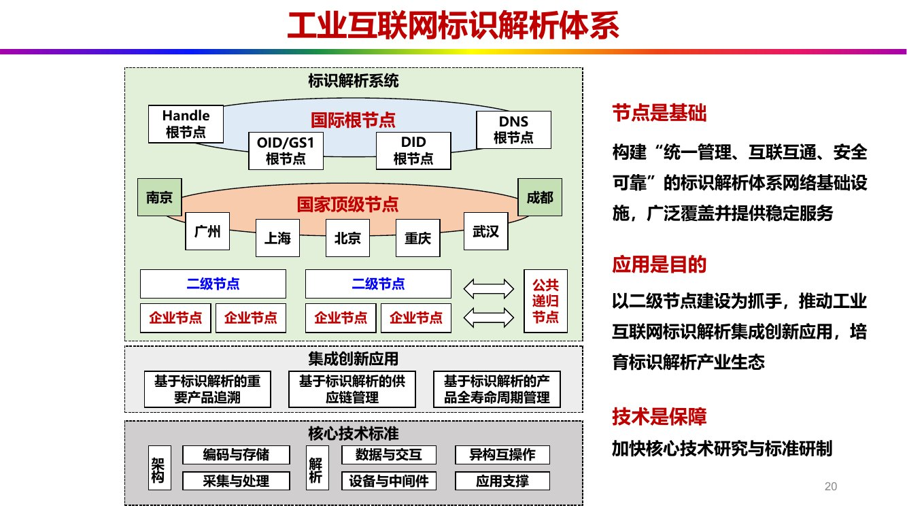
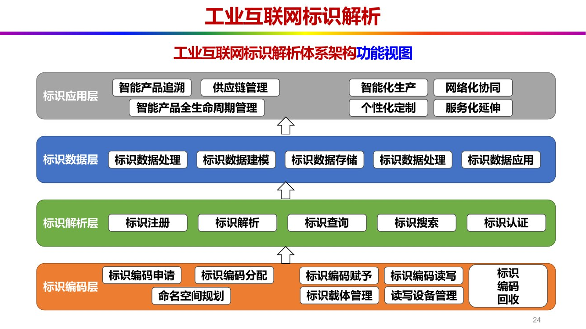
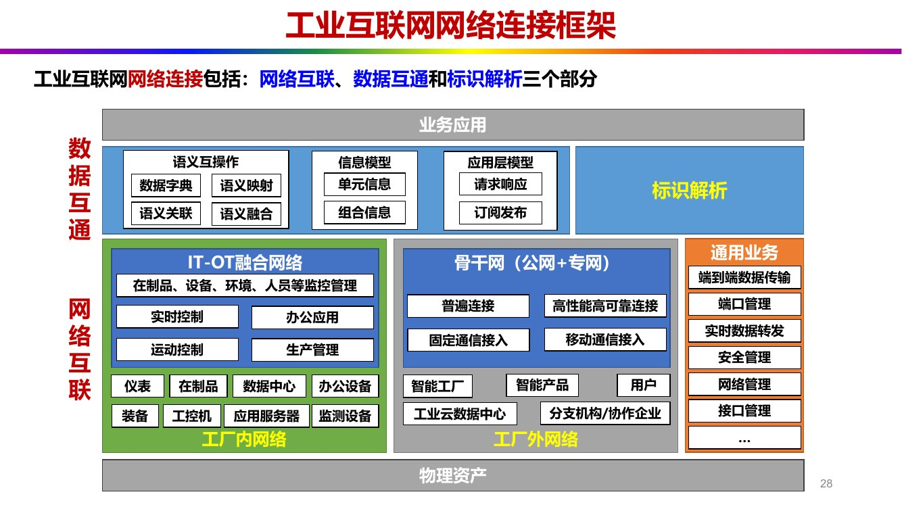
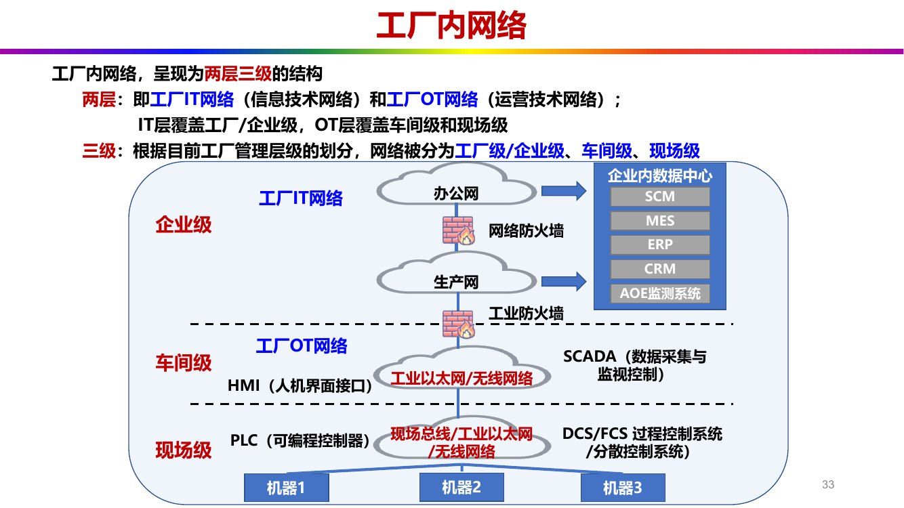
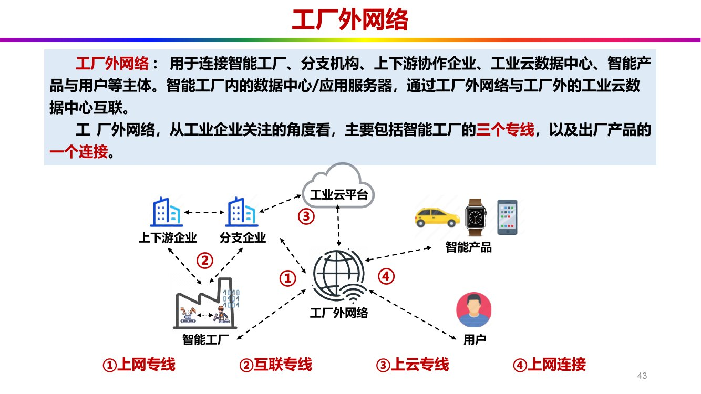
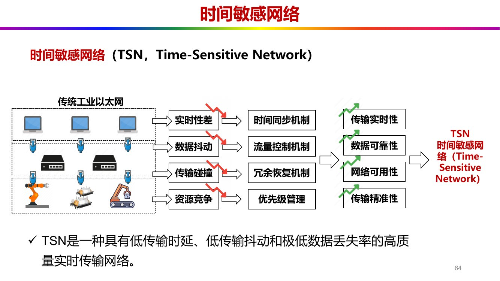
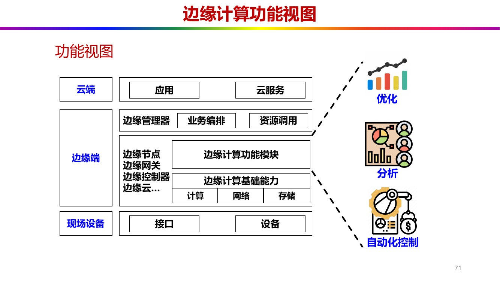

# 第 4 章 网络连接技术：标识解析、内外网与协议

> 本章对应课件《第 4 章 工业互联网的网络关键技术》（共 82 页）。
> 图例：加粗 = 课件原文中以红色（深红或纯红）标出的内容，句尾〔标红 C4·Py〕标注来源页。本文不用加粗表达其他强调。

第 3 章把网络体系拆成网络互联、数据互通、标识解析三部分，本章就是把这三件事落到技术层面。主线四步：先"认得清"——给每个物品、设备、产品发一张全网唯一的身份证（标识与标识解析）；再"连得上"——把工厂内网与工厂外网搭起来；再"说得通"——让现场总线、工业以太网、工业无线这些异构协议互通；最后"传得准"——5G、TSN、边缘计算如何改变工业现场的传输与计算规则。

## 4.1 工业互联网标识

### 4.1.1 从身份证到标识

课件的切入点是三个类比：身份证号码唯一对应每个公民，IP 地址唯一对应互联网中每台计算机，各类工业产品及设备也需要自己唯一的"身份证"进行统一管控〔C4·P5〕。前两者已成常识，第三者正是工业互联网标识要解决的问题。

> 课件定义：工业互联网标识是一种标识化系统，通过**数字化、编码**或其他形式的**唯一识别符号**，为工业物品、设备、产品等实体赋予独特的**标识符号**，使其能够在互联网环境中被**唯一识别、定位和管理**〔标红 C4·P6〕。

标识与域名的对照是理解标识解析的入口〔C4·P6〕：

| 对比项 | 互联网计算机标识 | 工业互联网标识 |
| --- | --- | --- |
| 名字 | **域名**：`www.baidu.com` | **标识**：`86.10000/ac.qd.1024` |
| 解析系统 | 域名解析系统（DNS） | 标识解析系统 |
| 解析结果 | IP 地址：`123.125.114.114` | IP 地址：`3ffe:8080::1` + 标识关联的信息 |

标识编码 `86.10000/ac.qd.1024` 由五段组成，依次表示国家、厂商、设备、城市、序列号。域名解析拿到 IP 就结束了，标识解析拿到地址之后还要继续取出与该标识绑定的业务信息，这是两者最实质的差别。

标识的作用链条是这样的：多个"国家、企业、类别、序列号"各自唯一对应一个标识，通过**标识解析系统**实现数据互通与综合管理，最终实现工业互联网设备、产品、人员、企业的高效管控〔标红 C4·P10〕〔C4·P7〕。

### 4.1.2 两类标识载体

标识要落在物理载体上。课件把载体分为被动与主动两类〔C4·P8–9〕：

| 类别 | 载体形式 | 特点 | 优点 | 不足 |
| --- | --- | --- | --- | --- |
| 被动标识载体 | 条形码、二维码、射频识别（RFID）、近场通信（NFC） | 自身不带电，靠外部读写设备读取 | 成本极低、技术成熟、易印刷 | 需外部设备读、读写距离近、易污损、不能主动上报 |
| 主动标识载体 | 通用集成电路卡（UICC）、通信模组、芯片（MCU）、终端 | 自带通信与计算能力，可主动联网上报 | 可主动上报、可远程管理、可承载更多数据 | 成本高、需要供电、改造难度大 |

RFID 虽然"无线"，仍属被动载体，因为它不能自己发起通信。判断标准是能不能自主通信与计算，不是有没有无线电。

> 【补充】主动标识载体比被动载体难落地，理由有三：一是要供电，现场取电困难；二是要联网，协议与网络配置复杂；三是要安全，密钥、证书、远程升级都得管。被动载体只需"印上去、贴上去"。这也是课件在 P9 追问"哪个更难"的落点。

### 4.1.3 应用流程与标识安全体系

标识的应用流程是一条闭环〔C4·P10〕：产品生产/设备部署 → 标识分配 → 标识解析系统（标识编码生成、标识入库）→ 生产管理、状态监控、数字化管理。

标识安全体系分两部分〔C4·P11〕：

- 标识安全性：**加密传输**、**加密**编码、身份验证、访问控制、数据备份、网络安全；
- 标识隐私保护：数据匿名、隐私政策、标识生命周期管理。

### 4.1.4 标识的作用与六个"一码"

标识把**物理实体**与**数字实体**关联起来，形成**可识别数据对象**〔标红 C4·P12〕。围绕这一点，课件归纳了六个作用方向：设备定位跟踪、提高生产效率、促进可识别数据对象的管理和交互、标准化管理、提升设备互操作性、降低产业成本，并支撑工业互联网的网络互联互通与数据共享共用〔C4·P12〕。

对外表达则凝练成六个"一码"〔标红 C4·P13〕：

| 提法 | 含义 |
| --- | --- |
| **一码一物** | 一个标识码对应一个产品，扫码解析获得产品全信息 |
| **一码上云** | 一个标识码连接设备上云，实现设备生命周期全监控 |
| **一码全览** | 一个标识码查看所有环节，快速了解产品质量全追溯 |
| **一码协同** | 一个标识码实现协同到底，帮助企业数据共享全打通 |
| **一码分权** | 一个标识码实现多种识别，帮助企业不同对象全管控 |
| **一码万能** | 一个标识码实现万个功能，帮助企业提供产品全服务 |

六者依次对应"物、云、览、同、权、能"，从单件产品一路延伸到产品服务生态。

## 4.2 工业互联网标识解析

### 4.2.1 定义与核心内容

标识解析把产品、零部件、生产设备、生产过程、供应链等全生命周期各环节信息赋予唯一标识，通过对标识编码进行解析，实现信息查询和定位，实现跨企业、跨行业、跨地域的数据互通和精准协同〔C4·P17〕。它由两块组成：**标识编码**与**标识解析**〔标红 C4·P17〕。

解析过程分四步〔C4·P17〕：解析发起方发出标识解析请求 → 标识解析节点把标识寻址到目标地址 → 返回标识所关联对象的地址 → 由数据服务器返回标识所对应的信息对象。

> 【补充】标识解析与 DNS 的三条区别：① 解析对象不同，DNS 解析的是"域名 → IP"，标识解析是"标识 → 地址 + 关联信息"；② 根体系不同，DNS 是 ICANN 下的全球唯一根，标识解析是多根并存（Handle、DNS、OID/GS1、DID 各有其根）；③ 目标不同，标识解析还要解决跨企业、跨行业、跨地域的数据互通与确权，DNS 不承担这件事。

### 4.2.2 为什么推广标识解析：五个痛点

课件用一张图列出推广标识解析体系的五个现实问题〔标红 C4·P18〕：

| 痛点 | 表现 |
| --- | --- |
| **国家内统一布局缺乏** | 各行业、各地区自建体系，互不相通 |
| **国际上数据安全受威胁** | 根节点在境外，数据主权受制于人 |
| **企业间信息互通困难** | 协作企业之间数据对不上 |
| **企业内数据交流困难** | 历史数据库、SCADA、工业 PC、PLC 各自为政 |
| **工厂内设备标识复杂** | 零部件标识、在制品标识、产品标识各不相同 |

五个问题自上而下是"国家—国际—企业间—企业内—设备"的层层收窄：越往外越关乎主权与布局，越往里越关乎现场编码的混乱。

### 4.2.3 节点五级与三句话总纲

标识解析体系按节点层级分为五级：**国际根节点**、**国家顶级节点**、二级节点、**企业节点**、**公共递归节点**〔标红 C4·P20〕。

*图 4-1 工业互联网标识解析体系：国际根节点—国家顶级节点—二级节点—企业节点—递归节点（课件 C4·P20）*

| 层级 | 职能 |
| --- | --- |
| 国际根节点 | Handle、DNS、OID/GS1、DID 四类根节点并存 |
| 国家顶级节点 | 北京、上海、重庆、广州、武汉；图中另列南京、成都 |
| 二级节点 | 面向行业或区域的解析节点，是应用推广的抓手 |
| 企业节点 | 企业内部标识解析 |
| 公共递归节点 | 提供缓存与递归解析服务 |

> 南京、成都两地作为灾备节点布局，属于补充说明；课件图上标注的城市共七个。

同页给出贯穿全局的三句话总纲〔标红 C4·P20〕：**节点是基础**（构建"统一管理、互联互通、安全可靠"的标识解析体系网络基础设施，广泛覆盖并提供稳定服务）、**应用是目的**（以二级节点建设为抓手，推动标识解析集成创新应用，培育产业生态）、**技术是保障**（加快核心技术研究与标准研制）。三句话的顺序就是建设顺序：先把节点铺开，再用应用拉动，最后靠技术兜底。

### 4.2.4 Handle 根体系

Handle 体系是国际根节点的主要形态之一，其层级对应关系如下〔C4·P22〕：

| 缩写 | 含义 |
| --- | --- |
| GHR | 国际并联根节点（Global Handle Registry） |
| ARS | 全球辅根节点，全球各 Handle 根系统 MPA 之间平等、协商、共管 |
| ARS-MPA | MPA 辅根节点，如国家工业互联网节点、电子政务节点 |
| LHS | 下级授权节点，如行业节点、区域节点、企业节点、N 级节点 |

解析服务由**缓存/递归解析服务节点**承担，提供递归解析与缓存解析〔标红 C4·P22〕。Handle 体系的理念是"平等、协商、共管"，而非单一主体主导。

### 4.2.5 体系架构功能视图：四层

**工业互联网标识解析体系架构**的功能视图自下而上分四层〔标红 C4·P24〕：

| 层 | 内容 |
| --- | --- |
| 标识编码层 | 编码的申请、分配、赋予、读写、回收；命名空间规划、标识载体管理、读写设备管理 |
| 标识解析层 | 标识注册、标识解析、标识查询、标识搜索、标识认证 |
| 标识数据层 | 标识数据处理、标识数据建模、标识数据存储、标识数据应用 |
| 标识应用层 | 智能产品追溯、供应链管理、智能化生产、网络化协同、智能产品全生命周期管理、个性化定制、服务化延伸 |

*图 4-2 标识解析体系功能视图：编码层—解析层—数据层—应用层（课件 C4·P24）*

> "四层"与"五级"讲的是两件不同的事：功能视图是四层（标识编码层 → 标识解析层 → 标识数据层 → 标识应用层），描述体系由哪些功能块构成；节点是五级（国际根、国家顶级、二级、企业、公共递归），描述解析请求在哪些实体之间逐级转发。前者是功能分层，后者是节点分级。

## 4.3 网络连接框架

### 4.3.1 网络要满足的需求

工业互联网网络要同时应付设备多、分布广、种类多、实时性与安全性五类约束〔C4·P26〕。要实现从**设备**到**人员**到**产品**到**企业**的信息互联，就必须有合理高效的**网络连接架构**〔标红 C4·P26〕。

### 4.3.2 三部分与内外网分工

工业互联网网络连接包括**网络互联**、**数据互通**和标识解析三个部分〔标红 C4·P28〕，与第 3 章的网络功能视图完全一致，区别只在于这里落在"连接框架"上：最上是业务应用，中间是数据互通（语义互操作、信息模型、应用层通信），下面是网络互联（IT-OT 融合网络即工厂内网络，骨干网即工厂外网络），最底是物理资产；右侧竖条是标识解析与通用业务（端到端数据传输、端口管理、实时数据转发、安全管理、网络管理、接口管理）。

*图 4-3 工业互联网网络连接框架：数据互通 + 网络互联 + 标识解析，横向分工厂内网/工厂外网（课件 C4·P28）*

内网与外网的分工，课件用四个"互联"讲得很干脆：

- 工厂内网络实现工厂内部**人的互联**、**物的互联**、**机的互联**，支撑工厂内的业务应用〔标红 C4·P29〕；
- 工厂外网络实现工厂外部**企业的互联、工厂的互联、用户的互联、产品的互联**，支撑工厂外的业务应用〔标红 C4·P30〕。

> 内网管"墙内"，外网管"墙外"：内网把一台台设备、一个个人、一批批在制品连成厂内的闭环；外网把这座厂接到它的分支、上下游、云端和已经卖出去的产品上。

## 4.4 工厂内网络

### 4.4.1 "两层三级"结构

工厂内网络呈现为**两层三级**的结构〔标红 C4·P33〕：

- **两层**：工厂 IT 网络（信息技术网络）与工厂 OT 网络（运营技术网络），IT 层覆盖企业级，OT 层覆盖车间级与现场级；
- **三级**：按工厂管理层级划分，分为**企业级**、**车间级**、**现场级**。

*图 4-4 工厂内网络的两层三级：IT 网络（企业级）+ OT 网络（车间级、现场级）（课件 C4·P33）*

图中各级的代表系统与设备如下（企业级之上还有**工厂内骨干网络**〔标红 C4·P32〕）：

| 层级 | 所属 | 代表系统/设备 |
| --- | --- | --- |
| 企业级 | 工厂 IT 网络 | 办公网、生产网、网络防火墙、企业内数据中心（含 AOE 监测系统）、SCM、MES、ERP、CRM |
| 车间级 | 工厂 OT 网络 | **工业以太网/无线网络**、HMI（人机界面）、SCADA（数据采集与监视控制）、工业防火墙 |
| 现场级 | 工厂 OT 网络 | PLC（可编程控制器）、DCS、FCS、**现场总线/工业以太网/无线网络**、机器 1/2/3 |

> 两处按定义校正：DCS 是分散控制系统，FCS 是现场总线控制系统，课件 P33 原图把它们注成"过程控制/分散控制系统"，标注有误；此外生产网虽画在企业级，其业务流量实际贯穿车间与现场两级，因为它承载的正是控制类与采集类业务。车间与现场的无线接入常用 NB-IoT、LoRa〔标红 C4·P38〕。

> 【补充】IT 网络与 OT 网络的四条区别：① 关注点，IT 重数据传输与业务协同，OT 重实时控制与生产连续性；② 实时性，IT 容忍秒级延迟，OT 要求毫秒级确定性；③ 协议，IT 用 TCP/IP、HTTP，OT 用现场总线或工业以太网（Profinet、Modbus 等）；④ 运维，IT 可以随时打补丁重启，OT 不能随便停线，所以偏重工业防火墙与白名单，而不是给工控机装杀毒软件。

### 4.4.2 按业务分类：四张网

工厂内网按业务分为**生产网**、**办公网**、**安防网**、**企业数据中心**〔标红 C4·P39–41〕：

| 网 | 承载的业务 |
| --- | --- |
| **生产网** | 控制类（产线控制、远程控制）、采集类（传感器采集、环境传感、视频检测与采集）、连接类（设备自动化程序下载、生产加工程序下载、基于无线网络的 AGV 导航、远程诊断维修指导） |
| **办公网** | 宽带办公与上网、固话业务、视频/语音会议、内网系统互联互通（MES、安防监控等） |
| **安防网** | 视频监控系统、门禁系统、物联网传感系统（周界安防、智能电表） |
| **企业数据中心** | 制造执行系统（MES）、供应链管理（SCM）、产品数据管理（PDM）、企业资源计划（ERP）、客户关系管理（CRM） |

"企业数据中心"在这里是一张网、一个业务域，指承载企业管理类系统流量的那片网络，而不是指机房本身。

## 4.5 工厂外网络

### 4.5.1 三个专线 + 一个连接

工厂外网络用于连接智能工厂、分支机构、上下游协作企业、工业云数据中心、智能产品与用户等主体〔C4·P43〕。从工业企业关注的角度看，它由**三个专线**加出厂产品的一个**连接**构成〔标红 C4·P43〕：

| 编号 | 名称 | 连接对象 | 关键技术 |
| --- | --- | --- | --- |
| ① | **上网专线**（企业互联网连接业务） | 智能工厂 ↔ 互联网 | **基于OTN的光网专线**、**MPLS VPN专线**（P44） |
| ② | **互联专线**（企业网专线业务） | 智能工厂 ↔ 分支企业、上下游企业 | **SD-WAN网络**（P45） |
| ③ | **上云专线**（企业云网融合业务） | 智能工厂 ↔ 工业云数据中心 | **Cloud VPN云网融合**（P46） |
| ④ | **上网连接**（企业无线外网业务） | 智能产品 ↔ 用户 | **LTE宽带移动通信**、**5G网络**、**NB-IoT网络**（P47） |

*图 4-5 工厂外网络的四个业务：上网专线①、互联专线②、上云专线③、上网连接④（课件 C4·P43）*

> ①②③都是"专线"，因为连接的两端都是组织或设施，需要带宽、隔离与质量保障；④是"连接"，因为那一端是散落在用户手里的产品，只能走无线公网。所以是"三个专线 + 一个连接"，而不是四个专线。

### 4.5.2 四个业务各自解决什么需求

| 业务 | 核心需求 |
| --- | --- |
| ① **上网专线** | 工业实体的**互联网接入**需求；跨区域的**互联**与**隔离**需求；工业网络与混合云互联需求；对广域承载网络的**差异化需求**〔标红 C4·P44〕 |
| ② **互联专线** | 大规模**异地协同办公**；低延时生产控制；智能安防；**高可靠、高安全、高质量**的端到端业务互联与部署服务〔标红 C4·P45〕 |
| ③ **上云专线** | 企业本地数据中心、办公网络、总部与分支机构同云数据中心互相连接；提供**高速、低时延、安全可靠**的专属上云通道〔标红 C4·P46〕 |
| ④ **上网连接** | 机器设备、原材料、控制系统、信息系统、产品以及人之间的网络互联；支撑智能控制、运营优化和生产组织方式变革〔C4·P47〕 |

> 【补充】顺带说明几个缩写：OTN 是光传送网，分光通道层（OCH）、光复用段层（OMS）、光传输段层（OTS），上层可承载 IP、Ethernet、ATM、SDH/SONET；MPLS 是多协议标记交换，VPN 是虚拟专用网络，SDN 是软件定义网络，SD-WAN 是软件定义广域网。

## 4.6 工业协议家族

### 4.6.1 总分类

工业协议家族先按传输介质分成两类〔标红 C4·P50〕：**有线通讯协议**（又分现场总线协议、工业以太网协议）与**无线通讯协议**（工业无线网络协议）。它们的共同作用是实现设备、传感器、控制器之间的数据交换〔C4·P50〕。

### 4.6.2 现场总线协议

现场总线协议是工业自动化中用于现场设备与控制系统之间数字通信的标准化通信协议，支持实时、可靠的数据交换，是一种数字化、双向、多节点的通信网络〔C4·P51〕。

代表协议八个：ProfiBus、ModBus、DeviceNET、CANOpen、CC-Link、AS-I、InterBus、ControlNet〔C4·P53〕。

Modbus 的地位特殊，它为装置和设备之间的通信提供了一种通用语言，串口通信形式包括 RS232、RS485、RS-422〔C4·P52〕。AS-I 是执行器—传感器接口（Actuator Sensor Interface），同样属于现场总线。

> 现场总线的价值在于"一根线串起一串设备"：过去每台仪表都要单独拉一对线回控制室，总线把几十台设备挂在同一条链路上，布线成本按数量级下降。

### 4.6.3 工业以太网协议

工业以太网协议是基于以太网技术的网络协议，用于工业控制系统和自动化控制系统〔C4·P54〕，四个代表协议是 Profinet、EtherNet/IP、EtherCAT、ModBus TCP〔C4·P54〕。

其中 EtherNet/IP 的细节最常被追问：基于标准以太网协议 IEEE 802.3，支持 TCP 与 UDP 两种传输层协议，支持星型、总线型等数种网络拓扑〔C4·P55〕。其**以太帧结构**依次为 Ethernet Header → IP Header → TCP/UDP Header → Encapsulation Header → Encapsulation Data → Trailer〔标红 C4·P55〕。

> 现场总线与工业以太网的分野：现场总线是"工业专用"的数字串行总线，多为串行、主从或令牌方式，需要专用线缆；工业以太网是"以太网改造"，用交换机组网、带宽高、天然可与 IT 网络融合。前者解决"取代 4–20 mA 模拟信号"，后者解决"和 IT 网络说同一种话"。

### 4.6.4 工业无线网络协议

工业无线网络协议主要有八种〔C4·P57–58〕：

| 协议名 | 说明 |
| --- | --- |
| **WLAN** | 无线局域网 |
| Bluetooth / BLE | 蓝牙与低功耗蓝牙 |
| WIA-PA / WIA-FA | 自主工业无线标准（过程自动化 / 工厂自动化） |
| LoRa | 非授权频段 LPWAN |
| WirelessHART | 基于 HART 的工业无线 |
| ZigBee | 低功耗 Mesh 网络 |
| ISA100.11a | 工业自动化无线标准 |
| 6LoWPAN | IPv6 over Low-power WPAN |

### 4.6.5 异构协议的互通

现场同时存在现场总线、工业以太网、工业无线三套协议栈，课件提问：如何基于种类繁多的异构工业协议，保证通讯的高速有效进行〔C4·P60〕？答案是三种方案〔标红 C4·P60〕：

1. **中间件和网关设备**；
2. **协议适配器和转换器软件**；
3. **协议数据格式转换**。

三者合起来正是**工业协议解析与转换**〔标红 C4·P60〕。用一句话概括：网关在南向兼容各种协议，内部做数据格式转换，北向以统一模型对外，OPC UA、MQTT 常被用作那个"统一的出口"。

## 4.7 网络新技术

### 4.7.1 5G

5G 的**超大带宽、超低时延、海量覆盖**特性与工业互联网的要求高度契合，为**新型基础设施建设**和**融合创新应用**提供了关键支撑与重要机遇〔标红 C4·P62〕。

五类工业应用〔C4·P62〕：远程协同管理（多地远程协同在线研发设计）、智能化生产（实时采集 + AI + 5G 远程实时控制）、产品服务化（产品数据高速采集与远程服务）、管控精细化无人化（机器视觉 + 5G 提升质量管理实时性）、供需对接实时化（供应链与市场供需信息对接）。

5G 的五个关键指标〔C4·P63〕：

| 指标 | 数值 |
| --- | --- |
| 广连接 | 1 百万 / km² |
| 大带宽 | 1 Gbit/s |
| 低时延 | 1 ms |
| 高可靠 | 99.9999%（六个 9） |
| 微抖动 | 1 μs |

> "六个 9"值得说明白：99.9999% 意味着年累计不可用时间约 30 秒量级，这正是工业控制对"网络不能停"的量化表达。可靠性每少一个 9，年停机时间就从秒级跳到小时级，产线无法接受。

三项使能技术：5G 高频与多天线技术、5G 网络切片技术、5G 边缘计算技术（AI）〔C4·P63〕。

### 4.7.2 时间敏感网络（TSN）

传统工业以太网有四个毛病，TSN 用四种机制逐一对应〔C4·P64〕：

| 传统工业以太网的问题 | TSN 的机制 | 得到的能力 |
| --- | --- | --- |
| 实时性差 | 时间同步机制 | 传输实时性 |
| 数据抖动 | 流量控制机制 | 数据可靠性 |
| 传输碰撞 | 冗余恢复机制 | 网络可用性 |
| 资源竞争 | 优先级管理 | 传输精准性 |

*图 4-6 TSN 用时间同步、流量控制、冗余恢复、优先级管理解决传统工业以太网的四个问题（课件 C4·P64）*

**时间敏感网络**（TSN）是一种具有低传输时延、低传输抖动和极低数据丢失率的高质量实时传输网络〔C4·P64〕；它是一组由 IEEE 802.1 制定的以太网增强标准，用于在标准以太网上实现**确定性通信**，确保关键数据在严格的时间限制内以**低延迟**、**低抖动**、**高可靠性**方式传输〔标红 C4·P65〕。

其原理可以压缩成两件东西：一个**全局时钟**，一个连接各网络组件的**传输调度器**，二者共同实现网络内的确定性实时通信〔标红 C4·P66〕。围绕它们的手段是**时钟同步**与**实时调度**〔标红 C4·P66〕。

> 普通以太网是"尽力而为"：冲突就排队重发，延迟不确定，适合网页与文件，不适合"必须在 1 ms 内把急停信号送到"的场合。TSN 用全局时钟把时间切成片，再按时刻表放行关键流量，于是"什么时候能通"变成可以事先算准的事——这就是确定性。因此 TSN 决定了工业实时控制能否直接跑在以太网上。

### 4.7.3 边缘计算

**边缘计算**是在靠近物或数据源头的网络边缘侧，融合**网络、计算、存储、应用**核心能力的**分布式**开放平台，**就近**提供边缘智能服务；它作为联接物理与数字世界的桥梁，使能智能资产、智能网关、智能系统和智能服务〔标红 C4·P69〕。落地时的入口设备是**边缘计算网关**〔标红 C4·P69〕。

功能视图分三层〔标红 C4·P71〕：

| 层 | 组成 |
| --- | --- |
| 云端 | 应用与云服务优化；边缘管理器（业务编排、资源调用） |
| 边缘端 | 边缘节点（边缘网关、边缘控制器、边缘云等）+ 边缘计算功能模块 + 边缘计算基础能力（计算、网络、存储） |
| 现场设备 | 接口 → 设备 → 自动化控制 |

*图 4-7 边缘计算功能视图：云端（应用/云服务优化 + 边缘管理器）、边缘端（节点/功能模块/基础能力）、现场设备（课件 C4·P71）*

边缘计算在功能上提供三大类服务〔C4·P72–74〕：

| 功能 | 内容 |
| --- | --- |
| 自动控制功能 | **建模**、**实体抽象**、**感知**、**执行**，以及资产管理（虚拟实体、系统服务） |
| 分析功能 | 视频图像分析、流数据分析、智能计算、数据挖掘；算法含遗传算法、蚁群算法、粒子群算法、关键帧提取、深度学习、特征提取 |
| 优化功能 | 测量与执行优化、多元控制协同优化（多变量控制、预测控制模型）、环境与设备安全优化、实时优化（参数估计、数据辨识）、调节控制优化（PID 参数优化、故障检测）、车间排产优化（需求预测、供应链管理、生产过程调度） |

> 感知与执行不是并列于三大功能之外的另一类功能，它们是自动控制功能内部的两个子项：感知负责采集现场状态，执行负责下发控制动作，建模与实体抽象则把设备映射成可计算的虚拟实体。

支撑上述功能的是三大能力〔C4·P75–78〕：

| 能力 | 内容 |
| --- | --- |
| 计算能力 | 数据清洗、数据分析、异构计算、边缘智能 |
| 网络能力 | 通信协议组件（协议适配、协议解析与转换）、网络传输控制（5G、TSN）、网络配置（设备配置与管理、安全策略、资源分配） |
| 存储能力 | 工业时序数据、业务数据、非结构化数据、数据备份与恢复 |

> 顺带说明一处口径差异：边缘计算定义里的核心能力是"网络、计算、存储、应用"四类〔C4·P69〕，而第 5 章讲边云协同时也把"智能"计入，写成网络、计算、存储、应用、智能五类资源〔C5·P99〕。

### 4.7.4 边云协同

边缘计算的主要业务形态有六种：物联网边缘计算、工业边缘计算、智慧家庭边缘计算、广域接入网络边缘计算、边缘云、多接入边缘计算（MEC）；由此展开为六大边云协同主场景与十四种边云协同子场景〔标红 C4·P81〕。

收窄到工业方向，落地的子场景有三个：设备优化、工艺过程优化、工厂全价值链优化〔C4·P81〕。三者正对应"设备—产线—工厂"三个层级，与第 3 章的三个优化闭环同构：设备优化对应机器设备运行优化，工艺过程优化对应生产运营优化，工厂全价值链优化对应企业协同与用户交互优化。

> 为什么"协同"而不是"替代"：云擅长长周期、全样本的建模与训练，边擅长毫秒级的实时响应与数据脱敏。边云协同的分工是云上训练出模型，下发到边缘推理执行，边侧再把新数据回流给云。

## 本章小结

- 标识的定义：通过数字化、编码等唯一识别符号，使实体可被唯一识别、定位和管理。
- 标识与域名的差别：标识解析除了返回地址，还要返回标识关联的业务信息。
- 两类载体：被动（条码、二维码、RFID、NFC）、主动（UICC、通信模组、MCU、终端）；主动载体难度在供电、联网、安全。
- 标识安全体系：标识安全性（加密传输、加密编码、身份验证、访问控制、数据备份、网络安全）与标识隐私保护。
- 六个"一码"：一码一物、一码上云、一码全览、一码协同、一码分权、一码万能。
- 标识解析核心内容：标识编码 + 标识解析；解析链路为请求 → 节点寻址 → 返回地址 → 数据服务器返回信息。
- 五个推广痛点：国家布局缺乏、国际数据安全受威胁、企业间互通难、企业内交流难、工厂内设备标识复杂。
- 节点五级：国际根节点 → 国家顶级节点 → 二级节点 → 企业节点 → 公共递归节点。
- 三句话总纲：节点是基础、应用是目的、技术是保障。
- Handle 体系：GHR 国际并联根节点、ARS 全球辅根节点、LHS 下级授权节点，理念是平等、协商、共管。
- 体系架构功能视图四层：标识编码层 → 标识解析层 → 标识数据层 → 标识应用层。
- 网络连接三部分：网络互联、数据互通、标识解析。
- 工厂内网两层三级：两层为 IT 与 OT，三级为企业级、车间级、现场级；按业务分生产网、办公网、安防网、企业数据中心。
- 工厂外网：三个专线（上网、互联、上云）+ 一个连接（上网连接）。
- 协议家族：现场总线八种、工业以太网四种（Profinet、EtherNet/IP、EtherCAT、ModBus TCP）、工业无线八种；异构互通靠网关、适配转换软件、数据格式转换。
- 5G 五指标：1 百万/km²、1 Gbit/s、1 ms、99.9999%、1 μs；三使能技术：高频多天线、网络切片、边缘计算。
- TSN：IEEE 802.1 的以太网增强标准，实现确定性通信；核心是全局时钟与传输调度器。
- 边缘计算：四类核心能力、三层功能视图、三大功能（自动控制、分析、优化）、三大能力（计算、网络、存储）。
- 边云协同：六种业务形态、六大主场景、十四种子场景，工业落地为设备优化、工艺过程优化、工厂全价值链优化。

课件第 82 页附有本章 11 道课后习题，可作为自查。
