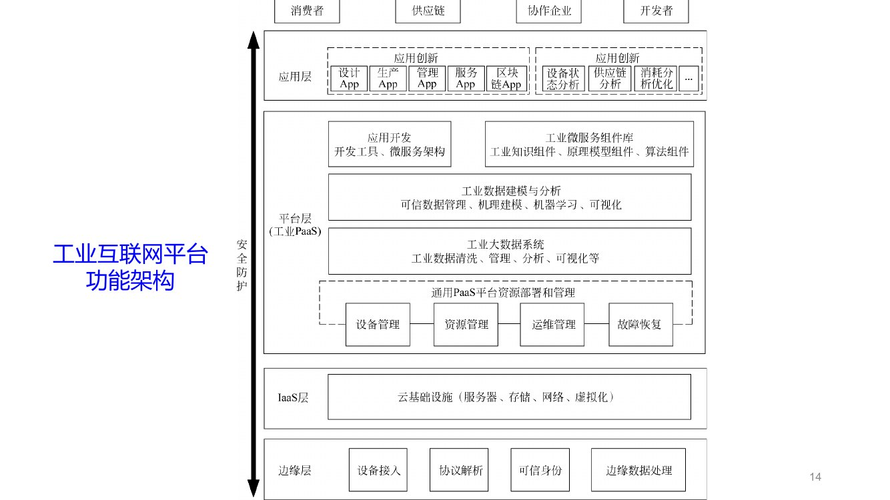
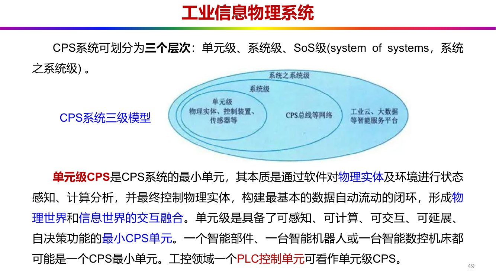
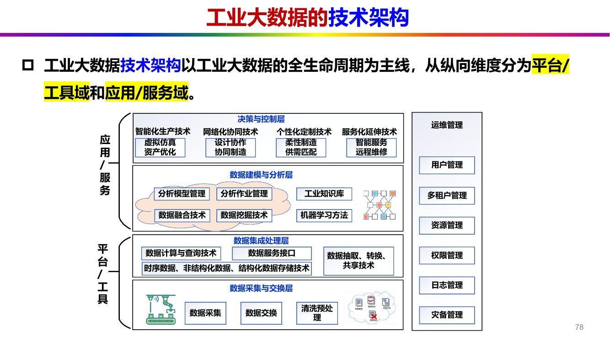
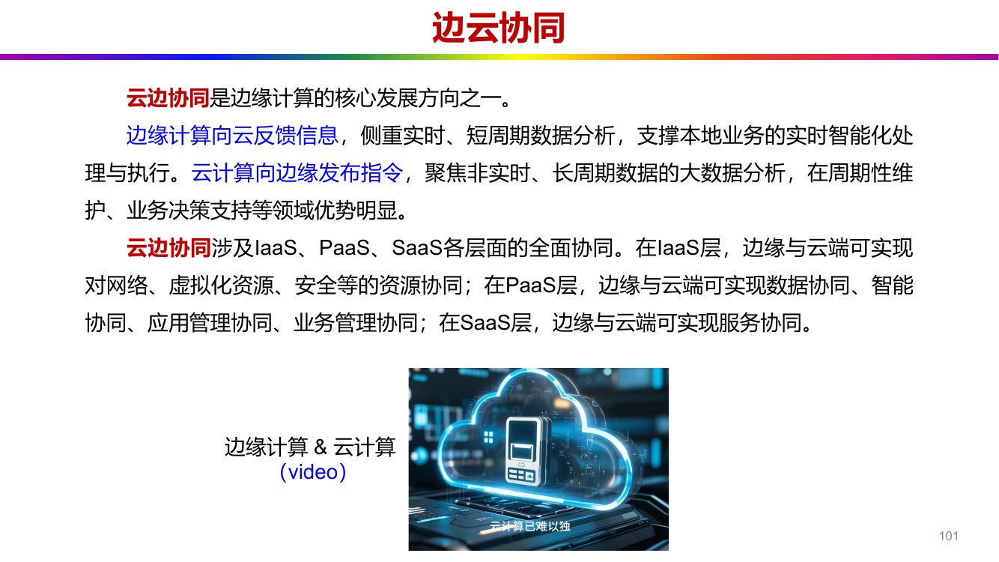

# 第 5 章 平台关键技术

> **课件结构**（第5章 工业互联网的平台关键技术-1013-1016，165 页）：
> 平台概述 → 平台关键技术（感知、通信、CPS、工业大数据、云计算、数字孪生）→ 平台实例
> → 平台应用
>
> 这是**内容最多**的一章（165 页），但结构极清晰：**"一个定义 + 四层架构 + 六项关键技术 +
> 三个平台 + 三个应用方向"**。考试时真正的必考点只有五处（见 `intro` §6 的说明）：
> ①平台四层架构与本质；②CPS 三级；③工业大数据特征；④数字孪生三特征；⑤三个应用方向 + 案例数字。
> 其余内容按"分类 + 名称"记，够选择填空用。

---

## 0 课件页码 → 本节

| 课件页 | 内容 | 本节 |
| --- | --- | --- |
| 6–7 | 平台定义、本质"数据 + 模型 = 服务"、核心层级 | 1.1 |
| 8–12 | 国内外平台发展现状 | 1.2 |
| 13–16 | 平台功能架构（四层）与各层作用 | 1.3 |
| 17 | 平台技术架构三部分 | 1.4 |
| 19–30 | 感知技术之一：传感器（分类、组成、新型、融合） | 2.1 |
| 31–37 | 感知技术之二：RFID | 2.2 |
| 38–42 | 感知技术之三：工业机器视觉 | 2.3 |
| 44–45 | 通信技术（承上启下，详见第 4 章） | 3 |
| 47–52 | CPS：概念、本质、三级模型 | 4.1 |
| 53–56 | PLC | 4.2 |
| 57–59 | DCS | 4.3 |
| 60–62 | SCADA | 4.4 |
| 64–71 | 工业大数据定义、多源异构、4V、多模态/跨尺度/高通量/重机理/强关联 | 5.1 |
| 73–83 | 工业大数据功能体系架构、技术架构与关键技术 | 5.2 |
| 84–91 | 工业大数据可视化（可视分析） | 5.3 |
| 93–98 | 云计算定义、两支撑、三服务、四部署 | 6.1–6.3 |
| 99–101 | 边缘计算与边云协同 | 6.4 |
| 103–110 | 数字孪生：提出、定义、三特征、三概念、西门子/GE | 7 |
| 112–130 | Predix、MindSphere、INDICS 三个平台实例 | 8 |
| 131–132 | 国内外平台的共通性与差异性 | 8.4 |
| 134–141 | 平台应用三方向、智能制造五场景 | 9.1–9.2 |
| 142–145 | 应用案例：安贝格、博世洪堡 | 9.2 |
| 146–155 | 网络协同制造（五场景 + NASA IDEA + 波音 GCE） | 9.3 |
| 156–164 | 云制造（云设计/云生产/云服务 + 航天云网案例） | 9.4 |
| 165 | 课后习题（15 题） | §10 |

---

## 1 平台概述（5.1）

### 1.1 定义与本质

> 【课件 C5·P6】工业互联网平台是**面向制造业数字化、网络化、智能化需求**，构建基于**海量数据
> 采集、汇聚、分析**的服务体系，支撑**制造资源泛在连接、弹性供给、高效配置**的**工业云平台**。

> 【课件 C5·P6】**工业互联网平台的本质是"数据 + 模型 = 服务"**。

> 【考点·论述·必考】"数据、模型、服务三者的关系"（课后题 1）——三句话：
> ① **数据是原料**：海量设备数据经采集汇聚进入平台；
> ② **模型是增值环节**：把工业知识（工艺机理、经验）沉淀为可复用的模型/微服务，数据才
>    从"记录"变成"知识"；
> ③ **服务是出口**：模型以工业 App / API 的形式对外提供服务，才产生商业价值。
> 收尾一句：**"没有模型的数据只是存储成本，没有服务的数据只是报表。"**

> 【课件 C5·P7】平台的核心层级：**边缘层、云基础设施层（IaaS 层）、平台层（工业 PaaS）
> 和应用层（工业 SaaS 或工业 App）**；而**数据、模型和服务是关键要素**。

### 1.2 发展现状（认名字即可）

> 【课件 C5·P8–11】

| 时间 | 事件 |
| --- | --- |
| **2013** | GE 率先推出 **Predix** 公有云平台 |
| 2015 之后 | 跨国企业布局加快：GE **Predix**、西门子 **MindSphere**、瑞士 ABB **Ability** |
| 2015 之后（国内） | 航天云网、三一重工、海尔、富士康依托制造能力推平台；用友、沈阳机床、徐工基于自动化/工业软件/装备积累向平台延伸 |

国内平台的四个来源领域（【课件 C5·P11】）：**通信领域、互联网领域、软件系统服务领域、
垂直领域（工业类企业和创业企业）**。

### 1.3 功能架构：四层（**本章第一个必考点**）

> 【课件 C5·P13】工业互联网产业联盟在《工业互联网平台白皮书》中提出**多层级**的平台功能架构：
> **边缘层、云基础设施层（IaaS 层）、平台层（工业 PaaS）、应用层（工业 SaaS）**；
> **其中，平台层是核心**。

*图 5-1 工业互联网平台功能架构：边缘层—IaaS 层—平台层（工业 PaaS）—应用层（工业 SaaS）（课件 C5·P14）*

四层各自的作用（【课件 C5·P15】，**逐句背**）：

| 层 | 课件原话 |
| --- | --- |
| **第一层 边缘层** | 通过**大范围、深层次的数据采集**，以及**异构数据的协议转换与边缘处理**，构建工业互联网平台的**数据基础** |
| **第二层 IaaS 层** | 包括 **IaaS 基础设施**，以及涵盖整个工业系统的**安全管理体系**，构成平台的**基础支撑和重要保障** |
| **第三层 平台层** | 基于**通用 PaaS** 叠加大数据处理、工业数据分析、工业微服务等创新功能，构建**可扩展的开放式云操作系统** |
| **第四层 应用层** | 形成满足**不同行业、不同场景**的**工业 SaaS 和工业 App**，实现平台的**最终价值** |

> 【考点·填空】"平台层是核心"——这四个字每年都可能出现。四层的"定位词"也要记住：
> 边缘层 = **数据基础**；IaaS = **基础支撑和重要保障**；平台层 = **核心 / 开放式云操作系统**；
> 应用层 = **最终价值**。
>
> 【坑·必看】第 3 章平台功能视图是**三层**（边缘/PaaS/应用，【课件 C3·P21】），本章是**四层**
> （加 IaaS，【课件 C5·P13】）。课件 P16 专门做了一次"课程回顾 & 比较"，就是在提醒这个差异。

### 1.4 技术架构：三部分

> 【课件 C5·P17】工业互联网平台技术可划分为：**基础技术、使能技术（enabling technology）、
> 信息安全技术**三部分。

> 【考点·填空】"使能技术"这个词很容易被漏掉——它不是"通用技术"，是**enable**（使能）：
> 让平台"能干活"的技术（大数据、AI、微服务等）。选择/填空常考"平台技术架构由哪三部分组成"。

---

## 2 感知技术（5.2）

> 【课件 C5·P19】工业互联网通过**边缘层实现感知**，感知技术是工业互联网**最基础且关键**的技术，
> 通常负责**采集工业现场的数据**。工业数据采集就是利用**泛在感知技术**对**多源异构设备和系统、
> 环境、人员**等一切要素信息进行采集和解析。
>
> 三项代表技术：**传感器技术、RFID 技术、工业机器视觉技术**。

### 2.1 传感器技术

**（1）分类（三套分法）与组成**

> 【课件 C5·P20】三种分法：按**原理**（电阻式、电容式、光栅式、超声波、激光、压电式…）、
> 按**被测量**（温度、湿度、振动、压力、力矩…）、按**输出信号**（数字、模拟）。

> 【课件 C5·P21】传感器一般由**敏感元件、转换元件、转换电路**组成，有时还需**外加辅助电源**
> 提供转换能量。传感器通过**敏感元件**感受的通常是**非电量**，而**转换元件**输出的通常是
> **电学量**（电压、电流、电荷量等）。

> 【考点·填空】传感器三元件：**敏感元件、转换元件、转换电路**（+ 辅助电源）。
> 【坑】"敏感元件感受非电量、转换元件输出电学量"——这一句常被倒过来出选择题。

**（2）新型传感器：四个特点 + 三类**

> 【课件 C5·P22】新型传感器技术呈现**微型化、数字化、智能化、网络化**特点。面向工业互联网的
> 新型传感器主要包括三类：

| 类别 | 定义要点 | 例子/优势 |
| --- | --- | --- |
| **微型传感器** | 基于**微电子系统和微加工技术**制造，**体积小、重量轻、能耗低** | Φ4 mm 超微型传感器；用于接触测量、非接触近距离测量、远距离信号探测；航空、医疗、工业自动化 |
| **智能传感器** | 集成**传感器 + 微处理器 + 通信功能**的传感系统；内部完成原始数据加工处理，可通过**标准接口**与外界交换数据；可用**软件改变工作模式** | 三个模块：**传感模块、智能处理模块、通信模块** |
| **多功能智能传感器** | 将**多种物理量**的数据感知采集装置与**新型智能处理器或新型网络**结合 | 多物理量采集、信息实时处理、数据分析与存储、数据高速传输；例：基于 **PVDF** 材料的"人造皮肤"触觉传感器 |

> 【考点·选择】"智能传感器由哪三个模块组成" → **传感模块、智能处理模块、通信模块**。

**（3）多传感器信息融合：三个层次（**必考，且要能说优缺点**）**

> 【课件 C5·P28】多传感器信息融合是通过采集并集成**各种信息源、多媒体和多格式信息**，生成
> **完整、准确、及时和有效**的综合信息的过程。与单传感器信号处理相比，可以**最大限度**地获得
> 被测目标或环境的信息量，取得最有用的解释或判断。

| 层次 | 在哪里融合 | 优点 | 缺点 |
| --- | --- | --- | --- |
| **① 原始数据层** | 在采集到的**原始信息层次**上融合 | 可以**保持尽可能多的现场信息** | **信息量大、所需时间长、实时性差** |
| **② 特征层** | 对原始信息中**提取的特征信息**综合分析和处理，融合成**单一特征向量**后再用模式识别方法处理 | **对通信带宽要求较低** | 由于**数据的丢失**使准确性有所下降 |
| **③ 决策层** | 将多个传感器的**识别结果**进行融合，为指挥控制决策提供依据 | **灵活性强、对传输带宽要求低**，能有效融合反映环境/目标各层面的不同类型信息 | 依赖各子决策的准确性 |

> 【考点·论述】"三层融合怎么选"——一句话原则：**要精度就往前端走（原始数据层），要实时和
> 带宽就往后端走（决策层）**。这句话把三层的优缺点串起来了，比逐条背更稳。

### 2.2 RFID 技术

**（1）定义与优势**

> 【课件 C5·P31】**射频识别（RFID，Radio Frequency Identification）**，又称无线射频识别，
> 通过**无线电信号**识别特定目标并读写相关数据，**无须**在识别系统与特定目标之间建立**机械或
> 光学接触**。可以认为 RFID 是一种**无线通信技术**，利用射频信号通过**空间耦合（交变磁场或
> 电磁场）**实现**无接触**信息传递，并通过所传递的信息达到**自动识别**的目的。

> 【课件 C5·P31】相比**条形码、二维码**等标识和识别技术，RFID 的优势：**读取速度快、
> 读写距离远、非视距读写、多标签识别、储存能力强**。

**（2）系统组成**

> 【课件 C5·P32】RFID 系统包括**阅读器、电子标签、应用管理系统**。

| 部件 | 作用（【课件 C5·P33】） |
| --- | --- |
| **阅读器** | 读取或写入电子标签信息；通过**天线**与标签无线通信；先由收发模块控制射频模块发射**询问信号**，标签感应后给出**应答信号**，阅读器处理后返回外部应用系统 |
| **电子标签（应答器）** | RFID 系统的**数据载体**，存储被识别物品信息；由**天线 + IC 芯片**构成，IC 芯片包括**射频模块、控制模块和存储器** |
| **应用管理系统** | 上层业务处理 |

> 【课件 C5·P33】天线的作用：**产生磁通量**，磁通量用于向**无源标签提供能量**，并在读写器与
> 标签之间**传递信息**。

**（3）近场与远场（区分原理的关键）**

> 【课件 C5·P36】RFID 依靠**磁耦合或电磁耦合**原理通信，差别在于工作场是**近场**还是**远场**：

| 方式 | 位置判据 | 常用频率 | 通信原理 |
| --- | --- | --- | --- |
| **近场** | 标签位于阅读器天线发射的**一个完整波长范围之内** | **低频、高频** | **磁场幅度调制** |
| **远场** | 标签位置**超出**一个完整波长范围，通信范围由标签反射的能量（阅读器射频模块对反射信号的灵敏度）决定 | **超高频、微波** | **反射信号幅度调制** |

> 【考点·选择】"近场用低频高频、远场用超高频微波"——这组配对是标准考法。
> 【补充】射频的常见频率范围：**300 kHz～300 GHz**（【课件 C5·P35】）；标签的**工作频率决定
> 系统允许的最远阅读距离**，也影响标签/阅读器的实现难度和成本。

> 【课件 C5·P37】RFID 优势总结：**防水防磁、读取速度快、储存能力强、识别距离远**；
> 可在干扰/非干扰环境下实时准确快速采集处理；可识别**非可视对象、移动对象、夜间对象**；
> 与互联网、无线通信结合后可对全球物品**定位、跟踪管理、信息共享**。

### 2.3 工业机器视觉

> 【课件 C5·P38】工业机器视觉技术是面向工业领域的机器视觉技术，通过**加装有视觉装置的机器
> 代替人眼**来实现**引导、检测、测量、识别**等功能，提高机器的自动化和智能化程度。

**（1）系统组成**

> 【课件 C5·P39】典型机器视觉系统的主要构成：**光照系统、摄像机（如 CCD 摄像机）、图像采集卡、
> 工业计算机**，还包括**被检测目标**和**图像处理后续的执行机构**。
> 整个系统分**前置部分**（照明 + 成像）和**后置部分**（往往位于计算机内部）。

**（2）工作过程（四步，可背成一句话）**

> 【课件 C5·P40】
> ① 用 **CCD 摄像机**等图像摄取装置把目标转换成**图像信号**，按像素分布、亮度、颜色等信息，
>    经 **A/D 转换**成**数字信号**；
> ② 图像系统对信号运算，**提取目标特征**（面积、长度、数量、位置等）；
> ③ 根据**预设容许度**和其他条件**输出结果**（尺寸、角度、偏移量、个数、合格与否、有无等）；
> ④ 上位机实时获得结果后，**指挥运动系统或 I/O 系统执行相应控制动作**。

**（3）四类应用（要能各举一例）**

> 【课件 C5·P41–42】

| 应用 | 做什么 | 典型例子 |
| --- | --- | --- |
| **视觉识别** | 读取条码、直接部件标识、印刷字符，或按定位图案/颜色/形状/尺寸/材质识别目标 | **二维码识别** |
| **视觉检测** | 用不同处理算法提取图像特征并判别，判断产品是否存在缺陷 | 金属表面检测、二极管基片检查、**PCB 缺陷检查**、焊缝缺陷识别 |
| **视觉测量** | **非接触**求取被检测物体相对预设标准的偏差（外轮廓尺寸、形状信息）；含**测量 + 统计**两步 | 齿轮、接插件、汽车零部件、IC 管脚、麻花钻、螺纹检测 |
| **视觉定位** | 在目标图像中**搜索并定位模板图像**（本质是**图像匹配算法**），获得位置、方向、尺度 | 机器人抓取、良品统计、电子元器件计数 |

> 【考点·选择】"视觉定位本质是什么" → **图像匹配**（在目标图中搜索模板图）。
> 【坑】视觉测量强调**非接触**、含**测量 + 统计**两步，这是它区别于"视觉检测"的地方。

---

## 3 通信技术（5.3，承上启下）

> 【课件 C5·P44】在工业互联网背景下，感知数据通过网络连接到达远端数据中心或云平台，不同系统
> 间相互访问也需要网络连接来实现互联互通。现阶段**以有线通信为主、无线通信为辅**：
> - **有线**：现场总线、**工业以太网**、**时间敏感网络（TSN）**，可实现数据的**可靠性和确定性传输**；
> - **无线**：**5G 蜂窝网络、低功耗广域网（LPWAN）**，收集设备、产品、工艺、环境及人员信息。

> 本节内容与第 4 章、第 2 章重复，**考试按第 4 章答**（那里最全）。这里只需记住"有线为主、
> 无线为辅"和"确定性"两个字。

---

## 4 工业信息物理系统（CPS）

### 4.1 CPS 的概念、本质与三级模型

**（1）为什么会有 CPS**

> 【课件 C5·P47】在传统观念中，**信息世界（cyber space）** 与**物理世界（physical world）** 是
> 分开的。随着物理世界朝**数字化、网络化、智能化**方向发展，最终将实现与信息世界的**融合与统一**，
> 于是**信息—物理融合系统（CPS）** 概念应运而生。
> - **cyber**：代表**计算系统和网络系统**组成的信息世界，包括离散的计算进程、逻辑的通信过程和
>   反馈控制过程；
> - **physical**：代表物理世界中的**进程、对象或事件**，即各种自然或人造系统按物理世界客观规律
>   在**连续时间**上的运行。

**（2）本质（背这四组词）**

> 【课件 C5·P48】CPS 的本质是构建一套赛博空间与物理空间之间**基于数据自动流动**的
> **状态感知、实时分析、科学决策、精准执行**的**闭环赋能体系**，以解决生产制造、应用服务过程中
> 的**复杂性和不确定性**问题，提高资源配置效率，实现资源优化。

> 【课件 C5·P48】工业领域中的**工业控制系统就是典型的 CPS 系统**；现代工业控制系统越来越多地
> 与信息网络融合，已成为**信息物理高度耦合的工业 CPS**。CPS 具有明显的**层级特征**：
> 小到一个智能部件、一个智能产品，大到整个智能工厂，都能构成 CPS。

**（3）三级模型（**本章第二个必考点**）**

> 【课件 C5·P49–51】CPS 可划分为三个层次：**单元级、系统级、SoS 级（system of systems，
> 系统之系统级）**。

| 级别 | 定义 | 例子 | 关键词 |
| --- | --- | --- | --- |
| **单元级** | CPS 的**最小单元**：通过软件对物理实体及环境进行**状态感知、计算分析**，并最终**控制**物理实体，构建最基本的**数据自动流动的闭环**，形成物理世界与信息世界的交互融合 | 一个智能部件、一台智能机器人、一台智能数控机床；**工控领域一个 PLC 控制单元** | 可感知、可计算、可交互、可延展、自决策 |
| **系统级** | **多个单元级 CPS** 通过**工业网络**实现更大范围、更宽领域的数据自动流动，构成**智能生产线、智能车间、智能工厂**，实现多个单元级的**互联、互通和互操作** | **DCS、SCADA**；由数控机床、机器人、AGV、传送带构成的智能生产线 | 局部制造资源的**自组织、自配置、自决策、自优化** |
| **SoS 级** | **多个系统级 CPS 的有机组合**：通过**大数据平台**实现**跨系统、跨平台**的互联互通互操作，促成**多源异构数据集成、交换和共享**的闭环自动流动，在**全局**范围实现信息全面感知、深度分析、科学决策、精准执行 | **工业云、大数据平台** | 与**工业互联网概念具有相同的愿景和目标** |

*图 5-2 CPS 三级模型：单元级—系统级—SoS 级（课件 C5·P49）*

> 【考点·论述·高频】"为什么说 PLC 是单元级 CPS、DCS/SCADA 是系统级 CPS？"（【课件 C5·P52】
> 直接给了答案，见 §4.5 的表）
> - **PLC**：现场测控功能强，实现**小范围**的系统控制流程 → **单元级**；
> - **DCS**：**集中管理、分散控制**，控制**同一地理位置**的生产系统 → **系统级**；
> - **SCADA**：对**分布距离远、生产单位分散**的生产系统进行数据采集、监视和控制 → **系统级**。
>
> 一句话判据：**"能不能自己完成一个完整闭环，还是只管一个点"**——管一个点的是单元级，
> 把多个点组织起来的是系统级，跨系统跨平台的是 SoS 级。

### 4.2 PLC（可编程逻辑控制器）

> 【课件 C5·P53】**PLC（Programmable Logic Controller）** 是以**计算机技术为基础**的新型数字化
> 工业控制装置，是一种**专门为在工业环境下应用而设计**的进行**数字运算操作**的电子装置。
> 采用一类**可编程的存储器**存储内部程序，执行**逻辑运算、顺序运算、定时、计数与算术操作**等
> 面向用户的指令，并通过**数字或模拟式的输入/输出**控制各种类型的机械或生产过程。

**硬件结构**

> 【课件 C5·P54】PLC 硬件系统主机主要由 **CPU、存储器（EPROM、RAM）、输入/输出单元、
> 外设 I/O 接口、通信接口及电源**组成。

**两种工作方式（**必考**）**

> 【课件 C5·P55】PLC 的工作方式有两种：**循环扫描**的工作方式和**中断**的工作方式。

| 方式 | 内容 |
| --- | --- |
| **循环扫描** | PLC 采用独特的**循环扫描**技术。投入运行后，工作过程分三个阶段：**① 输入采样；② 用户程序执行；③ 输出刷新**。整个过程执行一次所需时间称为**扫描周期**。运行期间 CPU 以一定扫描速度**重复执行**这三个阶段 |
| **中断** | 循环扫描方式使系统**难以应对新的输入状态变化**。现场中断常用于**故障处理**：若一个扫描周期为 $T_s$，PLC 产生输入后必须等 $T_s$ 才有新输出；若扫描周期内出现紧急情况，传统顺控方式要等周期结束才能处理，可能造成很大损失。因此一些**中型 PLC** 在循环扫描基础上**增加中断方式**：有中断请求时，操作系统中断当前任务转向执行中断处理程序，处理完毕返回原程序；多个中断请求按**优先级**排序处理 |

> 【考点·填空】循环扫描三阶段顺序：**输入采样 → 用户程序执行 → 输出刷新**。
> 【考点·论述】"为什么需要中断方式"——因为扫描周期造成**响应滞后**，紧急故障等不起一个
> 周期；中断让紧急事件**插队**处理。

### 4.3 DCS（分布式控制系统）

> 【课件 C5·P57】**DCS（Distributed Control System）** 是一种用于工业生产过程的**分布式自动化
> 控制系统**，实现**分散控制与集中管理**，提高生产效率和安全性。是集**计算机技术、通信技术、
> CRT 技术和控制技术（"4C"技术）** 于一体的新型控制系统。

**四大组成部分**

> 【课件 C5·P58】最基本的 DCS 应包括：**现场控制站、操作员站、工程师站（可利用操作员站兼）
> 和系统网络**。

**三级结构**

> 【课件 C5·P59】DCS 自下而上分为**控制级、监控级和管理级**，每级之间依次由**控制网络、
> 监控网络、管理网络**把相应设备连接起来，完成数据和命令的传输。

> 【课件 C5·P59】上位机（工程师站和工作站）用于**集中监视管理**，若干台下位机（现场控制站）
> **分散到现场**实现分布式控制；上位机、下位机之间用**控制网络**互联。DCS 体系结构既实现了
> **地理上和功能上分散的控制**，又通过**高速数据通道**把各分散点的信息**集中监视和操作**，
> 并能实现对**高级复杂规律**的控制。

> 【考点·选择】"4C 技术" → **计算机、通信、CRT、控制**（四个都以 C 开头，英文都是 C 打头）。
> 【记忆】DCS = **"分散控制 + 集中管理"**（八个字，顺序不能反：先分散控制，后集中管理）。

### 4.4 SCADA（数据采集与监视控制）

> 【课件 C5·P60】**SCADA（Supervisory Control And Data Acquisition）** 系统是由**计算机设备、
> 工业过程控制组件和网络**组成的控制系统，用以对工业生产过程进行**数据采集、监测和控制**。
> SCADA 包含两个层次的功能：**数据采集和监视控制**，其中**数据采集是基础**。
> SCADA 主要用于**测控点十分分散、分布范围广泛**的生产过程或设备的监控。

**结构与组成**

> 【课件 C5·P61】一套 SCADA 通常由**一个主站和多个子站**组成：主站位于**控制中心**，子站安装
> 在**厂站端**。主站分**前置子系统**和**后台子系统**，两者通过**局域网**相连：
> - **前置子系统**：完成与厂站端及其他调度控制中心的**通信**，并把数据发送给后台子系统；
> - **后台子系统**：进行**数据处理**；
> - 主站通过**广域网**与子站通信，完成数据采集和监视控制；
> - **厂站端**既是 SCADA 的**数据源**，又是**控制的目的地**。

> 【课件 C5·P61】SCADA 包含三个部分：① **分布式的数据采集系统**（下位机系统）；
> ② **过程监控与管理系统**（上位机系统）；③ **数据通信网络**（上位机网络、下位机网络及连接
> 二者的通信网络）。

> 【课件 C5·P62】SCADA 广泛采用"**管理集中、控制分散**"的集散控制思想，因此即使**上、下位机
> 通信中断，现场的测控装置仍能正常工作**，从而确保系统的安全和可靠运行。

> 【考点·论述】"SCADA 为什么比 DCS 更适合分散场景"——因为它的设计目标就是"测控点分散、
> 分布范围广泛"，且采用"**管理集中、控制分散**"，**通信中断时现场仍可独立运行**。

### 4.5 PLC / DCS / SCADA 三者对比（一张表解决课后题 7）

| 维度 | **PLC** | **DCS** | **SCADA** |
| --- | --- | --- | --- |
| 全称 | 可编程逻辑控制器 | 分布式控制系统 | 数据采集与监视控制系统 |
| 定位（【课件 C5·P52】） | **单元级 CPS** | **系统级 CPS** | **系统级 CPS** |
| 核心思想 | 逻辑/顺序控制，循环扫描 | **分散控制、集中管理** | **管理集中、控制分散** |
| 适用场景 | 设备级、小范围系统控制流程 | **同一地理位置**的生产系统 | **测控点分散、分布范围广**的生产过程/设备 |
| 组成 | CPU、存储器、I/O 单元、外设接口、通信接口、电源 | 现场控制站、操作员站、工程师站、系统网络 | 主站（前置 + 后台）+ 子站 + 通信网络 |
| 分级结构 | — | 控制级、监控级、管理级 | 下位机 + 上位机 + 通信网络 |
| 工作方式 | **循环扫描**（输入采样/程序执行/输出刷新）+ **中断** | 分级管控、高速数据通道 | 主站集中监控、子站现场采集与控制 |

---

## 5 工业大数据（5.5）

### 5.1 定义、来源与特征

> 【课件 C5·P64】工业大数据是**工业数据的总称**，包括**企业信息化数据、工业物联网数据，
> 以及外部跨界数据**（与第 2 章一致）。

> 【课件 C5·P65】工业大数据的**多源异构复杂性**（一张大表，选择/填空只考"哪几类系统、什么
> 实时性、什么数据类型"）：

| 分类 | 典型系统 | 采集的数据 | 实时性 | 数据类型 |
| --- | --- | --- | --- | --- |
| **资源管理** | **ERP** | 物料、采购、库存、生产计划、人力、财务、营销 | 无严格时效性，定期同步 | 结构化 |
| | **PLM** | 产品基本信息、设计数据及历史数据 | 无严格时效性，定期同步 | 结构化 |
| | **PDM** | 零件信息、配置、文档、CAD 文件、结构 | — | 结构化/非结构化 |
| **价值链管理** | **SCM** | 市场、询报价、招投标、采购需求、供应商资质、原材料采购、生产、库存、定单、分销发货 | 无严格时效性，定期同步 | 结构化 |
| | **CRM** | 商机、客户、产品、销售人员、合同订单、售后服务 | — | 结构化/时序 |
| **制造执行** | **MES** | 计划排程、生产调度、质量、工作中心/设备、工具工装、成本、生产看板、过程控制 | 需实时监控、定期同步 | 结构化/时序 |
| **工业控制** | **PLC** | 传感器数据、设备工况 | 需实时监控、实时反馈控制 | 时序数据 |
| **生产监控** | **SCADA** | 设备控制数据、设备运行参数、工业流程数据 | 含实时数据与历史数据 | 结构化/半结构化 |
| **外部系统** | 政府网站、电商平台、行业网站 | 行业标准、物流信息、价格行情 | 数据相对静止、定期更新 | 半结构化/非结构化 |

**（1）4V 特征（**必背**）**

> 【课件 C5·P66】工业大数据首先具有大数据 4V 特征：

| V | 英文 | 中文表述 |
| --- | --- | --- |
| **Volume** | 大体量 | 规模大，**大到难以处理** |
| **Variety** | 类型杂 | 类型杂，**多到难以处理** |
| **Value** | 价值密度低 | 有价值，但**价值密度稀疏** |
| **Velocity** | 变化快 | 变化快，**快到难以处理** |

**（2）工业大数据特有的五个特征（**本章最重要的清单之一**）**

> 【课件 C5·P67–71】

| 特征 | 含义 | 课件要点 |
| --- | --- | --- |
| **多模态** | 来自不同传感器、设备、系统和业务过程，涵盖**机械、电磁、流体、声学、热学**等多种数据类型 | 多学科多专业复杂；单体数据文件类型复杂；数据结构复杂（结构化/半结构化/非结构化工程数据） |
| **跨尺度** | 涉及多个尺度的数据 | **跨空间尺度**（设备、车间、工厂）+ **跨时间尺度**（毫秒级、分钟级、小时级） |
| **高通量** | 海量设备与测点数据持续涌入 | **7 天 × 24 小时**持续不断，数据总吞吐量大，达到 **PB 级甚至 EB 级** |
| **重机理** | 不仅包含观测数据，还包括系统内部的**运行机制、工程知识、生产工艺** | 大量工业过程具有**因果关系**，工业过程追求**确定性、消除不确定性**，分析必须注重**因果性**、强调**机理**的作用 |
| **强关联** | 零部件组成关系、工艺参数关联、生产过程与产品质量的关系、运行环境与设备状态的关系、全生命周期各环节数据的关联 | 跨设计/制造/管理/服务多环节 |

> 【考点·填空】工业大数据的特征 = **4V（Volume/Variety/Value/Velocity）+ 多模态、跨尺度、
> 高通量、重机理、强关联**（共 9 个词）。
>
> 【考点·论述】"重机理"是工业大数据区别于互联网大数据的**最关键**一条：
> 互联网大数据靠**相关性**就够（推荐系统不需要因果），工业过程要**控制**，控制必须知道
> **因果**——所以工业大数据不能只靠"喂数据"，必须结合**机理模型**。这句话几乎是"工业大数据
> 与消费大数据区别"的标准答案。

### 5.2 功能体系架构与技术架构

**（1）功能体系架构：四层**

> 【课件 C5·P73】工业大数据功能体系架构：**① 数据采集与交换；② 数据集成与处理；
> ③ 数据建模与分析；④ 决策与控制应用**。

| 层 | 作用（【课件 C5·P74–77】） |
| --- | --- |
| **数据采集与交换** | 从**传感器、SCADA、MES、ERP** 等内部系统及**企业外部数据源**获取数据，并实现不同系统之间数据的交互 |
| **数据集成与处理** | 对来自各种**分散、异构数据源**的工业数据进行**整合和处理** |
| **数据建模与分析** | 进行数据的**抽象、转换和建模**，然后应用**统计分析、机器学习、深度学习**等技术 |
| **决策与控制应用** | 立足深度数据分析成果，实现对工业过程的**实时控制和智能化决策优化** |

**（2）技术架构：两个域**

> 【课件 C5·P78】工业大数据技术架构以**工业大数据的全生命周期**为主线，从纵向维度分为
> **平台/工具域**和**应用/服务域**。

*图 5-3 工业大数据技术架构：纵向"平台/工具域—应用/服务域"，横向四层（课件 C5·P78）*

看图要点：

- **应用/服务域**（上）：**决策与控制层**（智能化生产、网络化协同、个性化定制、服务化延伸
  四类技术；虚拟仿真、设计协作、柔性制造、智能服务、资产优化、协同制造、供需匹配、远程维修）
  + **数据建模与分析层**（分析模型管理、分析作业管理、工业知识库、数据融合技术、数据挖掘技术、
  机器学习方法）；
- **平台/工具域**（下）：**数据集成处理层**（数据计算与查询、数据服务接口、数据抽取转换共享；
  时序/非结构化/结构化数据存储技术）+ **数据采集与交换层**（数据采集、数据交换、清洗预处理）；
- **右侧竖条**是运维管理：用户管理、资源管理、权限管理、日志管理、灾备管理。

**（3）四类关键技术**

> 【课件 C5·P79–83】

| 技术 | 要点 |
| --- | --- |
| **采集与交换** | 采集是对不同传感器信息进行**采样、量化、编码、传输**等适当转换；交换是数据在**不同应用系统之间的传输与共享**，确保**一致性** |
| **集成与处理** | 包括 **ETL（抽取—转换—加载）** 技术、数据存储管理技术、数据查询与计算技术，以及数据安全管理、数据质量管理等支撑技术 |
| **建模与分析** | 建模是根据工业实际元素与业务流程，构建**供应商、用户等数字模型**；分析分两类：**知识驱动的分析方法**（基于大量理论模型和对物理等动态过程的经验改造）与**数据驱动的分析方法**（利用算法在**完全数据空间**中寻找规律和知识） |
| **决策与控制应用** | 在工业生产过程中利用大数据技术进行**决策制定和实时控制**的一系列方法和工具 |

> 【考点·论述·高频】"知识驱动 vs 数据驱动"——这是本章最值得背的一对概念：
> **知识驱动**靠"机理/理论模型/专家经验"，样本少也能用，可解释性强，但建模慢、难覆盖复杂工况；
> **数据驱动**靠"算法 + 大数据"，能发现人想不到的规律，但依赖数据量与质量、可解释性差。
> 工业现场的正确做法是**两者结合**（机理 + 数据），这也呼应"重机理"特征。

### 5.3 工业大数据可视化

> 【课件 C5·P84】数据可视化研究如何将数据转化成**可交互的图形或图像**等可视表达，以**增强人的
> 认知能力**，达到**发现、解释、分析、探索、决策和学习**的目的。分支包括：**信息图、科学可视化、
> 信息可视化、可视分析**。

| 分支 | 对象 | 工业例子（【课件 C5·P85–87】） |
| --- | --- | --- |
| **科学可视化** | 各种设备的**数字化结构表征**和生产设备的**内外环境模拟** | 飞机发动机涡轮内流场可视化；工业炼钢炉内火焰可视化（常与 VR/AR/MR 结合） |
| **信息可视化** | 商业、财务、行政、数字媒体等的**大型异质性数据集合** | 多维数据（平行坐标、散点图矩阵）、网络数据（节点连接图）、时序数据（堆叠流图）；发动机起动转速变化、流水线进程、维修事件序列 |
| **可视分析** | 把统计学、数据挖掘、机器学习、信息可视化、人机交互、心理学结合，做**人在回路**的探索式分析 | 辊道窑（RHK）生产态势可视分析（锂电池正极材料烧结；多温区连续结构、自动温度控制、长时间连续工作） |

> 【考点·填空】"可视分析"概念**2005 年**首次出现（【课件 C5·P88】）。
> 【坑】"科学可视化"面向**物理/空间**（流场、温度场），"信息可视化"面向**抽象数据**（多维、
> 网络、时序），"可视分析"强调**人机交互 + 决策**。三者常被混着考。

---

## 6 云计算与边云协同（5.6）

### 6.1 云计算在平台中的两个作用

> 【课件 C5·P94】云计算和工业互联网平台层紧密相关，主要提供两部分支持：
> - 一部分是通过**资源虚拟化**方式为平台提供 **IaaS 云基础设施**（服务器、存储、网络等），
>   是工业互联网平台的**基础**；
> - 另一部分是提供**通用 PaaS 基础服务**，提供**工业数据管理和分析服务、工业微服务组件库和
>   应用开发环境**，是工业互联网平台的**核心**。

> 【考点·选择】"IaaS 是基础、通用 PaaS 是核心"——注意与"平台层是核心"的说法并存：
> **平台（工业 PaaS）在平台架构中是核心**，而**通用 PaaS 在云计算支撑中是核心**。

### 6.2 三种服务模式 + 四种部署模型

> 【课件 C5·P95】三种基本服务模式：**IaaS、PaaS、SaaS**（定义见第 2 章 §3.2）。

> 【课件 C5·P96】云部署模型表示某种特定的云环境类型，主要以**所有权、大小和访问方式**来区别：
> **公有云、社区云、私有云、混合云**。

| 模型 | 要点（【课件 C5·P97】） |
| --- | --- |
| **公有云** | 由**第三方云提供者**拥有、**可公共访问**；面向公众和大型行业组织开放；服务商提供从应用程序、软件运行环境到物理基础设施的 IT 资源安装、管理、部署和维护；用户**按需付费**。例：AWS、Azure、阿里云、华为云、腾讯云 |
| **私有云** | 降低了**数据所有权和隐私**方面的风险；分**本地私有云**（企业自建自营，业务视角与传统数据中心无异，只是用了云的栈技术）和**托管私有云**（基础设施由厂商提供，但资源**用户独占**）。**私有云失去了云计算最大的特点——弹性** |
| **社区云** | 由若干具有共同关切的组织共同使用 |
| **混合云** | 公有云 + 私有云的组合 |

> 【课件 C5·P98】其它云类型：**消费者云**（受众为普通大众/个人，也叫**大众云**，针对个人存储
> 和文档管理）、**企业云**（面向企业，针对企业**全面 IT 服务**）、**行业云**（针对**某个行业
> 定制**）。这些分类本质上仍是上述四种云类型的分割或组合。

> 【考点·填空】四种部署模型：**公有云、社区云、私有云、混合云**。
> 【坑】"私有云最大的缺点是失去了**弹性**"——这句话是课件原话，选择题爱考。

### 6.3 边缘计算与边云协同

> 【课件 C5·P99】边缘计算将**网络、计算、存储、应用、智能**五类资源汇聚到**网络边缘侧**，
> 在靠近物或数据源头的网络边缘侧就近提供**边缘智能服务**，是连接**虚拟空间和物理空间**的纽带。
> 边缘计算的提出主要是为了解决**集中式计算模式在实时性、带宽、能耗、隐私安全和数据保护**等
> 方面存在的不足。

> 【课件 C5·P100】**边缘计算**：在靠近物或数据源头的网络边缘侧，就近提供边缘智能服务。
> **边云协同**：边缘计算与云计算相结合，将**云端服务扩展到边缘端**。

> 【课件 C5·P101】分工（**必背两句**）：
> - **边缘计算向云反馈信息**，侧重**实时、短周期**数据分析，支撑**本地业务**的实时智能化处理与执行；
> - **云计算向边缘发布指令**，聚焦**非实时、长周期**数据的**大数据分析**，在周期性维护、业务
>   决策支持等领域优势明显。

**云边协同的三个层面**（【课件 C5·P101】，填空高频）：

| 层面 | 协同内容 |
| --- | --- |
| **IaaS 层** | 网络、**虚拟化资源**、**安全**等资源协同 |
| **PaaS 层** | **数据协同、智能协同、应用管理协同、业务管理协同** |
| **SaaS 层** | **服务协同** |

*图 5-4 边云协同：边缘向云反馈、云向边缘下发指令（课件 C5·P101）*

> 【考点·论述】"边缘计算与云计算的关系"（课后题 11）——四句话：
> ① 不是替代，是**分工**：边缘管**实时短周期**，云管**非实时长周期**；
> ② 边缘是云的**延伸**（把云端服务扩展到边缘端），云是边缘的**大脑**；
> ③ 协同是**全栈**的：IaaS 资源、PaaS 数据/智能/应用、SaaS 服务三层都要协同；
> ④ 目的：解决集中式云在**实时性、带宽、能耗、隐私**上的不足。

---

## 7 数字孪生（5.7）

### 7.1 概念的提出

> 【课件 C5·P103】概念的提出：
> - **1991 年**，耶鲁大学计算机教授 **David Gelernter** 提出 **digital twin** 的基本想法
>   （通过聚合物理和数字空间，来增强对现实世界描述）；
> - **2010 年 11 月**，**NASA** 发布报告，**首次使用 Digital Twin** 一词。

中文译名（【课件 C5·P103】）：数字双胞胎、数字化双胞胎、**数字孪生**、数字孪生体。

### 7.2 定义与三个特征（**必考**）

> 【课件 C5·P104】**NASA（2010）的定义**：Digital Twin 是针对**车辆（运载工具）或系统**的
> **集成化的多物理、多尺度、概率仿真**，它使用**物理特性模型、传感器更新数据和飞行历史信息**，
> 形成飞行中的孪生对象的**全生命周期的镜像**。

更容易背的表述（同页）：

> **数字孪生是物理对象的数字模型，该模型可以通过接收来自物理对象的数据而实时演化，从而与
> 物理对象在全生命周期保持一致。** 基于数字孪生可进行**分析、预测、诊断、训练**等（即仿真），
> 并将**仿真结果反馈给物理对象**，从而帮助对物理对象进行**优化和决策**。

> 【课件 C5·P104】**三个特征：实时同步、双向交互、全生命周期映射。**

> 【考点·填空】数字孪生三特征：**实时同步、双向交互、全生命周期映射**——这三个词几乎每年必考，
> 且容易被换成"实时监测、单向传输、单阶段建模"来当干扰项。

### 7.3 三个层次的概念（别混）

> 【课件 C5·P105】

| 概念 | 定义 |
| --- | --- |
| **数字孪生（模型/孪生体）** | 物理实体**全生命周期**的虚拟表示（模型） |
| **数字孪生系统** | 由**数字孪生（模型）、物理实体、数据**组成的系统 |
| **数字孪生技术** | 面向数字孪生**全生命周期（构建、演化、评估、管理、使用）**的技术 |

> 【考点·选择】"数字孪生系统由什么组成" → **数字孪生模型 + 物理实体 + 数据**（三者缺一不可）。
> 只有模型没有实时数据，那只是"三维模型/仿真"，不是数字孪生。

### 7.4 四个应用场景与两大企业实践

> 【课件 C5·P106】NASA 的四个应用场景：
> ① 通过数字孪生实现**飞行器发射前试飞**；② 对**飞行中的飞行器实际状态**进行镜像；
> ③ 对潜在灾难和损坏进行**现场取证和分析诊断**；④ 对**修改飞行任务参数的影响**进行分析。

> 【课件 C5·P107】西门子的三种"数字化双胞胎"：**产品数字化双胞胎、工艺（生产）数字化双胞胎、
> 工厂（性能）数字化双胞胎**。

| 类型 | 作用（【课件 C5·P108–109】） |
| --- | --- |
| **生产数字化双胞胎** | 在**制造和生产规划**中使用，有助于在**实际投入生产之前验证制造流程**在车间中的效果，打造在各种条件下都能保持高效的生产方法；进一步优化生产，**防止昂贵的设备停机**，甚至可**预测何时需要预防性维护** |
| **性能数字化双胞胎** | 从**产品和运行工厂**中捕获数据并分析，提供**切实可行的见解**，便于做出明智决策 |

> 【课件 C5·P110】GE 的观点（Colin Parris）：数字双胞胎其实是**一个学习的模型**，包括物理实体
> 的模型，进行分析，包括设计具体的使用规则和服务；收集分析后所获得的数据（含操作维修数据），
> 提取出来放入**人工智能模型**中。
> GE Predix 的成效：对喷气式发动机轴承异常检测可**提前 15–30 天**发现潜在故障；对**1 级叶片**
> 的寿命预测可节省 **4400 万美元**的发动机维护费用。

> 【考点·填空】GE 数字孪生的两个数字：**提前 15–30 天**发现轴承故障、节省 **4400 万美元**。

---

## 8 平台实例（5.8）

### 8.1 GE Predix（2013，工业互联网平台的开山之作）

> 【课件 C5·P113–114】2013 年，GE 为适应数字时代的发展模式，打造了 **Predix** 工业互联网平台。
> 面向风电、汽车、水、石油和天然气、制造、医疗保健、配电、运输、航空、智能环境、发电等行业。

> **性质**：Predix 是一个面向工业互联网的 **PaaS 平台**，使用了**分布式计算、大数据分析、
> 资产数据管理、M2M 通信、人工智能和机器学习**等技术。

**三层架构（【课件 C5·P115】）**：**边缘层、云平台层（平台层）、应用服务层**。

| 层 | 组成与职责（【课件 C5·P116–119】） |
| --- | --- |
| **边缘层** | 负责向云端输送采集的数据，包括 **Predix Machine、Predix Connect、Predix 边缘管理器**。**Predix Machine**：能嵌入工业控制系统或网络的**软件栈**，实现配置、管理、数据采集、边缘分析和监控；**Predix Connect**：通过各种通信方式接入网络，在边缘网关、控制器设备和 Predix 云之间提供**泛在、无缝、安全的端到端通信**；**Predix 边缘管理器**：对运行 Predix Machine 的边缘设备进行**集中的状态可视化** |
| **平台层** | 提供基于全球范畴的**云基础架构**，利用 **Cloud Foundry** 的**微服务架构**帮助开发者快速完成应用的构建、测试和部署；包含 **Predix Cloud** 和 **Predix.io** 两个核心要素。**Predix.io**：自主服务门户，开发者访问专门用于工业互联网应用的服务，是**基于 Predix 构建工业应用的起点**；**Predix Cloud**：整个方案的核心，提供工业数据采集、分析、建模及工业应用开发能力 |
| **应用服务层** | 提供**工业微服务框架**、设计/测试/运行工业互联网程序的环境、服务交互框架、**微服务市场**；包括 **Predix Services**（数据存储、消息传递、通知、分析等服务）和 **Predix for Developers**（把工业应用开发与传统 IT 应用区分开，保证在**正确的时间、以正确的方式、为正确的用户提供正确的信息**） |

> 应用案例（【课件 C5·P120】）：澳洲航空用 GE **Flight Analytics** 节约数百万千克燃油；
> 2017 年起为 1700 多名飞行员配备基于 Predix 的 **Flight Pulse**；美国**爱克斯龙（Exelon）**
> 电力公司部署 Predix 完整套件，应用于 **33 GW** 核电、混合电力、风电、太阳能和天然气电厂。

### 8.2 西门子 MindSphere（2016）

> 【课件 C5·P121】2016 年西门子推出 **MindSphere**，是一种**基于云的开放式物联网操作系统**，
> 使全球工业能以便宜的方式把机器和实体基础设施与数字世界衔接。服务包括**平台服务、网关服务、
> 物联网服务、分析服务、交换服务、运营管理服务、开发人员及合作伙伴服务**。

> 【课件 C5·P122】**三层架构**：**应用层、开放式 PaaS 层、连接层**。

| 层 | 内容（【课件 C5·P123】） |
| --- | --- |
| **应用层** | 基于 **Mind App** 和行业解决方案的智能应用服务：设备**预防性维护**、工厂**能耗分析**、资源优化 |
| **开放式 PaaS 层** | MindSphere 是 PaaS 平台，托管于全球安全可靠的云服务提供商（**AWS、微软 Azure、阿里云**等）；提供**大数据服务**（分析、存储、共享设备数据）与**工业 App 开发服务**（工业知识、开发工具、开发环境、App 共享） |
| **连接层** | 采集工业设备数据，通过 **MindConnect** 把所有物理资产（**包括西门子和非西门子**）、Web 和企业 IT 系统连接到 MindSphere；主要产品 **MindConnect Nano** 和 **MindConnect IoT 2040** |

> 案例（【课件 C5·P124】）：西门子成都创新中心基于 MindSphere 的 **AR 系统**——高频采集模块
> **CMS2000** 采集电机振动数据 → 边缘处理软件处理 → 通过 **Nano** 上载到 MindSphere →
> 平台分析并存储在 **IoT Service** → AR 后端通过**平台数据服务 API** 取出数据 → 送入 AR 手机/
> 平板/眼镜展示。

### 8.3 航天云网 INDICS（2015 启动，2017.6 全球发布）

> 【课件 C5·P125】中国航天科工集团 **2015 年**启动 **INDICS** 建设，**2017 年 6 月**正式向全球
> 发布。已开发英语、俄语、德语、波斯语等多语言版本，在**德国和伊朗**落地。
> 是以"**云制造**"为理论支撑、以**工业大数据**为驱动、以**云计算、大数据、物联网**技术为核心、
> 具有**自主知识产权**的工业互联网开放融通平台。

> 【课件 C5·P126】围绕**六大业务场景**（企业设备和产品服务、研发设计优化、智能生产管控、
> 采购供应协同、企业运营管理、社会化协同制造），构建了**分层架构、云架构、微内核融合**的
> "**分层云—微核心**"平台架构。

> 【课件 C5·P127】**四层架构**：**边缘层、IaaS 层、PaaS 层、应用层**。

| 层 | 内容（【课件 C5·P128–129】） |
| --- | --- |
| **边缘层** | 连接工业设备、应用系统和工业产品，采集数据上传。连接设备的部分叫"**物联网接入工具**"，提供丰富的**数据采集协议**、强大的**协议转换能力**和主流**数据上传协议** |
| **IaaS 层** | 与国内厂商合作打造**自主可控**的云基础设施产品和云服务 |
| **PaaS 层** | 采用 **Cloud Foundry** 成熟开源架构，提供云端应用开发工具、公共服务组件、第三方工业互联网环境产品、应用全生命周期管理产品、运行引擎；引入**聚类、分类、回归分析、关联规则、文本分析、深度学习**等算法 |
| **应用层** | **应用商店**提供丰富工业应用（多由第三方开发）；五类应用：① 面向企业系统级应用；② 面向行业的云服务；③ 面向数字化转型的解决方案；④ 工业大数据解决方案；⑤ 智能制造解决方案 |

> 案例（【课件 C5·P130】）：贵州航天电器用 INDICS 构筑智能制造样板间，打通"**生产计划、
> BOM/工艺数据、企业运行数据**"三条主线，产能达 **50 万件/年**，生产效率提高 **40% 以上**，
> 运营成本降低 **21% 以上**。

### 8.4 国内外平台的共通性与差异性

> 【课件 C5·P131】**共通性**两条：
> ① 工业互联网平台**本质上是基于云的开放式物联网操作系统**；
> ② 平台**技术架构基本趋同**：边缘层、IaaS 平台、工业 PaaS 平台、工业 SaaS 平台。
>
> 三个"定位"（**必背**）：
> - **边缘层是前提**：将工业设备、智能产品接入，通过协议转化和边缘计算形成有效的数据采集体系，
>   从而把**物理空间的隐形数据在网络空间显性化**；
> - **IaaS 是基础**：把计算、网络、存储资源**虚拟化**，支撑海量工业数据的存储和计算；
> - **工业 PaaS 是核心**：**向下对接海量工业设备，向上支撑工业智能化应用的快速开发和部署**。

> 【课件 C5·P132】**差异性**（四条）：
> ① 中国与美、德在**工业基础和工业 know-how** 方面差距显著；
> ② 中国**工业数据采集和分析能力不足**；
> ③ 中、美、德在**信息基础设施及 ICT 技术能力**方面各有所长；
> ④ 中国工业互联网平台具有**全球最旺盛的市场需求**和最完备的**互联网生态**。
>
> 背景：IaaS 主流服务商集中在中、美（AWS、微软、阿里云、腾讯云、华为云）；GE、西门子等信息化
> 水平高的龙头制造企业**设备数字化率、联网率**领先，**主导了 PaaS 的建设**。

> 【考点·论述】"国内外平台的差异"四条正好是"**两短一长一异**"：工业 know-how 短、数据采集
> 分析短、市场需求长、ICT 各有所长。背这四个短语，展开即得满分。

---

## 9 平台应用（5.9）

### 9.1 三个主要方向

> 【课件 C5·P134】**智能制造、网络协同制造和云制造**是当前制造业关注和发展的三大重要方向，
> 也是工业互联网平台应用的三个主要方向。

> 【考点·填空】三个方向：**智能制造、网络协同制造、云制造**（注意第 2 章云计算处写的是
> "智能制造、云制造、协同制造"，本章用"**网络协同制造**"）。

### 9.2 智能制造方向：五类场景

> 【课件 C5·P135】智能制造技术围绕企业生产制造的**全要素、全过程**，通过工业设备、伺服系统
> 和工控系统的**自适应感知技术**和**网络互联技术**，把关键生产加工环节**智能化**、数据传输
> **集成化**、泛在网络**互联化**，实现**自主感知制造信息、智能化决策优化生产过程、精准智能执行
> 控制指令**，提升自动化、智能化水平，提高效率并降低能耗、人力成本。

> 【课件 C5·P136】面向智能制造的工业互联网平台主要是指**企业内部云平台**：接入工业现场、
> 产品、需求、供应和人力资源等信息，采集采购、库存、销售、运输及回收等供应链业务数据和制造
> 资源的**技术参数、工况信息**，实时分析用户需求、设备/产品运行状态、性能参数及操作行为，
> 挖掘人、机、物相关的**复杂隐性关联信息**。

**五类应用场景（【课件 C5·P137–141】，每类都要能说一句"怎么做、价值是什么"）**

| 场景 | 做法 | 价值 |
| --- | --- | --- |
| **① 生产规划与仿真优化** | 以生产能力规划或改造方案为输入，在平台搭建**生产线仿真模型**，运行规划设计数据，做**预先仿真分析**；识别瓶颈环节、验证计划合理性；虚拟设备调试机械手以确定 **AGV 调度算法**的正确性 | **避免建成后才发现问题**造成巨大经济损失；获取产品生产最优方案 |
| **② 柔性生产管控** | 用传感器、嵌入式终端等使设备与设备、设备与产品、物理系统与平台（MES/SCM/资源管理）**智能互联**，实现状态/质量参数自动采集、预警自动推送、装配指令自动发送、工艺参数自动调节；再把**个性化订单的共性需求抽取整合**，与生产模块灵活配置 | 兼顾**规模生产效率**与**个性化快速响应**；解决订单波动大、定制成本高、设计频繁变动 |
| **③ 全面质量管理** | 基于**产品检验数据**与"**人、机、料、法、环**"过程数据做**关联性分析**；在关键工位/设备/工艺环节装**自动视觉识别**和**虚拟量测**设备，与 QMS、MES 互联；用**质量判异、过程判稳**模型在线监测预警；给产品赋**条码/二维码/电子标签**唯一标识以追溯 | 在线质量监测与异常分析，**降低不良率**；完成**质量评估与追溯** |
| **④ 设备管理和预测性维护** | 结合设备**历史数据 + 实时运行数据**，构建**设备数字孪生体**；采集运行/停机、工作速度、正常/预警/故障等状态数据，建**设备管理知识库**；关联分析形成**故障预测模型**与**故障诊断模型** | 提前预警、就近安排维护、交互式故障诊断、**远程可视化维护指导** |
| **⑤ 能耗管控** | 在关键设备、能源介质装**智能电表、水表、气表、流量计、压力计**及物联网硬件，把能耗端实时数据上传云平台；用**智能算法和模型**对产线能耗实时预测分析 | 能耗异常识别预警、原因追溯、模型调优，实现**工厂能耗精细化管理** |

> 【考点·论述】"预测性维护怎么做"是高频题，答"**数据（历史 + 实时）→ 数字孪生体 → 知识库 →
> 预测/诊断模型 → 预警与远程维护**"这条链，再补一句"从'坏了再修'变成'提前换件'"。

**（1）案例：西门子安贝格（与第 1 章同一组数字）**

> 【课件 C5·P142–144】安贝格工厂是**欧洲乃至全球最先进的数字化工厂**，被认为最接近工业 4.0
> 概念雏形：能灵活实现**小批量、多批次**生产，**每 100 万件产品中残次品仅 10 余件**，生产线
> **可靠性 99%**、**可追溯性 100%**；每年生产约 **1700 万个** SIMATIC 产品；自动化率 **75%**；
> 基于**数字孪生**把工艺规划与工程化、生产系统规划与工程化、仿真优化及验证全部数字化，
> 达到**实体与数字信息同步**，实现设计、制造、调试信息一体化联动。
> （第 1 章那组数字：每 1 秒一个产品、合格率 99.9985%、30 亿个元器件、年产 1200 万件、
> 5 公里运输带、产能提升 8 倍、质量提升 40 倍。）

**（2）案例：博世洪堡工厂（RFID 用于柔性生产管控）**

> 【课件 C5·P145】德国博世洪堡工厂在生产线广泛采用 **RFID**：所有零件有独特的**射频识别码**，
> 能同沿途关卡自动"对话"；每经过一个生产环节，读卡器自动读出相关信息并反馈到**控制中心**处理。
> 效果：**20 多条**生产线引入射频码系统，**减少 30% 库存**，**提高 10% 生产效率**，节省
> **上千万欧元**成本。

> 【考点·填空】博世洪堡：库存 **−30%**、效率 **+10%**、节省**上千万欧元**。这三个数字是
> "RFID 在柔性生产中有什么用"的唯一标准答案。

### 9.3 网络协同制造方向

> 【课件 C5·P146】**网络协同制造**：依托网络化环境开展**跨专业、企业或地域**的**协同设计、
> 协同仿真、协同试验、协同生产、协同保障和协同管理**等制造全过程活动。核心是实现制造活动与
> 过程中跨专业、跨企业、跨地域的**制造资源能力的数字化、网络化集成与协同运行**。

价值（同页）：帮助企业实现设计、制造资源的**共享协同和优化配置**，提高**快速反应和竞争能力**；
大型企业可使**组织结构扁平化**，更灵活高效地集聚资源；中小企业可与龙头企业合作，发挥自身优势。

> 【课件 C5·P147】网络协同制造中的平台一般指**行业云或企业混合云**。行业云既支持大企业**突破
> 企业边界**实现更大范围的行业资源开放与协同，又支撑中小企业作为产业链组成部分**融入行业体系**。

**五类典型场景**

> 【课件 C5·P148–150】

| 场景 | 要点 |
| --- | --- |
| **① 协同设计** | 产品设计、数控编程、仿真模型分析等；核心企业通过平台**发布设计需求**（工艺、模型、代码、工期、检测、试制要求），工程师通过平台**响应需求**，把程序/模型/设计文档**上传平台** |
| **② 跨企业协同生产** | 针对**产能不足或产能瓶颈**；打通多企业**异构信息系统**的数据通路；用户即时获得不同企业**产能信息**，线上/线下磋商确定合作模式；用**有限产能排产工具**按工期、物流距离等约束把订单**最优分配给多家企业联合生产** |
| **③ 供应链协同** | 平台汇聚行业上下游供应商、服务商，提供原辅材料采购与**外协加工**对接；支持**能力匹配和需求匹配**，提供供应商管理、供应链过程管理 |
| **④ 社会化协同制造** | 平台聚集大量行业制造资源（设备、能力、服务）；用户获取订单后，用涵盖设计、仿真、生产的**全过程 App** 完成生产、外协及交付 |
| **⑤ 服务型制造** | 提高产品智能化水平，利用**标识解析、传感器**实现产品与平台连接，获取售出后运行状况；除**预测性维护、远程运维、设计优化**外，还可整合上下游资源做**产能共享、"产品+服务"** 等商业模式创新 |

**（1）案例：NASA IDEA（协同设计）**

> 【课件 C5·P151】NASA 在新一代**高超声速飞行器**研制中，针对机构异地分布导致的**多学科设计
> 流程割裂、数据分散、协同难度大**，基于 **IDEA** 集成了**控制、弹道、气动、结构**等专业设计
> 工具、软件、程序，为 **IPT 团队**提供一致的**分布式多学科设计优化**工程应用环境，完成从全机到
> 分系统组件各阶段不同分辨率模型的设计仿真和优化。

**（2）案例：波音 GCE（跨企业协同生产）**

> 【课件 C5·P153–155】波音传统做法是"内部完成详细设计 → 把模型/图纸发给外包企业"，存在
> **流程串行、技术状态管理难、反复修改多、周期长成本高**。针对 **B787**，波音用 Dassault 的
> **ENOVIA VPM** 创建全球协同平台 **GCE（global collaborative engineering）**，组建全球
> **IPT 团队**，通过网络传输 **MBD 模型**，交换设计、工艺、维护信息。

效果（**必背数字**）：B787 有 **400 多万个**零部件，波音只负责**尾翼和系统集成约 10%** 的工作，
其余由全球 **40 多家**合作伙伴通过 GCE 协作完成，使 B787 成为波音史上**完工最快、造价最低**的
机型之一。

> 【考点·填空】波音 B787：**400 多万**个零件，波音自制 **10%**，**40 多家**合作伙伴。

### 9.4 云制造方向

> 【课件 C5·P156】**云制造**是具有**中国特色**的智能制造系统，融合与发展了**网络化协同制造和
> 智能制造**。云制造技术是一种基于**泛在网络、面向服务**的**智慧化制造新模式**：融合与发展现有
> 信息化制造技术及**云计算、物联网、面向服务、智能科学、高性能计算、大数据**等新兴信息技术，
> 将各类**制造资源和制造能力虚拟化、服务化**，构成**制造资源和制造能力的服务云池**，并进行
> 协调的优化管理和经营，使用户通过网络就能**随时按需获取**制造资源与能力服务，进而智慧地完成
> 产品制造全生命周期的各类活动。

关键词：**"数字化、网络化、智能化深度融合"**（【课件 C5·P156】）。

> 【课件 C5·P157】与网络协同制造的平台一样，云制造的平台也主要是**行业云或企业混合云**；
> **不同点**：应用于云制造的平台把**网络协同制造功能和智能制造功能进一步融合**，目的是
> **以按需服务的方式提供虚拟化的制造资源或能力**。

**三类应用**

> 【课件 C5·P157–158】

| 应用 | 内容 |
| --- | --- |
| **① 云设计** | 云平台整合行业中设计活动的**计划、流程、数据、软件**等各类设计资源提供云端服务，帮助企业完成设计、分析 |
| **② 云生产** | 基于云平台和**工业大数据引擎**，打通企业"**生产计划、BOM 及工艺路线、企业数据**"三类业务链，实现企业内部各生产模块、各车间及多生产基地之间的**资源和流程业务协同**，以及制造企业与设计提供方的**设计协同** |
| **③ 供应链/营销链/售后链云服务** | 提供企业内部**进、销、存**管理及企业间进销存业务交互服务，实现从计划、物料申购、采购到出入库、结算的**全环节数字化和规范化**；打通企业间采购、销售、仓储管理的数据接口，实现**企业间协同和无缝对接** |

**案例：航天云网（云制造的中国样本）**

> 【课件 C5·P159–164】

| 案例 | 做法 | 成效（**数字必背**） |
| --- | --- | --- |
| **小卫星智能制造** | 基于 INDICS 的 **CPDM/CRP** 协同应用环境，把智能、柔性化软硬件贯穿研发/设计/制造全过程；基于**数字孪生及模型驱动**的卫星**模块化快速设计**；基于模型的实体与虚体管理实现**模型跨阶段连续传递**；基于数据和模型驱动的一体化智能生产系统实现柔性智能化生产；全业务链条质量管控 | **研制生产周期缩短 75%**；**单星生产成本降低 50% 以上**；关键工艺参数与结果 **100% 采集与反馈** |
| **高端电连接件智能工厂**（航天电器智能制造样板间，中德国际合作重点项目） | 建基于云平台的线上线下结合的智能工厂；通过智能装备、自动化生产线、车间互联互通网络、智能传感器、产品编码标识、在线监视检测实现**柔性混线生产**；云端 SaaS 与内部工业软件集成，打通"生产计划、BOM/工艺数据、企业运行数据"三条主线；大数据建模构建**质量/工艺优化模型**；用 **VR** 搭虚拟工厂实现远程监控，用仿真做产线布局/物流/节拍**数字孪生** | **自动化率提升至 60%**；**研制周期缩短 33%**；**不良品率降低 56%**；**运营成本降低 21%**；**能源利用率提高 21%** |

> 【考点·论述】案例数字是"论述题的证据"。记住三组：
> 安贝格（99.9985%、75%、8 倍/40 倍）、波音（10%、40 家）、航天云网（−75%、−50%；60%、
> −33%、−56%、−21%、+21%）。写论述时每提一个观点就配一个数字，分数立刻不一样。

---

## 10 本章课后习题与答题落点

课件第 165 页 15 道题：

| 课件原题 | 答题落点 |
| --- | --- |
| 1. 平台的定义和本质？"数据、模型、服务"三者的关系 | §1.1 |
| 2. 平台的功能架构及各层主要作用 | §1.3 四层表 |
| 3. 平台技术架构的三大组成部分？各自包含哪些技术？ | §1.4（基础技术/使能技术/信息安全技术） |
| 4. 感知技术的不同类别及典型应用 | §2（传感器/RFID/机器视觉） |
| 5. 通信连接技术的分类及各种技术包含的内容 | §3 + 第 4 章 |
| 6. CPS 的三个层次，并举例 | §4.1 三级模型 |
| 7. PLC、DCS、SCADA 的区别及各自工作方式 | §4.5 对比表 |
| 8. 工业大数据的特征 | §5.1（4V + 五特征） |
| 9. 工业大数据的功能体系架构 | §5.2 四层 |
| 10. 云计算的服务模式和部署模型 | §6.2（三服务 + 四部署） |
| 11. 边缘计算与边云协同的区别与联系 | §6.3 |
| 12. 数字孪生的定义？举例说明应用 | §7.2 + §7.4 |
| 13. Predix、MindSphere、INDICS 三个平台的分层架构 | §8.1–8.3（三层/三层/四层） |
| 14. 国内外主流平台的共通性与差异性 | §8.4（三定位 + 四差异） |
| 15. 平台的三个主要应用方向 | §9.1（智能制造/网络协同制造/云制造） |

> 【考点·论述】第 13 题一定要**分开写三个平台的分层**，并且指出异同：
> **Predix 三层（边缘/云平台/应用服务）、MindSphere 三层（应用/开放 PaaS/连接）、
> INDICS 四层（边缘/IaaS/PaaS/应用）**——差异在于 INDICS 显式列出了 IaaS，而 Predix 与
> MindSphere 把 IaaS 隐含在平台层。

---

## 11 本章必背清单（考前 15 分钟）

1. **平台定义**：面向制造业三化需求、基于海量数据采集汇聚分析的服务体系、支撑制造资源
   泛在连接/弹性供给/高效配置的工业云平台。
2. **本质**：**数据 + 模型 = 服务**。
3. **功能架构四层**：边缘层（数据基础）、IaaS（基础支撑与保障）、平台层（**核心**、开放式
   云操作系统）、应用层（最终价值）。
4. **技术架构三部分**：基础技术、**使能技术**、信息安全技术。
5. **感知三技术**：传感器（三元件 + 三类新型 + 融合三层）、RFID（三部件 + 近场/远场）、
   机器视觉（四组成 + 四应用）。
6. **CPS 本质**：状态感知、实时分析、科学决策、精准执行（数据自动流动的闭环）。
7. **CPS 三级**：单元级（PLC）、系统级（DCS、SCADA）、SoS 级（工业云、大数据平台）。
8. **PLC 循环扫描三阶段**：输入采样 → 用户程序执行 → 输出刷新（+ 中断方式）。
9. **DCS**：4C 技术；四组成（现场控制站、操作员站、工程师站、系统网络）；三级（控制/监控/管理）。
10. **SCADA**：两功能（采集、监视控制）；主站（前置 + 后台）+ 子站；管理集中、控制分散。
11. **工业大数据特征**：4V + 多模态、跨尺度、高通量、**重机理**、强关联。
12. **功能体系架构四层**：采集与交换、集成与处理、建模与分析、决策与控制。
13. **云部署四模型**：公有云、社区云、私有云、混合云；私有云**失去弹性**。
14. **边云协同**：边缘管实时短周期、云管非实时长周期；IaaS/PaaS/SaaS 三层协同。
15. **数字孪生三特征**：实时同步、双向交互、全生命周期映射；三概念（模型/系统/技术）。
16. **三个平台**：Predix（3 层）、MindSphere（3 层）、INDICS（4 层）；三定位（边缘是前提、
    IaaS 是基础、工业 PaaS 是核心）。
17. **三个应用方向**：智能制造（五场景）、网络协同制造（五场景）、云制造（云设计/云生产/云服务）。
18. **案例数字**：安贝格 99.9985%/75%；博世洪堡 −30%/+10%；波音 10%/40 家；小卫星 −75%/−50%；
    航天电器 60%/−33%/−56%/−21%/+21%。
