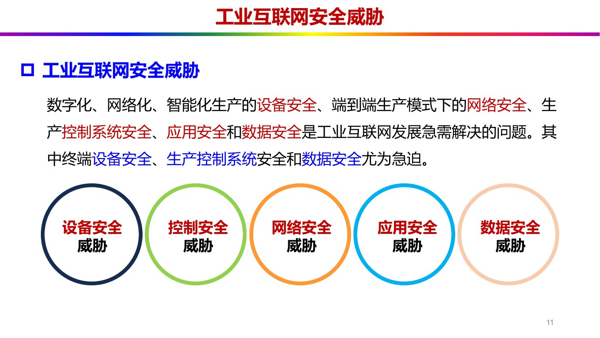
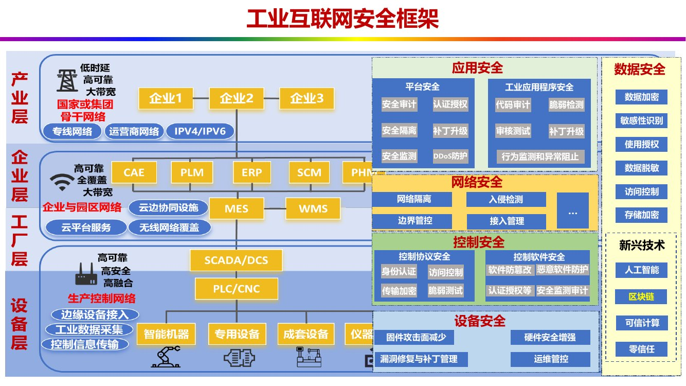

# 第 6 章 安全技术

> **课件结构**（第6章 工业互联网的安全技术-0929，77 页）：
> 安全威胁 → 安全框架 → 设备安全 → 控制安全 → 网络安全 → 应用安全 → 数据安全 → 工业区块链
>
> 这一章的结构**极其整齐**，是论述题最好拿分的一章：**"五维（设备/控制/网络/应用/数据）×
> 三段（变化 → 风险 → 防护技术）"**。除了区块链那一节，其余内容都可以套同一个模板展开。
> 复习方法：把五维的"变化"和"防护技术清单"背熟，论述题按维度分点写，每点"变了什么 + 风险是
> 什么 + 用什么技术防"。

---

## 0 课件页码 → 本节

| 课件页 | 内容 | 本节 |
| --- | --- | --- |
| 5–7 | 震网病毒事件与攻击路径 | 1.1 |
| 9–10 | 漏洞数据、三个思考（物理隔离≠安全等） | 1.2 |
| 11 | 五类安全威胁 | 1.3 |
| 13–14 | 安全框架总图、五维定义 | 2.1 |
| 15–27 | 五维的"变化"与"安全分析" | 2.2 |
| 29–31 | 设备安全防护技术 | 3 |
| 33–41 | 控制安全防护技术（协议侧 + 软件侧） | 4 |
| 43–47 | 网络安全防护技术 | 5 |
| 49–53 | 应用安全防护技术（平台 + 工业 App） | 6 |
| 55–59 | 数据安全防护技术（传统 + 新兴技术） | 7 |
| 61–76 | 区块链与工业区块链四个解决方案 | 8 |
| 77 | 课后习题（8 题） | §9 |

---

## 1 安全威胁（6.1）

### 1.1 震网病毒（Stuxnet）：本课程的"第一案例"

> 【课件 C6·P5–6】
> - **震网病毒**（Stuxnet 蠕虫，又称"超级工厂病毒"）是**首个专门针对工业控制系统的破坏性
>   蠕虫病毒**；
> - 目标：**伊朗核电站铀离心机**（西门子工控系统），造成**浓缩铀离心机大规模故障**；
> - 结果：**入侵成功**，使伊朗核工业**陷入停滞**；
> - 定性：**全球第一个主动攻击真实世界基础设施的蠕虫病毒**。

> 【课件 C6·P6】由此得出两条判断：
> ① **工业安全：网络攻击可对现实世界的工业设备造成物理破坏**；
> ② （配合 P10 的三个思考）**物理隔离不等于安全**。

**攻击路径六步**（【课件 C6·P7】，填空/排序常考）：

> **① 感染 → ② 扫描 → ③ 更新 → ④ 破坏 → ⑤ 控制 → ⑥ 欺骗、摧毁**

> 【考点·论述】"震网病毒事件的警示意义"（课后题 1）——四点：
> ① **攻击目标变了**：从"偷数据"变成"毁设备"，网络攻击有了**物理破坏力**；
> ② **物理隔离失效**：病毒通过 U 盘/供应链等**离线途径**进入内网，说明"隔离"只是降低概率，
>    不是安全保证；
> ③ **单点防护不够**：一个漏洞（西门子 PLC 的配置软件）就能穿透整个体系，必须**纵深防御**；
> ④ **IT 与 OT 融合是双刃剑**：融合带来效率，也把 IT 的攻击面引到了 OT。

### 1.2 形势与三个思考

> 【课件 C6·P9】**2025 年：网络安全漏洞总数达 48482 条，同比增长 21.1%；其中工控系统漏洞
> 864 条，同比上升 13.2%。** 针对工业控制系统的攻击事件集中在**电力、化工、石油、铁路、
> 新能源、核应用**等关键领域，关系到国家经济命脉。

> 【课件 C6·P10】三个思考（**每一条都能当论述题的分论点**）：
> ① **物理隔离不等于安全**；
> ② **安全机制薄弱**；
> ③ **单一防护措施极易被突破**。

> 【考点·论述】"为什么物理隔离不等于安全"——三条理由：① 隔离网络仍需**移动介质/供应链/
> 运维笔记本**进出（震网就是走 U 盘）；② 隔离导致**补丁无法及时更新**，漏洞长期留存；
> ③ 隔离让人**放松警惕**，缺乏监测手段，被入侵后**发现更晚**。

### 1.3 五类安全威胁

*图 6-1 工业互联网的五类安全威胁：设备、控制、网络、应用、数据（课件 C6·P11）*

> 【课件 C6·P11】数字化、网络化、智能化生产的**设备安全**、端到端生产模式下的**网络安全**、
> **生产控制系统安全**、**应用安全和数据安全**是工业互联网发展急需解决的问题。其中
> **终端设备安全、生产控制系统安全和数据安全尤为急迫**。

| 威胁类别 | 对应对象 |
| --- | --- |
| **设备安全威胁** | 工业机器人、智能仪表、传感器等现场设备 |
| **控制安全威胁** | 控制软件、控制协议 |
| **网络安全威胁** | 工厂内、外部网络及边界 |
| **应用安全威胁** | 工业互联网平台与工业应用程序 |
| **数据安全威胁** | 工厂内部、外部数据及用户信息 |

> 【考点·选择】"尤为急迫"的三类是**终端设备安全、生产控制系统安全、数据安全**——注意是
> "三"不是"五"，这是很细的一个考点。

---

## 2 安全框架（6.2）

### 2.1 五维框架总图

*图 6-2 工业互联网安全框架：设备/控制/网络/应用/数据五维 + 新兴技术（课件 C6·P13）*

> 【课件 C6·P13–14】工业互联网安全包括五个维度：

| 维度 | 覆盖对象（【课件 C6·P14】） |
| --- | --- |
| **设备安全** | 工业机器人、智能仪表、传感器等 |
| **控制安全** | 控制软件、控制协议等 |
| **网络安全** | 工厂内、外部网络及边界 |
| **应用安全** | 工业互联网平台与工业应用程序**两大类** |
| **数据安全** | 工厂内部、外部数据及用户信息 |

框架里的"新兴技术"一栏（【课件 C6·P13】）：**人工智能、区块链、可信计算、零信任**。

> 【考点·论述·必考】"安全框架的层次结构及各层次主要防护内容"（课后题 3）——答题模板：
> **"五维 + 三段"**：先写五个维度名称，再对每个维度写"变化 → 风险 → 防护技术"各一句，
> 最后补"并用 AI/区块链/可信计算/零信任等新兴技术增强"。

### 2.2 五维的"变化"与"安全分析"（本章最该背的对照表）

#### （1）设备安全

> 【课件 C6·P15】**设备变化**：
> - 现场设备由**机械化**向**智能化**发展；
> - 新模式：**嵌入式操作系统（EOS）+ 微处理器 + 应用软件**。
> （例子：传统车床/铣床 → 数控车床/数控铣床）

> 【课件 C6·P16】**设备安全分析**（四点）：
> ① **扩散速度增加**；② **攻击直达设备**（控制系统 → 智能设备）；
> ③ **攻击范围扩大**；④ **漏洞影响扩大**（特定型号设备 → 海量通用设备）。

> 【考点·论述】"设备变智能了，为什么反而更不安全"——"三化"带来的三个后果：
> **有 OS 就有漏洞**（EOS 可被攻击）、**有网络就有入口**（联网设备可被远程攻击）、
> **有软件就能刷**（固件可被篡改）。再补一句"同型号设备海量同构，一个漏洞影响一大片"。

#### （2）控制安全

> 【课件 C6·P17】**控制变化**：
> - 生产控制：**分层、封闭、局部 → 扁平、开放、全局**；
> - 控制环境：**IT 与 OT 融合**，控制网络由**封闭走向开放**；
> - 控制布局：控制范围**从局部到全局**，**控制监测上移、实时控制下移**。

> 【课件 C6·P17】工业控制系统（**ICS**）主要包括：**SCADA 系统、DCS、PLC** 以及其它控制系统。

> 【补充·课件 C6·P18】"扁平"指**扁平化管理**：通过**减少管理层次、压缩职能部门和机构**，
> 使决策层与操作层之间的中间管理层级尽可能减少，以便快速把决策权延至生产、营销最前线；
> 对应的是传统的**金字塔管理模式**。

> 【课件 C6·P19】**控制安全分析**（三点，**极重要**）：
> ① **攻击从 IT 层渗透到 OT 层，OT 层不再可信**；
> ② **OT 层控制协议、软件安全机制缺失**，攻击难度大大降低；
> ③ **信息安全与功能安全交织**。

> 【考点·论述】"信息安全与功能安全交织"是什么意思？——功能安全关心"设备别伤人"，
> 信息安全关心"系统别被攻破"。两者交织体现在：**安全防护措施本身可能影响功能安全**
> （比如给 PLC 打补丁要停机、加防火墙会增加时延、加密会拖慢实时控制）。所以工业安全不能
> 照搬 IT 的"先关再修"，必须**在线、无损、可回滚**。这句话是高分点。

#### （3）网络安全

> 【课件 C6·P20】**网络变化**：
> - 工厂内网呈现**IP 化、无线化**，组网方式**灵活化、全局化**；
> - **IT 信息网络与 OT 控制网络逐渐融合**，企业专网与互联网逐渐融合；
> - 传统互联网网络安全问题**向工业互联网蔓延**。

> 【课件 C6·P21】**网络安全分析**（三点）：
> ① 工业互联协议由**专有协议**向**以太网/IP 协议**转变，**攻击门槛极大降低**；
> ② 工业以太网交换机**性能低**，易受**分布式拒绝服务攻击（DDoS）**；
> ③ 工厂网络的互联、生产、运营由**静态转为动态**，**安全策略面临挑战**。

> 【补充·课件 C6·P21】DDoS（Distributed Denial of Service，分布式拒绝服务攻击）：通过大量
> 受控设备向目标系统发送海量请求，使其无法为正常用户提供服务。

> 【考点·选择】"为什么工业协议改用以太网/IP 后更危险"——因为**协议公开、工具丰富、攻击门槛
> 低**；专有协议虽然不通用，但"不透明"本身就是一层防护。这是"开放性"的代价。

#### （4）应用安全

> 【课件 C6·P23】**应用变化**：
> - 包括**工业互联网平台**与**工业应用程序**两大类；
> - 覆盖**智能化生产、网络化协同、个性化定制、服务化延伸**等方面；
> - **设计协同、供应链协同、制造协同、服务协同、用户全流程参与**。

> 【课件 C6·P24】工业互联网具备**多用户、多设备、多平台、多工序、数据来源多、类型多、
> 跨组织、跨区域**等特点，带来安全挑战。

> 【课件 C6·P25】**应用安全分析**（三点）：
> ① **安全保护需求不同**：不同业务有不同的服务安全需求；
> ② **网络安全隔离能力要求高**；
> ③ **业务应用安全保障能力要求高**。

> 【考点·填空】应用安全的两个大类：**工业互联网平台安全** + **工业应用程序安全**（第 6 章
> §6 就按这两类展开）。

#### （5）数据安全

> 【课件 C6·P26】**数据变化**：
> - **少量、单一、单向 → 大量、多维、双向**转变；
> - 数据**体量增大、种类增多、结构复杂**；
> - **工厂内外网络双向流动共享**。

> 【课件 C6·P27】**数据安全分析**（四点）：
> ① **数据泄露风险增大**；② **数据保护难度增大**；③ **数据价值保护需求**；
> ④ **用户隐私数据可能泄露**。

> 【考点·论述】"数据从单向变双向，风险为什么变大"——单向（设备→平台）时数据只在内部流动；
> 双向共享后，数据要**出企业边界**（给供应链、给客户、给第三方 App），于是多了三个风险：
> **谁在用（越权）、用到哪（出境/出界）、怎么删（生命周期）**——正好对应后面 §7 的
> "访问控制、脱敏、生命周期管理"。

---

## 3 设备安全防护技术（6.3）

> 【课件 C6·P29–31】四类技术：

| 技术 | 内容 |
| --- | --- |
| **① 固件攻击面减少（Firmware Attack Surface Reduction，FASR）** | 从**操作系统内核、协议栈**做安全增强，**阻止恶意代码传播与运行**。**固件（Firmware）**：存储在硬件设备中的特殊软件，直接控制设备底层操作，充当**硬件与高级软件（如操作系统）之间的桥梁** |
| **② 漏洞修复与补丁管理** | 流程：**设备发现 → 漏洞扫描 → 漏洞评估 → 漏洞修复**（配套"安装—下载—测试—批准—监测"的补丁流程）。**漏洞修复**：修复设备中存在的漏洞和安全弱点；**补丁管理**：补丁的**检测、下载、测试、批准和安装** |
| **③ 硬件安全增强** | 对硬件进行**标识**；把硬件级部件（**安全芯片或安全固件**）作为**系统信任根** |
| **④ 运维管控** | 对外部存储器等**硬件连接设备**的使用进行管控；部署**运维管控系统** |

> 【考点·填空】FASR = **固件攻击面减少**；"系统信任根"由**安全芯片/安全固件**提供。
> 【坑】"漏洞修复"与"补丁管理"是两件事：前者是**修漏洞**（动作），后者是**管补丁的全流程**
> （检测→下载→测试→批准→安装）。

---

## 4 控制安全防护技术（6.4）

分**控制协议安全**与**控制软件安全**两侧（对应安全框架图 C6·P13 的两列）。

### 4.1 控制协议安全防护（五项）

> 【课件 C6·P33–37】

| 技术 | 内容 |
| --- | --- |
| **① 身份认证** | 主要通过**知识类认证、资产类认证、本征类认证**的组合方式实现，确保控制系统执行的控制命令**来自合法用户** |
| **② 白名单技术** | 通过建立**工业控制协议白名单访问控制策略**，过滤一切非法访问，保证只有**白名单内的可信任指令和消息**才能在网络上传输 |
| **③ 访问控制** | **鉴别访问主体的合法身份**后，通过某种途径**准许或限制**用户对数据信息的访问能力及范围，从而**控制对关键资源的访问** |
| **④ 传输加密** | 三种手段：**在协议栈增加安全层**、**在协议应用数据单元增加安全字段**、**改进通信会话的过程** |
| **⑤ 脆弱性测试**（漏洞评估） | 一种**系统化识别**系统、网络、应用中**安全弱点**的安全检测方法，通过**量化分析潜在威胁**并提出**修复建议**，是**漏洞管理与风险管理的核心环节**。其中 **Fuzzing test（模糊测试）占 80%**；模糊测试分**黑盒、白盒、灰盒**三种类型 |

> 【考点·填空】身份认证三种方式：**知识类、资产类、本征类**（对应"你知道什么/你拥有什么/
> 你是谁"）。传输加密三种手段要能列全。
> 【考点·选择】脆弱性测试中占比最高的是 **Fuzzing（模糊测试），约 80%**。

### 4.2 控制软件安全防护（四项）

> 【课件 C6·P38–41】

| 技术 | 内容 |
| --- | --- |
| **① 软件防篡改** | 以**代码测试、完整性校验、代码加密**等方式，防止攻击者篡改工业控制软件 |
| **② 恶意软件防护** | **恶意代码检测、预防和恢复** |
| **③ 认证授权、漏洞修复和补丁升级** | 传统手段，但要**在线、不中断生产** |
| **④ 安全监测与审计** | 利用特定工业软件操作的**周期性**，测量协议不同阶段执行中的**偏差**；利用控制软件中的**时间序列信息**，基于**无监督学习**的方法进行**异常检测** |

> 【考点·论述】"为什么工业控制软件的安全监测要用无监督学习"——因为工业现场**几乎没有
> 带标签的攻击样本**（不能拿生产线做实验），且正常行为**高度规律、周期性强**，所以适合
> "学正常、报异常"的**无监督异常检测**。这个回答把"工控场景的特殊性"讲透了。

---

## 5 网络安全防护技术（6.5）

> 【课件 C6·P43–47】五项：

| 技术 | 内容 |
| --- | --- |
| **① 网络隔离** | **限制网络之间的资源共享**，防止信息泄露。典型场景：**工厂内外网隔离、生产网与办公网隔离、工业控制系统隔离**。包括**物理隔离、协议隔离、应用隔离** |
| **② 边界管控** | 在网络**边界**上部署可靠的安全防御设备，对**安全域边界**进行监视，**识别边界上的入侵行为并进行有效阻断**（如现场控制级环境、线路调控环境、运营管理系统环境之间的边界） |
| **③ 接入管理** | 对**接入的设备与标识解析节点**进行**身份认证**，保证**合法接入和合法连接** |
| **④ 通信和传输保护** | **加密技术、校验机制** |
| **⑤ 入侵检测系统（IDS）** | 通过**网络流量分析**，实现**网络流量监测与告警**。两类方法：**基于规则库**（预先定义模式或与已知恶意序列比对）与**基于异常**（早期用机器学习，当前用**深度学习**，用大规模神经网络参数挖掘训练样本背后的知识） |

> 【考点·填空】网络隔离三种：**物理隔离、协议隔离、应用隔离**（注意不是"逻辑隔离"）。
> 【考点·选择】入侵检测两类方法：**基于规则库（特征匹配）/ 基于异常（行为）**；
> 基于异常当前主流是**深度学习**。

---

## 6 应用安全防护技术（6.6）

> 【课件 C6·P49】应用安全分**平台安全**与**工业应用程序安全**两大类。

### 6.1 平台安全（六项）

> 【课件 C6·P49–50】

| 技术 | 内容 |
| --- | --- |
| **安全审计** | 记录、审查平台操作行为 |
| **认证授权** | 身份鉴别与权限分配 |
| **安全隔离** | 多租户/多应用之间隔离 |
| **安全监测** | 运行状态与异常监测 |
| **补丁升级** | 平台组件漏洞修补 |
| **DDoS 防护** | 基于**负载均衡、内容分发网络（CDN）、分布式集群防御**等 |

### 6.2 工业应用程序安全（四项）

> 【课件 C6·P51–53】

| 技术 | 内容 |
| --- | --- |
| **① 代码审计** | 检查**源代码中的缺点和错误信息**，分析并找到这些问题引发的**安全漏洞** |
| **② 脆弱性检测** | 基于**漏洞数据库**或 **APP 逆向**等技术手段，对工业应用程序进行**漏洞发现** |
| **③ 审核测试** | 上线前的合规与安全测试 |
| **④ 行为监测及异常阻止** | 基于**静态行为规则匹配**或**机器学习**的方法 |

> 【考点·选择】"代码审计"针对**源代码**（白盒），"脆弱性检测"针对**已编译的程序**
> （可用漏洞库 + 逆向）。这两个概念最容易被互换出题。

---

## 7 数据安全防护技术（6.7）

### 7.1 三类传统防护（按数据生命周期分）

> 【课件 C6·P55】

| 环节 | 技术 |
| --- | --- |
| **数据传输** | **数据加密** |
| **数据处理** | **数据敏感性识别、使用授权、数据脱敏** |
| **数据存储** | **访问控制、存储加密** |

> 【记忆法】"**传加密、用授权、存控制**"——三个动作对应三个环节，正好是一条数据的生命周期。

### 7.2 四类基于新兴技术的防护（**必考清单**）

> 【课件 C6·P56–59】

| 技术 | 作用（课件原话） |
| --- | --- |
| **基于人工智能** | **数据智能识别保护、智能安全溯源、智能风险预警、智能精准管控**（四项能力） |
| **基于区块链** | **数据安全存储和可信交换共享** |
| **基于可信计算** | **确保数据可信、可控、可管**。**可信计算（Trusted Computing）**：通过**硬件和软件协同工作**，确保计算设备、数据和应用程序在任何情况下都能**按预期安全运行**的技术体系 |
| **基于零信任架构** | **数据可信访问**（"永不信任、持续验证"） |

> 【考点·填空】AI 数据安全的四项能力：**智能识别保护、智能安全溯源、智能风险预警、
> 智能精准管控**——四个都是"智能 + 动词 + 名词"的结构，很好记。
> 【考点·选择】"零信任"的核心是**数据可信访问 / 持续验证**，不是"建立内网边界"。

---

## 8 工业区块链技术（6.8）

### 8.1 区块链基础

> 【课件 C6·P61】**区块链（Blockchain）**：是一种由**区块（block）**组成的**链式数据结构**，
> 并且是**去中心化**的、**不可篡改**的**分布式账本**技术。通过链式数据结构记录交易和信息，
> 实现数据**透明和安全**。

> 【课件 C6·P62】加密技术与安全性：**哈希算法**（提供**唯一性**、**不可篡改性**）+
> **加密密钥**（**公钥/私钥**，共同决定**整体安全性**）。

> 【课件 C6·P63】区块链的五个特性：

| 特性 | 含义 |
| --- | --- |
| **透明性** | 账本公开可查 |
| **不可篡改性** | 哈希链式结构保证 |
| **去中心化** | 无单一中心机构 |
| **可追溯性** | 每笔记录可回溯 |
| **减少交易成本和时间** | 去掉中间对账环节 |

典型应用场景（【课件 C6·P63】）：**金融服务、供应链管理、医疗保健、数字身份认证、投票系统、
智能合约**。

> 【考点·填空】区块链五特性：**透明性、不可篡改性、去中心化、可追溯性、减少交易成本和时间**。
> 【坑】"区块链 = 比特币"是错的：比特币是**应用**，区块链是**底层技术**（课件 P61 的图把二者
> 画成"比特币 ⊂ 区块链 ⊂ 分布式数据库"的包含关系）。

### 8.2 工业区块链的特征

> 【课件 C6·P64】
> - **技术基础**：**数字签名、时间戳、分布式共识及多方存储、智能合约自动执行**；
> - **功能特色**：**多中心化信任构建、跨组织高效协作、可控安全共享、可追溯审计防篡改**；
> - **应用领域**：**多方可信安全存证、业务协同全过程留痕、资产盘点监管治理**等领域具有显著优势；
> - 结论：**链网协同（区块链—工业互联网协同）势在必行**。

> 【考点·论述】"为什么工业互联网需要区块链"——一句话：工业互联网要**跨企业**协作，而跨企业
> 之间**没有共同信任的中心**；区块链用**分布式账本 + 智能合约**在**不依赖第三方**的前提下
> 建立信任，正好补上"多主体协作"这块短板。

### 8.3 四个解决方案（挑战 → 方案，一一对应）

> 【课件 C6·P65】总表：

| 挑战 | 基于工业区块链的解决方案 |
| --- | --- |
| **信任构建难** | **工业互联网分布式信任管理** |
| **数据确权流转难** | **工业互联网数据确权流转管理** |
| **数据安全共享难** | **工业互联网数据安全共享管理** |
| **事件审计追溯难** | **工业互联网事件审计追溯管理** |

逐条要点（【课件 C6·P66–76】）：

**（1）分布式信任管理**（解决"多平台、多设备、多用户、多工序协作缺乏统一可信身份认证"）

> - **联盟数字身份表示方法**：实现**人机物多类型实体身份快速标记**（联盟身份 ID = 联盟分布式
>   数字身份标识 + 联盟身份凭证；一实体可生成多个联盟身份 ID，对应不同场景的凭证）；
> - **联盟数字身份全生命周期管理**：实现**身份自生成、自存储、自销毁**——注册 → 验证 → 更新 →
>   撤销（四步都在账本上留痕）；
> - **重要属性隐私保护机制**：实现**跨联盟协同许可认证**，分四级（身份 ID 生成 → 身份凭证
>   生成 → 身份区块生成 → 身份验证）。

**（2）数据确权流转管理**（解决"数据来源多、流转权属关系确认难、使用责任不清晰"）

> - **内外因素联合抽取轻量化数据资产身份标签并上链**，满足海量唯一标记需求；
> - **联盟分布式账本上数据资产与标签身份绑定**，支持跨域多方数字资产**链下链上连通和确权存储**；
> - **构建隔离通道和流转共识策略的访问控制机制**，支撑**非授权流转阻断**。

**（3）数据安全共享管理**（解决"原始数据共享意愿低、加密数据计算过程过于透明、难追踪"）

> - **联盟分布式多方密文同态计算**，支持**原始数据密文共享**及计算方**密文计算过程不透明**；
> - **联盟计算方安全激励协同机制**，支持数据计算方**全阶段留痕追踪**和共享结果**正向激励**；
> - 目标：实现可追踪的"**数据模型共享、数据不可见**"创新业务模式。

**（4）事件审计追溯管理**（解决"跨组织跨区互通联动后缺乏统一高效的追溯审计手段"）

> - **建立事件可信共享渠道**，实现跨域事件信息**定期及时上链**；
> - **生成区块链上事件映射逻辑链**，支持完成不同阶段到**原始事件发生点**的审计追溯；
> - **智能合约自主执行机制**，支持事件行为簇以时间为单位打包**审计报告**的共享查阅和审计数据
>   自动化标注和更新。

> 【考点·论述】"工业区块链解决了工业互联网安全的哪些核心难题"（课后题 8）——按"**信任、
> 确权、共享、审计**"四个词答，每个词配一句"用什么技术"：
> 信任用**分布式身份账本**、确权用**资产标签上链**、共享用**密文同态计算**、审计用**事件映射
> 逻辑链 + 智能合约**。

---

## 9 本章课后习题与答题落点

课件第 77 页 8 道题：

| 课件原题 | 答题落点 |
| --- | --- |
| 1. 震网病毒事件的基本情况及对工业互联网安全的警示意义 | §1.1（六步路径 + 四点警示） |
| 2. 五类安全威胁？各核心关注点？内在逻辑关系？ | §1.3 表 + §2.2（逻辑：设备被攻→控制被夺→网络被穿→应用被破→数据被窃，逐层向上传导） |
| 3. 安全框架的层次结构及各层主要防护内容 | §2.1 + §3–§7 |
| 4. 五个维度各自发生怎样的变化？带来哪些新挑战？ | §2.2 五张"变化 → 分析"表 |
| 5. 五个维度分别简述其主要防护技术 | §3–§7 各清单 |
| 6. 应用安全防护有哪两大类？各自主要技术 | §6.1 平台安全 + §6.2 工业 App 安全 |
| 7. 什么是区块链？具有哪些特性？ | §8.1（定义 + 五特性） |
| 8. 工业区块链解决了哪些核心难题？举例说明 | §8.3（四个解决方案） |

> 【考点·论述】第 2 题问"内在逻辑关系"，这是本章唯一需要"串起来"的题。标准答法：
> 五类威胁不是并列的，而是**一条攻击链**——攻击者先**攻设备**（拿到入口），再**夺控制**
> （拿到控制权），沿**网络**横向移动（扩大战果），利用**应用**漏洞（拿到平台权限），最终
> 窃取或破坏**数据**（达成目的）。所以防护也要**纵深**：任何一层都不能少。

---

## 10 本章必背清单（考前 10 分钟）

1. **震网病毒**：首个专门针对工控系统的破坏性蠕虫；目标伊朗核电站离心机；**首个主动攻击
   真实世界基础设施**的病毒；路径六步：感染→扫描→更新→破坏→控制→欺骗摧毁。
2. **三个思考**：物理隔离≠安全、安全机制薄弱、单一防护极易被突破。
3. **五类威胁**：设备、控制、网络、应用、数据；**尤为急迫**：终端设备、生产控制系统、数据。
4. **五维变化**：设备机械化→智能化（EOS + 微处理器 + 软件）；控制分层封闭局部→扁平开放全局；
   网络 IP 化/无线化 + IT/OT 融合；应用平台 + 工业 App、多用户多设备多平台；数据少量单一
   单向→大量多维双向。
5. **控制安全三分析**：IT 渗透到 OT（OT 不再可信）、OT 协议软件安全机制缺失、信息安全与
   功能安全交织。
6. **设备防护四项**：FASR、漏洞修复与补丁管理、硬件安全增强（信任根）、运维管控。
7. **控制防护**：协议侧（身份认证/白名单/访问控制/传输加密/脆弱性测试 Fuzzing 80%）+
   软件侧（防篡改/恶意软件防护/认证授权补丁/安全监测审计-无监督学习）。
8. **网络防护五项**：网络隔离（物理/协议/应用）、边界管控、接入管理、通信传输保护、入侵检测
   （规则库/异常）。
9. **应用防护两类**：平台（审计/认证授权/隔离/监测/补丁/DDoS）+ 工业 App（代码审计/脆弱性
   检测/审核测试/行为监测异常阻止）。
10. **数据防护**：传输加密、处理（敏感性识别、使用授权、脱敏）、存储（访问控制、存储加密）；
    新兴：AI（四能力）、区块链、可信计算、零信任。
11. **区块链**：链式结构的去中心化不可篡改分布式账本；五特性（透明、不可篡改、去中心化、
    可追溯、减少交易成本和时间）。
12. **工业区块链四方案**：分布式信任管理、数据确权流转、数据安全共享、事件审计追溯。
