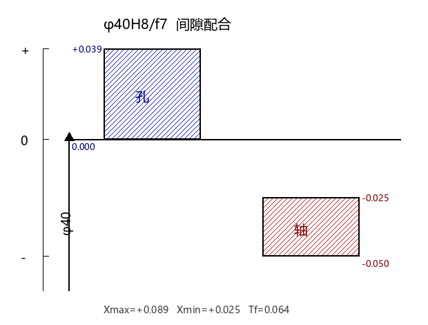
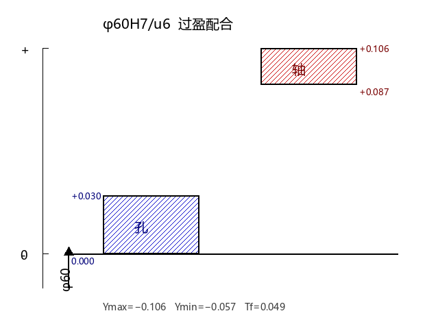
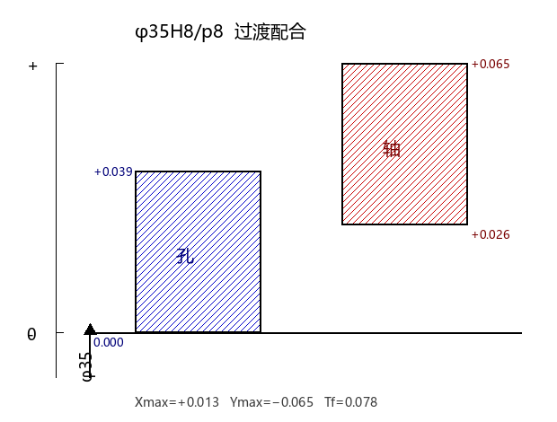

# 计算题专题（30分 · 送分题）

> **声明**：本页「自练」题均为编者自拟，**非老师提供**，答案可能有偏差，请以老师例题与作业答案为准。
> 计算题是**送分题**，公式固定、步骤固定，务必拿满 30 分。带计算器。

---

# 第一部分 · 配合计算（第2章，15分）

## 一、核心公式（必背）

设孔为 $ES$（上偏差）、$EI$（下偏差），轴为 $es$、$ei$（单位 mm 或 μm）。

| 公式 | 说明 |
|---|---|
| $ES = D_{max} - D$，$EI = D_{min} - D$ | 孔上/下偏差 |
| $es = d_{max} - d$，$ei = d_{min} - d$ | 轴上/下偏差 |
| $T_h = \lvert ES - EI \rvert$，$T_s = \lvert es - ei \rvert$ | 孔/轴公差（恒为正） |
| 间隙配合 $X_{max} = ES - ei$，$X_{min} = EI - es$ | $X_{min} \ge 0$ |
| 过盈配合 $Y_{max} = EI - es$，$Y_{min} = ES - ei$ | $Y_{max} \le 0$ |
| 过渡配合 $X_{max} = ES - ei$，$Y_{max} = EI - es$ | 有间隙有过盈 |
| $T_f = T_h + T_s$ | 配合公差 |
| 间隙 $T_f = X_{max} - X_{min}$；过盈 $T_f = Y_{min} - Y_{max}$；过渡 $T_f = X_{max} - Y_{max}$ | 三种算法 |

> **口诀**：求 $X_{max}/Y_{max}$ 一律「**孔大减小（ES−ei）**」；求 $X_{min}/Y_{min}$ 一律「**孔小减大（EI−es）**」。判断类别看结果符号：两者都 ≥0 是间隙，都 ≤0 是过盈，一正一负是过渡。

**基准制**：基孔制（孔 $H$，$EI = 0$）；基轴制（轴 $h$，$es = 0$）。

## 二、套路A：已知配合代号 → 查表 → 算配合（三段式）

以 $\phi 40H8/f7$ 为例：

1. **查表**：标准公差 IT7 = 25 μm，IT8 = 39 μm；轴 $f$ 的基本偏差 $es = -0.025$ mm。
2. **定偏差**：
   - 孔 $H8$：$EI = 0$，$ES = +0.039$；
   - 轴 $f7$：$es = -0.025$，$ei = es - IT7 = -0.050$。
3. **算配合**：$X_{max} = ES - ei = +0.089$，$X_{min} = EI - es = +0.025$，$T_f = 0.089 - 0.025 = 0.064$。间隙配合。

**公差带图画法**：画零线 → 孔带在上（标 ES、EI）→ 轴带在下（标 es、ei）→ 两带重叠关系即配合类别。

## 三、套路B：已知极限间隙/过盈 → 反求配合代号

以「$\phi 40$，要求 $X_{max}=+0.066$，$X_{min}=+0.025$」为例：

1. 判类别：$X_{min}>0$ → 间隙配合。
2. 算配合公差 $T_f = X_{max} - X_{min} = 0.041 = T_h + T_s$。
3. 选公差等级（**基孔制 + 孔比轴低一级**）：查表试 IT6 = 16 μm、IT7 = 25 μm，$16 + 25 = 41$ 正好 → 孔 IT7、轴 IT6。
4. 定孔：$H7$ → $EI = 0$，$ES = +0.025$。
5. 定轴：$ei = ES - X_{max} = -0.041$；$es = EI - X_{min} = -0.025$ → 查基本偏差表 $es=-0.025$ 对应字母 **f** → 轴 $f6$。
6. 结果：$\phi 40H7/f6$。

> 反求套路本质：先由 $T_f$ 拆出 $T_h + T_s$ 定等级，再由 $ES$（或 $EI$）与给定的 $X/Y$ 反解出轴的 $ei$ 或 $es$，查表定字母。

## 四、孔基本偏差的两条换算规则（基轴制必考）

- **通用规则**（大多数情况）：$A$~$H$ 用 $EI = -es$；$J$~$ZC$ 用 $ES = -ei$。
- **特殊规则**（仅高精度过渡/过盈）：$K$、$M$、$N$（≤IT8）与 $P$~$ZC$（≤IT7）：$ES = -ei + \Delta$，其中 $\Delta = IT_n - IT_{(n-1)}$（孔比轴低一级的那级差）。

## 五、老师例题精讲（6 题，全部逐行）

### 例1 查表：$\phi 40H8/f7$ 与 $\phi 40F8/h7$（间隙，基孔 vs 基轴）

查表：IT7 = 25 μm，IT8 = 39 μm。

**$\phi 40H8/f7$（基孔制）**：$EI = 0$，$ES = +0.039$；$es = -0.025$，$ei = -0.050$。
- 间隙配合：$X_{max} = ES - ei = +0.089$，$X_{min} = EI - es = +0.025$，$T_f = 0.064$。

**$\phi 40F8/h7$（基轴制）**：孔 $F$ 用通用规则 $EI = -es$（$f$ 的 $es=-0.025$）→ $EI = +0.025$，$ES = EI + IT8 = +0.064$；轴 $h7$：$es = 0$，$ei = -0.025$。
- 间隙配合：$X_{max} = +0.089$，$X_{min} = +0.025$，$T_f = 0.064$。

> 结论：同名配合 $\phi 40H8/f7$ 与 $\phi 40F8/h7$ 的**配合性质完全相同**（$X_{max}/X_{min}$ 一致），只是基准制不同。

### 例2 查表：$\phi 60H7/u6$ 与 $\phi 60U7/h6$（过盈）

查表：IT6 = 19 μm，IT7 = 30 μm。

**$\phi 60H7/u6$**：$EI = 0$，$ES = +0.030$；轴 $u$ 的 $ei = +0.087$，$es = ei + IT6 = +0.106$。
- 过盈配合：$Y_{max} = EI - es = -0.106$，$Y_{min} = ES - ei = -0.057$，$T_f = Y_{min} - Y_{max} = 0.049$。

**$\phi 60U7/h6$**：孔 $U$（≤IT7）用**特殊规则** $ES = -ei + \Delta$，$\Delta = IT7 - IT6 = 11$ μm → $ES = -0.087 + 0.011 = -0.076$；$EI = ES - IT7 = -0.106$。轴 $h6$：$es = 0$，$ei = -0.019$。
- 过盈配合：$Y_{max} = EI - es = -0.106$，$Y_{min} = ES - ei = -0.057$，$T_f = 0.049$。

> 结论：基孔制 $\phi 60H7/u6$ 与基轴制 $\phi 60U7/h6$ 过盈量**完全相同**。

### 例3 查表：$\phi 35H8/p8$ 与 $\phi 35P8/h8$（过渡）

查表：IT8 = 39 μm。

**$\phi 35H8/p8$**：$EI = 0$，$ES = +0.039$；轴 $p$ 的 $ei = +0.026$，$es = +0.065$。
- 过渡配合：$X_{max} = ES - ei = +0.013$，$Y_{max} = EI - es = -0.065$，$T_f = X_{max} - Y_{max} = 0.078$。

**$\phi 35P8/h8$**：孔 $P$（IT8，因孔轴同级 $\Delta = IT8 - IT8 = 0$）$ES = -ei + \Delta = -0.026$；$EI = ES - IT8 = -0.065$。轴 $h8$：$es = 0$，$ei = -0.039$。
- 过渡配合：$X_{max} = +0.013$，$Y_{max} = -0.065$，$T_f = 0.078$。

### 例4 反求：$\phi 30$，$X_{max}=+0.027$，$Y_{max}=-0.030$ → 过渡配合

- $T_f = X_{max} - Y_{max} = 0.027 - (-0.030) = 0.057 = T_h + T_s$。
- 基孔制，孔比轴低一级：试 IT8 = 33 μm、IT7 = 21 μm，$33 + 21 = 54 < 57$ 且最接近 → 孔 IT8、轴 IT7。
- 孔 $H8$：$EI = 0$，$ES = +0.033$。
- 轴 $ei = ES - X_{max} = +0.033 - 0.027 = +0.006$ → 查表 $m$ 的 $ei = +0.008$ 最接近 → 轴 $m7$，$es = ei + IT7 = +0.029$。
- 结果 $\phi 30H8/m7$；验算：$X_{max}=+0.025$、$Y_{max}=-0.029$，均在要求范围内 ✓。

### 例5 反求：$\phi 40$，$X_{max}=+0.066$，$X_{min}=+0.025$ → 间隙配合

- $T_f = 0.066 - 0.025 = 0.041$。
- 试 IT6 = 16 μm、IT7 = 25 μm，$16 + 25 = 41$ → 孔 IT7、轴 IT6。
- 孔 $H7$：$EI = 0$，$ES = +0.025$。
- 轴 $ei = ES - X_{max} = -0.041$，$es = EI - X_{min} = -0.025$ → 字母 **f** → 轴 $f6$。
- 结果 $\phi 40H7/f6$。

### 例6 反求：$\phi 40$，$Y_{max}=-0.076$，$Y_{min}=-0.035$ → 过盈配合

- $T_f = Y_{min} - Y_{max} = -0.035 - (-0.076) = 0.041$。
- 孔 IT7（$ES=+0.025$，$EI=0$）、轴 IT6。
- 轴 $ei = ES - Y_{min} = +0.025 - (-0.035) = +0.060$ → 字母 **u** → 轴 $u6$；$es = EI - Y_{max} = +0.076$。
- 结果 $\phi 40H7/u6$。

## 六、自练（配合，自拟）

> 答案仅供参考，可能有偏差。

**自练1**：查表确定 $\phi 50H7/g6$ 与 $\phi 50G7/h6$ 的极限偏差，判断配合类别并求 $X_{max}$、$X_{min}$、$T_f$。（提示：IT7=25 μm、IT6=16 μm，$g$ 的 $es = -0.009$）

参考答案

$\phi 50H7/g6$：孔 $+0.025/0$，轴 $-0.009/-0.025$；间隙配合，$X_{max}=+0.050$，$X_{min}=+0.009$，$T_f=0.041$。$\phi 50G7/h6$：孔 $+0.034/+0.009$（$EI=-es=+0.009$），轴 $0/-0.016$；$X_{max}=+0.050$，$X_{min}=+0.009$，$T_f=0.041$。

**自练2**：基本尺寸 $\phi 30$ mm 的孔轴配合，要求 $X_{max}=+0.041$、$X_{min}=+0.007$，确定基准制、公差等级、偏差代号与配合种类。（提示：IT6=13 μm、IT7=21 μm）

参考答案

间隙配合，$T_f = 0.034$；取孔 IT7、轴 IT6（$13+21=34$）；孔 $H7$（$+0.021/0$）；轴 $ei=ES-X_{max}=-0.020$，$es=EI-X_{min}=-0.007$ → 字母 **g** → 轴 $g6$；结果 $\phi 30H7/g6$。

---

# 第二部分 · 测量计算（第3章，15分）

## 一、题型1：量块组合（83 块一套）

**83 块一套组成**：1.005、0.5、1 各 1 块；1.01~1.49（间隔 0.01，49 块）；1.5~1.9（间隔 0.1，5 块）；2.0~9.5（间隔 0.5，16 块）；10~100（间隔 10，10 块）。

**组合原则**：① 块数尽量少，**总数不超过 4 块**；② 从**消去尺寸最小尾数**开始逐一选取。

**老师例题**：组合 28.935、29.425、25.545：

| 目标 | 组合 | 消尾过程 |
|---|---|---|
| 28.935 | 1.005 + 1.43 + 6.5 + 20 | 先 1.005 消 0.005，再 1.43 消 0.03，再 6.5，再 20 |
| 29.425 | 1.005 + 1.42 + 7.0 + 20 | 先 1.005，再 1.42 消 0.02，再 7.0，再 20 |
| 25.545 | 1.005 + 1.04 + 3.5 + 20 | 先 1.005，再 1.04 消 0.04，再 3.5，再 20 |

> 套路：第一步总用 1.005 消掉小数第 3 位，再从现有块里逐位消尾。

## 二、题型2：测量列数据处理（六步模板）

设等精度测量 $N$ 次得 $L_1, L_2, \dots, L_N$：

1. **算术平均值**：$\bar L = \dfrac{1}{N}\sum L_i$（真值的最可信赖值）。
2. **残差**：$v_i = L_i - \bar L$（应 $\sum v_i = 0$ 校验）。
3. **单次测量标准偏差（贝塞尔公式）**：$\sigma = \sqrt{\dfrac{\sum v_i^2}{N-1}}$。
4. **判粗大误差（拉依达准则）**：若 $\lvert v_i \rvert > 3\sigma$ 则剔除该值，重算，直到无粗大。
5. **算术平均值标准偏差**：$\sigma_{\bar L} = \dfrac{\sigma}{\sqrt N}$。
6. **极限误差与结果**：$\Delta_{lim} = \pm 3\sigma_{\bar L}$；结果 $L_0 = \bar L \pm \Delta_{lim}$（置信概率 99.73%）。

## 三、老师例题精讲

### 例7 轴直径 10 次测量

测得值（mm）：30.454、30.459、30.454、30.459、30.458、30.459、30.456、30.458、30.458、30.455。

| 序号 | $L_i$ | $v_i$/μm | $v_i^2$ |
|---|---|---|---|
| 1 | 30.454 | −3 | 9 |
| 2 | 30.459 | +2 | 4 |
| 3 | 30.454 | −3 | 9 |
| 4 | 30.459 | +2 | 4 |
| 5 | 30.458 | +1 | 1 |
| 6 | 30.459 | +2 | 4 |
| 7 | 30.456 | −1 | 1 |
| 8 | 30.458 | +1 | 1 |
| 9 | 30.458 | +1 | 1 |
| 10 | 30.455 | −2 | 4 |
| | | $\sum v_i=0$ | $\sum v_i^2=38$ |

1. $\bar L = 30.457$ mm。
2. $\sigma = \sqrt{38/(10-1)} = 2.05$ μm。
3. $3\sigma = 6.15$ μm，无 $\lvert v_i \rvert > 6.15$，无粗大误差。
4. $\sigma_{\bar L} = 2.05/\sqrt{10} = \pm 0.648$ μm。
5. $\Delta_{lim} = \pm 3 \times 0.648 = \pm 1.944$ μm。
6. $L_0 = (30.457 \pm 0.002)$ mm（误差在 ±0.002 mm 内的可能性达 99.73%）。

### 例8 量块组合（见上）

### 例9 温度误差（环境误差）

公式：$\delta = L\,[\,a_2(t_2 - 20) - a_1(t_1 - 20)\,]$（$\delta$ 单位 mm，$a$ 单位 $10^{-6}/^\circ C$）。

**题**：千分尺测黄铜零件 $L = 100$ mm，室温（千分尺、钢）$15^\circ C$，零件未等温 $30^\circ C$，求温度误差并判断合格性（要求 $\phi 100^{\,0}_{-0.022}$，测值 99.991 mm）。

解：钢 $a_1 = 11.5\times10^{-6}$，黄铜 $a_2 = 18\times10^{-6}$，$t_1=15$，$t_2=30$：

$\delta = 100 \times [18\times(30-20) - 11.5\times(15-20)]\times10^{-6} \approx +0.024$ mm。

修正真值 $L_0 = 99.991 - 0.024 = 99.967$ mm，因 $99.967 < L_{min} = 99.978$，**不合格**。

> 若等温测量（$t_1=t_2=15$），$\delta \approx -0.003$ mm，$L_0 = 99.994$ mm，则合格——**等温后再测可大幅减小温度误差**。

## 四、自练（测量，自拟）

> 答案仅供参考，可能有偏差。

**自练3**：用 83 块一套量块组合尺寸 48.885 mm。

参考答案

$48.885 = 1.005 + 1.38 + 6.5 + 40$（共 4 块）。

**自练4**：等精度测得某尺寸 10 次（mm）：25.0360、25.0365、25.0362、25.0364、25.0367、25.0363、25.0366、25.0363、25.0366、25.0364，求测量结果。

参考答案

$\bar L = 25.0364$ mm，$\sum v_i^2 = 0.40$，$\sigma = \sqrt{0.40/9} = 0.21$ μm；$3\sigma = 0.63$ μm 无粗大；$\sigma_{\bar L} = 0.066$ μm，$\Delta_{lim} = \pm 0.198$ μm；$L_0 = (25.0364 \pm 0.0002)$ mm。

