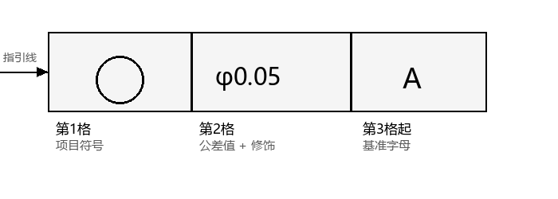
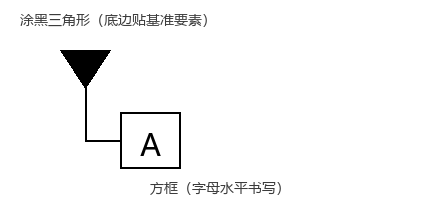

# 制图符号速补

> 本班未系统学习机械制图，本页只补**考试标注 / 改错必需**的符号与规则，不做系统制图教学。看完本页再进「标注题」与「改错题」。

## 1. 尺寸标注三要素

一个完整尺寸 = **尺寸界线 + 尺寸线 + 尺寸数字**：

- 尺寸线两端带**箭头**，指向被标注要素；
- 尺寸数字注在尺寸线上方，单位 mm **省略不写**；
- 直径加 `φ`，半径加 `R`，正方形边长加 `□`。

## 2. 公差带代号与配合代号

| 代号 | 含义 |
|---|---|
| `φ50 H8` | 孔公差带代号 = 基本偏差字母（大写）+ 公差等级数字 |
| `φ50 f7` | 轴公差带代号 = 基本偏差字母（小写）+ 公差等级数字 |
| `φ50 H8/f7` | 配合代号 = 孔公差带（分子）/ 轴公差带（分母） |

> 配合代号也可写成上下分数形式（H8 在上、f7 在下）。

- 孔用**大写**字母（H、F、G…），轴用**小写**字母（h、f、g…）；
- 字母与数字**同号大小**书写。

## 3. 形位公差框格（核心）

- **第1格**：公差项目符号（直线度 / 平面度 / 圆度 / 圆柱度 / 线轮廓度 / 面轮廓度 / 平行度 / 垂直度 / 倾斜度 / 同轴度 / 对称度 / 位置度 / 圆跳动 / 全跳动）。
- **第2格**：公差值（mm）+ 修饰符号（`φ` 圆柱、`Sφ` 球面、`Ⓜ Ⓛ Ⓔ Ⓡ Ⓟ`）。
- **第3格起**：基准字母。**第三格 = 第一基准**，第四、五格 = 第二、三基准（与字母表顺序无关）。
- 指引线从框格左端或右端引出，**弯折不超过 2 次**。

## 4. 基准符号

- 字母**大写**、**水平书写**（无论基准符号在图面上的方向如何）；
- **禁用字母**：E、I、J、M、O、P、R、F、L（共 9 个）。

## 5. 指引线箭头与基准三角形的摆放（改错重灾区）

| 被测要素类型 | 指引线箭头放置 |
|---|---|
| 轮廓要素（线 / 面） | 箭头指**轮廓线或它的延长线**，与尺寸线**明显错开** |
| 中心要素（轴线 / 中心面 / 球心） | 箭头与**尺寸线的延长线重合（对齐）** |

| 基准要素类型 | 基准三角形底边放置 |
|---|---|
| 轮廓要素 | 底边贴**轮廓线或延长线**，与尺寸线**明显错开** |
| 中心要素 | 底边贴**尺寸界线**，连线与**尺寸线对齐** |

> 一句话：**轮廓要素「错开尺寸线」，中心要素「对齐尺寸线」**。箭头总指向公差带宽度方向或直径方向。

## 6. 修饰符号表

| 符号 | 含义 | 位置 |
|---|---|---|
| `φ` | 圆柱面 / 圆公差带 | 公差值前 |
| `Sφ` | 球面公差带 | 公差值前 |
| `Ⓜ` | 最大实体要求 | 公差值后（或基准字母后） |
| `Ⓛ` | 最小实体要求 | 公差值后 |
| `Ⓔ` | 包容要求 | 尺寸后（如 φ20 Ⓔ） |
| `Ⓡ` | 可逆要求 | Ⓜ / Ⓛ 后 |
| `Ⓟ` | 延伸公差带 | 公差值后 |

## 7. 表面粗糙度符号

| 符号 | 含义 |
|---|---|
| `√` | 任何方法获得的表面（不能单独使用） |
| `√` 上加横线 | 用去除材料方法获得的表面（切削加工） |
| `√` 加圆 | 用不去除材料方法获得的表面 |

- 幅度参数写在符号上方：`Ra 3.2`、`Rz 6.3`。
