# 标注题专题（25分）

> **声明**：本页「自练」题均为编者自拟，**非老师提供**，答案可能有偏差。老师「标注题」已精讲。
> 先看「制图符号速补」再做题。标注题分两道：**陈述式（10分）** 考第4章形位公差标注；**应用（15分）** 考滚动轴承/平键/花键/螺纹（四选一，螺纹概率小）。

---

# 第一部分 · 形位公差标注（陈述式，10分）

## 一、公差项目与公差带形状速查（决定要不要加 φ）

| 项目 | 符号 | 公差带形状 | 是否加 φ |
|---|---|---|---|
| 直线度（给定平面） | — | 两平行直线 | 否 |
| 直线度（给定方向） | — | 两平行平面 | 否 |
| 直线度（任意方向） | — | 圆柱面 | **φ** |
| 平面度 | ◇ | 两平行平面 | 否 |
| 圆度 | ○ | 两同心圆（半径差 t） | 否 |
| 圆柱度 | ⌭ | 两同轴圆柱面（半径差 t） | 否 |
| 线轮廓度 / 面轮廓度 | ⌒ | 两包络线 / 面 | 否 |
| 平行度 / 垂直度 / 倾斜度（单向） | // ⊥ ∠ | 两平行平面 | 否 |
| 平行度 / 垂直度（任意方向） | // ⊥ | 圆柱面 | **φ** |
| 同轴度 | ◎ | 圆柱面 | **恒 φ** |
| 对称度 | ≐ | 两平行平面 | 否 |
| 位置度 | ⌖ | 圆柱面（球面加 Sφ） | **φ / Sφ** |
| 圆跳动 / 全跳动 | ↗ | 测量方向上 | 否 |

> **记忆**：只有「同轴度」恒加 φ；「位置度」加 φ（球面 Sφ）；「直线度/平行度/垂直度」在**任意方向**时才加 φ。其余都不加。

## 二、标注规则（核心，详见「制图符号速补」§5）

1. **被测要素**：轮廓要素 → 箭头指轮廓线/延长线，**错开尺寸线**；中心要素 → 箭头**与尺寸线对齐**。
2. **基准要素**：轮廓要素 → 三角形底边贴轮廓线/延长线，错开尺寸线；中心要素 → 底边贴尺寸界线，**与尺寸线对齐**。
3. 基准字母大写、水平书写，禁用 E/I/J/M/O/P/R/F/L。
4. 第三格 = 第一基准，依次类推。

## 三、老师例题1精讲（标注题1，10分）

**题目**：把下列技术要求标注在图上。
- (1) $\phi d$ 圆柱面尺寸 $\phi 30^{\,0}_{-0.025}$，采用**包容要求**；$\phi D$ 圆柱面 $\phi 50^{\,0}_{-0.039}$，采用**独立原则**；
- (2) 键槽侧面对 $\phi D$ 轴线的**对称度** 0.02 mm；
- (3) $\phi D$ 圆柱面对 $\phi d$ 轴线的**径向圆跳动** ≤ 0.03 mm，轴肩端平面对 $\phi d$ 轴线的**端面圆跳动** ≤ 0.05 mm。

> 下图是老师标注后的**参考答案图**。建议先按规则自己标一遍，再对照核对。

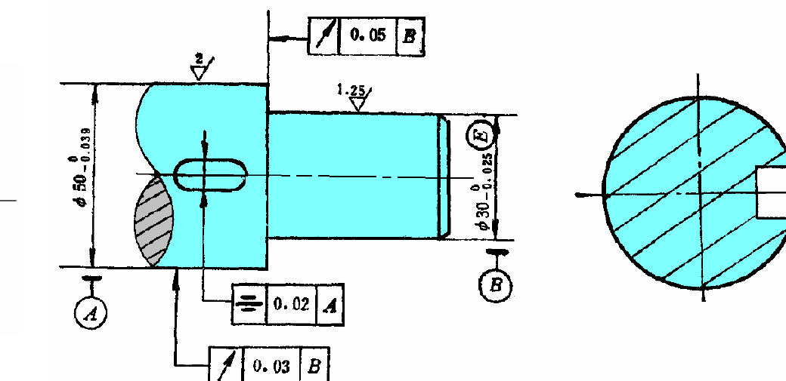

**逐条解法**：

**(1)** 尺寸公差与公差原则标注在尺寸后：
- $\phi 30^{\,0}_{-0.025}$ 后加 Ⓔ → $\phi 30^{\,0}_{-0.025}\ Ⓔ$（包容要求）；
- $\phi 50^{\,0}_{-0.039}$ **不加任何符号**（独立原则是默认，无需标注）。

**(2)** 对称度框格 + 基准：

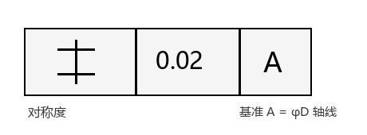
- 基准 A 是**中心要素**（$\phi D$ 轴线）→ 基准三角形底边贴 $\phi D$ 的尺寸界线，连线**与 $\phi D$ 尺寸线对齐**；
- 被测要素是键槽侧面（**中心平面**）→ 指引线箭头与键槽宽度尺寸线**对齐**。

**(3)** 两个圆跳动框格，共用基准 B = $\phi d$ 轴线：

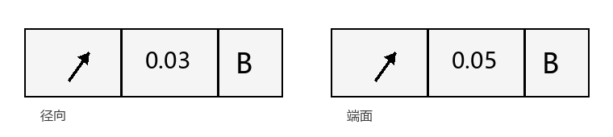
- 径向圆跳动：箭头指向 $\phi D$ **圆柱面**（轮廓要素，箭头指轮廓线）；
- 端面圆跳动：箭头指向轴肩**端平面**（轮廓要素）。

> 关键点：基准都是中心要素（轴线），所以基准三角形必须与尺寸线对齐；被测是轮廓面/中心面，箭头按「轮廓错开、中心对齐」摆放。

## 四、自练（陈述式标注，自拟）

**自练1**：把下列要求标注在图上：$\phi 40$ 圆柱面尺寸 $\phi 40^{\,0}_{-0.033}$ 采用包容要求；其轴线对 $\phi 20$ 圆柱面轴线的**同轴度** $\phi 0.02$ mm；$\phi 40$ 圆柱面对 $\phi 20$ 轴线的**径向全跳动** 0.03 mm。

参考答案

$\phi 40^{\,0}_{-0.033}\ Ⓔ$；同轴度框格 $[\bigcirc \mid \phi 0.02 \mid A]$，基准 A 为 $\phi 20$ 轴线（三角形与 $\phi 20$ 尺寸线对齐），被测箭头与 $\phi 40$ 尺寸线对齐；全跳动框格 $[\nearrow \mid 0.03 \mid A]$，箭头指向 $\phi 40$ 圆柱面轮廓线。

---

# 第二部分 · 应用标注（15分，四选一）

> 四类中只考一类，每类记住「**基准制 + 公差带位置 + 装配图标注写法**」三件事即可。

## 一、滚动轴承（第7章）

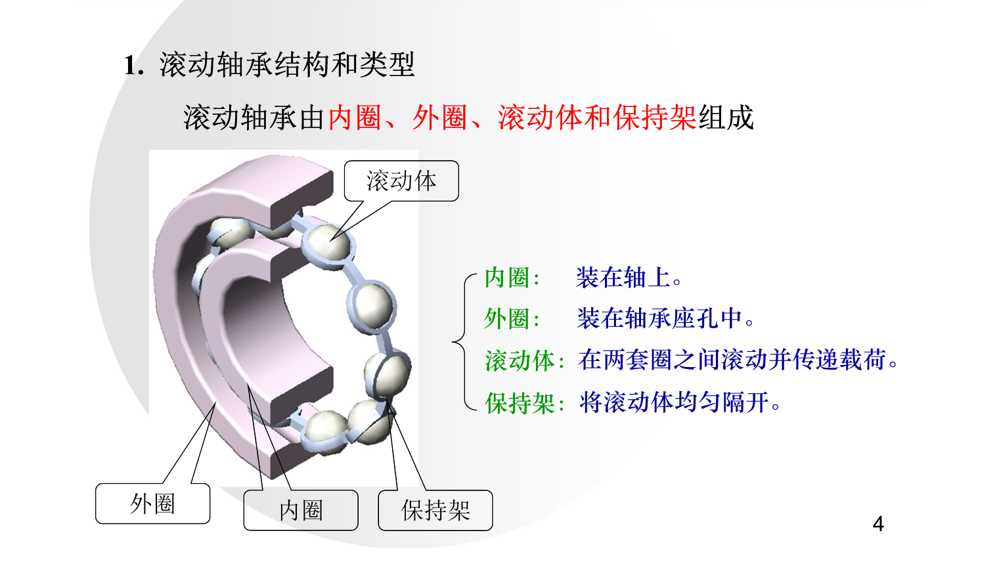

1. **基准制**：内圈与轴颈 → **基孔制**；外圈与外壳孔 → **基轴制**。
2. **公差带位置（特殊！）**：轴承内圈（基准孔）公差带位于零线**下方**；外圈（基准轴）公差带也在零线**下方**。

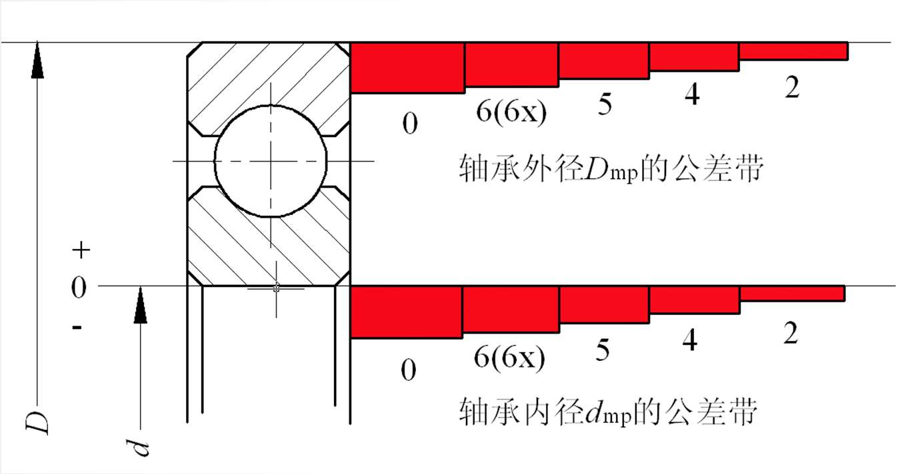
3. **配合性质**：内圈配合比同名基孔制配合**偏紧**；外圈与同名基轴制**基本一致**。配合性质由**轴颈/外壳孔**公差带决定（轴承本身公差带已定）。
4. **装配图标注**：只标**轴颈**和**外壳孔**的公差带代号，**不标**轴承公差等级代号。例：轴颈 $\phi 50k6$，外壳孔 $\phi 90H7$。

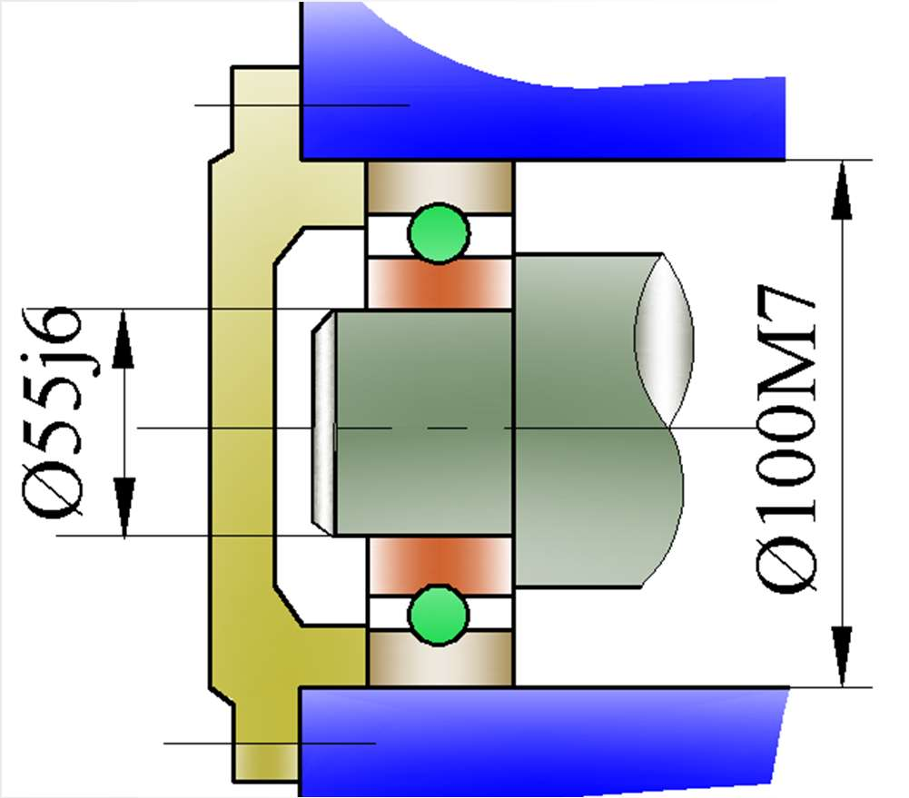
5. 公差等级：向心轴承 0、6、5、4、2（2 最高）。

## 二、平键（第11章）

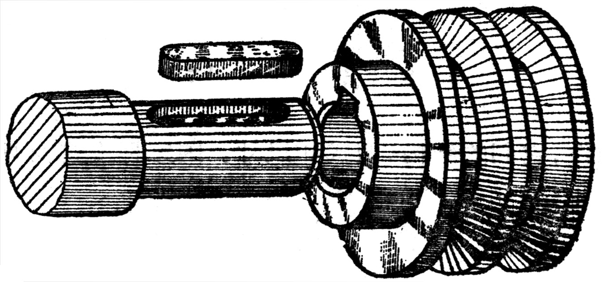

1. **基准制**：键是标准件，键宽配合采用**基轴制**，键宽公差带 **h8**（较松联结用 h9）。
2. **三种配合**（宽度 b）：

| 配合 | 轴槽 | 轮毂槽 | 应用 |
|---|---|---|---|
| 较松联结 | H9 | D10 | 导向平键（轮毂在轴上移动） |
| 一般联结 | N9 | JS9 | 载荷不大的固定联结 |
| 较紧联结 | P9 | P9 | 载荷大、有冲击、双向转矩 |

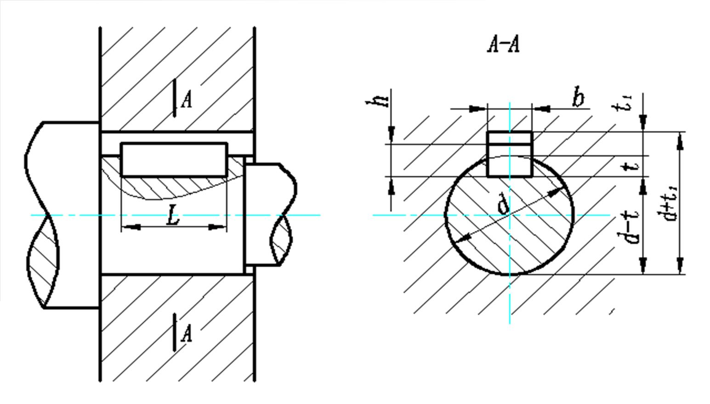

3. 键高 h → h11，键长 L → h14，轴槽长 → H14（非配合尺寸）。
4. **形位公差**：键槽两侧面对轴/轮毂轴线的**对称度**取 7~9 级。
5. **标注**：标键宽配合，如 $16N9$（轴槽）、$16JS9$（轮毂槽）。

## 三、花键（第11章）

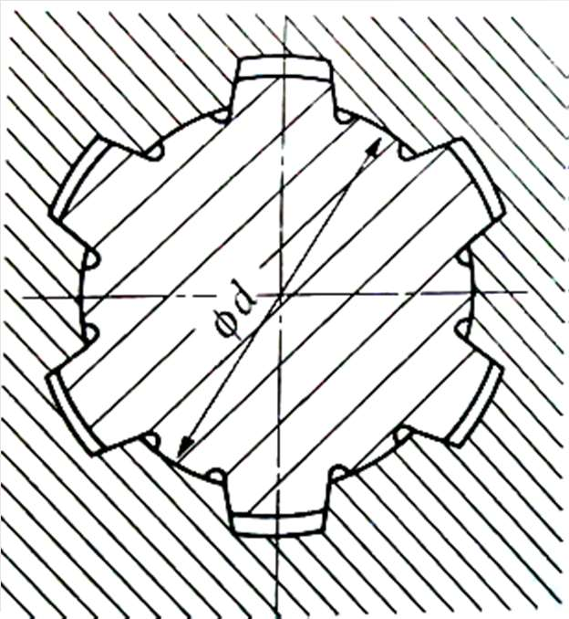

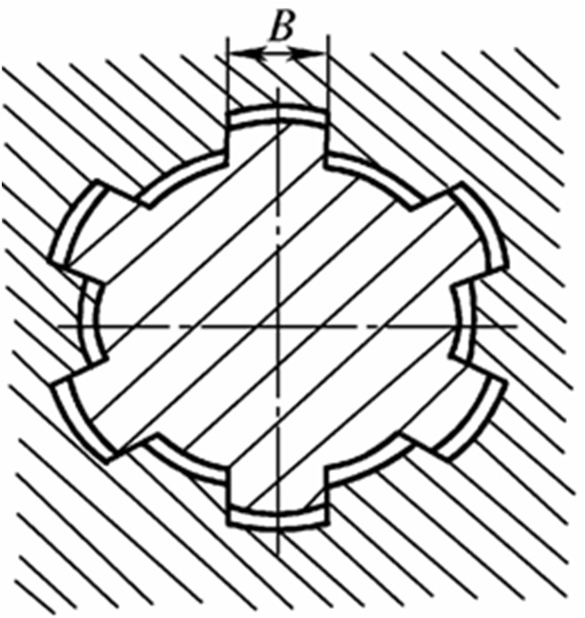

1. **定心方式**：矩形花键采用**小径 d 定心**（GB/T1144-2001）。
2. **基准制**：基孔制。
3. **配合类型**：滑动、紧滑动、固定三种。
4. **规格标注**：按 $N \times d \times D \times B$（键数 × 小径 × 大径 × 键宽）：
   - 内花键：$6\times28H6\times32H10\times7H9$
   - 外花键：$6\times28g5\times32a11\times7f7$
   - 花键副：$6\times28\dfrac{H6}{g5}\times32\dfrac{H10}{a11}\times7\dfrac{H9}{f7}$
5. **几何公差**：小径（定心直径）用**包容要求**；键宽大批量用**位置度 + 最大实体要求**，单件小批用**对称度 + 等分度**（独立原则）。

## 四、螺纹（第10章，概率小）

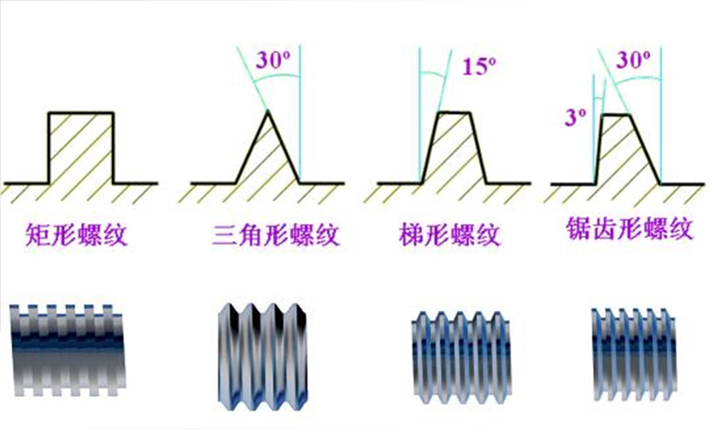

1. **标注组成**：螺纹代号 + 公称直径 + 导程/螺距 + 中径公差带 + 顶径公差带 + 旋合长度 + 旋向。
2. **实例**：
   - $M10\text{-}6g$：单线粗牙外螺纹、公称 10、中径和顶径公差带 6g、中等旋合长度、右旋（均省略）；
   - $M20\times2\text{-}6H/5g6g\text{-}S$：内螺纹 6H 与外螺纹 5g6g 的配合，短旋合长度；
   - $M14\times Ph6P2\text{-}7H\text{-}L\text{-}LH$：导程 6、螺距 2 的三线内螺纹，长旋合，左旋。

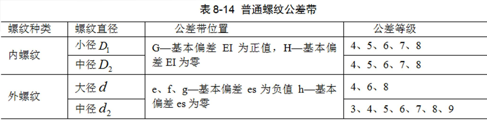
3. 基本偏差：内螺纹 G/H（公差带在零线上方，EI）；外螺纹 e/f/g/h（公差带在零线下方，es）。

## 五、自练（应用标注，自拟）

**自练2**：某滚动轴承（0 级）内圈内径 $\phi 30$ 与轴颈配合，外圈外径 $\phi 62$ 与外壳孔配合。写出装配图上应标注的配合尺寸代号，并说明基准制。

参考答案

轴颈 $\phi 30k6$（或类似过盈/较紧过渡带），外壳孔 $\phi 62H7$；内圈基孔制、外圈基轴制；装配图只标轴颈与外壳孔代号，不标轴承公差等级。

