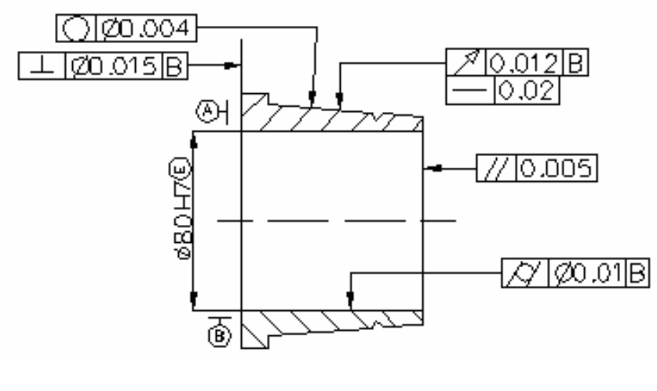

# 改错题专题（15分）

> **声明**：改错题约束是「**不得改变形位公差项目**」——只能改**标注方式**（箭头指向、基准摆放、φ、字母），不能改公差类型和公差值。本页「自练」题为编者自拟（**非老师提供**，答案可能有偏差）。

## 一、高频错误清单（逐条对照）

改错题的所有错误，本质都是违反了「制图符号速补」里的两条摆放规则。按出现频率排序：

### 1. 被测要素箭头指向错误（最高频）

| 被测要素 | 正确 | 常见错误 |
|---|---|---|
| 轴线/中心面/球心（中心要素） | 箭头与**尺寸线对齐**（或尺寸线延长线重合） | 箭头指到了轮廓线/表面上 |
| 圆柱面/平面（轮廓要素） | 箭头指**轮廓线或延长线**，错开尺寸线 | 箭头与尺寸线对齐了 |

> 判错口诀：先问「被测的是**面**还是**中心线**」。是中心线 → 对尺寸线；是面 → 错开尺寸线。

### 2. 基准三角形摆放错误

| 基准要素 | 正确 | 常见错误 |
|---|---|---|
| 中心要素 | 三角形底边贴**尺寸界线**，连线**与尺寸线对齐** | 三角形底边直接压在轮廓线上 |
| 轮廓要素 | 三角形底边贴**轮廓线或延长线**，错开尺寸线 | 三角形底边与尺寸线对齐 |

### 3. φ 使用错误

| 情形 | 是否正确加 φ |
|---|---|
| 同轴度、位置度（圆/圆柱公差带） | **必须加 φ** |
| 直线度 / 平行度 / 垂直度（任意方向，圆柱公差带） | **加 φ** |
| 位置度（球面公差带） | **加 Sφ** |
| 平面度、圆度、圆柱度、对称度、跳动、线/面轮廓度 | **不加 φ**（加 φ 即错） |

> 常见错误：对称度、平面度、圆度、圆柱度多加了 φ；同轴度、位置度漏了 φ。

### 4. 基准字母错误

- 用了禁用字母 E、I、J、M、O、P、R、F、L；
- 基准字母未**水平书写**（跟着基准符号一起倾斜了）；
- 多个基准时，框格第三/四/五格顺序填错（第三格必为第一基准）。

### 5. 指引线错误

- 指引线弯折超过 2 次；
- 箭头未指向公差带宽度方向或直径方向。

### 6. 基准缺失

平行度、垂直度、倾斜度、同轴度、对称度、位置度、跳动等**必须有基准**。若框格第三格（及以后）没有基准字母（如「╱ 0.005」），属漏标基准，应补上（如「╱ 0.005 A」）。

> 本题图（老师改错题2）中就有一个「╱ 0.005」平行度**没标基准**，是典型的漏基准错误。

## 二、改错题解题思路（三步）

1. **逐个框格看**：先读每个框格的项目符号，判断被测要素是轮廓还是中心要素；
2. **按「轮廓错开、中心对齐」**核对箭头与基准三角形；
3. **核对 φ / Sφ / 字母 / 基准是否缺失 / 指引线**，只改标注、不改项目与公差值。

## 三、自练（改错，自拟）

> **声明**：本题为编者自拟，**非老师提供**，答案可能有偏差。

**自练1**：指出下列标注中的错误并改正（不得改变形位公差项目）。

> 有一阶梯轴，$\phi 40$ 圆柱段与 $\phi 20$ 圆柱段同轴。图上标注：
> - ① $\phi 40$ 圆柱面的「圆度 0.01」框格，其指引线箭头与 $\phi 40$ 的尺寸线**对齐**；
> - ② $\phi 40$ 轴线对 $\phi 20$ 轴线的「同轴度 φ0.02」框格，基准字母写成了 **M**；
> - ③ $\phi 40$ 圆柱面对 $\phi 20$ 轴线的「径向圆跳动 0.03」，基准三角形底边直接**压在 $\phi 20$ 圆柱面的轮廓线上**。

参考答案

① 圆度被测的是**圆柱面（轮廓要素）**，箭头应指**轮廓线/延长线并错开尺寸线**，不能与尺寸线对齐；② 基准字母 **M 是禁用字母**，应改用它（如 A），并水平书写；③ 基准是 $\phi 20$ **轴线（中心要素）**，三角形底边应贴 $\phi 20$ 的尺寸界线并与尺寸线对齐，不能压在轮廓线上。改错时项目符号、公差值均不变。

**自练2**：改正以下标注错误：某孔 $\phi 50$ 的轴线「直线度（任意方向）」标注为「0.02」（未加 φ）；其端面「平面度」标注为「φ0.03」。

参考答案

直线度任意方向公差带是圆柱面，应加 φ → φ0.02；平面度公差带是两平行平面，**不应加 φ**，改回 0.03。

