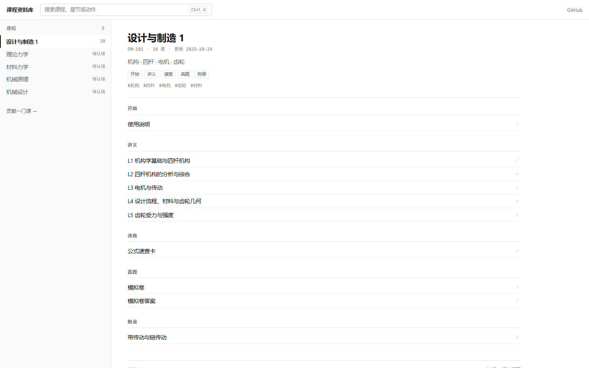
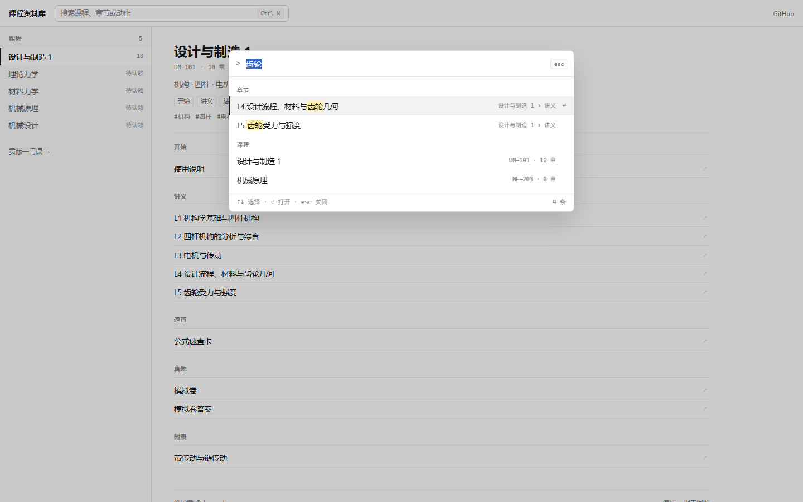

# 交互与视觉设计

这份文档记录门面（`site/`）为什么是现在这个样子。它不是样式说明，而是取舍记录。





## 1. 两条约束决定了整体

1. **每门课是一本 mdbook**，书里已经有目录、搜索、锚点、打印、主题。
2. **门面只负责“在课程之间找和走”**，不负责渲染正文。

如果把正文塞进 Lustre（SPA 或 iframe），就要重新实现锚点、浏览器返回、刷新、
分享、打印、Ctrl+F，并且每次升级 mdbook 都会和门面打架。所以：

> 门面是索引器，书是阅读器。两者只通过**链接**交接。

## 2. 信息架构

- 没有学期。学期只对某一届学生有意义，资料库要跨届使用。
- 没有卡片。课程数量会增长，卡片无法竖着扫。
- 首屏就是内容：**左侧课程列表 + 右侧选中课程的目录地图**。
- 课程的第一坐标是“课程”，第二坐标是“书里的 Part / 章节”。

页面结构：

```
topbar      品牌 / 命令面板入口 / GitHub
workspace   rail（课程列表） + detail（课程地图）
palette     命令面板（覆盖层）
```

课程地图来自构建期的 `SUMMARY.md`，所以门面**知道**每门课里有什么，不需要
点进去才知道。

## 3. 命令面板

### 为什么是面板，而不是一堆快捷键

快捷键的问题是：记不住、发现不了、互相冲突。门面把所有“找”和“做”收进同一个
输入框：

- 输入普通文字 → 匹配章节、课程
- 输入动作名 → 匹配动作
- 结果分三组：**章节 / 课程 / 动作**
- 排序：章节 > 课程 > 动作；组内按匹配质量，再按目录顺序

### 键盘

全站只有四个键：

| 键 | 行为 |
| --- | --- |
| `Ctrl K` / `⌘K` | 打开面板（已在面板内则聚焦并全选） |
| `/` | 同上；在输入框里不劫持 |
| `↑` `↓` | 移动高亮 |
| `↵` | 执行高亮项 |
| `Esc` | 关闭 |

没有 `Ctrl+1`、`g h` 之类的组合键。动作只存在于面板里，不另外绑键。

### 动作

动作是“不能靠点目录完成的事”：

| 动作 | 作用 |
| --- | --- |
| 只看有「真题」的课程 / 清除筛选 | 写 `?kind=`，收窄左栏 |
| 复制本页链接 / 复制某课链接 | 剪贴板 |
| 在 GitHub 上编辑某课 | 打开该课 `SUMMARY.md` |
| 报告某课的内容问题 | 预填 Issue |
| 认领某课（仅 planned） | 预填认领 Issue |
| 打印 / 存 PDF | `window.print()` |
| 打开仓库 / 贡献指南 | 外链 |

面板是加速器，不是唯一的门：左栏、章节、筛选 chip 都能用鼠标完成同样的事。

### 面板里不搜正文

只搜课程名、代码、摘要、标签、Part、章节标题和动作名。正文搜索留在每本书里
（mdbook 自带，带高亮和上下文）。

代价是搜不到“某个公式出现在哪一节”；收益是门面不需要构建全文索引、不需要
懒加载、没有加载失败态，`catalog.json` 在构建期内联，运行时零请求。

## 4. URL 契约

| 参数 | 写入时机 | 说明 |
| --- | --- | --- |
| `?c=<slug>` | 选中课程 | 刷新还原右栏；手机刷新直接进详情 |
| `?q=<text>` | 面板打开且输入非空 | 刷新还原面板和查询 |
| `?kind=<kind>` | 启用内容筛选 | 与 `c` 可组合 |

实现细节：

- 全部用 `history.replaceState`。门面内部不制造历史记录；浏览器“后退”主要用于
  从书回到门面。
- 关闭面板时删掉 `q`，所以刷新不会莫名弹出面板。
- 刷新还原是 URL 的职责，不是存储的职责。

## 5. 不写任何本地存储

门面：没有 `localStorage`、没有 cookie、没有进度上报。浏览器里能看到的只有 URL。

书：mdbook 自己会往 `localStorage` 写 `mdbook-theme` / `mdbook-sidebar`。
`courses/dm1/theme/course.js` 把这两个键的写入拦掉了，保证“这个站不在你的设备上
留东西”。

删掉的旧功能：阅读进度、上次读到哪、百分比进度条、最近访问。它们都依赖存储，
而且“62% 掌握度”本质上是在编。

## 6. 视觉系统

从“手账”换成“工具/索引”：

| | 旧 | 新 |
| --- | --- | --- |
| 底色 | 奶油纸 `#fff8e7` | 白 `#fff`，左栏 `#fafafa` |
| 容器 | 12px 圆角卡片 + 阴影 | 1px 实线分隔，无阴影 |
| 字体 | Lexend 展示体 | 系统 sans + 等宽元信息 |
| 首屏 | 大标题 + 一句话 | 直接是课程列表 |
| 选中态 | 糖果色铺底 | 2px 实心竖线 + 字重 |
| 强调色 | 莓红 | 靛蓝 `#1f6feb`，只用于焦点和链接 |

密度：正文 14px，元信息 10.5–11px，行高 30–34px，8px 网格。

mdbook 侧只做主题对齐、返回胶囊和存储拦截；不覆盖 `index.hbs`，避免
mdbook 升级时整个主题断掉。

## 7. 已知取舍

- **门面首屏是 JS 渲染的。** 没有做构建期预渲染；`<noscript>` 里有直接进书的链接。
  好处是构建链简单，代价是首屏有一次脚本执行。
- **没有全文搜索。** 见 3.5。等内容的体量真的上来，再加构建期索引也不迟。
- **没有阅读进度。** 这是“不存储”的直接代价。如果以后要加，它是纯增量：书端
  一个脚本 + 门面读取，不动现在的结构。
- **mdbook 顶栏保留原样。** 只改了字体、颜色和标题字号；没有重写它的布局。

## 8. 下一步（如果继续做）

1. 书内“下一门 / 上一门”交接；
2. 构建期从 mdbook 产物抽取章节锚点，让面板能直接跳到 `#小节`；
3. 课程标签筛选（现在只有内容类型）；
4. 门面的静态预渲染（改善首屏和无 JS）。
