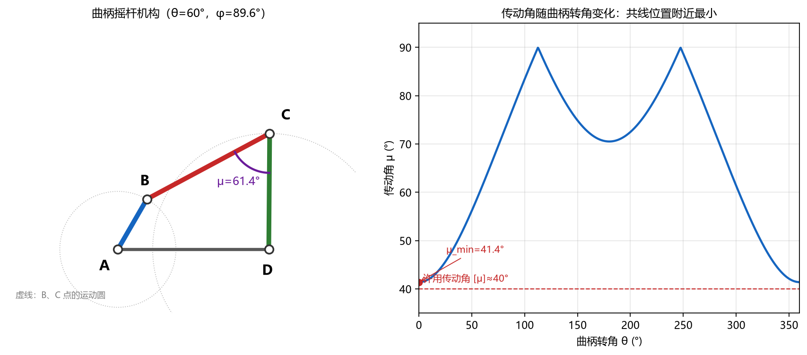

# 第 1 章 平面四杆机构

> **这一章的主线**：会不会**判断**（类型、曲柄、死点）→ 会不会**算**（位置、速度、传动角、急回）→ 会不会**设计**（刚体导引、函数生成、轨迹综合）。
> 你作业做的就是最后一种"轨迹综合"，所以这一章你其实已经领先别人半个身位了。

---

## 0 先看考什么

| 考点 | 常见题型 | 要求 |
| --- | --- | --- |
| 自由度 | 给机构图数构件、数低副 | 会用 $F=3n-2P_L-P_H$ |
| 曲柄存在条件 | 给四个杆长判断机构类型 | 30 秒内出结论 |
| 急回特性 | 给杆长求极位夹角 $\theta$、行程速比系数 $K$ | 会画极限位置、会算 |
| 传动角 | 求 $\gamma_{\min}$、判断死点 | 记住共线位置 |
| 位置分析 | 给 $\theta$ 求 $\varphi$ | 会列闭环方程/余弦定理 |
| 速度分析 | 给 $\omega_2$ 求 $\omega_3,\omega_4,v_C$ | 瞬心法或矢量方程 |
| 设计 | 按连杆位置 / 按两连架杆位置 / 按 $K$ | 中垂线法、Freudenstein、作图 |
| 轨迹综合 | 解释等式、未知数、为什么用最小二乘 | 能讲清你作业的思路 |

> 小测如果只有 60–90 分钟，**判断 + 一个速度/传动角计算 + 一个设计** 是最可能的组合。

---

## 1 基本概念（10 分钟过一遍）

- **构件**：能独立运动的刚性单元（注意：一个构件可以包含多个零件）。
- **运动副**：两构件间的可动联接。低副（面接触：转动副、移动副）、高副（点/线接触：凸轮、齿轮）。
- **自由度**：

$$F = 3n - 2P_L - P_H$$

  铰链四杆机构：$n=3$，$P_L=4$，$P_H=0$，所以 $F=3\times3-2\times4=1$。

- **四个杆的名字**（后面全用这套记号）：

| 符号 | 名称 | 说明 |
| --- | --- | --- |
| $a=AB$ | 曲柄/连架杆 | 能整周回转的连架杆 |
| $b=BC$ | 连杆 | 不与机架直接相连 |
| $c=CD$ | 摇杆/连架杆 | 只能摆动 |
| $d=AD$ | 机架 | 固定杆 |

- **三种基本型式**：曲柄摇杆、双曲柄、双摇杆。
- **演化**：曲柄滑块（对心/偏置）、导杆机构、摇块机构、定块机构、偏心轮机构、正弦机构。
  演化的本质是**改变构件长度或取不同构件为机架**，不是新机构。

---

## 2 曲柄存在条件（必考，30 秒判断）

### 2.1 两个条件，缺一不可

1. **杆长条件**（Grashof 条件）：最短杆 + 最长杆 ≤ 其余两杆之和。
2. **最短杆的位置**：最短杆必须是**机架**或**连架杆**。

| 最短杆是 | 机构类型 |
| --- | --- |
| 连架杆（曲柄） | 曲柄摇杆机构 |
| 机架 | 双曲柄机构 |
| 连杆 | 双摇杆机构 |
| （杆长条件不满足） | 无论最短杆在哪，都是双摇杆 |

> **口诀**：先排序看"最短+最长"，再看最短杆坐哪把交椅。
> 杆长条件不满足时，任何构件都不能整周回转。

### 2.2 例题（后面一直用这台机构）

$$a=50,\quad b=120,\quad c=100,\quad d=130\ \text{mm}$$

**判断类型：**

1. 排序：$50 < 100 < 120 < 130$。
2. 最短 + 最长 $=50+130=180$；其余两杆 $=100+120=220$。
3. $180\le 220$，满足杆长条件。
4. 最短杆 $a=50$ 是连架杆，且能整周回转 → **曲柄摇杆机构**（$a$ 为曲柄，$c$ 为摇杆）。

> **坑**：题目给的是"四杆长度"，没说是哪根。判断时必须说明按哪种装配（哪根是机架）。机架换了，类型会变，但杆长条件不变。

---

## 3 工作特性

### 3.1 急回特性（行程速比系数 $K$）

**极限位置**：摇杆摆到最远/最近时，曲柄与连杆**共线**。

- 曲柄与连杆拉直：$AC_1 = a+b$
- 曲柄与连杆重叠：$AC_2 = b-a$

在三角形 $ACD$ 中用余弦定理求两个顶角：

$$\cos\angle C_1AD=\frac{d^2+AC_1^2-c^2}{2d\cdot AC_1},\qquad
\cos\angle C_2AD=\frac{d^2+AC_2^2-c^2}{2d\cdot AC_2}$$

**极位夹角**（曲柄两个极限位置之间的锐角）：

$$\theta=\left|\angle C_1AD-\angle C_2AD\right|$$

**行程速比系数**：

$$K=\frac{180^\circ+\theta}{180^\circ-\theta}
\qquad\Longleftrightarrow\qquad
\theta=180^\circ\frac{K-1}{K+1}$$

- $K=1$：无急回（$\theta=0$）。
- $K$ 越大，急回越明显，但传动角通常越差。

**本例**：$AC_1=170$，$AC_2=70$

$$\angle C_1AD=\arccos\frac{130^2+170^2-100^2}{2\times130\times170}=35.94^\circ,\quad
\angle C_2AD=49.57^\circ$$

$$\theta=13.67^\circ,\qquad K=\frac{193.67}{166.33}=1.164$$

> **坑 1**：极位夹角不是两个**摇杆**位置的夹角（那是摆角 $\psi$），而是两个**曲柄**位置的夹角。
> **坑 2**：极位夹角不是把两个顶角相加。两个曲柄位置在转向上相差 $180^\circ+(\angle C_2AD-\angle C_1AD)$，而极位夹角定义为它与 $180^\circ$ 的偏差，所以 $\theta=|\angle C_1AD-\angle C_2AD|$。

### 3.2 压力角与传动角

- **压力角 $\alpha$**：从动件受力方向与该点速度方向的锐角。
- **传动角 $\gamma$**：连杆与摇杆之间所夹的锐角，$\gamma=90^\circ-\alpha$。

对铰链四杆，$\gamma=\angle BCD$（若 $>90^\circ$ 取补角）：

$$\cos\angle BCD=\frac{b^2+c^2-BD^2}{2bc},\qquad
BD^2=a^2+d^2-2ad\cos\theta$$

**$\gamma$ 的最小值出现在曲柄与机架共线的两个位置**：$BD=d-a$ 和 $BD=d+a$，分别算出来取较小的那个。

**本例**：

- $BD=d-a=80$：$\cos\angle BCD=\dfrac{120^2+100^2-80^2}{2\times120\times100}=0.75$，$\angle BCD=41.41^\circ$。
- $BD=d+a=180$：$\cos\angle BCD=-0.3333$，$\angle BCD=109.47^\circ$，取补角 $70.53^\circ$。
- 所以 $\gamma_{\min}=41.41^\circ$（在 $\theta=0^\circ$，曲柄与机架重叠时）。

一般机械要求 $[\gamma]\ge40^\circ$，高速重载取 $50^\circ$ 以上。本例刚好压线，属于"能用但不算好"的设计。

**死点**：当 $\gamma=0^\circ$（连杆与从动件共线）时，力全部沿从动件，无法产生转矩。缝纫机踏板、自行车下死点都是例子。克服办法：加飞轮利用惯性、多组机构错列、加辅助弹簧。

### 3.3 一张图记住

左：$\theta=60^\circ$ 时的位形，$\varphi=89.6^\circ$，$\gamma=61.4^\circ$。
右：传动角随曲柄转角变化，在曲柄与机架共线处出现最小值（$\gamma_{\min}=41.4^\circ$）。**考试画草图时，就画这两个共线位置。**

---

## 4 运动分析

### 4.1 位置分析（几何法，考场首选）

已知 $a,b,c,d,\theta$，求 $\varphi$：

1. 连 $BD$：

$$BD=\sqrt{a^2+d^2-2ad\cos\theta}$$

2. 在 $\triangle BCD$ 中求 $\angle CBD$：

$$\cos\angle CBD=\frac{b^2+BD^2-c^2}{2b\cdot BD}$$

3. 求 $B\to D$ 的方向角：

$$\beta_{BD}=\operatorname{atan2}\left(-a\sin\theta,\ d-a\cos\theta\right)$$

4. 连杆方位角 $\psi=\beta_{BD}\pm\angle CBD$（正负号对应两条装配支路，按图选）。
5. $C=B+b(\cos\psi,\sin\psi)$，$\varphi=\operatorname{atan2}(C_y,\ C_x-d)$。

> 两条装配支路（"上装/下装"）在数值上都是解，考试时要按机构简图选对的那条。

**代数通式**（把 $\psi$ 消掉后得到）：

$$P\cos\varphi+Q\sin\varphi+R=0$$

$$P=2c(d-a\cos\theta),\quad Q=-2ac\sin\theta,\quad R=d^2+c^2+a^2-b^2-2ad\cos\theta$$

$$\varphi=2\arctan\frac{Q\pm\sqrt{P^2+Q^2-R^2}}{P-R}$$

### 4.2 速度分析

**矢量方程**：

$$\vec v_C=\vec v_B+\vec v_{CB}$$

- $v_B=\omega_2 a$，方向 $\perp AB$；
- $v_{CB}=\omega_3 b$，方向 $\perp BC$；
- $v_C=\omega_4 c$，方向 $\perp CD$。

写成坐标式（两个方程解 $\omega_3,\omega_4$）：

$$\omega_3\begin{bmatrix}-(C_y-B_y)\\ C_x-B_x\end{bmatrix}
=\omega_4\begin{bmatrix}-(C_y-D_y)\\ C_x-D_x\end{bmatrix}
-\omega_2\begin{bmatrix}-(B_y-A_y)\\ B_x-A_x\end{bmatrix}$$

**瞬心法**（判断题、快速估算）：三心定理——三个构件的三个瞬心必在同一直线上。四杆机构有 6 个瞬心，其中 $P_{12},P_{23},P_{34},P_{14}$ 在铰链处，$P_{13},P_{24}$ 用三心定理求。传动比：

$$\frac{\omega_3}{\omega_1}=\frac{\overline{P_{12}P_{23}}}{\overline{P_{13}P_{23}}}$$

（注意方向，正负号用转向判断。）

**本例**（$\theta=60^\circ$，$\omega_2=10$ rad/s）：

$$\omega_3=-2.34\ \text{rad/s},\qquad \omega_4=3.00\ \text{rad/s},\qquad v_C=300.2\ \text{mm/s}$$

也就是说，曲柄转 1 圈，摇杆只转 $3.00/10=0.30$ 圈，**减速比约 3.33**。

### 4.3 加速度分析

$$\vec a_C=\vec a_B+\vec a_{CB}^n+\vec a_{CB}^t$$

- $a_B^n=\omega_2^2 a$，指向 $A$；$a_B^t=\alpha_2 a$，$\perp AB$。
- $a_{CB}^n=\omega_3^2 b$，指向 $B$；$a_{CB}^t=\alpha_3 b$，$\perp BC$。
- $a_C^n=\omega_4^2 c$，指向 $D$；$a_C^t=\alpha_4 c$，$\perp CD$。

两个未知数 $\alpha_3,\alpha_4$，投影到两个坐标轴解。图解法用**加速度影像**（构件上三点加速度构成的三角形与构件本身相似）。

> 小测一般不会让你手算加速度，但会问"加速度影像是什么""科氏加速度什么时候有"。平面四杆没有科氏加速度（没有移动副），曲柄滑块才有。

### 4.4 瞬心与尖点（和你作业直接相关）

四杆机构连杆曲线出现**尖点**的几何条件：**描点 $P$ 正好落在连杆的瞬心 $P_{13}$ 上**。此时 $P$ 点的速度为零，轨迹出现一个尖点。

你作业里目标曲线顶点曲率半径只有 $0.033$，接近尖点，所以用"描点落在瞬心上"来构造初值——这是把课本的瞬心理论直接用在数值设计上，考试如果问"你的初值怎么来的"，这就是标准答案。

> **注意符号冲突**：你作业报告里 $\gamma$ 表示描点臂 $BP$ 与连杆 $BC$ 的夹角，而课本里 $\gamma$ 是传动角。写卷子时用 $\delta$ 表示描点臂夹角，免得老师看晕。

---

## 5 设计（综合）

### 5.1 三类设计问题，先认清

| 类型 | 已知 | 求 | 典型方法 |
| --- | --- | --- | --- |
| **刚体导引** | 连杆（或连杆上一条线）的若干个位置 | 固定铰 $A,D$ 和杆长 | 中垂线法（圆点） |
| **函数生成** | 两连架杆的若干对对应位置 $(\theta_i,\varphi_i)$ | 各杆长 | 反转法（图解法）/ Freudenstein（解析法） |
| **轨迹生成** | 连杆上一点的若干位置（曲线） | 各杆长 + 对应曲柄转角 | 等式 + 最小二乘（你的作业） |

### 5.2 按给定连杆位置设计（刚体导引）

**已知**：连杆 $BC$ 的三个位置 $B_1C_1,\ B_2C_2,\ B_3C_3$。
**求**：固定铰 $A,D$。

**做法**：$A$ 是 $B_1,B_2,B_3$ 三点圆的圆心，$D$ 是 $C_1,C_2,C_3$ 三点圆的圆心。

1. 连 $B_1B_2$、$B_2B_3$，作两条中垂线，交点即 $A$。
2. 连 $C_1C_2$、$C_2C_3$，作两条中垂线，交点即 $D$。
3. $a=AB_1$，$b=B_1C_1$，$c=CD_1$，$d=AD$。

- **两个位置**：中垂线只有一条，$A$ 有无穷多解（需再给条件，如 $a$ 或 $\gamma_{\min}$）。
- **三个位置**：唯一解（三点定圆）。
- **四个位置**：一般无精确解，只能近似——这就自然过渡到"最小二乘"。

> 这一步就是"三点定圆"，考场上画图 + 圆规即可，不需要复杂计算。

### 5.3 按两连架杆对应位置设计（函数生成）

#### 方法一：反转法（图解法）

已知 $A,D$，以及曲柄三个位置 $\theta_1,\theta_2,\theta_3$ 对应摇杆三个位置 $\varphi_1,\varphi_2,\varphi_3$（即 $C_1,C_2,C_3$ 已知）。

1. **倒置**：以 $AB_1$ 为机架，把整个机构绕 $A$ 反转 $-\theta_i$，使 $AB_i$ 与 $AB_1$ 重合。
2. 反转后 $C_i$ 变到 $C_i'$：$C_i'=R(-\theta_i)(C_i-A)$。
3. 在倒置机构里，$CD$ 成了"连杆"，$B$ 成了固定铰；$B$ 到 $C_i'$ 的距离就是连杆长 $b$（常数）。
4. 所以 **$B$ 是 $C_1',C_2',C_3'$ 三点圆的圆心**——又是中垂线交点。
5. 量出 $b=BC_1'$、$a=AB_1$，$c,d$ 已知。

> 反转法的本质：**把"两连架杆对应位置"翻译成"连杆位置"**，然后回到 5.2 的三点定圆。

#### 方法二：Freudenstein 方程（解析法，考大题就靠它）

把闭环矢量方程消去连杆方位角，得到输入角 $\theta$ 与输出角 $\varphi$ 的关系：

$$K_1\cos\varphi-K_2\cos\theta+K_3=\cos(\varphi-\theta)$$

$$K_1=\frac{d}{a},\qquad K_2=\frac{d}{c},\qquad K_3=\frac{d^2+c^2+a^2-b^2}{2ac}$$

**推导**（建议会）：由 $\vec{AB}+\vec{BC}=\vec{AD}+\vec{DC}$ 得 $b^2=(d+c\cos\varphi-a\cos\theta)^2+(c\sin\varphi-a\sin\theta)^2$，展开即得。

**三对对应位置**：把 $(\theta_i,\varphi_i)$ 代入，得到三个**线性**方程：

$$\begin{bmatrix}
\cos\varphi_1 & -\cos\theta_1 & 1\\
\cos\varphi_2 & -\cos\theta_2 & 1\\
\cos\varphi_3 & -\cos\theta_3 & 1
\end{bmatrix}
\begin{bmatrix}K_1\\K_2\\K_3\end{bmatrix}
=
\begin{bmatrix}\cos(\varphi_1-\theta_1)\\\cos(\varphi_2-\theta_2)\\\cos(\varphi_3-\theta_3)\end{bmatrix}$$

解出 $K_1,K_2,K_3$ 后，**任选一个 $a$**（尺度自由），再：

$$d=K_1a,\qquad c=\frac{d}{K_2},\qquad b=\sqrt{a^2+c^2+d^2-2acK_3}$$

> 这就是老师说的"代数的方法"：**先解线性方程组，再回代求杆长**。因为 $a$ 可任选，所以解不唯一（差一个缩放），这是考点。

**例**：已知三对位置，取 $a=40$ mm，设计机构。

| $i$ | $\theta_i$ | $\varphi_i$ |
| --- | --- | --- |
| 1 | $30^\circ$ | $86.60^\circ$ |
| 2 | $60^\circ$ | $90.63^\circ$ |
| 3 | $90^\circ$ | $102.65^\circ$ |

代入解线性方程组：

$$K_1=2.750,\qquad K_2=1.375,\qquad K_3=1.578$$

回代：

$$d=2.75\times40=110,\qquad c=\frac{110}{1.375}=80,\qquad
b=\sqrt{40^2+80^2+110^2-2\times40\times80\times1.578}=100$$

得到 $a=40,\ b=100,\ c=80,\ d=110$。校验：$40+110=150\le100+80=180$，满足杆长条件，是曲柄摇杆。

> 这三对位置其实就是从这台机构正算出来的，所以回代能精确还原——正好用来验算你的公式有没有写错。

### 5.4 按行程速比系数 $K$ 设计

**已知**：$K$、摇杆长 $c$、摆角 $\psi$。**求**：$a,b,d$（解不唯一，通常再给 $d$ 或 $a$）。

1. 算极位夹角：$\theta=180^\circ\dfrac{K-1}{K+1}$。
2. 选 $D$，按摆角 $\psi$ 作摇杆两极限位置 $DC_1,DC_2$。
3. 连 $C_1C_2$，作弦 $C_1C_2$ 所对圆周角为 $\theta$ 的圆（圆心 $O$ 在中垂线上，$\angle C_1OC_2=2\theta$）。
4. 固定铰 $A$ 在该圆上（取使机构为曲柄摇杆的一侧）。
5. 量 $AC_1,AC_2$，则

$$a=\frac{AC_2-AC_1}{2},\qquad b=\frac{AC_1+AC_2}{2},\qquad d=AD$$

6. 校核杆长条件与 $\gamma_{\min}$。

**为什么这样？** 极限位置时曲柄与连杆共线，所以 $AC_1=b-a$、$AC_2=b+a$，两式相加/相减即得。

> **坑**：$A$ 在圆上可以滑动，所以没有唯一解。题目一定会再给一个条件（$d$、$a$ 或 $\gamma_{\min}$），否则就说明"解族"即可。

### 5.5 轨迹综合（你的作业，考试可能让你讲思路）

**问题**：给定目标曲线上的 $N$ 个点 $T_i$，设计四杆机构，使连杆上一点 $P$ 依次经过这些点。**不要求**连杆姿态，也不要求到达各点的时刻——这叫 **path generation without prescribed timing**。

**未知数**（你作业的记号）：

$$p=[d,L_2,L_3,L_4,L_5,\delta,t_x,t_y,\psi,\theta_1,\dots,\theta_{10}]$$

共 $9+10=19$ 个。

**方程**：每个采样点给出

$$X_i=T_i\quad(\text{2 个方程}),\qquad |C_i-D|=L_4\quad(\text{1 个方程})$$

共 $2N+N=30$ 个标量方程。

**于是**：30 个方程、19 个未知数，方程多于未知数——一般**没有精确解**，只能求最小二乘意义下的最优解：

$$\min_p\ \tfrac12\|r(p)\|^2,\qquad
r(p)=\begin{bmatrix}X_1-T_1\\ \vdots\\ X_{10}-T_{10}\\ w(|C_1-D|-L_4)\\ \vdots\\ w(|C_{10}-D|-L_4)\end{bmatrix}$$

你作业里 $w=1000$，用 scipy.optimize.least_squares（信赖域反射，等价于 MATLAB 的 lsqnonlin）求解。

**为什么方程会多？** 因为 $N$ 个点给出 $2N$ 个位置方程，但只多了 $N$ 个自由转角 $\theta_i$，净多出 $N$ 个约束；$N=10$ 时多出 10 个。所以"精确复现 10 个点"一般做不到，只能让误差尽量小。

**考试如果问**："你这个设计为什么用最小二乘而不是解方程？"
**答**：未知数 19、方程 30，超定；且目标曲线在顶点处接近尖点，精确解可能不存在。最小二乘在残差平方和意义下给出最优折中，残差标准差 $\sigma=1.5\times10^{-3}$（约为拱高的 $0.01\%$）。

**如果问**："为什么 10 个点的曲柄转角是未知数？"
**答**：题目不要求运动规律（no prescribed timing），每个采样点对应的曲柄转角是自由的，所以每个点增加 2 个方程、1 个未知数；若给定 timing，则每个点只增加 2 个方程、0 个未知数，$N$ 个点就需要 $2N$ 个方程对 9 个机构参数，更加超定。

---

## 6 易错点清单（考前 5 分钟看）

1. **杆长条件**：是"最短+最长 ≤ 其余两杆"，不是"任意两杆之和 > 第三杆"。
2. **最短杆位置**决定类型；杆长条件不满足时一律双摇杆。
3. **极位夹角** $\theta$ 是两个曲柄位置之差（取锐角），不是摇杆摆角。
4. **$K$ 的公式**：$K=(180+\theta)/(180-\theta)$，反解时 $\theta=180(K-1)/(K+1)$。
5. **传动角**取锐角：$\angle BCD>90^\circ$ 时取 $180^\circ-\angle BCD$。
6. **$\gamma_{\min}$** 在曲柄与机架共线的两个位置，两个都算再取小。
7. **位置分析**有两条装配支路，别选错。
8. **速度方向**：$\vec v_B\perp AB$，$\vec v_C\perp CD$，$\vec v_{CB}\perp BC$，转向别搞反。
9. **设计解不唯一**：Freudenstein 里 $a$ 任选；按 $K$ 设计时 $A$ 可在圆上滑动。
10. **符号冲突**：你作业的 $\gamma$ 是描点臂夹角，课本的 $\gamma$ 是传动角。

---

## 7 5 分钟自测

1. 四杆长度 $40,90,70,80$（依次为 $a,b,c,d$），判断类型。
2. 上题中若 $a$ 为曲柄，求 $\gamma_{\min}$。
3. 已知 $K=1.4$，求极位夹角。
4. 写出 Freudenstein 方程，并说明三个未知量是什么。
5. 轨迹综合中，为什么方程数会多于未知数？

> 答案见《07 模拟卷答案》最后一部分。