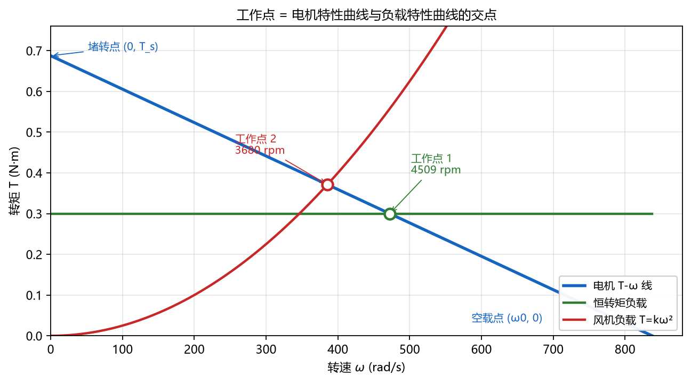

# 第 2 章 电机与驱动

> **这一章只讲一件事**：电机能出多大力、转多快，取决于**电压、负载和减速器**。
> 把三条方程记住，剩下的都是代数。

---

## 0 先看考什么

| 考点 | 常见题型 | 你要会 |
| --- | --- | --- |
| 机械特性 | 画 $T-\omega$ 直线、标空载点/堵转点 | 两点定一线 |
| 电流关系 | 给负载求电流 | $I=T/k_T$ |
| 工作点 | 两条曲线求交点、判断稳定性 | 解方程 + 比斜率 |
| 功率与效率 | 求输出功率、效率、最大功率点 | $P=T\omega$，$\eta=P_{out}/P_{in}$ |
| 减速器 | 给负载选减速比、算输出转矩 | $i=\omega_m/\omega_L$ |
| 读参数表 | 从铭牌/数据表反推 $k_T,k_e,R$ | 单位换算 |
| 概念 | 为什么高速好、堵转为什么烧 | 能解释 |

---

## 1 三条方程（整章的根）

对**直流电机**（有刷直流、无刷直流的外特性都近似这样）：

$$E=k_e\omega \qquad\text{（反电动势）}$$

$$T=k_T I \qquad\text{（电磁转矩）}$$

$$V=E+IR \qquad\text{（电枢回路电压平衡）}$$

其中 $k_e$ 单位 V·s/rad，$k_T$ 单位 N·m/A。**在国际单位制下 $k_T=k_e$**（数值相等），这是最容易被忽略的送分点。

把三式联立，消去 $E$ 和 $I$：

$$T=\frac{k_T}{R}(V-k_e\omega)$$

这就是一条**直线**：

$$T=T_s\left(1-\frac{\omega}{\omega_0}\right)$$

- **空载转速** $\omega_0=\dfrac{V}{k_e}$（$T=0$ 时）
- **堵转转矩** $T_s=\dfrac{k_T V}{R}$（$\omega=0$ 时，也就是启动瞬间）
- **堵转电流** $I_s=\dfrac{V}{R}$（只由电阻决定，通常是额定电流的 5–10 倍）

> **一句话**：电压决定"能转多快"（$\omega_0\propto V$），电阻和磁钢决定"能出多大力"（$T_s\propto V/R$）。

### 1.1 单位换算（必背）

$$n\ (\text{rpm})\ \longleftrightarrow\ \omega=\frac{2\pi n}{60}\ (\text{rad/s})$$

$$\omega_0=\frac{V}{k_e}\quad\Longrightarrow\quad
k_e=\frac{V}{\omega_0}=\frac{V}{2\pi n_0/60}$$

工程上常用：

$$T(\text{N·m})=9550\,\frac{P(\text{kW})}{n(\text{rpm})}$$

---

## 2 电流、功率、效率

### 2.1 电流与转矩成正比

$$I=\frac{T}{k_T}$$

负载要多大转矩，电机就吃多大电流。**电流表就是转矩表**。

- 空载时 $I_0$ 很小（只需克服摩擦和铁耗）；
- 负载增大，$I$ 线性增大；
- 堵转时 $I_s=V/R$ 最大，铜耗 $I^2R$ 全部变成热——**堵转几分钟就烧**。

### 2.2 功率

$$P_{out}=T\omega,\qquad P_{in}=VI,\qquad \eta=\frac{P_{out}}{P_{in}}$$

理想直流电机（忽略铁耗、摩擦）：

$$\eta=\frac{T\omega}{VI}=\frac{k_T I\,\omega}{V I}=\frac{k_e\omega}{V}=\frac{\omega}{\omega_0}$$

**效率 = 转速比**。这个结论非常好用：转速越低，效率越低。

### 2.3 最大功率点

$P=T\omega=T_s\omega(1-\omega/\omega_0)$，是开口向下的抛物线，顶点在：

$$\omega=\frac{\omega_0}{2},\qquad T=\frac{T_s}{2},\qquad P_{\max}=\frac{T_s\omega_0}{4}=\frac{V^2}{4R}$$

注意：**最大功率点效率只有 50%**。所以"能输出最大功率"和"效率最高"不是一回事。

### 2.4 为什么说"高速更适合电机"

1. **同样功率，转速越高，转矩越小**：$P=T\omega$。转矩小 → 电机磁路、绕组、体积都可以小。
2. **效率随转速升高**：$\eta\approx\omega/\omega_0$，低速大转矩时电流大、铜耗 $I^2R$ 大、散热又差。
3. **高速电机 + 减速器**是标准搭配：让电机工作在高效区，用减速器把"高速小转矩"换成"低速大转矩"。

> 所以选型的正确顺序是：**先定负载功率和转速 → 选电机工作转速（尽量高）→ 选减速比**。而不是反过来"找个大电机直接带"。

---

## 3 工作点：两条线的交点

电机能输出的是一条 $T-\omega$ 线；负载需要的也是一条 $T-\omega$ 线。**两条线的交点就是稳定工作点**。

### 3.1 三种典型负载

| 负载类型 | 转矩特性 | 例子 | 与电机线的交点 |
| --- | --- | --- | --- |
| 恒转矩 | $T_L=\text{常数}$ | 传送带、起重机、卷扬 | 水平线与斜线相交 |
| 风机/泵类 | $T_L=k\omega^2$ | 风扇、离心泵 | 抛物线与斜线相交 |
| 恒功率 | $T_L=P/\omega$ | 卷绕、机床主轴 | 双曲线与斜线相交 |

### 3.2 求交点（以恒转矩为例）

$$T_s\left(1-\frac{\omega}{\omega_0}\right)=T_L
\quad\Longrightarrow\quad
\omega=\omega_0\left(1-\frac{T_L}{T_s}\right)$$

再代回 $I=T_L/k_T$、$\eta=\omega/\omega_0$。

### 3.3 稳定性判据

在交点处，若负载转矩随转速上升得比电机转矩快，就是稳定的：

$$\frac{dT_L}{d\omega}>\frac{dT_m}{d\omega}$$

- 恒转矩负载：$0>-T_s/\omega_0$，恒稳定。
- 风机负载：$2k\omega>0$，恒稳定。
- 恒功率负载：$-P/\omega^2$ 可能比电机线更陡，**可能不稳定**（电压稍降就失速）。

---

## 4 例题（把上面的公式串起来）

**已知**：$V=24$ V，空载转速 $n_0=8000$ rpm，电枢电阻 $R=1.0\ \Omega$。

**求**：$k_e$、$T_s$、$I_s$。

$$k_e=\frac{24}{8000\times2\pi/60}=\frac{24}{837.76}=0.02865\ \text{V·s/rad}$$

$$T_s=\frac{k_TV}{R}=\frac{0.02865\times24}{1.0}=0.688\ \text{N·m},\qquad I_s=\frac{24}{1.0}=24\ \text{A}$$

**（1）恒转矩负载 $T_L=0.30$ N·m**

$$\omega=837.76\left(1-\frac{0.30}{0.688}\right)=472.2\ \text{rad/s}=4509\ \text{rpm}$$

$$I=\frac{0.30}{0.02865}=10.47\ \text{A},\qquad
P_{out}=0.30\times472.2=141.7\ \text{W}$$

$$P_{in}=24\times10.47=251.3\ \text{W},\qquad \eta=\frac{141.7}{251.3}=56.4\%$$

**（2）风机负载 $T_L=2.5\times10^{-6}\omega^2$**

解 $2.5\times10^{-6}\omega^2=0.688(1-\omega/837.76)$：

$$\omega=385.4\ \text{rad/s}=3680\ \text{rpm},\qquad T=0.371\ \text{N·m}$$

$$I=12.96\ \text{A},\qquad \eta=\frac{385.4}{837.76}=46.0\%$$

**结论**：同一个电机，带风机负载时工作点更低、电流更大、效率更低。**"电机发烫"往往不是电机坏了，是工作点选错了。**

---

## 5 减速器：把高速小转矩换成低速大转矩

### 5.1 三个关系

$$i=\frac{\omega_m}{\omega_L}=\frac{n_m}{n_L}
\qquad\text{（转速比）}$$

$$T_L=i\,\eta_g\,T_m
\qquad\text{（转矩放大，}\eta_g\text{ 为减速器效率）}$$

$$J_{eq}=J_m+\frac{J_L}{i^2}
\qquad\text{（负载惯量折算到电机轴）}$$

- 行星减速器 $\eta_g\approx0.9$–$0.97$；
- 谐波减速器 $\eta_g\approx0.7$–$0.85$；
- 蜗轮蜗杆 $\eta_g$ 可低至 $0.4$–$0.8$，但能自锁。

### 5.2 选型四步

1. **算负载**：$T_L$、$n_L$、$P_L=T_L\omega_L$。
2. **选电机转速**：尽量高（如 3000–6000 rpm），定 $i=n_m/n_L$。
3. **算电机侧转矩**：$T_m=T_L/(i\eta_g)$，再留 1.5–2 倍安全系数。
4. **校验**：电机在 $n_m$ 处能否输出 $T_m$（看 $T-\omega$ 线）；减速器额定转矩是否够；惯量比是否合适。

### 5.3 例题

负载 $T_L=2$ N·m、$n_L=100$ rpm，减速器 $\eta_g=0.7$。

- 若选 $n_m=4500$ rpm：$i=45$。
- 电机转矩：$T_m=2/(45\times0.7)=0.0635$ N·m。
- 电机功率：$P_m=T_L\omega_L/\eta_g=20.9/0.7=29.9$ W。
- 校验上面的电机：在 4500 rpm 处最大可输出 $0.688(1-4500/8000)=0.301$ N·m $>0.0635$，够用。

> **坑**：减速器输出转矩不能超过它自己的额定转矩。电机堵转转矩 $\times i$ 可能很大，但减速器齿轮先坏。

---

## 6 怎么看企业产品的电机参数表

以 maxon、Faulhaber、鸣志这类厂家的数据表为例，一行一行看：

| 参数 | 符号/单位 | 怎么用 |
| --- | --- | --- |
| 额定电压 | $U_N$ (V) | 工作点不能超过 |
| 空载转速 | $n_0$ (rpm) | 最高转速；$k_e=U_N/\omega_0$ |
| 空载电流 | $I_0$ (A) | 摩擦+铁耗，用来估效率 |
| 额定转矩 | $M_N$ (N·m) | **可长期连续工作**的转矩 |
| 额定转速 | $n_N$ (rpm) | 额定点转速 |
| 额定电流 | $I_N$ (A) | 长期工作的电流上限 |
| 堵转转矩 | $M_H$ (N·m) | 短时/启动，不能长期 |
| 堵转电流 | $I_H$ (A) | $R=U_N/I_H$ |
| 最大效率 | $\eta_{\max}$ (%) | 通常出现在额定点附近 |
| 转矩常数 | $k_M$ (N·m/A) | $I=T/k_M$ |
| 转速常数 | $k_n$ (rpm/V) | 就是 KV 值；$k_n=60/(2\pi k_e)$ |
| 电枢电阻 | $R$ (Ω) | 算堵转、算铜耗 |
| 转子惯量 | $J$ (kg·m²) | 惯量匹配 |
| 减速比 | $i$ | 输出转速/转矩换算 |
| 减速器额定转矩 | (N·m) | **最容易被忽略的上限** |

**三步读表**：

1. **定工作区间**：你的工作点必须落在 $0<n<n_0$ 之间，且转矩不超过 $M_N$（连续）或 $M_H$（短时）。
2. **反推参数**：$k_M=M_H/I_H$，$R=U_N/I_H$，$k_e=U_N/\omega_0$。三个数就把整条 $T-\omega$ 线确定了。
3. **看减速器**：输出转矩 $=i\eta M$，但必须 $\le$ 减速器额定转矩；输出转速 $=n/i$。

> **坑 1**：把"堵转转矩"当成"额定转矩"——堵转只能几秒钟。
> **坑 2**：KV 的单位是 rpm/V，不是 rad/s/V。
> **坑 3**：减速器效率不是 100%，选型时转矩要除以 $\eta$。
> **坑 4**：电机功率是**输出机械功率**，输入电功率还要除以效率。

---

## 7 其他电机（知道区别即可）

| 类型 | 特点 | 考点 |
| --- | --- | --- |
| 有刷直流 | 便宜、简单、电刷磨损 | 三条方程的原型 |
| 无刷直流（BLDC） | 电子换相、效率高、寿命长 | 外特性仍是 $T-\omega$ 直线 |
| 永磁同步伺服 | 闭环、动态好、有编码器 | 额定/峰值转矩、惯量匹配 |
| 步进电机 | 开环、按步走、低速大转矩 | 步距角、失步、转矩随频率下降 |
| 交流异步 | 结构简单、便宜 | 转差率 $s=(n_s-n)/n_s$，$n_s=60f/p$ |

步进电机额外记：步距角 $\theta_b=360^\circ/(z_r\cdot m)$（$z_r$ 转子齿数，$m$ 相数），实际常用"整步/半步/细分"。

---

## 8 易错点清单

1. $k_T=k_e$ 只在 SI 单位下成立；用 rpm/V 的 KV 值时别直接等。
2. 空载转速不是"额定转速"，额定转速更低。
3. 堵转电流 $V/R$，与负载无关；启动瞬间就是它。
4. 最大功率点在 $\omega_0/2$，不是额定点，且效率只有 50%。
5. 效率 $\eta=\omega/\omega_0$ 是理想值，实际因铁耗/摩擦更低。
6. 减速器：$T_L=i\eta T_m$，别忘了 $\eta$。
7. 惯量折算除以 $i^2$，不是 $i$。
8. 工作点稳定判据是比较**斜率**，不是比较转矩大小。

---

## 9 5 分钟自测

1. 24 V、$n_0=6000$ rpm 的电机，$k_e$ 是多少？
2. 上题若 $R=2\ \Omega$，堵转转矩和堵转电流各是多少？
3. 负载 $T=0.2$ N·m，电机 $k_T=0.03$ N·m/A，电流多大？
4. 为什么最大功率点效率只有 50%？
5. 减速比 $i=20$、效率 0.9，电机输出 0.1 N·m，负载端得到多大转矩？

> 答案见《07 模拟卷答案》。