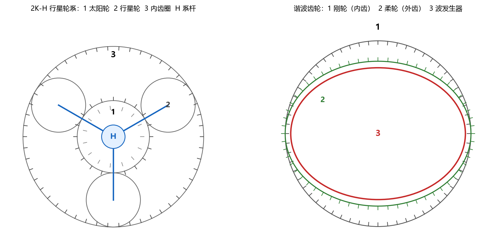

# 第 3 章 齿轮

> **这一章的主线**：渐开线为什么能保证传动比不变 → 齿轮怎么算尺寸 → 轮系（尤其行星）传动比怎么求 → 谐波为什么减速比大 → 齿轮怎么坏、怎么设计。

---

## 0 先看考什么

| 考点 | 常见题型 | 你要会 |
| --- | --- | --- |
| 渐开线性质 | 简答：为什么传动比恒定/中心距可分 | 公法线是内公切线 |
| 几何计算 | 给 $m,z$ 求 $d,d_a,d_f,d_b,a$ | 套公式，注意标准齿 |
| 重合度 | 给参数求 $\varepsilon_\alpha$ | 会算 $\alpha_a$ |
| 根切 | 判断是否根切、最小齿数 | $z_{\min}\approx17$ |
| 定轴轮系 | 求传动比、判断转向 | 从动/主动，外啮合对数 |
| 周转轮系 | 行星轮系传动比 | 转化机构法 |
| 行星条件 | 同心/装配/邻接 | 三个公式 |
| 谐波 | 求减速比、说原理 | $i=z_f/2$ |
| 失效 | 五种失效、设计准则 | 闭式/开式怎么选 |

---

## 1 渐开线：为什么齿轮能用

### 1.1 生成

一条直线（发生线）沿基圆**纯滚动**，直线上任一点的轨迹就是渐开线。基圆半径 $r_b$ 决定渐开线的"胖瘦"。

### 1.2 四条性质（简答题的采分点）

1. 发生线在基圆上滚过的长度 = 基圆上对应弧长：$\overline{NK}=\overset{\frown}{AN}$。
2. 渐开线上任一点的**法线切于基圆**（$NK$ 就是法线）。
3. 基圆内没有渐开线。
4. 压力角随半径增大而增大：

$$\cos\alpha_K=\frac{r_b}{r_K}$$

分度圆上的压力角就是标准压力角 $\alpha=20^\circ$。

### 1.3 啮合基本定律与传动比恒定

**啮合基本定律**：一对齿廓在任一点接触，过接触点的公法线必须与连心线交于一个**固定点** $P$（节点），才能保证传动比恒定。

对渐开线齿廓：两基圆的内公切线就是公法线，它与连心线的交点 $P$ 固定，所以

$$i_{12}=\frac{\omega_1}{\omega_2}=\frac{r_{b2}}{r_{b1}}=\frac{r_2'}{r_1'}=\frac{z_2}{z_1}$$

**中心距可分性**：基圆不变，所以即使中心距因为制造/受热略有变化，传动比仍然不变。这是渐开线齿轮最大的优点。

> **课上那个"矩形齿"的例子**：矩形齿的接触点法线方向会随啮合位置变化，与连心线的交点不固定，所以传动比忽大忽小、有冲击。**渐开线的公法线始终是两基圆的内公切线，交点永远是 $P$**——这就是"为什么一定是渐开线"的标准答案。

### 1.4 渐开线函数

$$\operatorname{inv}\alpha=\tan\alpha-\alpha\ (\text{弧度})$$

$$\operatorname{inv}20^\circ=0.014904$$

用途：求任意圆齿厚、公法线长度、跨棒距。

---

## 2 基本几何计算（必考，送分）

### 2.1 五个基本参数

| 参数 | 公式 | 说明 |
| --- | --- | --- |
| 模数 | $m=p/\pi$ | 标准化，强度的主要标志 |
| 分度圆 | $d=mz$ | 计算基准 |
| 齿顶圆 | $d_a=d+2h_a^*m$ | 正常齿 $h_a^*=1$ |
| 齿根圆 | $d_f=d-2(h_a^*+c^*)m$ | 正常齿 $c^*=0.25$ |
| 基圆 | $d_b=d\cos\alpha$ | $\alpha=20^\circ$ |
| 标准中心距 | $a=m(z_1+z_2)/2$ | 外啮合 |

### 2.2 正确啮合条件

$$m_1=m_2,\qquad \alpha_1=\alpha_2$$

（斜齿轮还要 $\beta_1=-\beta_2$，即螺旋角大小相等、方向相反。）

### 2.3 连续传动条件与重合度

$$\varepsilon_\alpha=\frac{z_1(\tan\alpha_{a1}-\tan\alpha')+z_2(\tan\alpha_{a2}-\tan\alpha')}{2\pi}\ \ge 1$$

$$\cos\alpha_{ai}=\frac{d_{bi}}{d_{ai}}$$

标准安装时 $\alpha'=\alpha=20^\circ$。$\varepsilon_\alpha$ 越大，传动越平稳，一般要求 $\ge1.2$。

### 2.4 根切与最小齿数

用范成法加工时，齿数太少，刀具会把齿根切掉——**根切**。标准直齿轮不根切的最小齿数：

$$z_{\min}=\frac{2h_a^*}{\sin^2\alpha}\approx17\quad(\alpha=20^\circ)$$

避免办法：增大齿数、正变位、增大压力角。

### 2.5 例题

$m=3$ mm，$z_1=20$，$z_2=40$，$\alpha=20^\circ$，正常齿。

| 量 | 小齿轮 | 大齿轮 |
| --- | --- | --- |
| 分度圆 $d=mz$ | 60 | 120 |
| 齿顶圆 $d_a=d+2m$ | 66 | 126 |
| 齿根圆 $d_f=d-2.5m$ | 52.5 | 112.5 |
| 基圆 $d_b=d\cos20^\circ$ | 56.38 | 112.76 |
| 中心距 $a=m(z_1+z_2)/2$ | 90 | — |

重合度：

$$\alpha_{a1}=\arccos\frac{56.38}{66}=31.32^\circ,\qquad
\alpha_{a2}=\arccos\frac{112.76}{126}=26.50^\circ$$

$$\varepsilon_\alpha=\frac{20(\tan31.32^\circ-\tan20^\circ)+40(\tan26.50^\circ-\tan20^\circ)}{2\pi}=1.635$$

$\varepsilon_\alpha=1.635$ 表示同时有 1.635 对齿在啮合，传动平稳，合格。

---

## 3 轮系与传动比

### 3.1 定轴轮系

$$i_{1k}=\frac{n_1}{n_k}=(-1)^m\frac{\text{所有从动轮齿数之积}}{\text{所有主动轮齿数之积}}$$

$m$ 是**外啮合**的对数（内啮合不改变转向）。

### 3.2 周转轮系：转化机构法（反转法）

给整个轮系加上一个 $-n_H$ 的公共转速，系杆就"停"了，周转轮系变成假想的定轴轮系（**转化机构**）：

$$i_{1k}^{H}=\frac{n_1-n_H}{n_k-n_H}
=(-1)^m\frac{\text{从动轮齿数积}}{\text{主动轮齿数积}}$$

> 注意：$i_{1k}^H$ 是转化机构里的传动比，**不是**真实传动比 $n_1/n_k$。

### 3.3 2K-H 行星轮系的四种情况

太阳轮 1、行星轮 2、内齿圈 3、系杆 H，且 $z_3=z_1+2z_2$。

$$i_{13}^{H}=\frac{n_1-n_H}{n_3-n_H}=-\frac{z_3}{z_1}$$

| 固定件 | 输入→输出 | 传动比 | 说明 |
| --- | --- | --- | --- |
| 齿圈 3 | 太阳 1 → 系杆 H | $i_{1H}=1+\dfrac{z_3}{z_1}$ | 最常用，减速 |
| 太阳 1 | 齿圈 3 → 系杆 H | $i_{3H}=1+\dfrac{z_1}{z_3}$ | 减速比小 |
| 系杆 H | 太阳 1 → 齿圈 3 | $i_{13}=-\dfrac{z_3}{z_1}$ | 相当于定轴，反向 |
| 无 | 差动 | $n_1+\dfrac{z_3}{z_1}n_3=\left(1+\dfrac{z_3}{z_1}\right)n_H$ | 两个输入一个输出 |

### 3.4 复合轮系

步骤：

1. 把轮系**拆成**几个基本的定轴/周转部分。
2. 分别列传动比方程。
3. 用"同一构件转速相等"（如 $n_2=n_{2'}$）联立。

**例**：定轴 $z_1=20,z_2=40$，$i_{12}=-2$；后面接行星 $z_{2'}=20,z_3=60$（齿圈固定），$i_{2'H}=1+60/20=4$。则

$$i_{1H}=i_{12}\cdot i_{2'H}=(-2)\times4=-8$$

---

## 4 行星齿轮的三个条件

设计行星轮系时，齿数不能随便取：

1. **同心条件**（保证行星轮同时与太阳轮、齿圈啮合）：

$$z_3=z_1+2z_2$$

2. **装配条件**（$n_p$ 个行星轮能均匀装入）：

$$\frac{z_1+z_3}{n_p}=\text{整数}$$

3. **邻接条件**（相邻行星轮不打架）：

$$(z_1+z_2)\sin\frac{\pi}{n_p}>z_2+2h_a^*$$

**例**：$z_1=24,\ z_2=36,\ z_3=96,\ n_p=3$。

- 同心：$24+2\times36=96$ ✓
- 装配：$(24+96)/3=40$，整数 ✓
- 邻接：$(24+36)\sin60^\circ=51.96>36+2=38$ ✓
- 传动比（齿圈固定）：$i_{1H}=1+96/24=5$。

> 考试如果只给 $z_1,z_2$ 让你配齿圈，先写 $z_3=z_1+2z_2$，再用装配条件选 $n_p$。

---

## 5 谐波齿轮（减速比超大的那个）

### 5.1 组成

| 件 | 形状 | 作用 |
| --- | --- | --- |
| 波发生器 | 椭圆凸轮 + 柔性轴承 | 输入，把柔轮压成椭圆 |
| 柔轮 | 薄壁杯形，外齿 | 输出（通常），弹性变形 |
| 刚轮 | 内齿圈 | 固定（通常） |

### 5.2 原理

波发生器转一圈，柔轮上每一点被"捏"一次；因为柔轮比刚轮少 2 个齿（$z_g-z_f=2$），每转一圈柔轮相对刚轮**错开 2 个齿**。所以减速比极大：

$$i=\frac{z_f}{z_g-z_f}=\frac{z_f}{2}$$

（刚轮固定、波发生器输入、柔轮输出；**转向与输入相反**。）

- 若柔轮固定、刚轮输出：$i=\dfrac{z_g}{2}$，转向相同。
- 单级常用 $i=50$–$160$，双级可达 $10^4$ 以上。

**例**：$z_g=202,\ z_f=200$ → $i=200/2=100$。

### 5.3 优缺点

| 优点 | 缺点 |
| --- | --- |
| 减速比大、体积小、重量轻 | 柔轮反复变形，疲劳寿命是瓶颈 |
| 回差小、精度高 | 效率较低（70–85%） |
| 同时啮合齿数多，承载能力较高 | 发热大，需散热 |
| 可做成中空轴/走线 | 价格高，怕过载冲击 |

常用于机器人关节、谐波减速器（Harmonic Drive）、精密转台。

> **和行星的区别**：行星靠"多个行星轮分流"，谐波靠"齿数差 2 + 弹性变形"。两者都属于少齿差传动家族。

---

## 6 齿轮失效与设计准则

### 6.1 五种失效（必背）

| 失效 | 机理 | 多发场合 | 措施 |
| --- | --- | --- | --- |
| **轮齿折断** | 齿根弯曲疲劳/过载 | 闭式硬齿面、冲击载荷 | 增大模数、齿根圆角、正变位、提高材料韧性 |
| **齿面点蚀** | 接触疲劳，表面剥落 | 闭式软齿面（主要失效） | 提高硬度、降低粗糙度、增大直径、改善润滑 |
| **齿面胶合** | 高速重载油膜破裂，金属粘着撕脱 | 高速重载、润滑不良 | 极压添加剂、降低温度、提高粘度、抗胶合材料配对 |
| **齿面磨损** | 磨粒磨损 | 开式齿轮（主要失效） | 润滑、防尘、提高硬度 |
| **塑性变形** | 齿面金属塑性流动 | 低速重载、过热 | 提高硬度、避免过载、改善散热 |

### 6.2 设计准则（选择题高频）

- **闭式软齿面**（$\le350$ HB）：主要失效是点蚀 → **按接触疲劳强度设计**，再校核弯曲。
- **闭式硬齿面**（$>350$ HB）：主要失效是折断 → **按弯曲疲劳强度设计**，再校核接触。
- **开式齿轮**：主要失效是磨损 → **按弯曲强度设计**，适当增大模数补偿磨损。

### 6.3 强度公式的"形状"（记结论即可）

- 接触强度（Hertz）：$\sigma_H\propto\sqrt{\dfrac{1}{\rho}}$、与中心距有关，$d_1$ 越大越安全。
- 弯曲强度（Lewis）：$\sigma_F=\dfrac{2KT}{bd_1mY}$，模数 $m$ 越大越安全。

> 记忆：**点蚀看直径，折断看模数**。增大直径防点蚀，增大模数防折断。

### 6.4 常用材料

| 材料 | 热处理 | 用途 |
| --- | --- | --- |
| 45 钢 | 调质 | 一般齿轮 |
| 40Cr | 调质/表面淬火 | 中载 |
| 20CrMnTi | 渗碳淬火 | 高速重载、硬齿面 |
| 38CrMoAlA | 渗氮 | 精密、变形小 |

---

## 7 易错点清单

1. $d=mz$ 是分度圆，不是齿顶圆；$d_a=d+2m$。
2. 基圆 $d_b=d\cos\alpha$，永远小于分度圆。
3. 中心距变化不影响传动比（渐开线可分性），但影响压力角。
4. 定轴轮系符号：外啮合才变号，内啮合不变。
5. 转化机构法：$i_{1k}^H$ 的分子分母都要减 $n_H$。
6. 行星同心条件 $z_3=z_1+2z_2$ 只适用于**标准**齿轮、同模数。
7. 谐波减速比是 $z_f/2$，不是 $z_f$；转向相反。
8. 点蚀是闭式软齿面的主要失效，磨损是开式的主要失效。
9. 齿数少于 17 会根切（标准直齿、$\alpha=20^\circ$）。
10. 重合度 $\varepsilon_\alpha$ 必须大于 1 才能连续传动。

---

## 8 5 分钟自测

1. $m=2$、$z=30$，求 $d,d_a,d_f,d_b$（$\alpha=20^\circ$）。
2. 一对齿轮 $z_1=20,z_2=60$，求传动比；若改为内啮合，转向如何？
3. 行星轮系 $z_1=30,z_3=90$，齿圈固定，求 $i_{1H}$。
4. 谐波 $z_g=202,z_f=200$，求减速比和输出转向。
5. 闭式软齿面齿轮按什么强度设计？为什么？

> 答案见《07 模拟卷答案》。