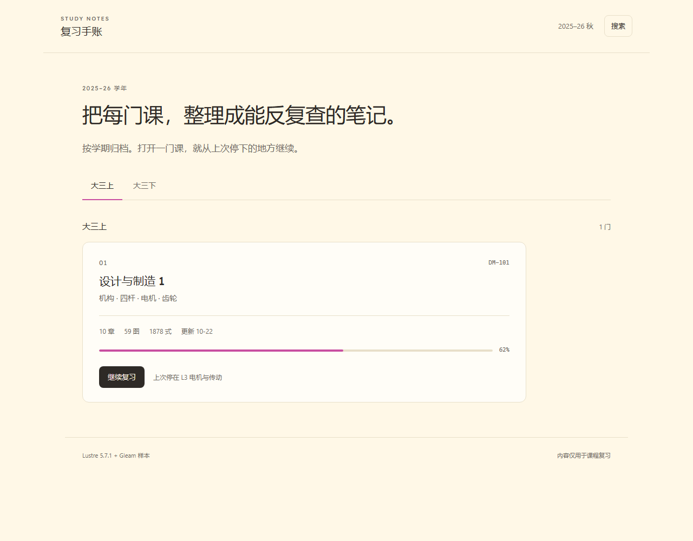
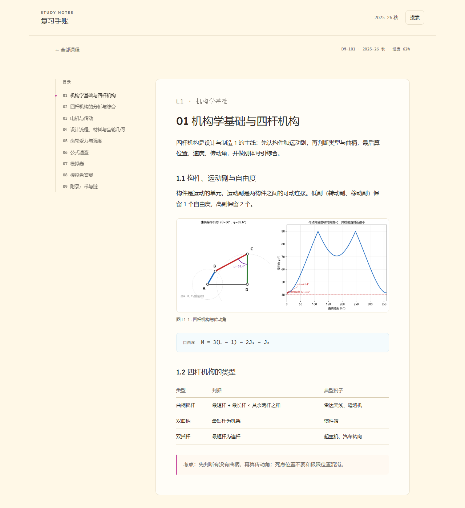

# Study Notes · Lustre 样本

这是 `design/lustre-sample` 分支上的一个**视觉与代码结构样本**，用来讨论：

- 奶油纸 + 白色内容面 + 极少糖果色的视觉系统；
- 首页（学期 + 课程卡）与课程页（目录 + 正文纸面）的布局；
- 用 Gleam + Lustre 写界面时，贡献者实际要碰的代码长什么样。

它**不是**最终架构：课程数据是手写的，只有第一章有正文，搜索是前端过滤，路由也只是内存里的两个页面。





窄屏版本见 `screenshots/home-mobile.png`、`screenshots/course-mobile.png`。

## 运行

最省事的方式：直接双击 `public/index.html`。仓库里提交了构建好的 `public/app.js`（IIFE，`file://` 可用），不需要装任何工具。

想改代码再运行：

- [Gleam](https://gleam.run/) 1.19+
- Node.js 18+
- 第一次构建需要联网（从 Hex 下载 Lustre）

```sh
cd prototype/lustre-sample
npm install
npm run dev
```

打开 <http://127.0.0.1:8765/>。

如果 `npm install` 在受限环境里卡在 esbuild 的 postinstall，可以用 `npm install --ignore-scripts`；esbuild 的平台包已经包含二进制。

只构建：

```sh
npm run build
```

`public/app.js` 由 `npm run build` 生成；仓库里提交的那份只是方便直接预览，不要手改。

## 代码结构

```text
prototype/lustre-sample/
├── src/lustre_sample.gleam   # 整个样本：model / update / view
├── scripts/
│   ├── entry.js              # 调用 Gleam 导出的 main()
│   ├── bundle.mjs            # esbuild -> public/app.js
│   ├── serve.mjs             # 本地静态服务器
│   └── strip-priv.mjs        # Windows 无符号链接权限时的构建兜底
├── public/
│   ├── index.html
│   ├── styles.css
│   ├── app.js                # 已提交的构建产物
│   ├── fig1_fourbar.png
│   └── fonts/lexend-latin.woff2
├── screenshots/
└── gleam.toml / manifest.toml
```

Lustre 的核心就三件事，和 Elm 很像：

```gleam
type Model { ... }        // 页面状态
type Message { ... }      // 用户做了什么
fn update(model, msg)     // 状态怎么变

fn view(model) -> Element(Message) {
  html.div([], [ ... ])   // HTML 就是 Gleam 函数
}
```

改视觉先看 `public/styles.css`；改结构/交互看 `src/lustre_sample.gleam`。两个文件都不长，适合直接在 PR 里讨论。

## 这个样本里能试的交互

- 切换“大三上 / 大三下”，看空状态；
- 点“继续复习”进入课程页；
- 课程页左侧目录、正文纸面、图、公式块、表格、引用；
- 点右上角“搜索”，输入“四杆”或“电机”过滤章节；
- 浏览器打印预览（Ctrl+P），确认导航和底色被去掉。

调试用的直达链接：

- 课程页：`public/index.html?page=course`
- 搜索浮层：`public/index.html?search=1`

## Windows 构建说明

Gleam 在 Windows 上会用目录符号链接把依赖包的 `priv/` 挂到构建目录；没有开启“开发者模式”时会报 `os error 1314`。这个样本不使用 Lustre 的 server component，所以 `npm run build` 会先删掉依赖包里未使用的 `priv/` 再编译（`scripts/strip-priv.mjs`）。

如果你在 Linux/macOS 上，这一步会自动跳过。

## 下一步要讨论的

1. 首页要不要保留“搜索”入口，还是先只做课程清单？
2. 课程页的目录放左侧，还是做成顶部的章节条？
3. 课程元数据用什么字段：学期、代码、章节数、图数、更新时间、进度？
4. 正式迁移时，Markdown 内容是在构建期转成 Gleam 数据，还是浏览器里运行时解析？
5. 内容作者只写 Markdown、界面作者改 Lustre，这个分工是否可接受？
